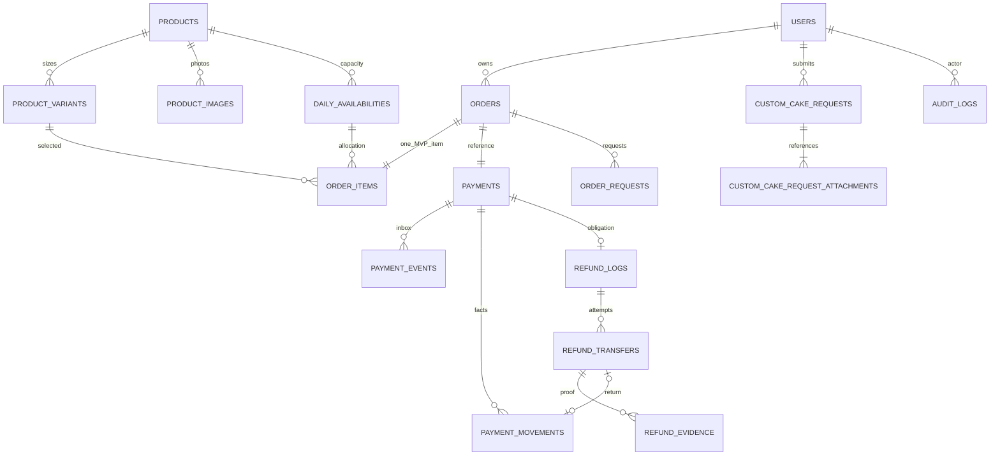

# Database Schema R1 — TBloom Cake
Revisi dokumentasi 19 Oktober 2026, melanjutkan R1 tanggal 16 Oktober 2026. **Siap ditinjau; belum diimplementasikan, belum siap dijalankan sebagai migration.** Target MySQL/InnoDB.

## 1. Ringkasan keputusan dan status audit

Sumber bisnis: [PRD](PRD-TBloom-Cake-v2.1.md), keputusan Owner dalam percakapan, dan instruksi finalisasi. Dokumen ini menggantikan delta schema R1 lama. Representasi teknis berikut merupakan rekomendasi Tech Lead untuk review, bukan keputusan bisnis baru.

Ketidaksesuaian sebelum revisi:
- PRD §1.3 dan dokumen pendamping masih menyebut A-01–A-05/A-09 belum disetujui.
- Schema lama hanya delta konseptual, belum dictionary lengkap; nominal payment ambigu; obligation dan transfer tercampur.
- AC/traceability belum memuat anomaly amount, cancel unpaid, pending limit, D+90, dan takeover unknown terbaru.
- Repository hanya scaffold users/cache/jobs, model/factory User dan example tests; belum ada implementasi bisnis.
- Pemeriksaan read-only ulang pada finalisasi ini kembali ditolak oleh MySQL di 127.0.0.1:3306. Server version, engine live, isi schema/data, constraints dan query plan **belum diverifikasi**. Kegagalan membaca metadata bukan bukti database kosong.

VillageSQL extension-builder bukan validator schema MySQL; tidak digunakan sebagai bukti validasi. Tidak ada guest checkout, shipping/Maps, DP custom, refund API, multi-item checkout, partial cancellation, timeline produksi atau laporan baru. Dua tabel pendukung finansial di bawah melaksanakan integritas refund MVP, bukan fitur akuntansi baru.

## 2. Keputusan Owner yang tersinkron

| ID | Keputusan |
|---|---|
| K-01 | Bayar tepat waktu tetap dipenuhi setelah verifikasi walau webhook terlambat. Deadline aksi bayar tetap30 menit; A-07 lama ditolak. |
| K-02 | Admin ditugaskan eksklusif untuk refund; Owner mengendalikan pengecualian/takeover. |
| K-03 | Cancellation eligible pending menahan handover. |
| K-04 | Anomali nominal terkonfirmasi: review Owner, tidak dipenuhi, ditutup; kembalikan dana terverifikasi yang masih menjadi hak customer setelah rekonsiliasi. |
| K-05 | Gateway ambigu tetap menahan kuota. Rekonsiliasi otomatis24/7, manual09–17 WIB. |
| K-06/A-03 | H-2 sampai23.59.59 WIB pada pickup_date minus dua tanggal; memakai waktu pengajuan. |
| K-07 | Takeover unknown tidak membolehkan transfer ulang; cek mutasi: sukses dibuktikan, gagal terkonfirmasi boleh retry, unknown tetap blokir. |
| K-08/A-05 | Cancellation seluruh order saja. |
| K-09/A-01 | Satu produk/ukuran/personalisasi per checkout, quantity≥1. |
| K-10/A-02 | Kuota per unit jual katalog, seluruh ukuran berbagi produk/tanggal. |
| K-11/A-09 | Maksimum3 pending yang masih memegang kuota per akun termasuk review; paid tidak dihitung. Horizon katalog/custom D+90 inklusif. |
| K-12/A-04 | Custom H-3 atau edible print H-7 kalender tanpa cutoff17.00; menambah print tetap H-7 saat perubahan. |
| K-13/A-05 | Edit simple hanya flavor/filling/color/inscription tanpa perubahan harga/kuota, H-2 dan approval. Pickup time/method tetap; catatan kurir boleh sebelum handover. Produk/ukuran/qty/tanggal harus cancel sah dan order baru. |
| K-14 | Pending unpaid boleh meminta cancel tanpa H-2/approval; release menunggu closure gateway sah tanpa pembayaran sukses. |
| K-15 | Timely payment sebelum gateway ditutup menang atas cancel pending: paid dan dipenuhi; cancellation berikutnya H-2/80%. |
| K-16 | Completed tetap mengonsumsi kuota. Release sah hanya sekali. |
| K-17 / A-06 input | DISETUJUI: pertahankan seluruh batas input awal PRD; tidak mengubah scope. |
| K-18 / A-06 retry dan layanan | DISETUJUI: retry otomatis terbatas dengan backoff, lalu antrean review manual; Tech Lead mengusulkan angka percobaan/jeda. Tidak ada SLA customer saat ini; staf memantau dan menangani pada jam operasional. |
| K-19 / A-08 | DISETUJUI: customer menerima notifikasi transaksinya sendiri; Admin hanya event penting payment_exception, refund, custom_request, cancellation, new_order. Gunakan template sesuai kebutuhan dengan data minimum. |
| K-20 / Retensi | DISETUJUI: retensi per kelas data; transaksi/refund mengikuti kebutuhan usaha dan kewajiban yang berlaku, log teknis lebih singkat; hapus/anonymize PII ketika tidak diperlukan. Purge otomatis dilarang sampai durasi final disetujui. |

K-04–16 adalah penomoran dokumentasi atas keputusan yang sudah diberikan. Persentase80% customer dan100% toko/actual late mengikuti PRD. Ini bukan persetujuan implementasi atau hasil test.

## 3. Status keputusan dan hal yang masih tertunda

Batas input awal PRD (K-17), strategi retry dan tidak adanya SLA customer (K-18), penerima notifikasi (K-19), serta prinsip retensi per kelas (K-20) **sudah disetujui**. Tidak ada persetujuan ulang untuk pilihan tersebut.

| Hal yang benar-benar belum final | Penanggung jawab / tindak lanjut | Dampak |
|---|---|---|
| Jumlah retry dan jeda/backoff per integrasi; parameter lease/timeout terkait | Tech Lead mengusulkan angka terbatas yang sesuai idempotency dan kemampuan provider. Tidak menetapkan angka baru pada sinkronisasi ini. | attempts/next_attempt_at/lease_until; gate konfigurasi worker dan test batas retry, bukan blocker bisnis input/routing. |
| Durasi retensi final per kelas data, termasuk file, staging, log dan backup | Owner menyetujui jadwal rinci berdasarkan kebutuhan usaha/kewajiban; prinsipnya sudah final. | Jangan aktifkan purge otomatis atau menganggap angka24 jam lama sebagai persetujuan; gate cleanup otomatis. |

Batas input yang diterima adalah batas awal PRD, termasuk panjang teks dan jumlah/ukuran upload. Tipe/kapasitas storage, enkripsi, representasi byte dan parameter operasional merupakan pekerjaan teknis yang harus konsisten dengan batas itu; bukan perubahan scope atau pertanyaan bisnis baru. Kontrak channel, MySQL live, koreksi ledger dan target teknis pemulihan yang belum dibuktikan tetap dicatat sebagai prasyarat teknis terkait, bukan A-06/A-08 yang menunggu Owner.

## 4. Data dictionary lengkap

### 4.0 Konvensi untuk setiap tabel

Target InnoDB/utf8mb4; label manusia utf8mb4_unicode_ci, identifier teknis case-sensitive ASCII/binary. Collation kedua sisi FK harus sama. Versi server aktual belum diketahui; gunakan MySQL yang mendukung CHECK enforced dan generated-column indexes setelah diverifikasi.

Definisi bersama ini memperluas setiap daftar kolom secara lengkap:
- **ID** = id BIGINT UNSIGNED NOT NULL AUTO_INCREMENT PRIMARY KEY, tanpa default eksplisit.
- **TS** = created_at,updated_at masing-masing DATETIME(0) NOT NULL, tanpa default, diisi aplikasi UTC. **CT** = created_at saja dengan definisi yang sama.
- **U** BIGINT UNSIGNED; **I** INT UNSIGNED; **S** SMALLINT UNSIGNED; **B** TINYINT UNSIGNED CHECK IN(0,1); **D** DATETIME(0) UTC; **V(n)** VARCHAR(n); **C(n)** CHAR(n) ASCII binary.
- Tanpa tanda ? berarti NOT NULL dan **tanpa default**. ? berarti nullable DEFAULT NULL. =nilai berarti default literal SQL tersebut. Nama berkelompok dengan tipe sama masing-masing mendapat tipe/null/default itu.
- Uang U rupiah integer, CHECK domain0..9223372036854775807 agar aman PHP64-bit. Quantity/kuota I. Tidak FLOAT/DOUBLE. Perkalian/penjumlahan dicek overflow sebelum tulis.
- Status V(32) atau V(16) ASCII disertai CHECK daftar §7. DATE pickup adalah tanggal lokal Jakarta; TIME pickup lokal, bukan timestamp UTC. Tidak menggunakan DATE(created_at UTC) sebagai tanggal bisnis.
- Semua FK bisnis ON DELETE/UPDATE RESTRICT, termasuk aktor nullable; null bukan izin menghapus histori. Semua PK/FK/UNIQUE/index di sini **usulan, belum terpasang/diuji**.
- **H**: histori, tanpa hard-delete normal; archive/deactivate jika tersedia. **P**: privat, akses pemilik dan staf berwenang. **PUB**: konten publik setelah diterbitkan. Prinsip retensi per kelas sudah disetujui K-20; durasi final mengikuti daftar tertunda §3.
- Object key file V(255) random server-generated, bukan URL publik; digest C(64) SHA256. Ciphertext TEXT, bukan VARCHAR panjang plaintext.
- Timestamp provider hasil normalisasi D; zona/presisi asli dicatat dalam payload redacted. Jika bukti tidak cukup presisi, review, tidak mengarang waktu.
- Kolom id referensi U→id induk kecuali dinyatakan komposit. Default tidak disebut berarti tidak ada; infra yang berbeda ditulis eksplisit.

### 4.1 users — F-002/F-010

Kolom: ID; name V(100); email V(254); whatsapp_number V(16); password V(255); role V(16)='customer'; is_active B=1; email_verified_at D?; remember_token V(100)?; TS.
UNIQUE(email), UNIQUE(whatsapp_number); INDEX(role,is_active,id); CHECK role IN(customer,admin,owner).
H/P. Email canonical, WA internasional canonical; password hash. Aktif→nonaktif; Owner aktif terakhir tidak boleh dinonaktifkan, dijaga transaksi yang mengunci semua kandidat Owner urut id. Existing name/email255 berbeda target; cek data sebelum shrink, backfill WA/role sah, jangan buat identitas fiktif. Akun tidak cascade delete order; profile berubah tidak mengganti snapshot.

### 4.2 products — F-001/F-009, BR-12/13

Kolom: ID; name V(150); slug V(191); category V(32); description TEXT?; sales_unit_label V(32); default_daily_quota I=5; is_active B=1; archived_at D?; TS.
UNIQUE(slug); INDEX(category,is_active,id); CHECK category IN(simple,cupcake,bento).
H/PUB. Aktif/nonaktif/archive; quota0 sah. Default hanya template availability baru, tidak retroaktif. Archive tidak menghapus order.

### 4.3 product_variants — F-001/002

Kolom: ID; product_id U; size_label V(100); price U; is_active B=1; TS.
FK product_id→products; UNIQUE(product_id,size_label), UNIQUE(product_id,id); INDEX(product_id,is_active,id); CHECK price>0/domain uang.
H/PUB. Nonaktifkan, tidak hapus varian terpakai; snapshot harga order tidak berubah.

### 4.4 product_images — F-001/009

Kolom: ID; product_id U; path V(255); alt_text V(255); sort_order I=0; TS.
FK product_id→products; UNIQUE(path); INDEX(product_id,sort_order,id).
PUB, tanpa status bisnis. Penggantian file memakai key baru; boleh hapus media yang sudah tak direferensikan sesuai kebijakan, bukan bukti finansial.

### 4.5 daily_availabilities — F-004/009, BR-12–14

Kolom: ID; product_id U; availability_date DATE; quota_limit I; updated_by U?; TS.
FK product_id→products, updated_by→users; UNIQUE(product_id,availability_date), UNIQUE(product_id,id); INDEX(availability_date,product_id).
H. Tidak ada counter used kedua. Limit≥SUM(quantity unreleased) diperiksa transaksi setelah lock;0 menutup tanggal. Tanggal availability=order.pickup_date dijaga aplikasi, produk dijaga composite FK item. Archive produk tidak menghapus row.

### 4.6 orders — F-002/005/006/007/010

Kolom: ID; order_number V(40); user_id U; status V(32)='pending'; customer_name_snapshot V(100); email_snapshot V(254); whatsapp_snapshot V(16); pickup_date DATE; pickup_time TIME(0); pickup_method V(16); handover_note V(255)?; product_total U; payment_expires_at D; paid_at D?; expired_at D?; cancelled_at D?; completed_at D?; handed_over_by U?; cancellation_reason TEXT?; policy_version V(64)?; policy_text_snapshot TEXT?; courier_terms_accepted_at D?; idempotency_key V(128); request_hash C(64); TS.
FK user_id/handed_over_by→users; UNIQUE(order_number), UNIQUE(user_id,idempotency_key), UNIQUE(id,user_id).
INDEX(user_id,status,id), INDEX(user_id,created_at,id), INDEX(status,payment_expires_at,id), INDEX(pickup_date,status,id).
CHECK status §7; pickup_method IN(self_pickup,online_courier); pickup_time09:00:00..21:00:00, SECOND=0; total>0/domain uang; payment_expires_at=created_at+INTERVAL30 MINUTE; paid/completed memerlukan paid_at; completed memerlukan completed_at/handed_over_by; cancelled/expired memerlukan timestamp terkait; courier memerlukan policy_version/text/accepted_at nonNULL.
H/P. Snapshot kontak immutable; terms bukti persetujuan. Pending review tetap pending, alasan di payments. Cutoff/D+90/pending≤3/total item dijaga transaksi, bukan CHECK. Tidak address/shipping/MDR.

### 4.7 order_items — F-002/004, BR-13/16

Kolom: ID; order_id U; product_id U; product_variant_id U; daily_availability_id U; product_name_snapshot V(150); size_snapshot V(100); sales_unit_snapshot V(32); flavor_code V(64); flavor_label_snapshot V(100); filling_code V(64); filling_label_snapshot V(100); cover_color V(100); inscription V(150)=''; quantity I; unit_price U; line_total U; quota_released_at D?; quota_release_reason V(32)?; CT.
FK order_id→orders; (product_id,product_variant_id)→product_variants(product_id,id); (product_id,daily_availability_id)→daily_availabilities(product_id,id).
UNIQUE(order_id) menegakkan satu item MVP; INDEX(daily_availability_id,quota_released_at,order_id).
CHECK quantity>0,unit_price>0,line_total=unit_price*quantity/domain uang; release timestamp/reason keduanya NULL atau keduanya nonNULL; reason IN(expired,cancelled).
H/P personalisasi. Pilihan tanpa tulisan menyimpan string kosong eksplisit; aplikasi tetap mewajibkan pilihan customer, bukan diam-diam memakai default. Allocation aktif=release NULL. Identity/quantity/price immutable; personalisasi berubah hanya approval+audit. Menghapus UNIQUE untuk multi-item butuh persetujuan scope baru.

### 4.8 payments — F-006, BR-10/16–19

Kolom: ID; order_id U; provider V(32)='midtrans'; merchant_reference V(100); provider_transaction_id V(128)?; expected_amount U; currency C(3)='IDR'; status V(32)='pending'; provider_status V(64)?; fraud_status V(64)?; provider_paid_at D?; verified_at D?; is_late B?; review_reason V(64)?; reconciliation_attempts I=0; next_reconcile_at D?; closure_result V(32)?; closure_verified_at D?; closure_event_id U?; snap_token TEXT?; TS.
FK order_id→orders; UNIQUE(order_id), UNIQUE(provider,merchant_reference), UNIQUE(provider,provider_transaction_id), UNIQUE(id,order_id).
FK(closure_event_id,id)→payment_events(id,payment_id), dipasang belakangan setelah kedua tabel ada. INDEX(status,next_reconcile_at,id), INDEX(review_reason,next_reconcile_at,id).
CHECK expected_amount>0/domain uang; currency='IDR'; status §7; closure_result NULL atau unpaid_closed; tiga closure fields semuanya NULL atau semuanya terisi.
H/P; snap_token encrypted. expected_amount adalah tagihan=order.total melalui transaksi, bukan dana aktual. is_late NULL=unknown. Closure evidence hanya final bila tak bisa dibayar lagi dan tidak ada receipt mendahului penutupan. Actual late receipt bukan unpaid_closed. Nullable provider ID mengakomodasi HTTP belum selesai.

### 4.9 payment_events — inbox F-006/010

Kolom: ID; payment_id U?; provider V(32); provider_reference V(128); event_fingerprint C(64); payload_redacted JSON; received_at D; verified_at D?; processing_status V(32)='pending'; attempts I=0; next_attempt_at D?; claim_token C(36)?; lease_until D?; processed_at D?; error V(255)?; CT.
FK payment_id→payments; UNIQUE(provider,event_fingerprint), UNIQUE(id,payment_id); INDEX(processing_status,next_attempt_at,id), INDEX(processing_status,lease_until,id), INDEX(provider,provider_reference,id).
CHECK processing_status IN(pending,processing,processed,review,failed); claim/lease pasangan NULL/nonNULL; processed memerlukan processed_at/payment_id/verified_at.
H/P. Unknown reference review; tidak mengubah uang. Verifikasi signature sebelum event dipercaya. Payload allowlist immutable; metadata processing mutable. Fingerprint dedup transport, bukan identitas uang.

### 4.10 payment_movements — DB-02 fakta dana, internal MVP

Kolom: ID; payment_id U; kind V(16); source V(32); canonical_key V(191); amount U; occurred_at D; verified_at D; source_event_id U?; refund_transfer_id U?; verified_by U?; reconciliation_note TEXT?; CT.
FK payment_id→payments; (source_event_id,payment_id)→payment_events(id,payment_id); (refund_transfer_id,payment_id)→refund_transfers(id,payment_id); verified_by→users.
UNIQUE(payment_id,canonical_key), UNIQUE(refund_transfer_id); INDEX(payment_id,kind,id).
CHECK kind IN(receipt,return); source IN(gateway_receipt,manual_refund,provider_refund,reversal); amount>0/domain uang; receipt hanya gateway_receipt, return tiga sumber pengembalian; manual_refund wajib refund_transfer_id dan lainnya NULL; fakta gateway wajib source_event_id.
H/P, fakta terverifikasi immutable. Canonical key identitas pergerakan uang nyata. Reversal yang melaporkan refund sama ditautkan ke movement lama melalui audit pemrosesan, tidak insert kedua. Fakta receipt tambahan memicu review, tidak dihapus. Prosedur koreksi fakta salah wajib review TL sebelum implementasi; bukan edit/delete CRUD.

### 4.11 order_requests — F-007, K-03/14/15

Kolom: ID; order_id U; user_id U; type V(16); decision_mode V(16); requested_changes JSON?; reason TEXT; status V(16)='pending'; submitted_at D; reviewed_by U?; reviewed_at D?; decision_reason TEXT?; applied_at D?; idempotency_key V(128); request_hash C(64); active_order_id U GENERATED STORED nullable; TS.
FK(order_id,user_id)→orders(id,user_id); reviewed_by→users.
active_order_id = CASE WHEN status='pending' THEN order_id ELSE NULL END. UNIQUE(active_order_id), UNIQUE(user_id,idempotency_key); INDEX(order_id,submitted_at,id), INDEX(status,submitted_at,id).
CHECK type IN(cancellation,change), decision_mode IN(automatic,manual), status IN(pending,applied,rejected); change wajib requested_changes; applied wajib applied_at/reviewed_at; rejected wajib reviewed_at/decision_reason.
H/P. Approval+applied satu commit, tidak state approved menggantung. Satu pengajuan aktif per order; jika cancellation menggantikan change pending, reject/withdraw change diaudit dalam transaksi sama agar hak cancel sah tidak terhalang. Pending-unpaid cancel otomatis tetap pending sampai closure sah; timely payment menang→rejected/payment_won. Requested changes allowlist, bukan arbitrary update finansial.

### 4.12 refund_logs — F-007, kewajiban bukan transfer

Kolom: ID; order_id U; payment_id U; reason_type V(32); basis_amount U; percentage S; amount U; status V(32)='pending'; bank_name TEXT?; account_number TEXT?; account_holder TEXT?; bank_verified_at D?; bank_verified_by U?; assigned_admin_id U?; assignment_version I=0; completed_by U?; completed_at D?; review_reason TEXT?; TS.
FK(payment_id,order_id)→payments(id,order_id); bank_verified_by/assigned_admin_id/completed_by→users.
UNIQUE(payment_id), UNIQUE(id,payment_id); INDEX(status,created_at,id), INDEX(assigned_admin_id,status,id).
CHECK reason IN(customer_cancel,store_cancel,late_payment,amount_anomaly); percentage80 untuk customer_cancel,100 lainnya; basis/amount domain uang; amount=floor(basis_amount*percentage/100) dengan arithmetic decimal aman; bank fields semuanya NULL atau nonNULL; bank_verified_at/by pasangan; completed wajib completed_at/completed_by.
H/P. Bank encrypted nullable agar obligation dibuat sebelum rekening tersedia; prepare transfer wajib rekening verified. Customer basis=product_total exact paid; untuk kebijakan100%, basis adalah total penerimaan terverifikasi yang tercakup kewajiban SEBELUM pengurangan return. amount adalah kewajiban bruto, bukan sisa transfer. Return sah dikurangkan tepat sekali ketika menghitung remaining_obligation (§8). Duplikasi event tidak mengubah snapshot kewajiban. Fakta baru yang mengubah hak: freeze, review Owner dan audit before/after revisi kewajiban; bukan webhook bebas mengedit obligation atau membuat kedua.

### 4.13 refund_transfers — DB-06 attempt manual

Kolom: ID; refund_log_id U; payment_id U; attempt_number I; amount U; status V(32)='prepared'; prepared_by U; assignment_version I; idempotency_key V(128); source_account_key V(64); bank_name TEXT; account_number TEXT; account_holder TEXT; bank_verified_at D; prepared_at D; transfer_reference V(128)?; transferred_at D?; verified_by U?; verified_at D?; verification_note TEXT?; completed_at D?; active_refund_id U GENERATED STORED nullable; TS.
FK(refund_log_id,payment_id)→refund_logs(id,payment_id); prepared_by/verified_by→users.
UNIQUE(id,payment_id), UNIQUE(id,refund_log_id), UNIQUE(refund_log_id,attempt_number), UNIQUE(refund_log_id,idempotency_key), UNIQUE(source_account_key,transfer_reference).
active_refund_id=CASE WHEN status IN('prepared','unknown') THEN refund_log_id ELSE NULL END; UNIQUE(active_refund_id); INDEX(status,prepared_at,id).
CHECK status IN(prepared,unknown,succeeded,failed_confirmed); amount>0/domain uang; succeeded wajib reference/transferred_at/verified_by/verified_at/completed_at; failed_confirmed wajib verified_by/verified_at/verification_note.
H/P. Destination encrypted snapshot immutable setelah prepare. source_account_key alias rekening toko; reference identitas bank stabil bukan teks bebas. Unknown menahan dana tanpa expiry otomatis. Succeeded memerlukan evidence valid+movement return satu commit (aplikasi). Takeover menaikkan assignment_version; petugas lama ditolak aplikasi. SOP bank tetap diperlukan.

### 4.14 refund_evidence — F-007/010

Kolom: ID; refund_log_id U; refund_transfer_id U; private_path V(255); original_name_ciphertext TEXT; mime_type V(100); size_bytes I; sha256 C(64); uploaded_by U; created_at D.
FK(refund_transfer_id,refund_log_id)→refund_transfers(id,refund_log_id); uploaded_by→users; UNIQUE(private_path); INDEX(refund_transfer_id,id).
CHECK size_bytes>0, mime IN(image/jpeg,image/png,image/webp,application/pdf). Batas5MB awal PRD disetujui K-17; Tech Lead menyelaraskan representasi byte pada validasi dan CHECK tanpa mengubah batas bisnis.
H/P, append-only, tambah bukti koreksi bukan overwrite. Digest bukan UNIQUE global: mutasi sama dapat membuktikan beberapa transfer; validitas bukan hash saja.

### 4.15 custom_cake_requests — F-003, BR-08/09/20

Kolom: ID; request_number V(40); user_id U; customer_name_snapshot V(100); whatsapp_snapshot V(16); pickup_date DATE; size V(100); flavor_code V(64); filling_code V(64); option_labels_snapshot JSON; color V(100); inscription V(150)?; edible_print B=0; fondant B=0; fondant_details TEXT?; notes V(2000)?; status V(16)='submitted'; assigned_admin_id U?; status_reason TEXT?; idempotency_key V(128); request_hash C(64); TS.
FK user_id/assigned_admin_id→users; UNIQUE(request_number), UNIQUE(user_id,idempotency_key); INDEX(user_id,created_at,id), INDEX(status,created_at,id), INDEX(pickup_date,status,id), INDEX(assigned_admin_id,status,id).
CHECK status IN(submitted,contacted,quoted,accepted,rejected); fondant memerlukan details; rejected memerlukan reason.
H/P. H-3/H-7/D+90 dan perubahan print H-7 dijaga aplikasi. Tidak payment/order/DP/quota FK. Accepted/rejected terminal; perubahan sebelum terminal sesuai PRD diaudit.

### 4.16 custom_cake_request_attachments — F-003

Kolom: ID; custom_cake_request_id U; private_path V(255); original_name_ciphertext TEXT; mime_type V(100); size_bytes I; sha256 C(64); uploaded_by U; CT.
FK custom_cake_request_id→custom_cake_requests, uploaded_by→users; UNIQUE(private_path); INDEX(custom_cake_request_id,id).
CHECK size_bytes>0; mime IN(image/jpeg,image/png,image/webp).
H/P. Jumlah1–3 agregat dijaga transaksi; batas5MB awal PRD disetujui K-17. Submitted hanya setelah attachment minimum valid tersedia. File tidak public.

### 4.17 audit_logs — F-010/security

Kolom: ID; actor_user_id U?; actor_type V(16); entity_type V(64); entity_id U; action V(100); before_redacted JSON?; after_redacted JSON?; reason TEXT?; correlation_id C(36); created_at D.
FK actor_user_id→users; INDEX(entity_type,entity_id,created_at,id), INDEX(actor_user_id,created_at,id), INDEX(correlation_id,id).
CHECK actor_type IN(user,system,provider); user wajib actor_user_id.
H/P append-only, hak DB aplikasi dibatasi; bukan jaminan anti-tamper terhadap superuser DBA. Polymorphic entity bukan FK: allowlist dan commit bersama entitas yang tidak hard-delete. Audit akses bukti/takeover tanpa rekening penuh/token/raw secret.

### 4.18 notification_deliveries — outbox, BR-21

Kolom: ID; event_key V(128); recipient_ciphertext TEXT; recipient_key C(64); template_key V(64); entity_type V(64); entity_id U; payload_minimal JSON; status V(32)='pending'; provider_message_id V(128)?; attempts I=0; next_attempt_at D?; claim_token C(36)?; lease_until D?; last_error V(255)?; sent_at D?; delivered_at D?; TS.
UNIQUE(event_key,recipient_key,template_key); INDEX(status,next_attempt_at,id), INDEX(status,lease_until,id), INDEX(entity_type,entity_id,id), INDEX(provider_message_id).
CHECK status IN(pending,processing,sent,delivered,unknown,failed,suppressed); claim/lease pasangan; sent wajib sent_at, delivered wajib sent_at/delivered_at.
H/P. Recipient encrypted, recipient_key keyed HMAC tujuan canonical (bukan hash telepon polos). Key rotation harus mempertahankan dedup. Event key stabil dari transisi, bukan UUID baru setiap retry. Polymorphic tanpa FK: entitas allowlist dan commit atomik. A-08/K-19 routing disetujui: customer hanya transaksi miliknya; Admin hanya payment_exception/refund/custom_request/cancellation/new_order. Template minimum sesuai kebutuhan, tanpa rekening/Snap token atau seluruh data customer.

### 4.19 testimonials — F-008 should-have

Kolom: ID; display_name V(100); content TEXT; photo_path V(255)?; rating TINYINT UNSIGNED?; publication_status V(16)='draft'; sort_order I=0; TS.
INDEX(publication_status,sort_order,id); CHECK status IN(draft,published,archived); rating NULL atau1..5.
PUB setelah izin publikasi; tidak FK order/customer; archive histori, hapus aset tak direferensikan sesuai kebijakan. Opsional sesuai PRD, bukan blocker pembayaran.

### 4.20 password_reset_tokens dan sessions — infrastruktur akun

Mempertahankan driver framework; tidak memakai TS implisit.
- password_reset_tokens: email V(255) PRIMARY KEY; token V(255); created_at TIMESTAMP? DEFAULT NULL. Tidak FK email karena profil dapat berubah; invalidasi token di aplikasi. Token hash, P; cleanup expired sesuai konfigurasi yang diverifikasi, durasi retensi operasional pending; prinsip per kelas sudah disetujui K-20.
- sessions: id V(255) PRIMARY KEY; user_id U?; ip_address V(45)?; user_agent TEXT?; payload LONGTEXT; last_activity INT signed. INDEX(user_id), INDEX(last_activity). Source sekarang tanpa FK. Target TL mempertahankan itu: aplikasi/session expiry menangani orphan, akun bisnis tidak hard-delete; invalidate saat nonaktif. Guest session user_id NULL sah. last_activity epoch UTC. P, revoke/logout/expiry, bukan histori finansial.

### 4.21 jobs, job_batches, failed_jobs — infrastruktur queue

Tidak memakai TS implisit; tipe berikut sesuai source migration.
- jobs: ID; queue V(255); payload LONGTEXT; attempts SMALLINT UNSIGNED; reserved_at INT UNSIGNED?; available_at INT UNSIGNED; created_at INT UNSIGNED. INDEX(queue). Kandidat INDEX(queue,reserved_at,available_at,id) harus EXPLAIN query driver dahulu.
- job_batches: id V(255) PRIMARY KEY; name V(255); total_jobs INT signed; pending_jobs INT signed; failed_jobs INT signed; failed_job_ids LONGTEXT; options MEDIUMTEXT?; cancelled_at INT signed?; created_at INT signed; finished_at INT signed?. Tidak FK jobs.
- failed_jobs: ID; uuid V(255) UNIQUE; connection V(255); queue V(255); payload LONGTEXT; exception LONGTEXT; failed_at TIMESTAMP NOT NULL DEFAULT CURRENT_TIMESTAMP; INDEX(connection,queue,failed_at).
Epoch UTC pada integer time; status represented reserved/finished/cancelled fields, bukan enum bisnis. Jobs membawa ID, tidak bank plaintext. Redaksi payload/exception. Delete sukses sesuai driver; failed/batch prune menunggu kebijakan. Worker lease tidak menggantikan claim inbox/outbox atau unknown transfer. CHECK baru harus diuji kompatibilitas driver, bukan dipaksakan.

### 4.22 cache, cache_locks, migrations — infrastruktur

- cache: key V(255) PRIMARY KEY; value MEDIUMTEXT; expiration BIGINT signed; INDEX(expiration).
- cache_locks: key V(255) PRIMARY KEY; owner V(255); expiration BIGINT signed; INDEX(expiration).
- migrations: id INT UNSIGNED NOT NULL AUTO_INCREMENT PRIMARY KEY; migration V(255); batch INT signed. Tidak timestamp/default lain; dibuat framework migration repository, struktur live belum diverifikasi.
Epoch UTC; cache evictable, bukan saldo/kuota; lock cache tidak menggantikan InnoDB. Tidak menyimpan rekening/bukti/token. migrations bukan boleh diedit untuk berpura-pura schema terpasang. Retensi payload P dan cleanup sesuai §3. Down infra hanya rehearsal disposable, bukan shared/prod.

### 4.23 Lifecycle, orphans, rollback

Seluruh27 tabel (19 bisnis+8 infra) telah didefinisikan. H/P/PUB dan FK policy berlaku per tabel. Tidak cascade delete transaksi; actor nullable tidak berarti boleh menghapus histori. Audit/outbox polymorphic dijaga aplikasi, bukan klaim FK. File staging orphan ditangani §8.

Migration kelak expand/backfill/validate/contract: audit data nyata, duplicate email/WA/reference, orphan, overflow/status lama sebelum NOT NULL/UNIQUE/FK. Existing users tidak diasumsikan kosong. Jangan backfill sukses provider/rekening/identitas fiktif.
Urutan DDL: users/catalog→availability/orders/custom→items/payments tanpa closure FK→events→requests/refund_logs→transfers→evidence/movements→audit/outbox; closure FK terakhir. Down lepaskan cycle FK dahulu lalu reverse dependencies. Jangan disable FK checks untuk melewati data rusak.
MySQL multi-statement DDL tidak diasumsikan rollback transaksi atomik. Database berisi histori finansial: rollback aplikasi kompatibel/forward-fix, bukan DROP. Backup+restore DB/files/keys diuji dahulu. Tidak ada migration dibuat/dijalankan sekarang.

## 5. ERD

Parent wajib memiliki item/payment/attachment minimum adalah invariant commit aplikasi: FK/UNIQUE saja tidak memaksanya. Event boleh belum terhubung payment. Audit/outbox entity_type/id logical link; seluruh FK aktor ada di dictionary.

## 6. Constraint dan index beserta alasan

| ID | Jaminan | Lapisan |
|---|---|---|
| C-01 | Variant/availability sesuai produk | Composite FK+parent UNIQUE; bukan3 FK independen. |
| C-02 | Refund/payment/order, transfer/payment/obligation, evidence/transfer/obligation sesuai | Composite FK+parent UNIQUE. |
| C-03 | Request sesuai pemilik order | Composite FK; authorization tetap aplikasi. |
| C-04 | Idempotency checkout/request | UNIQUE user/key + hash comparison; payload berbeda ditolak. |
| C-05 | Satu payment/obligation dan canonical movement tidak dobel | UNIQUE; event fingerprint sendiri tidak cukup. |
| C-06 | Satu request pending, satu transfer unresolved | Nullable generated slot + UNIQUE; bukan partial index PostgreSQL. |
| C-07 | Status, uang, quantity, timestamp wajib | NOT NULL+CHECK; NULL/UNKNOWN harus ditangani eksplisit. |
| C-08 | Aggregate kuota/pending≤3/refund≤dana | Transaksi+parent locks+current read, bukan CHECK lintas tabel. |
| C-09 | Rekening verified, bukti valid, role, bank sukses | Aplikasi/policy/SOP; FK tidak membuktikan fakta bank. |
| C-10 | Inbox/outbox recovery | status/due/id dan status/lease/id indexes; fencing token. |
| C-11 | Daftar customer/admin/kuota | user/status/id, pickup/status/id, assigned/status/id, availability/released/order indexes; pagination dan SUM terarah. |
| C-12 | Rekonsiliasi/audit | payment/kind/id, entity/time/id, correlation indexes; tidak scan semua JSON. |

Hindari index duplikat prefix FK. JSON/ciphertext tidak diindex untuk pencarian plaintext. Pencarian kontak exact lewat users; snapshot search lama belum dijanjikan full-text. Dashboard keyset pagination/batas tanggal/eager loading, EXPLAIN dengan volume representatif sebelum klaim performa.

CHECK tidak dapat menjaga agregat/tabel lain; FK composite memerlukan tipe/collation dan referenced keys sesuai; locking read digunakan dalam transaksi. Dasar: [MySQL CHECK](https://dev.mysql.com/doc/refman/8.4/en/create-table-check-constraints.html), [FK](https://dev.mysql.com/doc/refman/8.4/en/create-table-foreign-keys.html), [locking reads](https://dev.mysql.com/doc/refman/8.4/en/innodb-locking-reads.html). Referensi8.4 bukan bukti versi server proyek.

## 7. State machine dan kontrak transaksi

### 7.1 Status yang diizinkan

| Entitas | State/transisi dan guard |
|---|---|
| Orders | pending→paid untuk exact timely verified; pending→expired untuk final unpaid tanpa cancel; pending→cancelled untuk unpaid cancel+closure sah. paid→completed handover eligible; paid→cancelled cancellation sah. Actual late/anomaly ditutup expired/cancelled sesuai fakta, refund terpisah. CHECK IN(pending,paid,completed,expired,cancelled). |
| Payments | CHECK IN(pending,paid,failed,expired,cancelled,partially_refunded,refunded). Final tanpa dana→failed/expired/cancelled; verified receipt→paid; return fakta→partially_refunded/refunded. Review_reason terpisah; status dana tidak berarti order boleh dipenuhi. |
| Requests | pending→applied atau rejected. Approval dan application satu commit. Automatic cancel kalah timely payment→rejected/payment_won. |
| Refund obligation | CHECK IN(pending,processing,review,completed). Prepare→processing; ambiguous→review; verified failure+tanpa unresolved→pending; sisa kewajiban0 dan tak unresolved→completed. |
| Transfer | prepared→unknown sebelum eksekusi/tidak pasti; prepared/unknown→succeeded dengan bukti atau failed_confirmed dengan verifikasi. Retry attempt baru, tidak menghapus attempt lama. |
| Custom | submitted→contacted→quoted→accepted/rejected; reject awal dengan alasan; terminal tidak dibuka CRUD. |
| Inbox | pending→processing→processed/review/failed; reclaim lease hanya replay idempoten. |
| Outbox | pending→processing→sent→delivered bila receipt sah; ambiguous→unknown; definitive failure→failed; obsolete→suppressed. |

Partially_refunded:0<returns<receipts; refunded:returns=receipts>0. Jika fakta eksternal returns>receipts, catat insiden excess_return, blokir transfer; jangan menghapus fakta demi invariant proyeksi. Old settlement tidak mengembalikan refunded menjadi paid. Completed tidak dibatalkan standar.

### 7.2 Urutan lock/isolation

Pilihan TL: sesi transaksi bisnis **READ COMMITTED** eksplisit dan diuji; bukan perubahan server sekarang. Keputusan memakai current reads setelah locks, bukan pre-read/cache/replica.

Urutan global: **customer users→products/variants urut id→daily_availabilities urut id→orders urut id→payments→order_requests→refund_logs→refund_transfers→child effects/audit/outbox**. Boleh melewati lock tak diperlukan, tidak boleh kembali mengambil lock sebelumnya. Semua perubahan hitungan pending mengambil customer lock; semua release/quota mengambil availability; semua pengajuan/approval/handover mengambil order walau request belum ada. Catalog edits memakai urutan produk/varian sama.
Pre-read hanya menemukan stable IDs, reread setelah lock. Availability belum ada: insert dengan UNIQUE product/date dan tangani duplicate, jangan lock row nonexistent sebagai jaminan.
Deadlock/lock timeout: rollback seluruh transaksi, bounded retry+jitter dan reread; angka A-06/TL pending. Tidak replay aktivitas bank/HTTP dalam retry DB. HTTP/file operations di luar lock. Inbox claim transaksi singkat terpisah; domain worker tidak memegang lock inbox lalu mengambil parent dalam arah terbalik; recheck token sebelum commit.

### 7.3 Operasi atomik

1. Checkout: lock akun/catalog/availability; cek key/hash, pending<3, cutoff/D+90/harga/aktif dan SUM unreleased. Satu waktu server setelah lock untuk cutoff/created/deadline. Insert order/item/payment/audit/outbox satu commit. HTTP Midtrans sesudah commit, reference tetap saat timeout/recovery.
2. Apply payment: verifikasi provider di luar lock; lock domain/reread; validasi reference/currency/amount/waktu. Insert receipt canonical sekali. Timely exact→paid, reject automatic cancel payment_won. Unknown timing→review+hold; anomaly→Owner review tanpa fulfill. Audit/outbox atomik.
3. Expiry/cancel unpaid: deadline memicu close/reconcile, bukan release. HTTP di luar lock, evidence final diperiksa ulang di dalam. Timely success menang. Final unpaid sah→expired/cancelled+release sekali. Timeout/pending/404 tunggal/QR masih terlihat bukan bukti unpaid final.
4. Cancellation paid: submit lock order, validasi H-2 dari submitted_at server dan paid, simpan pending. Approval lock global; cancelled+release+obligation+request applied+audit/outbox satu commit. Reject tidak release. Store cancel tidak tunduk H-2.
5. Handover: lock order dan cek paid/pending eligible cancellation; bila ada tolak. completed/actor/time+audit satu commit, tidak release. Jika submit committed dahulu, handover ditolak; jika handover committed dahulu, submission tidak lagi eligible. Waktu klik browser bukan urutan transaksi.
6. Refund: lock order/payment/refund, cek role/assignment version. Prepare cek ledger/unknown/reversal, rekening verified, amount≤dana dan sisa kewajiban; insert active transfer dan commit. Sebelum bank tandai unknown. Complete setelah mutasi/evidence durable: return movement+attempt succeeded+payment/obligation/audit satu commit. Takeover tidak menghapus attempt/dana tertahan.
7. Admin quota: lock availability; limit≥semua unreleased termasuk pending review/completed. Default produk tidak retroaktif.
8. Custom: policy/key/hash, D+90/H-3/H-7, staging file valid; request+attachments+audit/outbox atomik. Print change tetap H-7. Tidak membuat transaksi custom.

### 7.4 Recovery

Kontrak adapter tiap channel harus membuktikan absolute expiry sejak order, waktu sukses/zona/presisi, final close termasuk race close/settle, dan GET status recovery. Waktu tepat boundary/bukti tidak cukup presisi→review+hold sampai fakta jelas; TL menutup definisi channel sebelum implementasi, tanpa mengubah K-01.

Expiry final salah lalu timely receipt: freeze auto transition, simpan fakta+alert. Jika kapasitas belum dialihkan, reacquire di bawah lock dan restore paid melalui exception Owner diaudit. Jika sudah dipakai pihak lain, tidak mencabut alokasi/overbook/refund otomatis; Owner menyelesaikan pemenuhan operasional sesuai K-01. Bukan fitur kapasitas tambahan otomatis. Bukti finalitas channel tetap gate penting.

Inbox: claim token+lease; efek domain dan processed satu commit. Crash sebelum commit rollback, sesudah commit replay no-op. Reclaimed lease tidak membolehkan stale worker commit.
Outbox: row bersama domain commit; enqueue sesudah commit hanya akselerasi, scanner memulihkan enqueue hilang. HTTP di luar DB; fencing hasil. Timeout setelah provider menerima→unknown; tanpa provider idempotency/status tidak menjanjikan exactly-once. Duplikasi pesan mungkin, bukan duplikasi uang.
Rekonsiliasi24/7 dapat menerapkan verified paid kapan pun; manual09–17 WIB hanya manusia, bukan membatasi automation.

## 8. Finansial, kuota, inbox/outbox, file dan data sensitif

Istilah: **tagihan**=product_total/expected_amount; **penerimaan**=SUM receipt terverifikasi; **pengembalian**=SUM return terbukti; **kewajiban**=refund_logs.amount; **attempt** belum selesai bukan uang kembali.

Di bawah payment/refund lock:
- available_funds=max(0,receipts−returns−SUM prepared/unknown attempts).
- remaining_obligation=max(0,obligation−returns yang direkonsiliasi untuk kewajiban tersebut−active attempts).
- Prepare≤keduanya. Complete menghitung ulang dengan mengecualikan reserve attempt sendiri; perubahan reversal membekukan keputusan sampai rekonsiliasi.
- Satu obligation/payment MVP: pengembalian customer pada payment yang sama mengurangi kewajiban setelah verifikasi. Event yang melaporkan return sama ditautkan ke movement existing, tidak dijumlah ulang. Reversal/chargeback ambigu membekukan transfer.
- Faktual transfer sukses yang baru diketahui setelah reversal eksternal tetap dicatat walau menyebabkan excess return; blokir transfer berikutnya dan incident. Tidak menjanjikan DB dapat mencegah dua aktivitas eksternal independen.
- Contoh receipt100.001, obligation80.000. Return eksternal20.000→sisa60.000; laporan ulang tetap60.000. Attempt unknown60.000→tidak boleh transfer tambahan. Success→obligation completed, payment partially_refunded80.000/100.001.
- Mismatch bill100.000/receipt90.000→tidak fulfill/top-up; review/close, obligation100% dari90.000 dikurangi return sah.
- Tidak menyimpan counters dana independen yang bebas diedit. Proyeksi payment dari fakta; bukan fitur laporan akuntansi.

### Identitas fakta dan pengurangan saldo tepat sekali

Kontrak canonical_key dipilih Tech Lead berdasarkan identitas provider yang dibuktikan, bukan nomor event transport:

| Fakta | Identitas/logika deduplikasi |
|---|---|
| Receipt gateway | Namespace provider + transaction identifier + identitas penerimaan bila channel mendukung lebih dari satu movement. Settlement berulang dari transaksi yang sama tidak menjadi receipt baru. |
| Refund manual | Identitas refund_transfer yang sudah dibuktikan serta referensi bank/rekening sumber. UNIQUE(refund_transfer_id) membatasi satu movement untuk satu attempt. |
| Provider refund/reversal | Identitas pengembalian stabil yang dibuktikan provider. Cocokkan dahulu terhadap return existing di bawah payment lock; label sumber berbeda bukan bukti ada dua pengembalian. |
| Identitas tidak jelas | Event masuk review, hentikan transfer tambahan; jangan mengarang receipt/return dari kemiripan nominal atau waktu saja. |

Jika event baru ternyata melaporkan movement lama, simpan audit action payment_event_matched_movement dengan event_id, movement_id, dasar pencocokan dan actor/correlation; event ditandai processed dalam commit yang sama tanpa movement baru. Kaitan audit ini dijaga aplikasi, bukan FK JSON. Jika identitas sama tetapi nominal/currency/fakta berbeda, freeze review; jangan overwrite fakta lama atau mengabaikan konflik hanya karena UNIQUE terkena. Canonical encoding harus deterministik dan tanpa truncation; bila identifier melampaui kapasitas, gunakan digest ber-namespace dengan provenance terverifikasi, bukan memotong identifier.

Contoh penting: penerimaan90.000 dan return20.000 terjadi sebelum kewajiban anomaly dibuat. basis_amount=90.000, percentage=100, amount=90.000; remaining_obligation=70.000 dan available_funds=70.000. Jangan menyimpan amount70.000 lalu menguranginya lagi dengan20.000. Obligation completed jika sisa hak0 dan tidak ada unresolved attempt; penyelesaian melalui return eksternal direkonsiliasi/diaudit staf berwenang tanpa menciptakan bukti transfer manual fiktif.

Koreksi fakta ledger yang sebelumnya dinyatakan terverifikasi tetap exception terkontrol: freeze payment/refund dan pertahankan baris sumber. R1 tidak menyediakan endpoint edit/delete fakta atau kompensasi otomatis. Runbook koreksi append-only beserta representasi schema-nya harus disahkan Tech Lead sebelum migration ledger; ini gap teknis tersisa, bukan keputusan baru atas persentase refund.

### Kuota, file dan privasi

Kuota SUM quantity unreleased. Status pending/paid/completed seharusnya konsisten marker; jika tidak, incident, jangan mengecualikan item sehingga kapasitas tampak kosong. Release status+marker satu commit; replay no-op. Completed unreleased untuk tanggal historis. Pending ambigu tetap dihitung max3.

Rekening/Snap token encrypted, key terpisah dari DB/backup; password/reset token hash. Tidak secret di chat/git/audit/outbox. Bank tujuan hanya customer pemilik dan assigned Admin/Owner sesuai kebutuhan. Bukti/custom melalui policy-authenticated access atau URL sementara setelah policy; tidak public symlink. Filename asli encrypted; bytes MIME/size diverifikasi, quarantine/scan dan image processing sesuai risiko sebelum dipercaya; PDF tidak sembarang inline.

File/DB bukan transaksi bersama: private staging→validasi→durable object→commit metadata. DB gagal→orphan tanpa public access. Janitor hanya hapus staging tidak direferensikan setelah grace/retensi disetujui, tidak bukti committed. File hilang→incident, jangan complete refund. Backup DB/files/key recovery diuji; rotasi enkripsi/HMAC menjaga histori/dedup.
K-20 menetapkan retensi berbeda per kelas: transaksi/refund sesuai kebutuhan usaha dan kewajiban, log teknis lebih singkat, PII dihapus/anonymize ketika tidak lagi diperlukan. Durasi final tetap menunggu persetujuan Owner; jangan aktifkan purge otomatis, termasuk staging/log/backup, sebelum jadwal kelas terkait disetujui. Minimalkan payload sekarang. Error queue/inbox/outbox disanitasi.

## 9. Traceability dan penutupan audit desain

Requirement lengkap: [Traceability](Traceability-Matrix.md). DBT test: [Test Cases](Test-Cases.md). Semua hasil eksekusi **belum diverifikasi**.

| Temuan | Solusi/alasan dan dokumen | Kewenangan | Prasyarat; bukti | Status desain |
|---|---|---|---|---|
| DB-01 | Dictionary target vs scaffold, §4/Laravel Structure | TL | Versi/data actual; DBT-01 | Ditangani; implementasi belum ada |
| DB-02 | Tagihan/fakta/obligation/attempt terpisah, §4/8 | K-04 disetujui; TL representasi | Canonical keys/prosedur koreksi; DBT-06/07 | Ditangani, review teknis tersisa |
| DB-03 | Nullable bank obligation, verified wajib prepare | TL | Key/storage; DBT-09 | Ditangani |
| DB-04 | Composite FK objek sama, §6 | TL | DDL server; DBT-02 | Ditangani |
| DB-05 | Hold/final evidence/atomic release/completed, §7 | K-01/05/14–16 | Channel finality; DBT-04/05/16 | Internal dirancang, integrasi gate |
| DB-06 | Assignment version+active slot+unknown, §4.13 | K-02/07; TL | SOP/source reference; DBT-08/09/10 | Ditangani, bukan external exactly-once |
| DB-07 | Parent lock+unique request+atomic apply | K-03/06/13; TL | Semua write path; DBT-11 | Ditangani |
| DB-08 | MySQL race/stale/deadlock/recovery tests | QA/TL | DB isolated; DBT-01–21 | Rencana tersedia, belum diuji |
| DB-09 | Lengkap27 tabel, §4; batas input awal dipertahankan | TL; K-17 disetujui | Validasi DDL terhadap batas PRD; DBT-01/03/19 | Desain tersedia; batas input bukan pending Owner |
| DB-10 | Inbox/outbox durable/fencing/recovery, routing K-19 | TL; K-18/K-19 disetujui | Angka retry TL dan pembuktian routing; DBT-12/13 | Kebijakan disetujui; parameter teknis belum final |
| DB-11 | Encryption/private files/policy/redaction; retensi per kelas K-20 | TL; Owner durasi | Keys/storage/durasi; DBT-14 | Prinsip disetujui, durasi final pending |
| DB-12 | RESTRICT/archive/polymorphic discipline/restore | TL+Owner retensi | Inventaris/restore; DBT-15/19 | Ditangani, rehearsal belum |
| DB-13 | Sinkron K-01–16/A status semua companions | Keputusan Owner existing | Review docs; DBT-20 | Sinkron dokumentasi |

Tidak menyatakan closed operasional. DB-02 koreksi fakta, DB-05 channel, angka retry TL dan durasi retensi final tetap gate terkait. Batas input, penerima, strategi retry, tanpa SLA customer dan prinsip retensi sudah disetujui K-17–20.

## 10. Rencana uji dan verifikasi aktual

Source diperiksa:3 migration users/cache/jobs, model/factory User, example tests; phpunit SQLite :memory:. Tidak ada test bisnis yang dijalankan. Dependency terbaca sebelumnya Laravel13.35.0/Pest5.3.1/Boost2.10.3/Pint1.32.1; bukan versi server MySQL. Config engine nullable bukan bukti InnoDB live.

| Pemeriksaan | Status |
|---|---|
| Baca dokumen/source migrations/model/factory/tests | Dilakukan statis; bukan test runtime |
| MySQL version/engine/schema/constraints/data/query plan | Belum diverifikasi; query read-only ulang19 Oktober2026 kembali connection refused sebelum SELECT dijalankan |
| DBT-01–21 MySQL/InnoDB | Belum diverifikasi |
| Midtrans sandbox per channel | Belum diverifikasi |
| SOP bank/transfer manual | Belum diverifikasi; tidak transfer nyata |
| Restore/rollback/files/key recovery | Belum diverifikasi |

Operator: pastikan service/port/config lokal benar tanpa membagikan secret; pastikan bukan production; read-only cek VERSION(), DATABASE(), session timezone/sql_mode/isolation dan information_schema tables/constraints/indexes. Audit anomali/count tanpa dump PII. Jangan migrate:fresh/seed untuk memperbaiki koneksi. SQLite bukan bukti concurrency InnoDB.

## 11. Blocker sebelum migration

1. Lingkungan: versi/engine/collation/sql_mode/data existing serta kompatibilitas driver diverifikasi; jangan menganggap kosong.
2. Finansial: TL review canonical key/cross-FK/source reference/SOP koreksi fakta. Tidak perlu persetujuan ulang80/100 atau takeover.
3. Payment/kuota: sandbox membuktikan final close, timestamp/presisi dan absolute expiry; channel tak mendukung tidak diaktifkan berdasarkan asumsi.
4. A-06: terapkan batas input awal yang sudah disetujui. Tech Lead menuntaskan usulan jumlah retry/jeda; tanpa SLA customer adalah keputusan saat ini, bukan approval tertunda. Retry bukan alasan membuang reservasi ambigu.
5. Security: keys/storage/policy/backup plan; buktikan routing K-19 dan minimisasi data. Durasi retensi final disetujui sebelum purge otomatis; prinsip retensi K-20 sudah final.
6. Setelah gate terkait: barulah migration dirancang, tests MySQL isolated dibuat/dijalankan, upgrade/rollback rehearsal dan UAT. Tidak ada izin menjalankan migration pada tahap ini.

## 12. File yang diperbarui

Database-Schema.md; PRD-TBloom-Cake-v2.1.md; Architecture-Document.md; Laravel-Structure-Document.md; Traceability-Matrix.md; Acceptance-Criteria.md; Test-Cases.md. Semuanya dokumen root yang sudah ada sebelum finalisasi. Tidak mengubah kode aplikasi, dependency, migration, konfigurasi runtime atau data.
