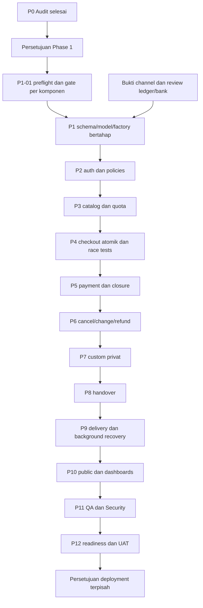

# IMPLEMENTATION PROGRESS — TBloom Cake

> Audit 23 Oktober 2026: [TESTING-REPORT.md](TESTING-REPORT.md) dan bagian K adalah snapshot historis. Sesi lanjutan dicatat di L–AR: O–AA pembayaran, AB–AH cancellation/refund, AI–AK custom, AL–AO prasyarat konten dan pickup/handover, AP–AR outbox, adapter dan persiapan probe notifikasi. Hasil aktual terbaru menggantikan status temuan lama tanpa mengubah bukti audit historis.

## A. Project Overview

| Field | Nilai |
|---|---|
| Proyek | TBloom Cake |
| Baseline | PRD v2.1 / R1, finalisasi 19 Oktober 2026 |
| Diperbarui | 6 November 2026, Asia/Bangkok (UTC+07:00) |
| Status keseluruhan | Phase9 1/4 COMPLETED; roadmap54/70. P9-02d probe + regresi final156passed/507assertions pada Laravel13.40 (AR); closure P9-02 BLOCKED pada G-NOTIFY live dan key HMAC lokal yang belum tersedia |
| Fase aktif | Phase9 — Notifications & Background Processing, diotorisasi instruksi lanjut 5 November; berhenti sebelum Phase10 |
| Task aktif | P9-02d persiapan probe satu-slot terverifikasi; dry-run belum ready karena NOTIFICATION_RECIPIENT_HMAC_KEY tidak tersedia. Menunggu konfirmasi pulihkan key lama atau buat key pertama; belum ada persetujuan kirim nyata. Token/target ada, mailer log tetap |
| Milestone berikutnya | Selesaikan G-NOTIFY → implementasi/verifikasi P9-02 → P9-03/04 → approval Phase10; tidak menutup fase berdasarkan fake saja |
| Target stack | Laravel 13 / PHP 8.4 / MySQL InnoDB / Blade + Tailwind 4 / Midtrans Snap / Fonnte + email / database queue / Pest |
| Repository saat audit | Branch main; HEAD 95fab79959ea4d9fb8077140bd2f2d0b95a61a5e; origin fardhanfahrezy/tbloom-cake |
| Repository sesi lanjutan | 6November: awal fix/checkout-submit-guard/12201e8, kemudian branch fitur codex/phase9-internal-probe untuk checkpoint0729a14 yang sudah dipush. origin/codex/phase1-database-foundation tetap12201e8 (implementasi f364248 + upgrade). Tiga perubahan checkout lokal pihak lain tetap utuh dan tidak masuk commit probe (AR) |
| Checkpoint source akhir Phase 1 | Branch lokal codex/phase1-database-foundation; checkpoint fbabe6a (ledger), 352a725 (private storage), 9a80568/d9892ae (custom), 7ca58c1/0a7699e/7b8a09e (identity/audit/outbox), diikuti checkpoint P1-14; tidak ada merge/push/PR |
| Batas eksekusi | Approval Opsi B membatasi tepat2transaksi Sandbox: A400000IDR danB500000IDR; kedua slot sudah dipakai. GET ulang dua reference sama diizinkan; tidak membuat transaksi tambahan. Tanpa dashboardchange, databaseproduksi/developmentwrite, realfunds/card/OTP/keyexposure/deploy. Permintaan push pengguna5November mengotorisasi commit/push, tidak mengotorisasi pesan nyata. GitHub sudah memuat checkpoint12201e8 (AR); perubahan checkout pihak lain tidak boleh tercampur |

Sumber yang sudah dibaca seluruhnya: PRD-TBloom-Cake-v2.1.md, Architecture-Document.md, Database-Schema.md, Laravel-Structure-Document.md, Acceptance-Criteria.md, Test-Cases.md, Traceability-Matrix.md. Dokumen sumber tetap merupakan spesifikasi, bukan bukti implementasi. Instruksi master prompt lampiran dan AGENTS.md berlaku. `.ai/rules` tidak ditemukan pada audit ini.

Tracker ini menjadi satu tempat roadmap, checklist, keputusan, hasil test, dan penggunaan plugin sesuai permintaan pengguna. Tidak membuat `tasks/plan.md`, `tasks/todo.md`, atau base folder baru dari default skill Plan karena pengguna menentukan satu file progres utama.

### Bukti repository dan environment

| Area | Hasil aktual 21 Oktober 2026 | Implikasi |
|---|---|---|
| PHP / Composer | PHP CLI 8.4.12; Composer 2.10.1 | Sesuai major target; composer.json masih mengizinkan PHP ^8.3, pengetatan constraint belum dilakukan |
| PHP dependencies | Laravel 13.35.0, Tinker 3.0.2, Boost 2.10.3, Pint 1.32.1, Pest 5.3.1, Pest Laravel 5.0.1, Pail 1.2.7, Pao 1.1.5, Faker 1.24.1, Mockery 1.6.15, Collision 8.9.5 | Diverifikasi dengan composer show --direct dan Boost application_info; tidak memasang dependency |
| Node / npm | Node 25.9.0; npm 11.12.1 | Versi aktual, bukan keputusan versi deployment |
| JS dependencies | Tailwind/@tailwindcss/vite 4.3.3; Vite 8.3.4; laravel-vite-plugin 3.2.0; concurrently 10.0.6; Bootstrap 5.3.8 | Bootstrap terpasang tetapi tidak diimport app.css/app.js; tetap Blade/Tailwind, tidak migrasi ke Bootstrap 6 |
| Optional package | npm ls melaporkan @laravel/multiplex unmet optional dependency | Tidak memasang ulang; belum dibuktikan memblokir aplikasi/build |
| Konfigurasi lokal | APP_ENV local; debug true; locale en; session/cache/queue database; mail log; disk local | Konfigurasi pengembangan; belum validasi konfigurasi produksi atau pengiriman email |
| Waktu | app.timezone UTC; belum ada konfigurasi/operasi bisnis Asia/Jakarta | UTC sesuai penyimpanan event. Konversi kalender/cutoff Jakarta perlu diimplementasikan, bukan mengganti semua timestamp menjadi WIB |
| Secrets | APP_KEY tersedia; Midtrans/Fonnte keys tidak tersedia dalam .env saat pemeriksaan | Hanya memeriksa keberadaan, tidak menyalin nilai. .env diabaikan Git dan tidak tracked. Kredensial sandbox tetap gate integrasi |
| Database | MySQL 8.4.3, schema lokal tbloom; 9 tabel, seluruhnya InnoDB dan utf8mb4_unicode_ci | Koneksi Boost berhasil. Status connection refused pada dokumen 19 Oktober adalah histori, bukan blocker koneksi saat ini |
| Isolation / timezone DB | REPEATABLE-READ; session timezone SYSTEM, system SE Asia Standard Time | READ COMMITTED rekomendasi schema belum dikonfigurasi/diuji. UTC connection perlu diverifikasi sebelum DML timestamp; tidak mengubah server global |
| SQL mode | ONLY_FULL_GROUP_BY, STRICT_TRANS_TABLES, NO_ZERO_IN_DATE, NO_ZERO_DATE, ERROR_FOR_DIVISION_BY_ZERO, NO_ENGINE_SUBSTITUTION | Metadata terbaca; belum membuktikan CHECK/composite FK R1 bekerja |
| Collation | Default schema utf8mb4_0900_ai_ci; tabel scaffold utf8mb4_unicode_ci | Tentukan collation eksplisit yang sama di kedua sisi FK dan binary identifier pada migration terkait |
| Data existing | users 0; sessions 4; cache 3; migrations 3; password_reset_tokens/jobs/job_batches/failed_jobs/cache_locks masing-masing 0 | Snapshot hitungan saat query; database tidak kosong, cache/session dapat berubah oleh penggunaan normal. Tidak membaca payload/PII |
| Migration | Tiga migration scaffold sudah Ran, batch 1; tidak ada migration bisnis | Status dikonfirmasi query Boost dan artisan migrate:status di luar sandbox; tidak menjalankan migration |
| Schema users | name/email varchar255; tanpa WA/role/is_active; timestamp nullable; hanya PK dan unique email | Target R1 belum terpasang. Backfill/shrink preflight tetap harus membaca ulang data saat implementasi |
| Kode existing | User + factory, base Controller, AppServiceProvider, routes / dan health /up, welcome view, migration users/cache/jobs | Tidak ada model/controller/policy/job bisnis, auth endpoints, payment, quota, custom, atau refund |
| Scheduler | artisan schedule:list: No scheduled tasks have been defined | Konfigurasi queue database bukan bukti worker/scheduler beroperasi |
| Test existing | Dua example tests; phpunit SQLite :memory:, array mail/session/cache, sync queue | Tidak ada test bisnis. SQLite tidak membuktikan row locks InnoDB |
| GitHub | Connector get_repo berhasil; repository public, default branch main; local main...origin/main | Metadata remote terverifikasi. Tidak membuat commit/branch/PR/push pada sesi audit |
| Aset/desain | Tidak ada tautan Figma pada tujuh dokumen; public hanya aset scaffold | Sumber desain Figma/brand/foto aktual belum diberikan; tidak mengarang desain Figma |
| Perubahan pihak lain | .env.example berubah 1 baris selama audit, sebelum agen menulis tracker | Dipertahankan; bukan perubahan agen. Jangan memasukkannya ke commit otomatis |

Pada audit awal belum ada bukti build frontend, sandbox payment, email/WhatsApp delivery, backup/restore, concurrency, atau deployment. Bukti pengujian fondasi dan rehearsal lokal yang ditambahkan sesudah audit dicatat terpisah pada bagian D/G/I; bukan bukti acceptance runtime atau deployment.

## B. Progress Dashboard

Jumlah dihitung dari task ID pada bagian C. COMPLETED untuk Phase 0 berarti deliverable audit terbukti, bukan acceptance fitur bisnis lulus. NOT STARTED dapat memiliki dependensi/gate terbuka; BLOCKED dipakai ketika task sudah dicoba dan tidak dapat diselesaikan.

| Phase | Total Tasks | Completed | In Progress | Blocked | Not Started |
|---|---:|---:|---:|---:|---:|
| 0 — Audit & environment | 5 | 5 | 0 | 0 | 0 |
| 1 — Database foundation | 14 | 14 | 0 | 0 | 0 |
| 2 — Authentication & authorization | 5 | 5 | 0 | 0 | 0 |
| 3 — Catalog & availability | 4 | 4 | 0 | 0 | 0 |
| 4 — Checkout & order | 5 | 5 | 0 | 0 | 0 |
| 5 — Payment | 7 | 7 | 0 | 0 | 0 |
| 6 — Cancellation & refund | 7 | 7 | 0 | 0 | 0 |
| 7 — Custom requests | 3 | 3 | 0 | 0 | 0 |
| 8 — Handover | 3 | 3 | 0 | 0 | 0 |
| 9 — Notifications & background | 4 | 1 | 0 | 1 | 2 |
| 10 — Public & dashboards | 4 | 0 | 0 | 0 | 4 |
| 11 — Security & QA | 5 | 0 | 0 | 0 | 5 |
| 12 — Deployment readiness | 4 | 0 | 0 | 0 | 4 |
| **Total** | **70** | **54** | **0** | **1** | **15** |

Progres audit/roadmap: Phase0 5/5; Phase1 14/14 completed. Final MySQL: 840 passed, 2 live skipped, 2215 assertions; default: 90 passed, 752 skipped, 210 assertions. Tidak ada task fondasi yang masih berjalan atau blocked. Phase2 5/5 selesai: final MySQL962passed/2832assert+2live skipped (964total,duration_ms569227); default90passed/210assert+874skipped,duration_ms52285. Phase3 4/4 selesai: final MySQL1054passed/3349assert+2live skipped (1056total,duration_ms772139); default90passed/210assert+966skipped,duration_ms69053. Tidak seluruh acceptance bisnis dianggap lulus.

## C. Detailed Implementation Checklist

Status: `[ ]` NOT STARTED; `[~]` IN PROGRESS; `[x]` COMPLETED; `[!]` BLOCKED. Phase ditentukan oleh subbagian dan prefiks task. Kolom files adalah rencana kandidat sampai task dikerjakan, bukan klaim file dibuat. Semua task belum dimulai memiliki bukti test **NOT RUN**. Setiap executor harus membatasi satu task pada perubahan kecil, memecah menjadi child ID bila cakupan aktual terlalu besar, memperbarui jumlah dashboard, dan menyelesaikan/test/dokumentasikan task sebelum berpindah.

AC baseline Fxxx-ACn merujuk PRD §4. ID test tetap T-01–34 dan DBT-01–21, tidak menggantinya dengan ID baru. Coverage tambahan auth/konten/NFR boleh memakai nama test deskriptif saat baseline tidak memiliki ID yang tepat. DBT-20 adalah review dokumentasi, bukan runtime business test.

### Phase 0 — Repository Audit & Environment

| Status / Task ID | Deskripsi / requirement | AC / test | Dependencies | File aktual | Bukti / catatan |
|---|---|---|---|---|---|
| [x] P0-01 | Baca tujuh sumber, K-01–20/A-01–09 dan traceability seluruh F/BR/NFR | Master §4/13; DBT-20 review statis parsial | — | Tidak mengubah sumber | Seluruh sumber dibaca; konflik/otoritas di F/H; tidak menyebut DBT-20 full pass |
| [x] P0-02 | Audit source, dependency, config nonsecret, GitHub; semua F-001–010 | Master Phase 0; security/reliability NFR | P0-01 | Tidak mengubah aplikasi | composer show, npm ls, inventory app/routes/tests, GitHub get_repo; rincian A |
| [x] P0-03 | Audit MySQL dan migration tanpa mutasi; C-01–12 | Schema §11.1; bukan DBT-01 pass | P0-02 | Tidak mengubah database | Boost SELECT/metadata/count; artisan migration status; InnoDB 9 tabel, 3 migration |
| [x] P0-04 | Verifikasi baseline runner dan pisahkan test bisnis | Master quality gate; T/DBT tetap NOT RUN | P0-02 | Tidak mengubah test | Pest dua example: 2 passed, 2 assertions; hambatan sandbox dibuktikan dan alternatif berhasil |
| [x] P0-05 | Roadmap, graph, gates, log plugin dan next task | Master §5–6/13; seluruh Traceability Matrix | P0-01–04 | IMPLEMENTATION-PROGRESS.md | Tracker ditulis dan diperiksa; Phase 1 belum diotorisasi |

### Phase 1 — Database Foundation

Gate G-APPROVAL wajib sebelum seluruh task fase ini. Models/enums/factories dibangun mengikuti tabel yang sudah lolos gate; setiap slice yang melebihi sekitar lima file dipecah sebelum implementasi. Tidak menjalankan DDL pada schema tbloom sebagai database pengujian.

| Status / Task ID | Deskripsi / requirement | Acceptance / test wajib | Dependencies / gate | Rencana files | Bukti / catatan |
|---|---|---|---|---|---|
| [x] P1-01 | Preflight dedicated MySQL test dan fail-closed guard; BR-01, NFR reliability | Target terpisah, bootstrap menolak dev/remote/override; dua koneksi UTC/READ COMMITTED; prasyarat DBT-01/18/19 | P0-05, G-APPROVAL, G-DB | phpunit.mysql.xml; config/database.php; tests/TestCase.php; tests/Feature/DatabaseSafetyTest.php; tests/Feature/MySqlEnvironmentTest.php | RED9 failed → GREEN13 passed/21 assertions (MySQL); schema baru tbloom_testing, belum DDL bisnis |
| [x] P1-02 | Expand/validate/contract users; role/WA aktif; F-002/010 | Shrink/backfill sah, unique WA, role/active CHECK, UTC preserve; DBT-01/03/19 bagian users | P1-01, G-DATA | Dua migration baru; User.php; UserFactory.php; Models/UserRole.php; UserFoundationTest.php | 14 MySQL tests passed/41 assertions; Review Standards+Spec awal3 temuan, semua diperbaiki dan re-review tanpa required finding. Belum deploy |
| [x] P1-03 | DDL products/variants/images; F-001/009, C-01/07 | Types/unique/prices/category/RESTRICT; DBT-01/02/03 bagian katalog | P1-02 | Tiga models/factories/migrations/tests; ProductCategory; CatalogTestSeeder | 26 MySQL tests passed/67 assertions; seeder khusus tbloom_testing, review Standards1 temuan diperbaiki/Spec0; full regression sebelum seeder52 passed114 assertions |
| [x] P1-04 | DDL daily availability; F-004, BR-12/13 | Unique produk/tanggal, FK/updater, composite parent key, quota tanpa counter kedua; DBT-01/02/03 sebagian | P1-03; instruksi eksplisit pengguna22 Oktober untuk mengerjakan schema dan test tbloom_testing | DailyAvailability model/factory/migration/test; Product relation; CatalogTestSeeder | COMPLETED schema-only:24 test P1-04; bersama katalog35 passed/99 assertions; full MySQL90/210; Review0/0 required findings. D-012; runtime quota/release/concurrency belum dibuat |
| [x] P1-05 | DDL orders/items + snapshots; F-002/005, C-01/04/07 | One item/order, composite FK, money/deadline/pickup/terms CHECK; DBT-01/02/03 | P1-04; otorisasi eksplisit DDL pengguna22 Oktober (D-015) | Dua migrations/models/factories/tests, tiga enum, User.orders, guarded OrderTestSeeder, tracker | COMPLETED fondasi:77 focused passed/177 assertions; full MySQL191 passed/468 assertions+2 live skipped; Pint passed; Standards0/Spec0 required findings. Runtime/aggregate/at-least-one-item/payment dan request hash comparison tetap fase domain |
| [x] P1-06 | DDL payments/events dan closure FK terakhir; F-006 | Unique reference/payment, claim/lease, same-payment closure; DBT-01/02/03 | P1-05 selesai; kelanjutan Phase1 yang diotorisasi, batas schema D-018 | Tiga migrations; Payment/PaymentEvent dan tiga enums; dua factories/tests; Order.payment; PaymentTestSeeder | COMPLETED fondasi:69 focused/150assert; full MySQL260passed/618assert+2live skipped; Pint passed; Standards0/Spec1 diperbaiki→0 remaining. Encrypted Snap token, guarded seeder dan rollback refusal teruji; mapping/provider runtime/release belum diimplementasikan |
| [x] P1-07 | DDL canonical movements+append-only correction companion; F-006/007, C-05 | Immutable roots, correction head, provenance/dedup; DBT-01/02/06/07 partial+oracle D-024 | P1-06/P1-09 selesai; D-024 reviewed; final review resolved | Dua migrations/models/enums/factories/TestSeeders,key helper,parent relations,4testfiles | COMPLETED foundation: original109tests/220assert + review regression32/96; full MySQL600passed/1380assert+2live skipped. Standards1/Spec1 same arithmetic bypass fixed RED32 -> GREEN32,0remaining. Instance arithmetic/save/delete guarded, raw/bulk excluded; domain authorization/audit/reconciliation tetap Phase5/6 |
| [x] P1-08 | DDL order_requests; F-007, C-03/06 | Composite ownership, generated pending slot, state timestamps; DBT-01/02/03 | P1-05 selesai; Phase1 diotorisasi | Migration064425; OrderRequest/3enums/factory/test/guarded seeder; Order.requests; User.orderRequests; tracker | COMPLETED fondasi:43focused/103assert; full MySQL303passed/721assert+2live skipped; Pint dan Standards0/Spec0 required findings. Schema-only; endpoint, eligibility H-2, allowlist/hash comparison, lock dan application/audit/refund atomik tetap Phase6 |
| [x] P1-09 | DDL refund obligations/transfers/evidence; F-007 | Cross-object FK, one obligation/active attempt, encrypted TEXT, evidence checks; DBT-01/02/03 | P1-06/P1-08 selesai; design ledger/bank reviewed D-023/24 | RefundLog/Transfer/Evidence,3enums/3migrations/3factories/3tests/3guardedseeders, parent relations/config | COMPLETED fondasi:156focused/343assert; full MySQL459passed/1064assert+2live skipped; default38passed/96assert+423skipped; Pint passed; Standards0/Spec0 remaining. Child1/2/3 selesai. Snapshot encryption/FK/active slot/reference byte identity/private metadata teruji; runtime refund/file/provider belum dibuat |
| [x] P1-10 | DDL custom requests/attachments; F-003 | Private metadata, min attachment via app, tanpa payment/quota FK; DBT-01/03/15 partial | P1-02,G-FILES local foundation352a725 | Dua models/migrations/factories/TestSeeders,statusenum,User/parent relations,dua focusedfiles | COMPLETED foundation: child1 47/91,child2 33/65,combined80passed/156assert afterPint; Standards0/Spec0 bothchildren. Private helper integration tested. Aggregate1-3/minimumdurable/H3/H7/D90/policies/terminal transitions tetap Phase7 |
| [x] P1-11 | DDL audit/outbox; F-010,BR-21,K-19 | Stable dedup,HMAC/encryption,claim lease fields,redacted data; DBT-01/03/13/14 partial | P1-05/P1-10 complete; G-FILES storage dan HMAC identity ready | Child0 identity keyring then child1audit then child2outbox | COMPLETED foundation: HMAC16/22,audit45/121,outbox33/75; combined94passed/218assert afterPint,duration_ms19654. Standards0/Spec0 eachchild. Encryptedrecipient/historykeylookup/dedup/CHECK/rollback tested; runtimeemission/fencing/send/retry Phase4/9 |
| [x] P1-12 | DDL testimonials; F-008 Should Have | Publication/rating CHECK; DBT-01/03 bagian schema, bukan UI F008-AC1 | P1-02 | migration180529; Testimonial model/enum/factory/test seeder; TestimonialFoundationTest | 11 MySQL tests passed/22 assertions; source Review Standards0/Spec0 required; CHECK enforced; konten sintetis hanya test, UI tetap Phase10 |
| [x] P1-13 | Verifikasi infra dan indexes framework | Dictionary delapan tabel infra kompatibel driver, EXPLAIN sebelum index queue; DBT-01/19 sebagian | P1-01 | Tracker; tanpa migration/index baru | Metadata kolom/null/default/index8 tabel cocok; InnoDB/unicode_ci; EXPLAIN query pop memakai jobs_queue_index pada DB kosong. Bukan load/production plan proof |
| [x] P1-14 | Schema/model/factory integrity dan upgrade rehearsal | Target28tabel (27baseline+correction D-024), semua enum casts/relasi/factory tersedia; data invalid ditolak; DBT-01/02/03/15/19 | P1-02–13, semua gate terkait | tests/Feature/SchemaIntegrityTest.php, SchemaUpgradeTest.php, SchemaRecoveryTest.php, EnumIntegrityTest.php; 10 migration enum D-029 | COMPLETED: integrity/upgrade/partial-DDL/reverse-down/local restore dan enum exactness teruji; final MySQL840passed/2215assert+2live skipped. Spec gap reverse rehearsal ditutup; fresh review P2 enum ditutup RED16 -> GREEN21. Standards0/Spec0/fresh0 remaining. ProductionDR/realistic-volume EXPLAIN/runtime acceptance tetap fase terkait |

Urutan DDL normatif: users/catalog → availability/orders/custom → items/payments tanpa closure FK → events → requests/refund_logs → transfers → evidence/movements → audit/outbox; closure FK belakangan. P1-07 menunggu P1-09 karena FK ke transfers. Tidak ada siklus dependency task.

P1-09 dipecah sebelum implementasi agar satu child selesai/diuji sebelum child berikutnya: **P1-09.1** refund_logs obligation (migration/model/enums/factory/test/guarded seeder, bank nullable dan bruto floor); **P1-09.2** refund_transfers attempt (source alias BCA, reference unique, active slot, encrypted destination/version); **P1-09.3** refund_evidence metadata (private key/type/size/digest, cross-FK, encrypted filename). Ketiga child merupakan rincian P1-09, tidak menambah hitungan70task induk. Child1 COMPLETED60focused/137assert+regression/review; child2 COMPLETED61focused/132assert+review; child3 COMPLETED35focused/74assert+review. Parent final156focused/343assert+regresi lulus. Masing-masing child dibagi lagi ke tracer schema→state/constraints→fixtures/metadata/review agar perubahan tetap terukur.

### Phase 2 — Authentication & Authorization

| Status / Task ID | Deskripsi / requirement | Acceptance / test wajib | Dependencies | Rencana files | Bukti / catatan |
|---|---|---|---|---|---|
| [x] P2-01 | Register customer aktif; F-002, K-17 | Public role spoof diabaikan, normalized contacts unik, password≥12, unverified tidak dihalangi; T-01/02 | Phase 1 gate, P1-02 | RegistrationController, RegisterCustomerRequest, CanonicalContact, AccountPassword, provider/routes, 3Bladeviews, RegistrationTest | COMPLETED34passed/182assert afterPint,duration_ms25687; RED32/32. UI realChrome GET/screenshot verified; npm build passed. DBunique race/role spoof/privacy/normalization/boundaries/5-per-minute throttle tested. T-02 covered; T-01 actualcheckout/custom endpoints tetap Phase4/7 |
| [x] P2-02 | Login/logout dan active-account boundary | Session regenerate/invalidate, throttling, inactive ditolak | P2-01 | AuthenticatedSessionController,AccountController,LoginRequest,EnsureActiveAccount,provider/routes,login/accountviews,AuthenticationTest | COMPLETED16focused/95assert; combined50passed/277assert,duration_ms32159; RED16failed/16assert,duration_ms25120. Canonical login/activefresh/rolefresh/sessionlogout/remember/throttle covered; ChromeGETlogin verified |
| [x] P2-03 | Email password reset | Token terbatas/hash, anti-enumeration, mail fake, no real send | P2-02 | PasswordResetLinkController,NewPasswordController,2requests,2views,provider/bootstrap/routes,PasswordResetTest,brandCSS | COMPLETED17cases/85assert; combined67passed/362assert afterPint,duration_ms35083. RED16initial+1Hostcase. Brokerhash/expiry/singleuse/genericresponse/inactive/secretflash/trusted-origin/oldsession tested; emailNotificationfake,realSMTP pending |
| [x] P2-04 | Profile + own-resource policies; F-002/010 | Re-auth contact changes; snapshot historis tetap; cross-customer403/404; R1-AC19, DBT-14 | P2-02 | ProfileController,UpdateProfileRequest,profileview,OwnedResourceAccess,8policies,routes,ProfileTest/ResourcePolicyTest | COMPLETED30cases/119assert; withAuthentication46passed/214assert afterPint,duration_ms31409. Selfboundprofile/reauthunderlock/canonicalunique/race/privacy/snapshotpreservation;8policyownershipmappings+active-rolematrix/404deny; futuredomainHTTP/fileintegration remainsPhase4/6/7 |
| [x] P2-05 | Owner kelola Admin, role middleware | Customer dashboard staf ditolak; last active Owner dilindungi dengan lock | P2-04 | StaffAccountManager/Controller,EnsureRole,2requests,UserPolicy,bootstrap/routes,2staffviews,accountlayout,StaffAccountTest/ConcurrencyTest | Focused22passed/121assert; combined Phase2 119passed/602assert afterPint. Review hash-literal finding reproduced3failed/12assert then fixed3passed/15assert; full MySQL962passed/2832assert+2live skipped; default90passed/210assert+874skipped. Review0remaining. Tidak seeder akun produksi |

### Phase 3 — Product Catalog & Availability

| Status / Task ID | Deskripsi / requirement | Acceptance / test wajib | Dependencies | Rencana files | Bukti / catatan |
|---|---|---|---|---|---|
| [x] P3-01 | Katalog/tanggal/detail/unit sizes; F-001 | F001-AC1–3, R1-AC14/15; T-03/05, DBT-04/17 | Phase 2 gate, P1-03/04 | BookingCalendar,CatalogQuery,CatalogBrowseRequest,CatalogController,5catalogviews,accountlayout,app.js,routes,CatalogBrowseTest | COMPLETED22cases/78assert; withAuthentication38passed/173assert afterPint,duration_ms27147. Buildpassed. RED19/21 missingroutes; eagerload HasMany type corrected. StaleURL RED1->GREEN, browser-session cookie preserved in follow-up test. No row materialization; checkout assertions remain P4-02 |
| [x] P3-02 | Admin produk/harga/archive; F-009 | F009-AC1/2; old snapshot tidak berubah; DBT-03/15 | P3-01 | CatalogManager,ProductPolicy,2controllers,2requests,3staffproductviews,dashboard/routes,CatalogManagementTest,CatalogBrowseTest | COMPLETED26cases; combinedmanagement+browse+staff71passed/350assert,duration_ms18784 afterPint. RED22failed+1fixtureerror; corrected productVariant fixture then properRED404. Currentprice/archive/reactivate/scopedvariants/snapshot/auditrollback/uniqueracefeedback/formescaping tested. Buildpassed |
| [x] P3-03 | Product image processing/storage; F-001/009 | MIME/content/alt/dimensions, safe public output; DBT-14 | P3-02, G-FILES | CatalogImageStorage,ProductImageAdminController,SaveProductImageRequest,CatalogManager,ProductAdminController,routes,2staffviews,CatalogImageTest | COMPLETED20cases; combinedimage+management+browse69passed/366assert,duration_ms33465 afterPint. RED15/15->GREEN15/103 then expanded20cases. MIME/decode/WebP/resize/alt/scopedauth/rollback/replacement/write-readbackfailure/privatepath safety tested; buildpassed |
| [x] P3-04 | Admin quota/default override; F-004/009 | F004-AC1–4/F009-AC3, R1-AC03/15; T-03–05/24, DBT-04 | P3-02, P1-04/05 | CatalogManager,CatalogQuery,ProductQuotaAdminController,2requests,quotaview,productform/routes,CatalogQuotaTest/ConcurrencyTest | COMPLETED23cases; allPhase392passed/517assert,duration_ms135408 afterPint. RED16/16 + concurrency2missingmethod -> GREEN18/120 then expanded92all. TwoindependentMySQLconnections serialize quota writers and synthetic allocator; limit below fresh SUM rejected. Actual20checkout proof remains P4-05 |

### Phase 4 — Checkout & Order Management

| Status / Task ID | Deskripsi / requirement | Acceptance / test wajib | Dependencies | Rencana files | Bukti / catatan |
|---|---|---|---|---|---|
| [x] P4-01 | Calendar/cutoff/allowlist/pickup/personalization; F-002/005, BR-01–11 | F002-AC2–4, R1-AC14/16; T-06/07/08/26, DBT-17 | Phase 3 gate, P2-04, G-CONTENT checkout RESOLVED | CheckoutDetails; CheckoutRequest; config/checkout.php; CheckoutDetailsTest; CheckoutOptionsTest; BookingCalendar dipakai ulang | COMPLETED 23 Oktober: pengguna mengonfirmasi 3 rasa/3 filling resmi, seluruh kombinasi untuk semua produk/ukuran. Focused default 66 passed/170 assertions; tanpa persistensi checkout. Retest setelah Pint dicatat di L |
| [x] P4-02 | Atomic checkout/capacity/max3; F-002/004 | R1-AC03/13/15/17; T-03–05/07/10, DBT-03/04/18 | P4-01, P3-04, P1-05/06/11 | CreateOrder, CheckoutController, routes, database config, CreateOrderTest, CheckoutTransactionTest | COMPLETED source:23cases/127assert +two-connection timeout1case/13assert; afterPint combinedP4-01/02 90passed/310assert,duration_ms68534. Atomic rollback every child, after-lock cutoff, shared quota/max3/overflow/role/READ COMMITTED+UTC; no provider HTTP. Actual20checkout race tetap P4-05 |
| [x] P4-03 | Idempotency dan immutable snapshots; F-002 | F002-AC5, R1-AC02/17; T-09/10/26, DBT-02/03 | P4-02 | CreateOrder, CheckoutDetails, CheckoutRequest, CreateOrderTest | COMPLETED afterPint93passed/323assert,duration_ms27028. RED2/3 stale replay→GREEN; canonical hash scoped per akun, different payload409, unchanged contact/catalog/price/policy snapshots, original deadline/reference and current paid state. Snapshot fixture corrected to hydrated DB row; tidak menambah mutasi payment runtime |
| [x] P4-04 | Order detail/checkout UI/countdown/terms; F-002/005/006 | F002-AC6/F005-AC1/2/F006-AC6; T-08/26/32 | P4-03 | CheckoutController, OrderController, OrderPolicy, routes, checkout/order views/cancellation partial, catalog.show, app.js, CheckoutPageTest | COMPLETED termasuk reviewfixH-2:RED3→GREEN8/60assert, semua tercakupfullfinal. BrowserQA synthetic total/consent/countdown berhasil; console0; viewport668/scroll653. Buildfinal5.07spassed(existingfontainewarning). Pembayaranruntime tetapPhase5 |
| [x] P4-05 | Checkout concurrency dan state gate | 20 checkout/5 units, sizes shared, max3 held, lock melewati cutoff; DBT-04/17/18, T-04/07 | P4-03/04, G-DB | CheckoutConcurrencyTest, CheckoutTransactionTest; full regression | COMPLETED5processraces/110assert dalam fullfinal,time171.028s; observedlocks+uniqueconnectionIDs, capacity5/20,max3/4,replay1/8,cutoffrecheck,actualdeadlockafterpartialwrites→retry1. FullMySQL1172passed/3885assert+2liveskipped; default167passed/410assert+1007skipped; Pint/build/diffpassed. Tidak mengklaim provider/payment/expiry races Phase5 selesai |

### Phase 5 — Payment Integration

| Status / Task ID | Deskripsi / requirement | Acceptance / test wajib | Dependencies / gate | Rencana files | Bukti / catatan |
|---|---|---|---|---|---|
| [x] P5-01 | Adapter contract regression/Sandbox untuk scope BCA VA yang disetujui; F-006 | Kontrak pendukung R1-AC01–04/T-32/33/DBT-16, bukan seluruh acceptance runtime; Opsi B O/P/S | Phase4 gate selesai; G-PAY siap kontrak BCA sesuai S | BankTransferVerifier/Observation/Outcome; PaymentTiming; ReconciledPaymentTime; MidtransBankTransferStatus; MidtransPaymentChannels; tiga test kontrak baru; tooling/evidence O/P | .1/.2/.3 COMPLETED: status A/B VERIFIED, 163 tes kontrak baru, regresi246/792assert; default389passed/1121assert+1007skipped. Scope website BCA VA dipilih pengguna. Timing/finality ambiguous tetap unknown/review tanpa efek domain; kartu/21kanal lain deferred, bukan VERIFIED. T-32 recovery→P5-02; runtime C/D→P5-03–07 |
| [x] P5-02 | Snap session absolute expiry/reference recovery | F006-AC1/6, R1-AC02; T-09/16/32 pada scope aplikasi/offline; T-32 live belum diulang | P5-01 selesai scope BCA VA | 17file pada T: adapter/operation/migration/model/controller/policy/routes/Blade/JS/tests/tracker | COMPLETED .1/.2/.3: reference/deadline immutable, durable claim sebelum HTTP, encrypted reuse, unknown recovery dan stale GET fence. MySQL1465passed/4904assert+2liveskipped; default421passed/1197assert+1046skipped; JS3passed, build/Pint/diff passed. Tidak ada transaksi tambahan atau efek paid/release/refund |
| [x] P5-03 | Signature+durable inbox/fencing | F006-AC3/5, R1-AC18/19; T-11/12, DBT-12/14 pada scope inbox, bukan seluruh efek payment | P5-02/P1-06 selesai; G-RETRY inbox ditetapkan lokal di V | MidtransNotification, ReceiveMidtransNotification, PaymentEventInbox, LostPaymentEventClaim, webhook controller, bootstrap/app.php, dua featuretests, tracker | COMPLETED:50kasus baru; regresi final135passed/600assertions,duration_ms215791. DuaImportant reviewfixed RED3→GREEN4. Pint/route/diff lulus. Webhook di luarweb/session; CSRF browser tetap aktif; raw amount signature tetap. Domain consumer/actual funds/ledger P5-04; scanner P5-06 |
| [x] P5-04 | Apply canonical receipt/time/amount; BCA return otomatis excluded oleh pengguna, refund manual | R1-AC01/04/05/09/21 pada scope receipt/projection/review; T-12/13/15/25/27/33, DBT-05/06/07 parsial | P5-03, P1-07, G-LEDGER; keputusan refund manual pengguna di X | PaymentFunds, MidtransBankTransferStatus, PaymentEventInbox, PaymentNotices, PaymentReviewReason, ProcessPaymentEvent, ResolvePaymentException dan6featuretests; tracker | COMPLETED child1–4: final430passed/1517assertions, Pint/diff passed. Canonical receipt, effective funds, authorized timely fulfillment, Owner anomaly/actual-late resolution+release+gross100% obligation. Existing80% preserved. Unsupported return freeze; transfer/bukti/completion Phase6, W/X |
| [x] P5-05 | Final closure/release dan unpaid cancel resolution | R1-AC03/12; T-14/16, DBT-05 | P5-04 COMPLETED; review finality Y | CloseUnpaidPayment, ReconciledUnpaidClosure, PaymentNotices, ProcessPaymentEvent, feature/unit tests, tracker | COMPLETED scope aplikasi/offline: regresi533passed/2018assertions, tambahan2passed/13assertions; Pint passed. No-session proof atau genuine Owner finality; GETexpire/deadline saja bukan unpaid final. Scheduler P5-06 |
| [x] P5-06 | Reconciliation/reclaim/backoff/manual escalation | R1-AC18/24; T-16/33, DBT-12/18/21 | P5-05 COMPLETED; G-RETRY inbox V; provider budget Z | 18file di Z: dispatcher/job/reconciler, endpoint/request, closure/notices/consumer integration, routes/config/tests/tracker | COMPLETED:78focused/380assertions; parent583passed/2305assertions,duration_ms528594,exit0. Pint/route/schedule/diff passed. Automation24/7, explicit freshOwner09–17, bounded cycles/inbox retries→durable staff escalation. No customer SLA; production worker belum dioperasikan |
| [x] P5-07 | Timely receipt vs wrong-final-expiry incident | R1-AC04/20; T-34, DBT-05/16/18 scope aplikasi; bukan live finality | P5-06 COMPLETED; MySQL testing pulih, AA | RecoverTimelyPayment; CloseUnpaidPayment; ProcessPaymentEvent; PaymentReviewReason; PaymentReconciliationController; ReconcilePaymentRequest; RecoverTimelyPaymentTest; tracker | COMPLETED: Owner-attested recovery dengan lock kapasitas, original closure/audit dipertahankan, no overbook/automatic refund; final 21 file 610 passed/2509 assertions. Detail hasil runner dan batas bukti di AA. Berhenti untuk approval Phase 6 |

### Phase 6 — Cancellation, Changes & Refund

| Status / Task ID | Deskripsi / requirement | Acceptance / test wajib | Dependencies / gate | Rencana files | Bukti / catatan |
|---|---|---|---|---|---|
| [x] P6-01 | Submit/reject cancellation dan H-2; F-007 | F007-AC1/2, R1-AC07/12/16; T-17/30, DBT-05/11/17 scope submit/reject; handover P8 | Phase 5 selesai; kelanjutan disetujui pengguna; P1-08 | CancellationRequests; controller/2requests/OrderPolicy/routes; ReconcilePayments; CancellationRequestsTest; tracker (9file) | COMPLETED, AB: final7file 223 passed/1106 assertions/duration_ms259043/exit0; Pint/diff/routes passed. NoSession scanner beforedeadline, issued pending hold, payment_won, H2, auth, replay, rollback/parentlock tested; approval/application P6-02 dan handover P8 tetap terpisah |
| [x] P6-02 | Approve/store cancel+release+gross obligation | F007-AC3/5, R1-AC05/09/11/21; T-18/19/27, DBT-06/07/11 scope application; transfer/handover tahap berikutnya | P6-01 COMPLETED; P1-09 | CancelPaidOrder; controller/request/routes; PaymentNotices; ReconcilePayments; focused tests; tracker (8file) | COMPLETED, AC: final326 passed/1438 assertions/duration_ms292367, JSON runner passed (shell exit handle tidak tersedia); Pint/diff lulus; atomic gross80/100, replay/history/rollback/scanner integration verified; no bank execution |
| [x] P6-03 | Allowed personalization changes / courier note | R1-AC16; T-17/26, DBT-11/17 scope change/note; actualhandover P8 | P6-01 COMPLETED; P6-02 selesai serial | OrderChanges; controller/3requests/OrderPolicy/routes; OrderChangesTest; tracker (9file) | COMPLETED, AD: final6file225 passed/884 assertions/duration_ms206755/exit0; Pint/diff/routes lulus; partial field snapshots, H2, replay/config/terminal, cancellationpriority, auth/rollback/retry verified; nofinancial/quotachanges |
| [x] P6-04 | Exclusive Admin claim / Owner takeover | R1-AC06; T-28/29, DBT-08/10 scope assignment; bankexecution P6-06 | P6-02 COMPLETED, P2-05 | AssignRefund; controller/2requests/RefundLogPolicy/routes; AssignRefundTest; tracker (8file) | COMPLETED, AE: final227 passed/680 assertions/duration_ms113370/exit0; Pint/diff/routes lulus; recipientrolefix RED→GREEN; claim/takeover/version/unknownreserve/replay/rollback verified; work bukanizin transferulang |
| [x] P6-05 | Verified bank/private evidence pipeline | R1-AC10/19/23; T-20/22, DBT-09/14/15 | P6-04, G-BANK, G-FILES | RefundPrivateData; controller/3requests; RefundLogPolicy/bootstrap/routes/test/tracker | COMPLETED AF:299passed/848assertions/exit0; private bank/attestation/evidence, staging di luar lock, fresh finalauthorization; actual bankproof tetap manusia |
| [x] P6-06 | Prepare/unknown/complete/confirmed failure | R1-AC06/10/11/21; T-20/25/28/29, DBT-08/09/10 | P6-05, P5-04 | RefundTransfers; controller/3requests; PaymentNotices/bootstrap/routes/test/tracker | COMPLETED AG:264passed/1163assertions/exit0; snapshot/key/version proof, durablemutasi/evidence, atomicreturn/status/outbox, actualincident, keyrotation; no bank API |
| [x] P6-07 | Refund races and duplicate/reversal regression | R1-AC05/06/11/20/21; T-25/27/28/29, DBT-06–10/18 scope aplikasi/MySQL; bukan livebank | P6-06 COMPLETED | RefundTransfers; CancellationRefundRegressionTest; tracker (3file) | COMPLETED AH: gabungan12file386passed/1792assertions/exit0 setelah lockscopefix; subsequent Pending-path RED3→GREEN3/49, final pascaperbaikan/Pint3file95passed/529assertions/exit0. Actual workers/races/takeover/replay, Pending→Processing atomik dan rollback teruji;0Critical/Important tersisa |

### Phase 7 — Custom Cake Requests

| Status / Task ID | Deskripsi / requirement | Acceptance / test wajib | Dependencies | Rencana files | Bukti / catatan |
|---|---|---|---|---|---|
| [x] P7-01 | Custom form/request/calendar/idempotency; F-003 | F003-AC1/2/4, R1-AC14/16; T-01/21, DBT-17 | Phase 6 gate, P1-10, P4-01 | details/submit/events/request/controller/calendar/policy/views/js/test/tracker | COMPLETED, AI; final194passed/556assertions, Pint/build/diffcheck exit0; H3/H7/D90 tanpa transaksi custom |
| [x] P7-02 | 1–3 private image attachments | F003-AC3/4, R1-AC19/23; T-22, DBT-14/15 | P7-01, G-FILES | CustomRequestAttachments/controller, customviews, routes, test, tracker | COMPLETED, AJ; final150passed/451assertions/Pint/diffcheck exit0; minimum durable dan akses/digest/size/rollback teruji |
| [x] P7-03 | Admin custom lifecycle/edits | F003-AC1–4, R1-AC16; T-21/22, DBT-17 | P7-02 | workflow/admincontroller/2requests/policy/2staffviews/routes/js/layout/show/test/tracker | COMPLETED, AK; final352passed/1009assertions/Pint/build exit0; terminal/replay/version/H2/H7/role/atomic effects teruji |

### Phase 8 — Pickup & Handover

| Status / Task ID | Deskripsi / requirement | Acceptance / test wajib | Dependencies | Rencana files | Bukti / catatan |
|---|---|---|---|---|---|
| [x] P8-01 | Identifikasi pengambil / informasi pickup | F005-AC1–3, F008-AC3; T-08/26 | Phase 7 gate/P4-04/G-CONTENT pickup RESOLVED | config/store, pickup views, handover controller/policy/routes, test, tracker AM | COMPLETED; final28passed/135assertions/Pint/build exit0; officialcontent, read-onlychecklist, ownership/role teruji |
| [x] P8-02 | Atomic complete dan cancellation hold | F010-AC2/3, R1-AC07/08/15; T-24/30, DBT-11 | P8-01, P6-01/02 | CompleteHandover/VerifiedPaidOrder/request/controller/views, existingCancelPaidOrder/PaymentNotices, test/fixture, tracker AN | COMPLETED145passed/584assertions sesudahPint; no release, currentguards, replay, rollback, financialtrust teruji |
| [x] P8-03 | Submit/approval vs handover races | R1-AC08/20; T-31, DBT-11/18 | P8-02 | HandoverConcurrencyTest; tracker AO | COMPLETED; final5passed/87assertions sesudahPint, actualtwoPHPworkers/barrier/DBwait; serial state/refund/quota/audit/outbox konsisten |

### Phase 9 — Notifications & Background Processing

| Status / Task ID | Deskripsi / requirement | Acceptance / test wajib | Dependencies / gate | Rencana files | Bukti / catatan |
|---|---|---|---|---|---|
| [x] P9-01 | Outbox scanner/fencing/enqueue recovery; BR-21 | R1-AC18; T-23, DBT-13 pada scope orchestration | Phase8/P1-11 selesai; G-RETRY teknis AP | 11file kode/test + tracker, daftar aktual AP | COMPLETED: final75passed/215assertions/exit0 setelah Pint; expired pre-send reclaim, stale-token fencing, unknown tanpa auto-resend, enqueue failure recovery teruji. Adapters/live/scheduler tetap task berikutnya |
| [!] P9-02 | Fonnte/email adapters & minimum templates | R1-AC19/22; T-23, DBT-13/14/21 | P9-01 COMPLETED; persiapan fake AQ–AR diotorisasi; G-NOTIFY live tetap terbuka | Adapter/template AQ + InternalNotificationProbe/command/config/test/progres AR | PARTIAL/BLOCKED: final156passed/507assertions/exit0 pada Laravel13.40 sesudah Pint. Dry-run probe satu-slot aman tetapi belum ready: key HMAC identitas lokal tidak tersedia, riwayat key menunggu pengguna. Token/target ada, mailer log tetap; belum ada izin kirim atau bukti live. P9-03/04 belum dimulai |
| [ ] P9-03 | Scheduler/worker config/reclaim/backoff | R1-AC18/24; T-16/23, DBT-12/13/21 | P9-02, P5-06, G-RETRY | routes/console.php; jobs/commands/tests | NOT RUN; queue timeout/lease/retry_after konsisten; stale worker fenced |
| [ ] P9-04 | Unknown send/obsolete suppression/recovery | R1-AC18/22/24; DBT-13/21 | P9-03 | dispatcher/templates; focused tests | NOT RUN; no external exactly-once claim; purge nonaktif |

### Phase 10 — Public Pages & Operational Dashboard

| Status / Task ID | Deskripsi / requirement | Acceptance / test wajib | Dependencies / gate | Rencana files | Bukti / catatan |
|---|---|---|---|---|---|
| [ ] P10-01 | Public profile/pickup/policies & assets; F-008 | F008-AC3; jam/cutoff benar; keyboard/mobile | Phase 9 gate, G-CONTENT | views/components/controller/assets/test | NOT RUN; Figma hanya bila sumber tersedia; UI setiap fitur dasar tetap dibuat di fase fiturnya |
| [ ] P10-02 | Customer history/status order-payment-refund | F002-AC6, R1-AC19; cross-customer tests, DBT-14 | P10-01, P6-06, P7-03 | controller/policy/views/test | NOT RUN; review tidak meminta bayar ulang |
| [ ] P10-03 | Admin/Owner operational dashboard; F-010 | F010-AC1–4; T-02/28–31; DBT-14/19 | P10-02, P8-03, P9-04 | controller/query/policy/views/test | NOT RUN; filters/pagination, no revenue chart/mark-paid CRUD |
| [ ] P10-04 | Testimonials Should Have + responsive/a11y pass | F008-AC1/2; DBT-03; viewport360/keyboard/focus/contrast | P10-03, P1-12, G-CONTENT | controller/request/policy/views/test | NOT RUN; draft tidak bocor; review prioritas tidak memblokir payment |

### Phase 11 — Security, Integration & Quality Assurance

| Status / Task ID | Deskripsi / requirement | Acceptance / test wajib | Dependencies / gate | Rencana files | Bukti / catatan |
|---|---|---|---|---|---|
| [ ] P11-01 | Review traceability seluruh F/BR/K/NFR | Semua baseline AC + R1-AC01–24 dipetakan implementasi/test; DBT-20 | Phase 10 gate | tracker; koreksi source docs hanya jika diminta | NOT RUN; tutup gaps tanpa klaim test fiktif |
| [ ] P11-02 | Review plugin + Codex Security audit | R1-AC19/20/22/23; DBT-14/15/21; findings tervalidasi | P11-01 | scoped fixes/tests hanya sesudah temuan | NOT RUN; audit keamanan belum dijalankan pada Phase 0 |
| [ ] P11-03 | MySQL financial/concurrency/recovery suite | DBT-01–21 seluruh applicable; T-03–34; isolation/locks trace | P11-02, G-DB, G-RETRY, G-LEDGER | focused/regression tests | NOT RUN; SQLite tidak jadi pengganti |
| [ ] P11-04 | Sandbox provider end-to-end | T-11/13–16/32–34, DBT-16; recipients aman | P11-03, G-PAY, G-NOTIFY | integration tests/evidence tracker | NOT RUN; tidak menyentuh production/customer nyata |
| [ ] P11-05 | Full regression/build/performance/a11y | php artisan test --compact; npm run build; NFR PRD §8.2; DBT-19 | P11-04 | perbaikan scoped + test bila diperlukan | NOT RUN; target non-input belum menjadi SLA final |

### Phase 12 — Deployment Readiness

| Status / Task ID | Deskripsi / requirement | Acceptance / test wajib | Dependencies / gate | Rencana files | Bukti / catatan |
|---|---|---|---|---|---|
| [ ] P12-01 | Production config/storage/keys/channel readiness | Secrets/cookies/HTTPS/permissions; R1-AC19/23 | Phase 11 gate, G-PLATFORM, G-FILES | config/deploy files hanya bila disetujui | NOT RUN; bukan persetujuan deployment |
| [ ] P12-02 | Queue/scheduler/alerts/backup-restore rehearsal | R1-AC18/20/24; DBT-12/13/15/19; keys/files pulih | P12-01 | config/commands/tests/evidence tracker | NOT RUN; backup objectives perlu validasi operasional |
| [ ] P12-03 | UAT / final traceability / release checklist | Semua Must Have terbukti, limitations jujur, tidak ada critical unresolved | P12-02 | tracker/UAT evidence | NOT RUN; retensi pending tidak memberi izin purge |
| [ ] P12-04 | Handoff readiness dan gate deployment eksplisit | Owner menyetujui platform dan deployment; evidence runtime setelah deploy jika diotorisasi | P12-03, G-DEPLOY | deployment config bila diotorisasi | NOT RUN; Railway hanya pada tahap deployment dengan persetujuan, Cloud skill bila Cloud dipilih |

### Dependency graph dan checkpoints

Sesudah setiap 2–3 task: focused tests, pemeriksaan diff/traceability, update tracker. Sesudah setiap fase: laporkan bukti aktual dan tunggu persetujuan fase berikutnya sesuai master prompt. Domain outbox producer/audit ditulis pada fase domain yang bersangkutan; transport dan recovery lengkap di Phase 9. Status order paid/cancelled/expired dan alokasi tidak diubah sementara untuk mengejar urutan roadmap.

## D. Current Task

**Current 6 November 2026: Phase9 1/4 COMPLETED (AP–AR).** P9-01 selesai; probe P9-02d + regresi final156passed/507assertions/exit0 pada Laravel13.40 sesudah Pint. Roadmap54completed/0inprogress/1blocked/15notstarted. Dry-run belum ready karena key HMAC lokal tidak tersedia; riwayat/pemulihan atau pembuatan key pertama menunggu jawaban pengguna. Token/target tersedia, mailer log tetap. Pengiriman aktual belum disetujui dan tetap wajib sebelum fase selesai; Phase10 belum diotorisasi. Checkpoint di bawah tetap histori berurutan.

**Update sesudah run final P6-01: COMPLETED, 223 passed/1106 assertions/exit0; Phase 6 1/7, roadmap 41 completed/0 in progress/0 blocked/29 not started.** Next P6-02; tidak meminta approval antar-task dalam fase yang sudah diotorisasi. Catatan status sebelumnya di bawah/AB adalah histori berurutan.

**Checkpoint 29 Oktober 2026: Phase 5 COMPLETED 7/7; roadmap 40 completed/0 in progress/0 blocked/30 not started.** P5-07 final 21 file: 610 passed/2509 assertions/duration_ms1295394, hasil JSON runner `passed`; kode keluar sesi tidak lagi tersedia setelah pergantian sesi, tidak diklaim exit0. Pint sebelum regresi dan pemeriksaan diff lulus. MySQL pulih setelah diaktifkan pengguna. Berhenti di batas fase: AWAITING USER APPROVAL untuk Phase 6; P6-01 belum dimulai. Catatan checkpoint fase/task lama di bawah adalah histori.

**Checkpoint final24Oktober2026: Phase4 COMPLETED5/5.** P4-01–05 selesai berurutan, tanpa melewati G-CONTENT. Review F002-AC6 diperbaiki RED3→GREEN8/60assert dan gap actualdeadlock ditutup. FullMySQL1172passed/3885assert+2liveskipped(total1174,duration_ms977260); default167passed/410assert+1007skipped(duration_ms39042). Pint/build/diff lulus. Instruksi lanjut pengguna kemudian mengotorisasi Phase5; **P5-01 BLOCKED G-PAY**, bukti terbaru di M. Catatan fase lama di bawah adalah histori.

**P2-05 COMPLETED:**22focused passed/121assert,duration_ms74335; allsevenPhase2files119passed/602assert,duration_ms82933 afterPint. Owner-onlyAdmincreation,staffactivationwithrequiredreason,atomicredactedaudit,rolebeforebinding,staleactorchecks andlastOwnerorderedlocks verified. TwoindependentMySQLconnections demonstrate contenderwait1205 followedbyfreshactor rejection. Freshphase review foundonehash-literalpassworddefect;3regressions RED3failed/12assert -> GREEN3passed/15assert,duration_ms19677. ExplicitHash::make nowusedatregistration/reset/Admincreation. Reviewerrecheckedzero requiredfindings; earlier sessionhashconcern retracted afterinstalledSessionGuard sourcecheck. FinalfullMySQL962passed/2832assert+2live skipped,duration_ms569227; default90passed/210assert+874skipped,duration_ms52285. Phase2 5/5complete; noPhase3work. Browserretry reportsselectedChromeunavailable; nofurther visualpassclaimed.

**P2-04 COMPLETED:**30cases/119assert; withP2-02 46passed/214assert afterPint,duration_ms31409. Profileboundedtoauthenticateduser,privileged/foreign/password fieldsignored; contactchanges requirecurrentpassword bothvalidation andunderuserlock; normalization/unique/race handled; oldOrder/Custom snapshots unchanged. Eight policies autodiscoveredviaGate,activeowncustomer/activeAdminOwner view allowed,foreigncustomer404; financialgenericupdate/delete remainclosed. InitialRED19failed+9errors; twoinvalidrefundfixtures fixed processingstate,properRED policy9failed/7missingmethoderrors; firstGREEN27/28,before-snapshot fixture refreshedDBdefaults,thenGREEN. Policies testedasauthorizationcontracts; no fakeproductioncheckout/downloadroute or fullDBT14claim. NextP2-05,lasttaskPhase2.

**P2-03 COMPLETED:**17cases/85assert; combined67passed/362assert,duration_ms35083 afterPint. Brokerreset withuserlock,hashedtoken,60minexpiry,oneuse,rememberrotation; noautologin. Genericforgotfeedback existing/missing/inactive/recent,5/minidentity+10/minIP; token/password notflashed. ResetURL usesconfiguredorigin notHostheader. OldsessionRED200 diagnosed middlewarepriority interface target (`AuthenticatesSessions`),fixedrefresh-before-auth.session; GREEN. PalettePRD8.1 now6namedTailwindcolors,buildpassed; noassetsinvented. Chrome connection lostafterlogincheck,forgotvisualattemptunavailable; HTTP/Blade tests/buildpassed,finalbrowserretry planned. P2-04 next.

**P2-02 COMPLETED:**AuthenticationTest16cases/95assert; combinedP2-01/02 50passed/277assert,duration_ms32159 ; finalafterPint16passed/95assert,duration_ms28115. Active middleware re-readsDBuser eachprotectedrequest,setsfreshguarduser; disabledsession logout/invalidate,JSON401; canonicalcredentialgenericerror,session/CSRF rotation,POSTlogout,rememberopt-in. Throttle5/min identity+IP and30/minIP. ChromeGETlogin verified. P2-03 next; no realemail.

**P2-01 COMPLETED**,34passed/182assert setelahPint,duration_ms25687; npmrunbuild passed (optionalfontainewarning,tidakinstall). AwalRED32failed/32assert endpoint404,31/32firstGREEN; email254fixture diperbaiki setelahdiagnosticRFC labeltoolong,oldinputarrayRED500 ->scalar-safecomponentGREEN. Uniqueinsert race feedback terbukti. ChromeGETregister+AX/screenshot verified pada serverlokal8877 DBmysql_testing,sessionfile/mailarray,tanparegistrasiakunmelaluiUI. P2-02 berikutnya; Phase2 1/5.

**Phase 2 dimulai sesuai instruksi lanjut pengguna.** VerifikasiHEAD de73337 dan tracker cocok; hanya .env.example perubahanpengguna,AGENTS.md existing tidakditimpa,.ai/rules absent. Paket tetap Laravel13.35/Pest5.3/PHP8.4. Boost tools tidakterdaftar pada sesiini; fallback official13.x docs+installedsource,tidakmengarang toolcall.

Plan berurutan: P2-01 registrasi/allowlist/canonicalunique; P2-02 sesi/login/logout/active middleware; P2-03 brokerresetemail/token/anti-enumeration; P2-04 profil/reauth/own-resourcepolicies; P2-05 OwnerkelolaAdmin/roleboundary/lastOwnerlocking. Setiap task diuji dan tracker diperbarui sebelum berikutnya. Tidak membuat ulang fondasi Phase1. Satu fresh independent review di akhir fase sesuai executing-plans; implementasi dilakukan sendiri.

Ruling D-030: gunakan session guard/passwordbroker Laravel existing,FormRequests,Blade/Tailwind4 dan class rootapp bila helperdibutuhkan; tanpa starterkit/dependency baru. Canonicalemail lower+trim; WA hanyaformatpresentasi spasi/kurung/hyphen dihapus,08 ->+62,62 ->+62,00 ->+,explicit+internasional dipertahankan; huruf tidakdibuang diam-diam. Ini normalisasi teknis,bukan verifikasi nomor. DBunique tetap gate akhir untuk race. Defaultbcrypt dibatasi72bytes/NULditolak agar tidaktruncatesilent; minimal12karakter tetap. Respons/input/log tidakmengembalikan password. Nilai throttle teknis akses ditetapkan lokal,bukan parameterG-RETRYprovider.

Design mengacu tujuhdokumen dan roadmap yang telahdisetujui; instruksi pengguna implementasi berurutan dan stopdiakhirfase menggantikan gate brainstorm per-task dan dokumenrencana tambahan. Tracker tetap artefak rencana/progres tunggal. Tampilan akun berupa formresponsif,focusvisible,label/erroraksesibel,warna cream/rose sederhana tanpa mengarang brandasset; homepagefinal tetap Phase10.

**Checkpoint akhir: Phase 1 COMPLETED (14/14).** P1-07, prasyarat G-FILES, P1-10, P1-11 dan P1-14 selesai sesuai dependency. Seluruh suite MySQL sesudah perbaikan enum dan Pint: **842 total, 840 passed, 2 opt-in live skipped, 2215 assertions**, duration_ms452278. Suite default: **90 passed, 752 skipped, 210 assertions**, duration_ms35244. Pint dan git diff --check lulus. Independent Standards, Spec, serta fresh whole-branch review mencatat **nol temuan wajib tersisa** setelah perbaikan.

Tidak menjalankan DDL pada database development, mengirim pesan, mentransfer uang, melakukan push/PR, atau deploy. Bukti recovery hanya rehearsal lokal sintetis, bukan full DBT-19/production DR. Gate runtime payment/retry/notification/retention tetap berlaku pada fase terkait. **Berhenti di batas fase; P2-01 belum dimulai dan menunggu persetujuan Phase 2.**

Catatan di bawah adalah histori checkpoint; status terbaru diringkas di atas.

- **P1-14 child5 GREEN:**serialpaddedregression21passed/66assert,duration_ms28730 (20enumfields+legacyrolepreflight); RED5passed/16failed. Freshwholebranchre-review0remaining required findings. Tenmigration changes are literalBINARYchecks+rolepreflight only,existingvaliddomain unchanged. Formatter/fullMySQLsuite restarted afterfix; interruptedrun is not evidence.

- **P1-14 child5 enum integrity fix active:**freshwholebranchreview1P2: earlyascii_bin PADSPACE enumCHECKs accepted paddedVARCHAR values incompatible with PHP backedEnum::from. SerialRED21cases5passed/16failed,48assert,duration_ms25271 (15enumguards+legacyrolepreflight). Earlier interruptedfullrun and firstoverlappingprobe discarded; orphanownPestprocess explicitlyidentified/stopped,then onlyoneMySQLrunner verified. Ten local-only migrations use byte-exact enum membership,preflightrole alsoBINARY; no shared/deployedmigration rewritten (onlytbloom_testing). Guards for current5alreadyexact domains retained. RelevantGREEN/finalfullregression and freshre-review pending; no Phase1completionclaim.

- **P1-14 reverse-order gap resolved:**new SchemaUpgradeTest rollback/rebuild1passed/9assert,duration_ms46025 afterPint; all down methods exercised including closure/correctionFK ordering. Spec re-review0remaining. Prior combined8/285afterPint plus new1/9,fullMySQLregression now running before phasegate.

- **P1-14 combined afterPint:**8passed/285assert,duration_ms151871. Standards0; Spec1 required coveragegap: D-019 promised full empty reverse-orderdown rehearsal,fresh bypassesdown. Added child4 fullrollback/rebuild test before finalgate; no applicationdefect claimed orproductionrollbackpermission inferred. Re-review/finalregression pending.

- **P1-14 child3 verified local rehearsal:**SchemaRecoveryTest1passed/78assert,duration_ms44510. All28tables populated/snapshotted/restored byte-exact rawrows withFKson,generatedcolumns recomputed,paymentclosure restoredafterevents; realtwo privateimageobjects and encryptedmetadata regained via separatelocalbackupadapter. Withoutoldkeydecryptfails; recoveredprevioussynthetickey decryptsbank/Snap/filenames/recipient; HMACpreviouskeyrecovershistoryidentity. No realkey/PII/providercalls or developmentDDL. PendingPintcombined8tests/finalfullregression+reviews beforePhase1complete. ProductionDR/backupautomation/realisticEXPLAIN remain deferred.

- **P1-14 child2 verified:**SchemaUpgradeTest2passed/22assert,duration_ms60413. Real three-scaffold+expand migration path with syntheticlegacyuser; missingbackfill refused without rewriting; verifiedbackfill upgrades28tables preservingUTC/password/contactidentity. Syntheticemptytable collision fails after contractcommit,then explicit removal of emptytestcollision and migrate resumes without replaying contract. Cleanup fullschema/resetRefreshDatabaseState; no developmentDDL. Next child3localrecovery.

- **P1-14 child1 verified:**SchemaIntegrityTest5passed/185assert,duration_ms12538. Exact28InnoDB/unicode tables,20model/factory mappings,requiredDT0 creation/businessdateprecision,no floating money,allCHECKenforced,RESTRICTFKs,three storedunique slots. Sourcefoundation unchanged. Next child2 upgrade.

- **P1-11 COMPLETED foundation:**checkpoint audit0a7699e; outbox33passed/75assert; combined94passed/218assert afterPint. Standards0/Spec0 bothchildren,HMACproof16/22. No send/claim worker/runtime routing claims. **P1-14 IN PROGRESS:**child1 architecture/integrity inventory28tables/20businessmodels; child2 real scaffold upgrade+preflight/partialDDL resume; child3 complete local synthetic DB snapshot+privatebytes+independentkeys restore. Eachchild verified before next. No sourcebehavior added unless an actual regression requires it; verificationtests may pass existing foundation on first run. No productionDR/DBT19fullclaim.

- **P1-11 child1 audit verified:**11 dictionary columns,actor enum/user FK+CHECK,threequeryindexes,CT-only immutable cast; append-only instance save/delete/scalar/Each/quiet guards (raw/bulk excluded). RED39failed+6errors scaffold -> GREEN45passed/121assert,duration_ms56607; test corrected to permit initial save on unsaved model. Standards0/Spec0. Redaction/allowlist/atomicdomainwrite/DBrights deferred; synthetic seeder only isolatedMySQL. Child2 outbox next after formatter rerun/checkpoint.

- **P1-11 child0 COMPLETED prerequisite:** NotificationRecipientIdentity/NotificationChannel/config notifications/test; RED16failed/errors -> GREEN16passed/22assert,duration_ms3792 setelahPint; Standards0/Spec0 required findings. HMAC keyring independent APP_KEY,stable length-framed identity,candidate history lookup; no secrets generated. Child1 audit next; no runtime dedup/send claim.

- **P1-11 child0 HMAC prerequisite aktif**,P1-10checkpointd9892ae. Scope4files: NotificationChannel/NotificationRecipientIdentity/config notifications/featuretest. D-028: recipient_key adalah64lowerhex HMAC-SHA256 atas immutable encoding recipient:v1:+length-framedchannel+canonicalrecipient bytes,tidak normalize/truncate diam-diam. Dedicated32byte base64 secret di config,tidak fallbackAPP_KEY; failclosed keyringinvalid/emptyrecipient. Active+previousHMACkeys menghasilkan candidatekeys untuk lookuphistory yang sama,event/template sama di bawah parentlock sebelum insert. Rotasi: quiescewriters/drainworkers,deploy semua proses dengan active+previous sebelum resume; jangan campur oldwriter dengan writerkeyringbaru atau buang oldkeys saat history/replaymasihrelevan. APP_KEY encryptionrotation terpisah. Tidak realkey dibuat/disimpan atau send. Testcandidateidentity sebelumDDL; testlookuphistory setelah outboxada. Concurrentdomainemit/fencing tetap Phase4/9.

- **P1-10 parent COMPLETED foundation:**child1checkpoint9a80568; child2 33passed/65assert; combined80passed/156assert,duration_ms48875 sesudahPint. ReviewStandards0/Spec0 kedua children.9kolom CT-only attachment,separate actorFK,private pathunique,encryptedhidden filename,MIME/size dan helper integration tested. Next prerequisiteHMAC lalu P1-11; Phase1 12/14.

- P1-10.1 checkpoint9a80568. Child2 attachment metadata aktif:9kolom CT-only,private key UNIQUE,FK request/uploader RESTRICT,MIME3types,size1..5242880,ciphertextTEXT. Tracer schema/model/factory/test lalu guarded seeder/metadata/integration; parentP1-10 tetapINPROGRESS sampai gabungan/review selesai. Aggregate1-3/minimumdurable tetap operasiPhase7.

- **P1-10.1 parent COMPLETED foundation:**47passed/91assert,duration_ms53109 setelahPint; reviewers Standards0/Spec0. InitialRED43 -> GREEN43/74; seeder3RED -> expanded47/91.23kolom/5CHECK/duaFKusers,customer snapshots,statuses komunikasi dan guarded fixtures. Tidak membuat invoice/payment/quota atau runtimecustom. ParentP1-10 masihINPROGRESS; nextchild2attachments.

- **P1-10 aktif, child1 parent:** G-FILES selesai di352a725; Boost schema query tidak menemukan custom tables. Scope dictionary23kolom,dua FKusers,4listindexes,2unique keys. Tracer schema/model/factory/test kemudian enum/states/seeder/relations; child2 attachment metadata belum dimulai. Tidak ada payment/quota/order link atau actual upload endpoint.

- **G-FILES foundation COMPLETED:**5source/test/config files+tracker;24initialRED -> storage31passed/81assert; recovery5passed/20assert; combined36passed/101assert,duration_ms33146 setelah Pint. Standards0/Spec0 required. Real local write/reopen, snapshot restore+old encryption key, missing-proof refusal, failed filesystem write, rollback private orphan teruji. Unsigned default local storage route403 di testing sesuai installed ServeFile; signed URL disk lain404 karena root terpisah. Tidak membuat policy/endpoint/purge atau production claim. Next P1-10.1 parent; companion P1-10.2 attachments setelah child1 tested/reviewed.

- **G-FILES prerequisite aktif setelah checkpoint P1-07 fbabe6a.** Scope5files: PrivateUploadStorage,PrivateUploadPurpose,filesystems config,storage/recovery tests. Kontrak: disk lokal privat terpisah dari public dan local served root; throw-on-write, tanpa signed serving. MIME dari bytes (JPEG/PNG/WebP; PDF hanya refund), actual size1..5242880, nama object UUID server tanpa nama asli, readback hash/size sebelum return metadata. Nama asli hanya internal metadata untuk encrypted model cast. Upload helper tidak membuat DBrows/endpoint/transfer. Temp upload menjadi staging; DB rollback meninggalkan orphan privat tanpa purge. Uji storage failures/tampering dan restore bytes+metadata+synthetic keys pada dedicated local test directories/tbloom_testing. Ini prerequisite foundation dalam Phase1 yang sudah disetujui; production volume/policy/DR tetap P6/7/11/12. HMAC outbox memakai dedicated stable identity secret, terpisah dari APP_KEY; proof/helper sebelum DDL P1-11, bukan mengarang keys nyata sekarang.

- **P1-07 COMPLETED foundation pada recovery review:** reviewers Standards1/Spec1 menunjuk satu bypass yang sama;32regressions RED -> GREEN membuktikan scalar/Each/quiet pada persisted/unsaved ditolak. Regresi final setelah Pint600passed/1380assert+2live skipped(total602,duration_ms261401). Phase1 11/14, tidak lagi review-blocked. Next G-FILES sebelum P1-10. Batas domain di J tetap berlaku; tidak semua DBT-06/07/18 lulus.

- **Recovery review P1-07 sesi berikutnya:** dua reviewer kini benar-benar selesai, masing-masing menemukan satu isu yang sama: instance increment/decrement (+quiet/Each) melewati performUpdate. Source Laravel13.35 dikonfirmasi. Regression32cases (8methods x persisted/unsaved x 2models) RED32failed/32assert -> GREEN32passed/96assert. Dua protected arithmetic paths pada kedua models sekarang selalu menolak; tidak ada schema/dependency change. Final regression setelah Pint masih harus lulus sebelum parent COMPLETED. Temuan bukan bulk/raw exemption. Tidak mengulang task selesai atau menambah fitur domain.

- **Checkpoint sesi lanjutan: P1-07 BLOCKED pada independent review**, implementasi dan pengujian tersedia, belum COMPLETED. Root/correction migration masing-masing13/16kolom; no updated_at, composite provenance, generated first slot dan unique successor/revision/key. Guards instance menolak save/delete termasuk quiet; bulk/raw SQL bukan jaminan immutable. Projection membaca satu head, bukan SUM root+revisi. Canonical key versioned+length-framed digest tanpa mapping provider spekulatif. Focused109tests/220assert (57child1+52child2), full MySQL568passed/1284assert+2live skipped setelah Pint. Dua subagent review Standards/Spec gagal sebelum menelaah source karena usage limit layanan, bukan hasil review0findings. Tidak commit/push/PR, tidak menjalankan task berikutnya. Existing .env.example dipertahankan.
- Permintaan tambahan AGENTS.md: file sudah ada di cwd (8931bytes), diperiksa ulang dan git diff --quiet exit0; tidak ditimpa/diubah atau dibuat alternatif karena instruksi pengguna melarang overwrite.

- P1-07.1 roots COMPLETED foundation: 52focused root +5canonical key tests, combined57passed/107assert. RED missing schema/relations/states, lalu guards/seeder RED7failures; final GREEN. Child2 dimulai setelah child1 lulus. Model guards menolak instance save/delete termasuk quiet; raw SQL/bulk builder tidak diklaim immutable oleh guards. P1-07 parent belum selesai.

- **Recovery sesi lanjutan P1-07:** branch codex/phase1-database-foundation, HEAD f3241cc; hanya .env.example pihak lain dirty sebelum perubahan. .ai/rules tidak ada. Composer direct versions sesuai checkpoint. Boost read-only membuktikan empat tabel prerequisite di tbloom_testing InnoDB/MySQL8.4.3. Satu task induk aktif, dua child dikerjakan serial. Dictionary root mengikuti Schema4.10; dictionary companion persis D-024/F (16 kolom termasuk generated initial_movement_id, tanpa updated_at). Domain correction authorization/atomic audit-obligation dan provider identity tetap Phase5/6 setelah audit/outbox P1-11; foundation membuktikan struktur rantai/head/proyeksi, bukan seluruh DBT-06/07 atau operasi Owner.

- **Checkpoint final: P1-09 COMPLETED fondasi**, semua tiga child selesai; Phase1 menjadi10/14.156focused/343assert; full MySQL459passed/1064assert+2live skipped(total461,duration_ms222007); default38passed/96assert+423skipped(total461,duration_ms13040). Pint passed, semua source reviews Standards0/Spec0 remaining. Tidak ada runner atau implementasi parsial P1-09 yang tertinggal. Next P1-07 sesuai dependency; G-FILES tetap sebelum P1-10/11. Scope operasi bank/provider/upload/append-only/fencing tetap fase domain.

Checkpoint intermediate berikut dipertahankan sebagai histori, bukan status terkini.

- **P1-09.3 COMPLETED** untuk metadata, baseline9c9998f child2; parent P1-09 masih menunggu regresi lengkap. Metadata10kolom/2CHECK sesuai Schema4.14, nama asli encrypted/hidden, private key hidden, composite transfer/obligation, CT-only, fixtures sintetis tanpa file nyata. RED→GREEN35tests/74assert; combined156/343, Pint passed, Standards0/Spec0. D-026 menyelaraskan5MB awal ke5242880bytes untuk CHECK/config dan validasi upload kelak.

- Checkpoint terkini **P1-09.2 COMPLETED**, parent P1-09 IN PROGRESS. Transfer24kolom/encrypted snapshots/state evidence/active slot/reference uniqueness/guarded fixtures selesai;121combined passed/269assert. Review Standards1 P2 referensi PAD SPACE diperbaiki menjadi utf8mb4_0900_bin NO PAD; re-review Standards0, Spec0. Child3 evidence berikutnya; tidak transfer bank nyata atau enforcement runtime refund.
- Checkpoint child2: transfer60focused/126assert; bersama obligation120passed/263assert. Pint telah memformat ordered imports; source review Standards/Spec sedang berjalan. Config/refunds.php hanya menyimpan metadata source BCA/alias/channel sesuai user, tanpa kredensial/nomor rekening. Snapshot preservation diuji terhadap perubahan parent; budget/assignment-policy/fencing runtime tetap Phase6. Regresi penuh berikutnya sesudah child3; tidak mengklaim hasil child1 sebagai run ulang source terbaru.
- Task aktif **P1-09 IN PROGRESS; child P1-09.1 COMPLETED**. Recovery HEADd2868cb cocok tracker; hanya .env.example pihak lain dirty. Kontrak BCA/koreksi ledger direview dan diterima TL untuk fondasi sesuai D-023/24 sebelum DDL. Child1 selesai20kolom/8CHECK/casts/fixtures,60focused passed/137assert; full MySQL363passed/858assert+2live skipped; default38passed/96assert+327skipped; Pint passed; Review Standards0/Spec0. Child2/3 belum dibuat/dijalankan pada checkpoint child1; parent belum COMPLETED.
- Berkas aktual child1: app/Models/RefundLog.php,RefundLogStatus.php,RefundReasonType.php; database/factories/RefundLogFactory.php; migration2026_10_22_071728_create_refund_logs_table.php; database/seeders/RefundLogTestSeeder.php; tests/Feature/RefundLogFoundationTest.php; relasi refundLog pada Order.php/Payment.php; tracker ini. Sepuluh file termasuk tracker. Status fixture completed tidak membuktikan dana benar-benar kembali; operasi domain/ledger/transfers/evidence masih belum dibuat.
- Task terakhir **P1-08 COMPLETED** setelah recovery e5ce3a1; hanya .env.example pihak lain dirty sebelum pekerjaan dimulai. Tujuh sumber dan bagian order_requests direkonsiliasi; dependencies P1-05 selesai. Tidak ada implementasi parsial P1-08 yang tertinggal.
- Slice P1-08 selesai: (a) migration/model/factory/test minimum ownership/pending; (b) enum/casts, slot/idempotency/timestamp constraints dan parent relations; (c) guarded synthetic seeder, metadata proof, focused verification, Review Standards/Spec dan tracker. Seam roadmap: database R1 pada tbloom_testing serta model/factory sintetis; bukan endpoint cancellation/refund runtime.
- Hasil P1-08:43focused passed/103assert; full MySQL303passed/721assert+2live skipped; Pint passed; Review Standards0/Spec0 required findings. Berkas aktual11 termasuk tracker: app/Models/OrderRequest.php, OrderRequestType.php, OrderRequestDecisionMode.php, OrderRequestStatus.php, Order.php, User.php; database/factories/OrderRequestFactory.php; database/migrations/2026_10_22_064425_create_order_requests_table.php; database/seeders/OrderRequestTestSeeder.php; tests/Feature/OrderRequestFoundationTest.php; tracker ini.
- Profil default P1-08 juga lulus38passed/96assert+267skipped (265MySQL-only+2live); skipped tidak dihitung bukti schema/provider. Tidak ada proses pengujian yang masih berjalan pada checkpoint akhir.
- Kendala sesi: MySQL Laragon semula mati, dipulihkan dengan instance/config existing sebelum tes fitur; tidak mengubah konfigurasi/kredensial atau memigrasikan database development. Next: selesaikan prasyarat teknis G-LEDGER/G-BANK sebelum P1-09; G-FILES sebelum P1-10/11. P1-07 menunggu P1-09, P1-14 menunggu semuanya. Tidak ada gate ditandai lulus dari schema fixture, tidak membuka Phase2/deployment.

Checkpoint P1-06 berikut dipertahankan sebagai histori.

- Checkpoint terdahulu: **P1-06 COMPLETED** fondasi payments/events dan closure composite FK sesuai D-018. Recovery Git cocok5cde883; .env.example pihak lain dipertahankan. Implementasi schema/model/fixture selesai, tidak ada pekerjaan P1-06 parsial yang tertinggal.
- Berkas aktual P1-06: app/Models/Payment.php, PaymentEvent.php, PaymentStatus.php, PaymentEventStatus.php, PaymentClosureResult.php dan relasi Order.php; database/factories/PaymentFactory.php, PaymentEventFactory.php; migrations2026_10_22_015752_create_payments_table.php,2026_10_22_020009_create_payment_events_table.php,2026_10_22_021723_add_payment_closure_event_foreign_key.php; database/seeders/PaymentTestSeeder.php; tests/Feature/PaymentFoundationTest.php, PaymentEventFoundationTest.php; tracker ini. Total15 file task/tracker.
- Hasil akhir P1-06:69 focused passed/150assert; regresi MySQL260passed/618assert+2live skipped; default38passed/96assert+224skipped; Pint passed. Standards0 required findings; Spec1 temuan rollback diperbaiki dan re-review0 remaining. Seluruh runner DB serial, hanya tbloom_testing.
- Next runnable **P1-08 order_requests** karena P1-05 sudah selesai; P1-07 tetap menunggu P1-09 dan G-LEDGER. P1-09 memerlukan P1-08/G-LEDGER/G-BANK. Runtime G-PAY belum dibuktikan; tidak melepas kuota atau membuat money movements dari fixture. Phase2/deployment belum dimulai.

Checkpoint terdahulu berikut dipertahankan sebagai histori; status task aktif di atas berlaku.

- Checkpoint terdahulu: **P1-05 COMPLETED** fondasi DDL/model/factory/fixture sesuai otorisasi eksplisit D-015. Recovery Git cocok f8d9b5a; hanya .env.example pihak lain dirty sebelum perubahan baru. Tidak mengulang task selesai atau membuka Phase2.
- Implementasi P1-05: dua constrained migrations, Order/OrderItem, tiga enum, dua factory, relasi User.orders dan guarded OrderTestSeeder; default mass-assignment guard tetap aktif. Focused77 passed/177 assertions; full MySQL191 passed/468 assertions+2 live skipped; Pint passed dan review Standards0/Spec0 required findings.
- Checkpoint prasyarat selesai: command read-only midtrans:sandbox-preflight, config key/mode, strict channel parsing dan redaksi errors;24 fake-HTTP tests/81 assertions. GET merchant berhasil dengan key lokal,22 kanal aktif terverifikasi tanpa mengubah preferensi.
- Dua live probes opt-in lulus/8 assertions: request Snap berisi22 identifier + expiry30menit absolut diterima; request BCA dengan start_time mundur10menit diterima. Sesi belum dipilih metode dan Core status menghasilkan logical404; HTTP200/provider404 dikonfirmasi terpisah. Ini bukan bukti effective instrument expiry, paid_at atau final closure.
- Pekerjaan belum selesai: pemilihan/konfirmasi instrumen per kanal, boundary tepat deadline, pemetaan waktu sukses dan presisi, race close/settle serta webhook recovery. Konfirmasi provider tentang timestamp/finalitas sudah ditanyakan sebagai sumber tambahan; tidak mengubah K-01 atau mengurangi kanal tanpa keputusan pengguna.
- Checkpoint terdahulu: **P1-04 — Daily availability**, COMPLETED schema-only sesuai instruksi eksplisit pengguna (D-012). RED→GREEN schema dan fixture; tes terkait35 passed/99 assertions di tbloom_testing. Review Standards0/Spec0 required findings.
- Implementasi selesai: tabel dengan unique produk/tanggal dan produk/id, index tanggal/produk, quota unsigned tanpa default/counter kedua, FK RESTRICT produk/updater, tanggal kalender DATE dan timestamps DATETIME(0). Model/date cast, relasi, factory snapshot default dan guarded synthetic seeder tersedia.
- Pekerjaan parsial domain: operasi materialisasi production, transaksi ubah quota, perhitungan used dari alokasi, checkout concurrency dan release belum dibuat; tetap P3/P4/P5. Composite FK item→variant/availability sudah dibuktikan MySQL pada P1-05; composite ownership/refund/payment menunggu tabel terkait.
- Task yang selesai sesi22 Oktober: P1-03 katalog (26 focused tests/67 assertions), P1-12 testimoni (11/22), P1-13 audit read-only delapan tabel infra.
- Recovery P1-01/P1-02:27 passed/62 assertions. Product scaffold yang terputus sudah dilengkapi; tidak menghapus atau menimpa .env.example milik perubahan pihak lain.
- Acceptance scope: schema/model/factory/test seeder dan integritas database. Katalog publik/Admin, auth, checkout dan visibilitas testimoni tetap fase berikutnya; bukan fitur UI selesai.
- DDL/DML hanya dijalankan pada tbloom_testing. Database development tetap sembilan tabel scaffold; migration aplikasi baru belum diterapkan ke development/production.
- Gate berikutnya: bukti per channel untuk waktu sukses/zona/presisi, absolute expiry, final close versus settlement/recovery; dokumentasi provider umum atau mock tidak menutup gate sandbox.
- DDL P1-05 hanya diterapkan runner tbloom_testing; tidak ada migration development/production atau reset data selain schema disposable yang dilindungi guard. Tidak ada pekerjaan P1-05 terputus; Phase2/deployment belum dimulai. Pada checkpoint tersebut berikutnya P1-06 setelah gate terkait ditinjau.

## E. Completed Tasks

| Tanggal | Task | Ringkasan / file | Test/pemeriksaan dan hasil |
|---|---|---|---|
| 2026-10-21 | P0-01 | Seluruh tujuh dokumen dibaca; tanpa edit sumber | Review statis F-001–010, BR-01–21, A/K, AC baseline/R1, T/DBT; runtime bisnis tidak dijalankan |
| 2026-10-21 | P0-02 | Audit scaffold/config/dependencies/GitHub; tanpa perubahan aplikasi | Versi dan inventory terbaca; GitHub get_repo berhasil; gaps di A/F |
| 2026-10-21 | P0-03 | Audit schema/data aggregate dan migration; tanpa mutasi | MySQL8.4.3/InnoDB; metadata/count berhasil; 3 migration Ran |
| 2026-10-21 | P0-04 | Baseline runner diverifikasi; tanpa mengedit tests | php vendor/bin/pest --compact tests/Feature/ExampleTest.php tests/Unit/ExampleTest.php di luar sandbox: 2 passed, 2 assertions, duration_ms4021 |
| 2026-10-21 | P0-05 | IMPLEMENTATION-PROGRESS.md dibuat | Struktur A–J, 70 unique task IDs, dashboard/checklist, graph/gates dan diff diperiksa |
| 2026-10-21 | P1-01 | Test MySQL dedicated dan bootstrap guard tersedia, lima files konfigurasi/test | RED9 failed sebelum guard; GREEN13 passed/21 assertions, dua koneksi MySQL berbeda, UTC/READ COMMITTED |
| 2026-10-21 | P1-02 | Users R1 expand/contract, enum casts dan factory states; tanpa backfill fiktif | 14 tests passed/41 assertions; legacy UTC regression RED00:15→07:15 lalu GREEN; rollback dan duplicate preflight terbukti; review selesai |
| 2026-10-22 | P1-03 | Products/variants/images, enum dan synthetic factories/seeder; schema/index/FK/CHECK sesuai R1 | RED→GREEN per slice; katalog26 passed67 assertions; Review Standards/Spec terselesaikan; tidak membuat produk toko atau mengunggah file |
| 2026-10-22 | P1-13 | Audit source framework+live metadata delapan tabel infra tanpa perubahan DDL | Boost read-only COLUMNS/STATISTICS/TABLES sesuai dictionary; EXPLAIN worker query memakai jobs_queue_index; volume representatif tetap P11/DBT-19 |
| 2026-10-22 | P1-12 | Testimonial model/enum/factory, constrained DDL dan guarded synthetic test seeder | RED draft enum belum tersedia→GREEN11 passed/22 assertions; rating1..5/null, status, timestamps, seed refusal dan rollback diuji; Review0/0 required findings |
| 2026-10-22 | P1-04 | DailyAvailability model/factory/migration/test, Product relation dan CatalogTestSeeder; tujuh file termasuk tracker |24 tests P1-04,35 focused passed/99 assertions bersama katalog; full MySQL90/210; default14 passed/76 skipped/15 assertions; Pint dan dua review lulus |
| 2026-10-22 | P1-05 | Order/OrderItem, status/method/release enums, dua constrained migrations/factories/tests, User.orders dan guarded OrderTestSeeder;14 files termasuk tracker |77 focused/177 assertions; full MySQL191 passed/468 assertions+2 live skipped; Pint dan Standards/Spec review lulus. Snapshot retention, composite FK, safe arithmetic, status/timestamp/terms dan history rollback refusal terbukti |
| 2026-10-22 | P1-06 | Payment/PaymentEvent, tiga enums, tiga migrations, dua factories/tests, Order.payment dan guarded PaymentTestSeeder;15 files termasuk tracker |69focused/150assert; final MySQL260passed/618assert+2live skipped; default38passed/96assert+224skipped; Pint passed. Standards0/Spec1 diperbaiki→0 remaining. Ciphertext/hidden token, same-payment closure, durable unmatched inbox, constraints/indexes, seeder dan rollback protection terbukti |
| 2026-10-22 | P1-08 | OrderRequest/3enum, migration/factory/test/guarded seeder, Order.requests/User.orderRequests;11files termasuk tracker |43focused/103assert; full MySQL303passed/721assert+2live skipped; default38passed/96assert+267skipped; Pint/Standards0/Spec0 required findings. Ownership composite FK, generated pending slot/update/spoof prevention, state evidence, idempotency, reviewer/history RESTRICT dan metadata terbukti; runtime H-2/approval/refund tetap fase domain |
| 2026-10-22 | P1-09.1 (child) | RefundLog/2enum/migration/factory/test/seeder, Order/Payment.refundLog;10files termasuk tracker |60focused/137assert; MySQL363passed/858assert+2live skipped; default38passed/96assert+327skipped; Pint/Standards0/Spec0. Obligation gross floor/max, bank nullable/encrypted/hidden, composite FK/history dan guarded seeder terbukti. Child selesai; induk P1-09 tetap IN PROGRESS dan tidak menambah hitungan70task induk |

| Tanggal | Task selesai tambahan | Deliverable | Verifikasi |
|---|---|---|---|
| 2026-10-22 | P1-09.2 child | RefundTransfer/status/migration/factory/test/seeder, parent relations/config; checkpoint9c9998f |61tests/132assert;combined121/269;Pint/Standards0/Spec0 setelah fix D-025 |
| 2026-10-22 | P1-09.3 child | RefundEvidence/migration/factory/test/seeder, parent relations/config;9file termasuk tracker |35tests/74assert;combined156/343;Pint/Standards0/Spec0 |
| 2026-10-22 | P1-09 parent | Ketiga fondasi obligation/attempt/evidence selesai sesuai D-023–26 |156focused/343assert;fullMySQL459passed/1064assert+2live skipped;default38passed/96assert+423skipped;Phase1 menjadi10/14 |

| 2026-10-22 | P1-07 parent | Canonical roots/correction schema+projection+guards dan independent review fix selesai |FullMySQL600/1380+2live skipped; additional32regressionRED->GREEN; Phase1 menjadi11/14 |

| 2026-10-22 | P1-10 parent | Custom request dan private attachment metadata foundations selesai |80focused/156assert,Pint,Standards0/Spec0; Phase1 12/14 |

| Tanggal | Task Phase4 selesai | Deliverable | Verifikasi |
|---|---|---|---|
| 2026-10-23–24 | P4-01 | Official allowlist dikonfirmasi pengguna; calendar/pickup/personalization existing dituntaskan |66focusedpassed/170assert; tercakupfullfinal |
| 2026-10-23–24 | P4-02 | CreateOrder atomik, quota/max3/afterlockclock, audit/outbox/reference, bounded DBretry |23focusedcases+timeout two-connections; tercakupfullfinal |
| 2026-10-23–24 | P4-03 | Accountscoped canonical hash/durable replay/immutable snapshots/deadline |93combinedpassed/323assert setelahPint; tercakupfullfinal |
| 2026-10-23–24 | P4-04 | Form/detail/countdown/terms H-2/courier consent; oneImportantreviewfix |8pagecases/60assert; browserQA dan finalbuildpassed; tercakupfullfinal |
| 2026-10-24 | P4-05 |5realprocessraces plus fullregression/phasegate |5cases/110assert; MySQL1172passed/3885assert+2live skipped; default167passed/410assert+1007skipped |

## F. Blockers & Pending Decisions

Status final P1-09: seluruh child dan regresi telah lulus (G); catatan checkpoint intermediate di bawah adalah histori. Prasyarat schema tidak berarti runtime G-PAY, penyimpanan privat, SOP bank, ledger corrections atau concurrency telah terbukti.

Checkpoint penyelesaian child: P1-09.2 selesai pada9c9998f (61focused/132assert, combined121/269, Pint/Standards0/Spec0). P1-09.3 source metadata selesai35focused/74assert, combined156/343, Pint/Standards0/Spec0. Parent P1-09 belum dianggap selesai sebelum regresi final di G. Operasi file/bank/correction bukan bukti dari data sintetis.

### Gate pelaksanaan / bisnis

| Gate | Status / bukti | Dampak / tindakan berikutnya |
|---|---|---|
| G-APPROVAL | Phase1–9 diotorisasi melalui instruksi lanjut; Phase8 selesai3/3 (AM–AO), Phase9 P9-01 selesai (AP) | Phase9 tetap aktif, P9-02 tertahan G-NOTIFY. Berhenti di akhir Phase9 untuk approval Phase10. Persetujuan implementasi bukan izin deployment |
| G-RETENTION | Durasi retensi final per kelas belum disetujui Owner | K-20 prinsip sudah disetujui; jangan bertanya ulang prinsip. Purge otomatis tetap nonaktif termasuk staging/log/backup |
| G-DEPLOY | Belum ada persetujuan deployment | Tidak deploy Railway/Cloud atau akses production. Persetujuan fase implementasi bukan persetujuan deployment |
| G-PLATFORM | PRD §7.1 menyebut Laravel Cloud; instruksi terkini membolehkan Railway hanya saat deployment dan setelah approval | Jangan mengganti target secara diam-diam. Pilihan platform ditutup pada readiness tanpa mengubah stack/bisnis |

### Technical blockers

| Gate | Masalah / bukti | Dampak / tindakan berikutnya |
|---|---|---|
| G-LEDGER | FOUNDATION VERIFIED: P1-07 canonical movements/correction chain/head/provenance selesai; final regresi dan review lulus | Operasi domain, otorisasi, audit atomik, reconciliation dan provider identity tetap Phase 5/6; tidak mengklaim runtime keuangan selesai |
| G-REVIEW-P1-07 | RESOLVED review availability: Standards1/Spec1, satu isu arithmetic bypass yang sama; RED32 -> GREEN32 | Review benar-benar berjalan pada sesi recovery, bukan inference dari usage error. CLOSED: final MySQL600passed/1380assert+2live skipped setelahfix; tidak ada required finding lain |
| G-RETRY | DB checkout3attempts1205/1213+jitter20–60ms×attempt teruji. Inbox5claims,30/120/600/1800s,lease120s,runtime60s/retry_after90s. Recovery provider5cycles×max5claims≤25GET/lifecycle; jeda antarsiklus30/120/600/1800s, Z. Outbox AP:5claims/backoff30/120/600/1800s hanya known rejection, lease120s/job60s/retry_after90s/tries1; unknown tanpa auto-resend | P9-01 final75/215 passed; ACK transaction retry tidak mengulang transport. Scheduler/worker activation P9-03, provider/live acceptance belum terbukti. Tidak menandai seluruh AC24/DBT-21 lulus atau mengklaim worker produksi beroperasi |
| G-FILES | READY local foundation; AUD-BUG-001 decode gap diperbaiki dan storage/recovery45tests/119assert lulus, termasuk9truncation/resource regressions. Runtime rekening/bukti privat P6-05 terverifikasi, AF | Bukan production durability/DR/policy atau bank proof. P1-11 HMACidentity/keyring foundation tetap16/22; tidak ada real customerfiles atau purge diaktifkan |
| G-DATA | Snapshot users kosong, tetapi dapat berubah sebelum migration | Requery counts/anomalies sebelum shrink/backfill; jangan menggunakan snapshot audit sebagai izin asumsi semua DB kosong |
| G-BANK | CONTRACT READY: pengguna mengonfirmasi BCA Mobile/sourcealias/stable reference/unknown SOP (D-023), lalu memilih refund BCA VA manual oleh Admin melalui bank eksternal. Runtime guards/private evidence/unknown takeover terverifikasi lokal pada P6-05–07, AF–AH | Tidak ada transfer atau resi/mutasi nyata diperiksa agen; unknown tidak otomatis gagal/expire. Bukti runtime sintetis tidak dianggap bukti livebank/production |

### P1-09 — kontrak prasyarat,22 Oktober2026 (REVIEWED untuk fondasi schema)

Keterangan bank dari pengguna: BCA melalui m-BCA/BCA Mobile; source_account_key tepat `REK_UTAMA_TBLOOM_BCA`. Pengguna menyatakan resi memiliki ID stabil dan memberi contoh tersamarkan `20261022143000-BCA-XXXXXX`. Ini otorisasi kontrak schema refund, bukan bukti agen telah menginspeksi resi/mutasi atau melakukan transfer. Contoh bukan regex produksi dan aplikasi tidak membangun reference dari tanggal/jam sendiri. Belum ada konfigurasi source account/refund, ledger atau koreksi di source existing.

**Kontrak bank untuk fondasi P1-09.** Alias adalah identifier teknis immutable untuk satu rekening sumber; tidak boleh dipakai ulang untuk rekening lain. Referensi diambil utuh dari bukti bank terverifikasi, bukan nomor order, hash file atau teks buatan petugas; uniqueness `(source_account_key,transfer_reference)` mempertahankan case/byte sumber tanpa truncation. Referensi kosong/panjang melebihi128 atau identitas meragukan masuk review saat operasi domain, tidak disingkat. Destination snapshot encrypted dan verified sebelum prepare. Semua bank PII tetap privat; alias saja boleh masuk konfigurasi. Aturan K-07: prepared→unknown sebelum upaya eksternal; timeout/ketiadaan baris mutasi saja bukan failed_confirmed. Unknown dan reserve tetap menahan attempt baru; Owner takeover menaikkan assignment_version tanpa menghapus attempt/reserve/identitas bank. Succeeded perlu reference+time+verified actor/time+private evidence+return movement satu commit. Failed_confirmed perlu bukti kegagalan bank yang diverifikasi staf, bukan asumsi timeout. Runtime bank/SOP evidence, policy, key/storage recovery tetap harus diuji pada Phase6/11; readiness schema tidak mengklaim transfer nyata teruji.

**Gap G-LEDGER yang ditemukan.** Schema §4.10 hanya menerima receipt/return positif dengan sumber uang nyata; tidak ada cara membatalkan salah pencatatan tanpa UPDATE/DELETE atau return/receipt fiktif. Schema §8 meminta runbook append-only dan representasinya direview TL sebelum migration. Menggunakan audit JSON sebagai sumber saldo akan melanggar pemisahan sumber kebenaran; reversal berarti pengembalian eksternal, bukan koreksi internal.

**Usulan representasi TL (belum diterapkan).** Pertahankan payment_movements sebagai akar identitas pergerakan nyata yang immutable. Tambah satu tabel pendamping `payment_movement_corrections` pada P1-07: id; payment_movement_id/payment_id; revision INT UNSIGNED; previous_correction_id nullable; effective_amount BIGINT UNSIGNED0..PHP_INT_MAX; effective_occurred_at DATETIME0; verified_at DATETIME0; approved_by FK users; source_event_id/refund_transfer_id nullable sebagai bukti terverifikasi; reason TEXT; idempotency_key ASCII V128; request_hash ASCII C64; created_at DATETIME0. Tidak updated_at/hard delete. FK komposit menjaga movement/payment dan previous correction milik akar/payment sama; event/transfer juga payment sama. Tambah parent UNIQUE(id,payment_id) pada movements, parent UNIQUE(id,payment_movement_id,payment_id) pada corrections; UNIQUE(movement_id,revision), UNIQUE(previous_correction_id), UNIQUE(payment_id,idempotency_key). Satu koreksi awal dijaga nullable generated initial_movement_id (ketika previous_correction_id NULL) + UNIQUE. CHECK revision≥1, initial revision1/previousNULL dan subsequent revision>1/previousnonNULL; bukti event atau transfer minimal satu; required reason/actor/verification/time nonNULL. Validasi actor Owner aktif, bukti cocok, revision tepat sebelumnya+1, previous=head saat ini, tidak siklus, hash sama saat retry, dan immutable writes dijaga operasi domain di bawah payment/root locks, bukan klaim FK saja.

Proyeksi memakai effective amount/time dari correction head terverifikasi, atau nilai root bila belum dikoreksi. Ini mengganti interpretasi satu fakta, tidak menambah receipt/return uang; effective_amount0 hanya void dengan bukti bahwa pencatatan itu keliru. Root, seluruh revisi dan evidence tetap tersedia; tidak SUM root+revisi. Correction tidak membuat transfer otomatis, tidak mengaktifkan order cancelled/expired/completed, dan tidak menghapus reserve unknown. Perubahan hak kewajiban tetap freeze+review Owner, before/after obligation diaudit sebelum explicit reopen transfer. Salah identity/kind/source/association yang belum dapat dibuktikan tidak diperbaiki dengan tebakan atau fake offset: freeze dan review teknis khusus; tidak unfreeze dengan alasan koreksi amount saja.

Status final review kontrak: Standards0/Spec0 remaining setelah perbaikan urutan lock. D-024 menerima representasi ini pada lingkup fondasi P1-09 dan rencana P1-07. Istilah movement_id pada UNIQUE di proposal merujuk kolom lengkap payment_movement_id: UNIQUE(payment_movement_id,revision). Definisi dictionary correction lengkap/DDL, validasi rantai/actor/evidence dan test head/concurrency tetap harus diwujudkan pada task terkait sebelum klaim runtime selesai.

Runbook: (1) freeze payment/refund+cegah prepare; simpan evidence privat tanpa overwrite, identifikasi root/alias bank/actual movement; (2) Owner aktif verifikasi bukti dan hak customer, dedup terhadap seluruh root/return/attempt; (3) transaksi mengunci seluruh parent yang diperlukan sesuai Schema §7.2: users→catalog/availability jika diperlukan→orders→payments→order_requests jika diperlukan→refund_logs→refund_transfers→movement/correction sebagai child effects→audit/outbox. Movement/correction tidak dikunci sebelum refund/attempt. Setelah seluruh lock relevan diperoleh, reread head/version dan reserve; append correction+audit+proyeksi serta revisi obligation before/after yang disetujui satu commit; tanpa HTTP/transfer di dalam lock; (4) konflikt/insufficient identity tetap review; unknown tetap blokir transfer; (5) Owner unfreeze hanya setelah seluruh insiden terkait terselesaikan. Crash rollback seluruh perubahan DB; retry key+hash sama no-op, hash beda ditolak.

Canonical keys: gunakan identitas provider/bank yang telah dibuktikan adapter, bukan fingerprint event atau nominal/timestamp saja. Encoding versioned namespace+digest SHA256 atas tuple deterministik dengan batas komponen eksplisit; tidak truncate/lowercase identifier tanpa kontrak sumber. Manual return terkait transfer terverifikasi dan source alias/reference; UNIQUE(refund_transfer_id) tetap. Event yang melaporkan return sama hanya audit match ke root existing; konflik bukti/nominal masuk review, bukan overwrite. Identitas spesifik per kanal provider tetap G-PAY; kontrak ini tidak mengarang mapping field Midtrans.

Alternatif ditolak: UPDATE/DELETE root menghilangkan histori; offset reversal fiktif merusak fakta dana; koreksi di audit JSON menjadikan audit ledger kedua tanpa FK yang sesuai. Konsekuensi usulan: target teknis27→28tabel (20bisnis+8infra) dan P1-07/P1-14 perlu menampung corrections; tujuh sumber tetap baseline historis, delta eksplisit di tracker ini. Tidak mengubah persentase80/100, K-01–20, kanal/stack, atau membuat fitur akuntansi/customer baru. Usulan harus lolos review sebelum dinyatakan keputusan TL.

Oracle tambahan untuk P1-07/Phase5/6: receipt100.001 dikoreksi90.000→effective receipts90.000, root tetap100.001; return20.000 tetap dikurangi sekali dan obligation bruto90.000→remaining70.000. Correction0 tidak menjadi bank return; replay tidak menambah revision; head lama/cross-payment/branch/unknown evidence ditolak; dua koneksi berebut revision hanya satu commit; crash append/audit/obligation rollback atomik. Proyeksi/prepare/complete wajib menggunakan head yang sama di bawah lock; SELECT SUM(amount) langsung pada root tidak boleh digunakan untuk keputusan dana setelah corrections tersedia. Kasus identitas salah/unknown tetap freeze, tidak financial correction spekulatif. Test ini belum diimplementasikan/dijalankan; menjadi quality gate P1-07/domain, tidak dianggap lulus dari perhitungan contoh.

### External integration blockers

| Gate | Masalah / bukti | Dampak / tindakan berikutnya |
|---|---|---|
| G-PAY | READY untuk kontrak/session BCA VA Opsi B; P5-01/P5-02 COMPLETED di S/T. Bukti provider tetap A/B BCA; acceptance runtime canonical Phase5 tetap terbuka. Tidak menuntut hardexpiry universal atau mengklaim22kanal verified | Session/recovery/absolute deadline aplikasi lulus offline/MySQL; T-32 live tidak diulang karena izin transaksi sudah terpakai. Timing tanpa provenance tetap review/hold; expired_observed bukan release. Webhookdedup/receipt/ledger/closure/reconciliation/race tetap wajib P5-03–07. Kartu/21kanal lain deferred; dashboard tidak diubah |
| G-NOTIFY | PARTIAL READY persiapan AR: FONNTE_TOKEN/FONNTE_TEST_TARGET ada; NOTIFICATION_RECIPIENT_HMAC_KEY tidak tersedia, config cache tidak ada. Probe dry-run belum ready, slot belum terpakai. Nilai tidak dicetak, .env belum diubah; mailer log tetap. Riwayat key identitas perlu dikonfirmasi agar dedup lama tidak rusak | Menunggu pengguna: pulihkan key lama jika pernah ada atau izinkan key pertama32byte dibuat lokal. Setelah konfigurasi ready, tetap perlu persetujuan eksplisit satu WA ke target lokal dan verifikasi penerimaan; email nyata/provider/target belum disiapkan. Fake/accepted bukan delivered; tidak melompati P9-02 ke P9-03/04 |
| G-CONTENT | RESOLVED checkout23Oktober (3rasa/3filling); RESOLVED pickup5November: pengguna memberikan Jalan Mayor Sastra Atmaja No.2, Margadadi Indramayu, 081395439751, kurir Gojek/Grab dipesan customer | Alamat/kontak pickup boleh ditampilkan sesuai jawaban eksplisit. Foto produk/konten publik lain/Figma tetap sesuai gate fiturnya; bukan persetujuan konten yang belum diberikan |
| G-ARCHITECT | Tool/skill bernama AI Software Architect tidak ditemukan dalam katalog sesi | Fallback review teknis standar berdasarkan dokumen; tidak mengaku plugin architect dijalankan. Skill lokal improve-codebase-architecture diperiksa: fokus refactor scaffold, tidak sesuai tugas audit ini |

### Environment dan test blockers

| Gate | Status / bukti | Dampak / tindakan berikutnya |
|---|---|---|
| G-DB | CLOSED untuk local test setup: tbloom_testing baru; 13 test passed termasuk dua koneksi independen dan bootstrap refusal | Gunakan phpunit.mysql.xml. Guard hanya mengizinkan local tbloom_testing/SQLite memory sebelum traits reset; race bisnis dengan barrier belum diuji |
| Sandbox CLI | Dalam sandbox MySQL socket ditolak dan PHP is_readable(vendor/autoload.php)=false walau file_exists=true | Di luar sandbox read-only migration status dan dua example tests berhasil. Tidak perlu mengubah ACL/vendor/dependency untuk menyelesaikan audit |
| Test invocation | Artisan meneruskan --no-interaction ke PHPUnit13 dan opsi ditolak | Untuk test gunakan php vendor/bin/pest --compact <path>, yang diizinkan AGENTS.md; Artisan non-test tetap --no-interaction |
| Business suite | Test schema/factory/guard users, katalog, availability, orders/items, payments/events dan testimoni sudah berjalan; flow checkout/payment/refund belum ada | Partial DBT-01/02/03/19 terverifikasi sesuai log. T-01–34 dan DBT lain belum dijalankan penuh; sandbox/build/restore/UAT/load tetap belum terbukti |

### Rekonsiliasi dokumen dan otoritas

- PRD §6.4 masih menulis retensi belum diputuskan secara umum. PRD §1.4 K-20 dan companion docs lebih spesifik: prinsip per kelas sudah disetujui; hanya durasi final pending. Tidak membuka ulang keputusan prinsip dan tidak purge otomatis.
- Roadmap tujuh fase pada PRD §9 dan Phase 0–12 pada master berbeda tingkat rincian. Gunakan Phase 0–12 untuk eksekusi, tetap mempertahankan seluruh deliverable PRD dan checkpoints persetujuan tiap akhir fase.
- Riwayat connection refused 19 Oktober tetap benar sebagai histori. Bukti live 21 Oktober menunjukkan DB reachable, tanpa membuktikan constraints R1 sudah terpasang.
- Schema summary Boost mengelompokkan beberapa tipe integer secara umum; detail metadata migrations.id adalah INT UNSIGNED, sesuai source framework increments dan dictionary. Gunakan detail metadata untuk oracle DDL, bukan ringkasan saja.
- Target Laravel Cloud dalam PRD belum diganti oleh aturan kondisional Railway. Tidak ada keputusan platform baru dibuat pada sesi ini.
- CLAUDE.md masih berisi bootstrap pemasangan PHP8.5/Boost. Prasyarat PHP8.4 dan Boost sudah tersedia, sehingga tidak menjalankan ulang bootstrap atau mengubah dependency; instruksi target pengguna dan AGENTS.md berlaku.
- Tidak ditemukan kontradiksi baru yang memerlukan perubahan persentase refund, scope checkout, H-2/H-3/H-7, batas3/D90, penerima K-19, atau kebijakan K-01–20.

### G-PAY — bukti merchant dan gap kontrak,22 Oktober2026

Pengguna menyatakan kanal Snap Sandbox aktif dan mengotorisasi informasi ini untuk pengujian gate. GET live resmi mengembalikan22 identifier: akulaku, alfamart, bca_va, bni_va, bri_va, bsi_va, cimb_va, credit_card, dana, danamon_va, echannel, google_pay, gopay, indomaret, kredivo, other_qris, other_va, ovo, permata_va, saqu_va, seabank_va, shopeepay. Identifier induk tidak membuktikan subfitur GoPay Later/SpayLater atau activation production. Tidak mengirim PATCH atau mengubah toggle merchant.

| Kelompok pilihan pengguna | Bukti yang tersedia | Bukti yang belum tersedia |
|---|---|---|
| VA11 identifier termasuk echannel/other_va | Enabled preference terbaca; dimasukkan bulk enabled_payments pada request Snap yang diterima; BCA delayed session creation10menit diterima | Pemilihan/charge instrumen aktual, expiry_time efektif, asal timestamp customer paid, close/settle race per bank |
| GoPay/ShopeePay/OVO/DANA/other_qris |5 identifier enabled dan tercakup request sesi | Variasi QR/deeplink/PayLater, timestamp/presisi sukses, absolute instrument expiry, final close/race |
| credit_card/google_pay |2 identifier enabled dan tercakup request sesi | Capture time customer, issuer OTP/3DS expiry, Google Pay instrument path, final close/race |
| alfamart/indomaret |2 identifier enabled dan tercakup request sesi | Kode bayar/expiry metode, waktu aksi customer versus laporan provider, final close/race |
| akulaku/kredivo |2 identifier enabled dan tercakup request sesi dengan synthetic item_details | Approval/pembayaran aktual, timestamp/presisi, expiry efektif, final close/race |

Sumber resmi dan batas interpretasi:

- [Preference API](https://docs.midtrans.com/reference/snap-checkout-preference-api): GET /snap/v3/merchant-preferences memakai Basic server key dan memberi name/enabled. Command menampilkan identifier valid saja; identity, body error, key dan token tidak dicetak.
- [Expiry Snap](https://docs.midtrans.com/reference/expire-a-snap-session): expiry.start_time mengikat blanket expiry; page expiry saja tidak menghapus kesempatan membayar melalui instrumen yang masih valid. Setelah kartu masuk OTP/3DS, expiry dipengaruhi issuer. Dokumentasi ini belum membuktikan pemenuhan BR-10 per kanal merchant.
- [GET status](https://docs.midtrans.com/docs/get-status-api-requests): transaction_time bukan definisi universal waktu customer membayar; card capture dapat mendahului settlement. [Webhook caveat](https://docs.midtrans.com/docs/https-notification-webhooks) menjelaskan Core not-found dapat muncul sebelum customer memilih kanal Snap. Live GET terhadap sesi sintetis memang menghasilkan HTTP200/status_code404, tanpa transaction_status.
- [Snap request](https://docs.midtrans.com/reference/request-body-json-parameter) dan [Integration Guide](https://docs.midtrans.com/docs/snap-snap-integration-guide): identifier order maksimum50 karakter. Probe memakai prefix TBLOOM-GPAY- ditambah UUID,48 karakter, dan nominal sintetis500000, bukan master harga toko. Request awal dengan53 karakter ditolakHTTP400; setelah prefix diperbaiki, sesi berhasil dibuat.
- Session token/redirect URL tidak disimpan/dicetak. Probe hanya membuat sesi tanpa customer_details, VA/QR/card charge, atau pembayaran; sesi sintetis dibiarkan mengikuti expiry yang diminta. Tidak ada fakta pembayaran/closure/order/quota aplikasi yang dibuat dari probe.

**Status G-PAY runtime: OPEN.** Token acceptance termasuk backdated start_time bukan bukti deadline efektif saat kanal dipilih belakangan. Setelah checkpoint ini pengguna memberi keterangan konfigurasi dan otorisasi langsung DDL P1-05 (D-015), yang sudah dilaksanakan dan diuji. Pengujian instrumen/simulator DBT-16, definisi field sukses/presisi dan finalitas close versus settlement tetap perlu dituntaskan untuk runtime pembayaran. Tidak ada dukungan kanal yang diarang atau kanal pengguna yang dinonaktifkan diam-diam.

## G. Test Execution Log

| Tanggal checkpoint tambahan | Task | Jenis | Perintah/cakupan | Hasil | Bukti aktual |
|---|---|---|---|---|---|
| 2026-10-22 | P1-09.3 | RED metadata | Focused RefundEvidenceFoundationTest pada phpunit.mysql.xml | EXPECTED RED |34total/0passed/26assert;24failed+10errors,duration_ms27122: schema/relations/casts/state/seeder belum dibuat |
| 2026-10-22 | P1-09.3 | GREEN metadata | File focused sama | PASSED |34passed/73assert,duration_ms13789;10kolom/private metadata/compositeFK/size/MIME/CT/indexes/seeder/history |
| 2026-10-22 | P1-09.3 | MIME exact regression | Focused filter MIME trailing space, kemudian tiga file refund | PASSED setelah RED |RED1failed/1assert,duration_ms10480: PAD SPACE menerima MIME trailing space. CHECK memakai BINARY mime_type; GREEN156combined/343assert,duration_ms24479; child3 35tests/74assert |
| 2026-10-22 | P1-09.3 | Formatter | php vendor/bin/pint --dirty --format agent | PASSED |exit0/result passed; tidak dependency/vendor diubah |
| 2026-10-22 | P1-09 final | Full MySQL regression | php vendor/bin/pest --compact --configuration phpunit.mysql.xml | PASSED |459passed/1064assert+2opt-in live skipped,total461,duration_ms222007; serial hanya tbloom_testing. Tidak bank/file/provider nyata, skipped bukan bukti integrasi |
| 2026-10-22 | P1-09 final | Default regression | php vendor/bin/pest --compact | PASSED |38passed/96assert+423skipped,total461,duration_ms13040.421MySQL-only+2live skipped, bukan proof schema SQLite |

Log ini mencatat hasil aktual, termasuk invocation/environment errors. Test ID `—` berarti pemeriksaan scaffold/alat, bukan ID bisnis pengganti.

| Date | Task | Test ID | Command/Method | Result | Evidence |
|---|---|---|---|---|---|
| 2026-10-21 | P0-02 | — | php --version; composer --version; composer show --direct; node --version; npm --version; npm ls --depth=0 | PASSED | Versi A; optional multiplex unmet dilaporkan, tidak dependency baru |
| 2026-10-21 | P0-03 | — | Boost application_info/database_schema/database_query SELECT VERSION/metadata/count/migrations | PASSED | MySQL8.4.3, InnoDB9, migration3; tanpa payload session/cache/PII |
| 2026-10-21 | P0-03 | — | php artisan migrate:status --no-interaction, sandbox | BLOCKED | SQLSTATE HY000/2002 socket access forbidden; bukan database kosong |
| 2026-10-21 | P0-03 | — | php artisan migrate:status --no-interaction, di luar sandbox melalui tool approval | PASSED | Ketiga migration scaffold Ran batch1; exit0 |
| 2026-10-21 | P0-02 | — | artisan route:list --except-vendor; schedule:list; config:show app.timezone/queue.default/mail.default, --no-interaction | PASSED | Route aplikasi /; scheduler kosong; UTC/database/log |
| 2026-10-21 | P0-04 | — | artisan test --compact tests/Feature/ExampleTest.php --no-interaction dan Unit/ExampleTest.php | FAILED | Runner belum menjalankan assertion: Unknown option --no-interaction |
| 2026-10-21 | P0-04 | — | php vendor/bin/pest --compact, masing-masing example file di sandbox | BLOCKED | Cannot open bootstrap script vendor/autoload.php; PHP file_exists true/is_readable false; PHPUnit BootstrapLoader memakai is_readable |
| 2026-10-21 | P0-04 | — | php vendor/bin/pest --compact tests/Feature/ExampleTest.php tests/Unit/ExampleTest.php, di luar sandbox melalui tool approval | PASSED | tool pest result passed, tests2, passed2, assertions2, duration_ms4021, exit0 |
| 2026-10-21 | P0-01 | DBT-20 | Pembacaan tujuh dokumen dan perbandingan source/metadata | NOT RUN | Review statis parsial dilakukan; full implementasi/traceability oracle DBT-20 belum tersedia, tidak diklaim lulus |
| 2026-10-21 | Semua fase bisnis | T-01–34; DBT-01–21 runtime | Belum ada test code bisnis / sandbox / dedicated MySQL test | NOT RUN | Checklist rencana saja, tidak ada business test pass |
| 2026-10-21 | P0-05 | — | Baca tracker; hitung task/checklist/dashboard; git diff --check; git status | PASSED | 70 task ID unik, hitungan konsisten, hanya tracker ditulis agen; .env.example milik perubahan paralel dipertahankan |
| 2026-10-21 | P11-05 | — | npm run build | NOT RUN | Phase0 source read-only; belum menguji build atau download font eksternal |
| 2026-10-21 | P1-01 | DBT-01/18/19 prerequisites | php vendor/bin/pest --compact tests/Feature/DatabaseSafetyTest.php | FAILED | RED9 assertions gagal karena guard belum tersedia, sebelum perubahan konfigurasi |
| 2026-10-21 | P1-01 | DBT-01/18/19 prerequisites | php vendor/bin/pest --compact --configuration phpunit.mysql.xml tests/Feature/DatabaseSafetyTest.php tests/Feature/MySqlEnvironmentTest.php | PASSED | Run terakhir13 passed/21 assertions; bootstrap child sengaja target tbloom ditolak; tidak ada DDL bisnis |
| 2026-10-21 | P1-02 | DBT-01/03/19 users | php vendor/bin/pest --compact --configuration phpunit.mysql.xml tests/Feature/UserFoundationTest.php | PASSED | Terakhir14 passed/41 assertions. Intermediate failures: enum belum ada; assertion model-vs-DB diperbaiki; regression UTC benar-benar RED; nowdoc indentation diperbaiki. Bukan suite DBT lengkap |
| 2026-10-21 | P1-01/02 | — | php vendor/bin/pint --dirty --format agent | PASSED | Sandbox writable check terblokir; run di luar sandbox berhasil memformat tiga files, tanpa patch vendor |
| 2026-10-22 | Recovery | DBT-01/03/19 users + setup | php vendor/bin/pest --compact --configuration phpunit.mysql.xml tests/Feature/DatabaseSafetyTest.php tests/Feature/MySqlEnvironmentTest.php tests/Feature/UserFoundationTest.php | PASSED |27 passed/62 assertions; verifikasi ulang catatan sesi sebelumnya |
| 2026-10-22 | P1-03 | DBT-01/02/03 katalog | Focused Product/Variant/Image tests secara serial | PASSED | RED kategori/relasi belum tersedia → GREEN; seeder stub RED expected3 found0 → GREEN; terakhir26 passed/67 assertions |
| 2026-10-22 | P1-03 | Regression | php vendor/bin/pest --compact --configuration phpunit.mysql.xml | PASSED |52 passed/114 assertions sebelum seeder ditambah; duration_ms126255; bukan bukti seluruh27 tabel R1 tersedia |
| 2026-10-22 | Recovery | — | Run produk sempat overlap dengan runner MySQL sebelumnya | FAILED | Unknown table akibat overlap DDL pada disposable DB; run dibatalkan sebagai bukti RED fitur, diulang serial; development tetap terpisah |
| 2026-10-22 | P1-13 | DBT-01/19 infra sebagian | Boost database_query pada mysql_testing: COLUMNS, STATISTICS, TABLES, EXPLAIN pop SQL | PASSED | Delapan tabel infra cocok, engine/collation dan index terverifikasi; tidak mengklaim optimasi atau load test dari data kosong |
| 2026-10-22 | P1-12 | DBT-01/03 testimonials | php vendor/bin/pest --compact --configuration phpunit.mysql.xml tests/Feature/TestimonialFoundationTest.php | PASSED |11 passed/22 assertions; bukan bukti publikasi UI atau authorization Phase10 |
| 2026-10-22 | P1-03/12 | DBT-03 | Boost information_schema.TABLE_CONSTRAINTS | PASSED | Enam CHECK katalog/varian/testimoni ENFORCED=YES, termasuk kategori/flags/price/rating/publication |
| 2026-10-22 | Phase1 | Formatter | php vendor/bin/pint --dirty --format agent | PASSED | Run terakhir result passed setelah seeder/testimoni; tidak memodifikasi dependency/vendor |
| 2026-10-22 | Phase1 final checkpoint | Partial DBT schema + regression | php vendor/bin/pest --compact --configuration phpunit.mysql.xml | PASSED |66 passed/153 assertions, duration_ms55785; semua test yang tersedia, bukan seluruh55 skenario bisnis T/DBT |
| 2026-10-22 | Phase1 final checkpoint | Default profile | php vendor/bin/pest --compact | PASSED |14 passed/52 MySQL-only skipped/15 assertions, duration_ms6479. Skipped tidak dianggap pass schema |
| 2026-10-22 | P1-04 RED awal | Daily availability relation/schema | php vendor/bin/pest --compact --configuration phpunit.mysql.xml tests/Feature/DailyAvailabilityFoundationTest.php | FAILED |3 errors/0 assertions: product relation dan updated_by column belum tersedia; duration_ms22188 |
| 2026-10-22 | P1-04 GREEN awal | Model/date/default fixture | Perintah focused yang sama | PASSED |3 passed/9 assertions; duration_ms6267 |
| 2026-10-22 | P1-04 fixture RED | Constraint/schema/index/fixture | Perintah focused yang sama setelah test ditambah | FAILED |23 passed/48 assertions,1 failed: seeder belum membuat availability, expected3 found0; duration_ms22900 |
| 2026-10-22 | P1-04 + katalog GREEN | Partial DBT-01/02/03 dan factory regression | php vendor/bin/pest --compact --configuration phpunit.mysql.xml tests/Feature/DailyAvailabilityFoundationTest.php tests/Feature/ProductFoundationTest.php | PASSED |35 passed/99 assertions; duration_ms19017.24 test P1-04; composite parent key diuji metadata, composite order-item FK tetap P1-05; bukan bukti concurrency/runtime quota |
| 2026-10-22 | P1-04 | Formatter | php vendor/bin/pint --dirty --format agent | PASSED |Result passed, exit0 |
| 2026-10-22 | P1-04 final regression | Seluruh automated tests tersedia, profil MySQL | php vendor/bin/pest --compact --configuration phpunit.mysql.xml | PASSED |90 passed/210 assertions; duration_ms85239; DDL/DML hanya tbloom_testing, serial; bukan full acceptance bisnis |
| 2026-10-22 | P1-04 final regression | Profil default | php vendor/bin/pest --compact | PASSED |14 passed/76 MySQL-only skipped/15 assertions; duration_ms7668; skipped bukan bukti schema |
| 2026-10-22 | P1-05 / G-PAY | Console seam RED→GREEN | php vendor/bin/pest --compact tests/Feature/MidtransSandboxPreflightTest.php | PASSED setelah RED |Command belum ada→1 pass/3 assertions; discovery belum ada→2 pass/11; malformed records5 failed→9 pass/32. Key opaque regression1 failed→GREEN9/32; semua HTTP fake |
| 2026-10-22 | P1-05 / G-PAY | Guard/config/error regression | php vendor/bin/pest --compact --configuration phpunit.mysql.xml tests/Feature/MidtransSandboxPreflightTest.php | PASSED |24 passed/81 assertions; duration_ms2771; production/staging/mode ambiguity/key kosong, invalid payload,401/403/429/500/302, connection failure, empty set dan no leak; tidak membuat DB records |
| 2026-10-22 | P1-05 / G-PAY | Merchant discovery live | php artisan midtrans:sandbox-preflight --no-interaction | PASSED |HTTP GET autentikasi berhasil;22 enabled IDs di subsection F; tidak mencetak key/merchant identity atau mengubah preferences. Guard prefix awal terlalu ketat dan ditolak lokal; fix memakai nonblank key+modefalse+fixed sandbox host, autentikasi tetap provider |
| 2026-10-22 | P1-05 / G-PAY | Live probe diagnosis | MIDTRANS_SANDBOX_CONTRACT_TESTS=true, direct Pest phpunit.mysql.xml MidtransSandboxContractTest | FAILED lalu direkonsiliasi |Pertama2xHTTP400; reference53 karakter melebihi max50, diganti prefix sehingga48. Berikutnya creation accepted tetapi assertion transport404 salah (actualHTTP200). Read-only GET terhadap reference yang sama membuktikan logical status_code404 dan transaction_status absent; tidak menyimpulkan final unpaid |
| 2026-10-22 | P1-05 / G-PAY | Live session acceptance + preselection not-found | Flag opt-in sementara=true; php vendor/bin/pest --compact --configuration phpunit.mysql.xml tests/Feature/MidtransSandboxContractTest.php | PASSED |2 passed/8 assertions; duration_ms2708. Flag dipulihkan dalam finally dan exit runner dipropagasi. Acceptance payload + logical404 saja; belum effective expiry/timing/finality. Tidak charge/payment/refund, PII, notifikasi customer, atau mutation DB |
| 2026-10-22 | P1-05 / G-PAY | Formatter | php vendor/bin/pint --dirty --format agent | PASSED |Run awal memperbaiki ordered_imports; run terakhirpassed exit0 |
| 2026-10-22 | P1-05 / G-PAY | MySQL regression | php vendor/bin/pest --compact --configuration phpunit.mysql.xml | PASSED |114 passed/291 assertions,2 opt-in live skipped; duration_ms44493. Sesudah review mempersempit3 HTTP fake, focused24/81 diulang lulus duration_ms2982; source aplikasi tidak berubah |
| 2026-10-22 | P1-05 / G-PAY | Default regression setelah review fix | php vendor/bin/pest --compact | PASSED |38 passed/96 assertions,78 skipped (76 MySQL-only+2 opt-in live); duration_ms10802. Tidak ada network Sandbox dari suite default |
| 2026-10-22 | P1-05 orders | Raw schema/model/factory RED→GREEN | php vendor/bin/pest --compact --configuration phpunit.mysql.xml tests/Feature/OrderFoundationTest.php | PASSED setelah RED |Missing user relation→1pass/8assert. Expanded31pass/2errors enum/states→33pass/53assert; expired state sempat menerima closure payment_expires_at sebelum expand, diperbaiki delayed closure. Required timestamp cases memakai actor valid agar tidak false-positive |
| 2026-10-22 | P1-05 items | Schema/composite/arithmetic RED→GREEN | php vendor/bin/pest --compact --configuration phpunit.mysql.xml tests/Feature/OrderItemFoundationTest.php | PASSED setelah RED |Stub unknown quantity→index generated name terlalu panjang→nama eksplisit valid→1pass/11assert. Expanded33pass/2enumerrors→35pass/57assert. Cross-product IDs ditolak1452; multiplication overflow ditolak CHECK3819 dengan DECIMAL aman |
| 2026-10-22 | P1-05 fixtures | Guarded seeder + shared availability RED→GREEN | Focused Order/Item suites | PASSED setelah RED |Seeder expected6 found0 dan guard refusal2failed→76pass/174assert. Dua item fixture dengan variant/day sama sempat duplicate1062; factory kini reuse availability existing, bukan operasi domain materialisasi/concurrency |
| 2026-10-22 | P1-05 focused | Partial DBT-01/02/03 | php vendor/bin/pest --compact --configuration phpunit.mysql.xml tests/Feature/OrderFoundationTest.php tests/Feature/OrderItemFoundationTest.php | PASSED |77 passed/177 assertions; duration_ms10369. Metadata types/null/default/precision/ASCII/indexes, identity,FK RESTRICT,snapshot retention,terms,state timestamps dan rollback refusal; bukan checkout UI/runtime/comparison hash proof |
| 2026-10-22 | P1-05 | Formatter | php vendor/bin/pint --dirty --format agent | PASSED |Run pertama ordered_imports2files diformat; final run passed, tanpa perubahan dependency/vendor |
| 2026-10-22 | P1-05 final | MySQL regression | php vendor/bin/pest --compact --configuration phpunit.mysql.xml | PASSED |191 passed/468 assertions,2 opt-in live skipped; total193 tests; duration_ms114345. Semua DDL runner serial di tbloom_testing; bukan seluruh acceptance bisnis lulus |
| 2026-10-22 | P1-05 final | Default regression | php vendor/bin/pest --compact | PASSED |38 passed/96 assertions,155 skipped (153 MySQL-only+2 opt-in live); total193 tests; duration_ms9363. Skipped bukan schema proof; tidak menjalankan HTTP provider |
| 2026-10-22 | P1-06 payments RED→GREEN | Partial DBT-01/02/03 | Focused PaymentFoundationTest secara serial pada phpunit.mysql.xml | PASSED setelah RED | Awal relation missing1error/0assert→1passed/8assert. DatasetMissing pada parent operations diperbaiki. Expanded31passed/44assert+plaintext encryption fail+enum error→33passed/50assert |
| 2026-10-22 | P1-06 inbox/closure RED→GREEN | Partial DBT-01/02/03 | Focused PaymentEventFoundationTest lalu dua payment files | PASSED setelah RED | Awal missing relation1error→1passed/7assert. Closure RED1passed/10assert+3cross-payment/unmatched/missing accepted+missing relation→combined38passed/61assert. Expanded inbox26passed/37assert+3missing factory states; paid fixture missing method→combined63passed/107assert |
| 2026-10-22 | P1-06 environment | Test invocation | Approval tool otomatis sebelum exec_command test inbox | NOT RUN lalu retry berhasil | Approval review tidak selesai sebelum deadline; command tidak dimulai, bukan kegagalan assertion atau penolakan keamanan. Tool mengizinkan satu retry; retry1passed/7assert, tanpa mengubah permission/config/vendor |
| 2026-10-22 | P1-06 seeder/metadata | Partial DBT-01/02/03 | php vendor/bin/pest --compact --configuration phpunit.mysql.xml tests/Feature/PaymentFoundationTest.php tests/Feature/PaymentEventFoundationTest.php | PASSED setelah RED | Metadata dan closure-result invalid lulus; stub seeder RED65passed/138assert+3failed→GREEN68passed/146assert; duration_ms9741. Guard environment/connection/schema dan tiga bill/empat event sintetis |
| 2026-10-22 | P1-06 regression sebelum review fix | MySQL regression | php vendor/bin/pest --compact --configuration phpunit.mysql.xml | PASSED |259passed/614assert+2live skipped; total261; duration_ms140807. Tidak membuktikan rollback closure yang baru ditemukan reviewer |
| 2026-10-22 | P1-06 rollback review fix | Partial DBT-03/history | Filter refuses closure rollback, lalu dua payment test files | PASSED setelah RED | RED1failed/2assert: RuntimeException belum dilempar; Schema mock mencegah DDL sungguhan. Guard ditambah sebelum DROP FK→GREEN69passed/150assert; duration_ms12646. Cross-payment evidence tetap ditolak1452 setelah refusal |
| 2026-10-22 | P1-06 | Formatter | php vendor/bin/pint --dirty --format agent | PASSED | Pertama empat files fixed ordered_imports; setelah perbaikan rollback run terakhir result passed/exit0 |
| 2026-10-22 | P1-06 final | MySQL regression | php vendor/bin/pest --compact --configuration phpunit.mysql.xml | PASSED |260passed/618assert+2opt-in live skipped; total262; duration_ms135817. Setelah perbaikan rollback dan Pint; semua DDL/DML hanya tbloom_testing, serial |
| 2026-10-22 | P1-06 final | Default regression | php vendor/bin/pest --compact | PASSED |38passed/96assert+224skipped; total262; duration_ms13388. Skipped222 MySQL-only+2live; bukan bukti schema atau provider runtime |
| 2026-10-22 | P1-08 recovery | MySQL availability | Focused OrderRequestFoundationTest pada phpunit.mysql.xml, lalu pemeriksaan service/process/port | BLOCKED lingkungan lalu pulih | Awal1error/0assert,SQLSTATE2002 actively refused,duration_ms8784. Tidak ada mysqld/port3306/service aktif. Instalasi Laragon MySQL8.4.3 dan my.ini/data existing diverifikasi; mysqld dihidupkan hidden dengan defaults-file existing, tanpa initialize/install/reset/ubah konfigurasi |
| 2026-10-22 | P1-08 slice awal | Partial DBT-01/02/03 | php vendor/bin/pest --compact --configuration phpunit.mysql.xml tests/Feature/OrderRequestFoundationTest.php | PASSED setelah RED | Setelah koneksi pulih RED1error/0assert missing OrderRequest.order,duration_ms11052→GREEN1passed/4assert,duration_ms5502. Scaffold/migration/model/factory minimum ownership/pending |
| 2026-10-22 | P1-08 constraints/states | Partial DBT-01/02/03 | Focused file yang sama | PASSED setelah RED | Expanded RED13passed/28assert+11failed/4errors: CHECK belum ada, enum/states belum ada dan JSON cast belum ada. Ditambah6CHECK/3enum/casts/fixture states→GREEN28passed/51assert,duration_ms21134 |
| 2026-10-22 | P1-08 fixture/relations | Partial DBT-02/03 | Focused file yang sama | PASSED setelah RED | Expanded RED38passed/78assert+3seeder failures+1inverse relation error→GREEN42passed/89assert,duration_ms11849. Slot pending update/reopen/spoof, history, binary keys, parent/actor RESTRICT dan guard seeder teruji |
| 2026-10-22 | P1-08 metadata final focused | Partial DBT-01/02/03 | Focused file yang sama | PASSED |43passed/103assert,duration_ms14252.18kolom dictionary,type/null/default/ASCII/DATETIME0,STORED GENERATED dan unique/indexes cocok; bukan H-2/approval/refund runtime proof |
| 2026-10-22 | P1-08 | Formatter | php vendor/bin/pint --dirty --format agent | PASSED |Result passed/exit0 setelah43 focused tests; tidak ada dependency/vendor/config berubah |
| 2026-10-22 | P1-08 final | MySQL regression | php vendor/bin/pest --compact --configuration phpunit.mysql.xml | PASSED |303passed/721assert+2opt-in live skipped,total305,duration_ms205347. Runner serial pada tbloom_testing; bukan seluruh acceptance bisnis atau G-PAY/G-LEDGER/G-BANK lulus |
| 2026-10-22 | P1-08 final | Default regression | php vendor/bin/pest --compact | PASSED |38passed/96assert+267skipped,total305,duration_ms28399.265MySQL-only+2live skipped; bukan bukti schema dari SQLite atau payment provider |
| 2026-10-22 | P1-09 prerequisite | Design review | Plan/documentation+dua reviewer source-only atas kontrak bank/canonical/correction di F | REVIEWED | Standards1/Spec1 lock-order finding (isu sama) diperbaiki: child movement/correction setelah refund/transfers, head/reserve reread setelah parent locks. Re-review0 remaining kedua axes. Contoh oracle belum automated proof; D-023/24 membatasi foundation versus runtime |
| 2026-10-22 | P1-09.1 tracer | Partial DBT-01/02/03 | php vendor/bin/pest --compact --configuration phpunit.mysql.xml tests/Feature/RefundLogFoundationTest.php | PASSED setelah RED | RED1error/0assert missing RefundLog.payment,duration_ms22221→GREEN1passed/7assert,duration_ms12499. Obligation gross80% dan bank nullable |
| 2026-10-22 | P1-09.1 CHECK/privacy | Partial DBT-01/02/03 | Focused file yang sama | PASSED setelah RED | Expanded RED20passed/53assert+22failed/1error: CHECK/encryption/enums belum tersedia→GREEN43passed/68assert,duration_ms12236. Decimal floor/max, moneydomain0..PHP_MAX, hidden ciphertext, reason/status/nullable-bank/verification/completion evidence diuji |
| 2026-10-22 | P1-09.1 fixtures | Partial DBT-02/03 | Focused file yang sama | PASSED setelah RED | Expanded RED52passed/90assert+3seederfailed/4missingstates→GREEN59passed/125assert,duration_ms19139. ActorFK diuji terpisah agar constraint lain tidak menutupi defect; fixture gross basis tidak diklaim menguji pengurangan return runtime |
| 2026-10-22 | P1-09.1 focused final | Partial DBT-01/02/03 | Focused file yang sama | PASSED |60passed/137assert,duration_ms18551. Metadata20kolom/null/default/DATETIME0/ASCII/indexes sesuai dictionary; all synthetic-only tbloom_testing |
| 2026-10-22 | P1-09.1 | Formatter | php vendor/bin/pint --dirty --format agent | PASSED |Result passed/exit0, tanpa dependency/vendor/config berubah |
| 2026-10-22 | P1-09.1 final | MySQL regression | php vendor/bin/pest --compact --configuration phpunit.mysql.xml | PASSED |363passed/858assert+2opt-in live skipped,total365,duration_ms208264. Runner serial hanya tbloom_testing; tidak transfer bank/gateway atau provider-time mapping |
| 2026-10-22 | P1-09.1 final | Default regression | php vendor/bin/pest --compact | PASSED |38passed/96assert+327skipped,total365,duration_ms22033.325MySQL-only+2live skipped; skipped bukan bukti schema/runtime |
| 2026-10-22 | P1-09.2 tracer | Partial DBT-01/02/03 | php vendor/bin/pest --compact --configuration phpunit.mysql.xml tests/Feature/RefundTransferFoundationTest.php | PASSED setelah RED | RED1error/0assert missing RefundTransfer.refundLog,duration_ms11790→GREEN1passed/7assert,duration_ms12694.24kolom/snapshot/sourcealias/default active prepared |
| 2026-10-22 | P1-09.2 CHECK/privacy | Partial DBT-01/02/03 | Focused transfer file | PASSED setelah RED | RED24passed/47assert+15failed/1error CHECK/encryption/enum→GREEN40passed/64assert,duration_ms19620. Status/money/5successfields/3failurefields, unknown active dan privacy terbukti |
| 2026-10-22 | P1-09.2 states/fixtures | Partial DBT-02/03 | Focused transfer file | PASSED setelah RED | RED49passed/84assert+3seederfailed/7missingstates→GREEN59passed/110assert,duration_ms17886. Terminal history,uniqueattempt/refundkey/sourcebankreference,namespace,spoofedslot,actor/parentRESTRICT,rollback dan seeder guard |
| 2026-10-22 | P1-09.2 focused+root regression | Partial DBT-01/02/03 | php vendor/bin/pest --compact --configuration phpunit.mysql.xml tests/Feature/RefundLogFoundationTest.php tests/Feature/RefundTransferFoundationTest.php | PASSED |120passed/263assert,duration_ms18976; transfer60/126 termasuk metadata24kolom/null/default/ASCII/DATETIME0/STOREDslot/indexes. Regresi penuh parent dijadwalkan setelah child3 |
| 2026-10-22 | P1-09.2 | Formatter | php vendor/bin/pint --dirty --format agent | PASSED setelah format |Dua files ordered_imports diformat,exit0; tidak dependency/vendor berubah |
| 2026-10-22 | P1-09.2 reference fix | DBT-02/03 partial | Combined obligation+transfer tests | PASSED setelah RED | Boost membuktikan ascii_bin PAD SPACE; RED1error duplicate1062/1assert untuk trailing space. VARCHAR128 kini utf8mb4_0900_bin NO PAD. GREEN121passed/269assert,duration_ms26311; transfer61tests/132assert. Trailing space,case,Unicode composed/decomposed tetap berbeda dan round-trip utuh |

| 2026-10-22 | P1-07.1 roots/key | Partial DBT-01/02/03/06 | Direct Pest mysql config, root Feature+Unit key | PASSED setelah RED | Root awal1error missing relation; expanded44tests gagal schema/states. Factory dependency ordering dan cross-payment fixture diperbaiki. Guards/seeder RED7failures?GREEN57passed/107assert,duration_ms22260. Encoding menjaga case/space/full input dan tuple boundaries; tidak membuktikan provider identity |
| 2026-10-22 | P1-07.2 corrections | Partial DBT-01/02/03/06/07 | Direct Pest mysql config, correction foundation | PASSED setelah RED | Stub40tests failed/errors?GREEN40passed/78assert,duration_ms40657. Effective100001?90000 dengan return20000 tetap70000, void0 tanpa fake return; bukan authorization/reconciliation runtime |
| 2026-10-22 | P1-07.2 expanded | Correction/history and two-connection constraint proof | Direct Pest mysql config, correction foundation+concurrency | PASSED |52passed/113assert,duration_ms145367. Dua koneksi berbeda dengan transaksi overlap/read head1, Acommit revision2 lalu B1062/rollback; bukan parallel lock-wait atau operasi domain. Tanpa outer test transaction/sleep; reset hanya dedicated tbloom_testing. Rollback append mempertahankan root/head sebelumnya; bukan audit-obligation crash proof |
| 2026-10-22 | P1-07 | Formatter | php vendor/bin/pint --dirty --format agent | FIXED exit0 |16PHP files style/imports/line endings diperbaiki; regresi MySQL dijalankan sesudah format |
| 2026-10-22 | P1-07 final code | MySQL regression | php vendor/bin/pest --compact --configuration phpunit.mysql.xml | PASSED |568passed/1284assert+2opt-in live skipped,total570,duration_ms397411. DDL/DML serial hanya tbloom_testing; tidak payment/bank/upload/notification nyata |
| 2026-10-22 | P1-07 review | Independent Standards+Spec | collaboration ledger_standards_review dan ledger_spec_review | BLOCKED/NOT RUN |Kedua agent gagal karena usage limit layanan sebelum memberi laporan. Tidak menyimpulkan0findings atau task COMPLETED; recovery harus review existing source, bukan mengulang code/tests yang sudah terbukti |

| 2026-10-22 | P1-07 final code | Default regression | php vendor/bin/pest --compact | PASSED |43passed/107assert+527skipped,total570,duration_ms31195.525MySQL-only+2live skipped; ini bukan schema proof dari SQLite |
| 2026-10-22 | P1-07 final | Formatter and whitespace | php vendor/bin/pint --dirty --format agent; git diff --check | PASSED |Final Pint result passed/exit0; diff check exit0. AGENTS.md git diff --quiet exit0; tidak diubah |

| 2026-10-22 | P1-07 recovery review | Independent source review | Existing ledger_standards_review dan ledger_spec_review resumed | COMPLETED |Keduanya benar-benar membaca source, masing-masing1required finding, isu sama: instance arithmetic bypass. Tidak ada required finding lain atau judgment smells. Usage blocker sebelumnya pulih |
| 2026-10-22 | P1-07 review fix | Instance append-only arithmetic | Direct Pest mysql config two foundation files filter rejects model arithmetic | RED -> GREEN |RED32failed/32assert,duration_ms19390 -> GREEN32passed/96assert,duration_ms15312.8methods x persisted/unsaved x 2models. Dua protected helpers guarded dengan compatible signatures; no DB/schema/dependency change |
| 2026-10-22 | P1-07 final after fix | Full MySQL regression | php vendor/bin/pest --compact --configuration phpunit.mysql.xml | PASSED |600passed/1380assert+2live skipped,total602,duration_ms261401. Source fix diformat sebelum runner; schema hanya tbloom_testing. Review issue resolved dengan regression, bukan klaim reviewers menjalankan test |

| 2026-10-22 | G-FILES storage RED/GREEN | Private storage contract | Direct Pest default PrivateUploadStorageTest | PASSED setelah RED |24initialfailed/errors karena helper/config belum ada ->24passed/66assert; expanded metadata/keycollision31passed/81assert,duration_ms9351. Fileinfo actual bytes,1..5242880,no original filename in keys,no overwrite on collision,readback guards |
| 2026-10-22 | G-FILES real local recovery | Partial DBT-14/15/19 | Direct Pest mysql config PrivateUploadRecoveryTest | PASSED setelah expectation fix |Awal27/29combinedpassed,2wrong404oracles; ServeFile source menunjukkan403 untuk unsigned pada testing. Oracle diperbaiki, signed unrelated-disk URL404 ditambah ->5passed/20assert,duration_ms50671. Tidak mengubah aplikasi demi status404 |
| 2026-10-22 | G-FILES final | Focused storage+recovery after Pint | php vendor/bin/pest --compact --configuration phpunit.mysql.xml tests/Feature/PrivateUploadStorageTest.php tests/Feature/PrivateUploadRecoveryTest.php | PASSED |36passed/101assert,duration_ms33146. Dua source reviewers Standards0/Spec0;5source files. Localtest proof saja, no production volume/DR/real keys/policy verification |

| 2026-10-22 | P1-10.1 parent | Partial DBT-01/02/03/15 | Direct Pest mysql config CustomCakeRequestFoundationTest | PASSED setelah RED |Initial43failed/errors ->43passed/74assert,duration_ms26335; seeder expanded44passed+3failed/errors ->47passed/91assert,duration_ms53109 setelahPint. Metadata23kolom,FKs/limits/states/snapshots/identity/RESTRICT/rollback tested. ReviewStandards0/Spec0 |

| 2026-10-22 | P1-10.2 attachment | Partial DBT-01/02/03/14/15 | Direct Pest mysql config attachment foundation | PASSED setelah RED |Initial29failed/errors ->29passed/49assert,duration_ms36368; expanded33tests30passed+3seederfailed/errors ->GREEN33passed/65assert.9kolom/MIME/size/FKs/privacy/unique/rollback/seeders/helper integration tested |
| 2026-10-22 | P1-10 final | Combined custom foundation afterPint | php vendor/bin/pest --compact --configuration phpunit.mysql.xml tests/Feature/CustomCakeRequestFoundationTest.php tests/Feature/CustomCakeRequestAttachmentFoundationTest.php | PASSED |80passed/156assert,duration_ms48875; Standards0/Spec0 bothchildren. Bukan business/minimum1-3/policy/leadtime runtime proof. Phase1 menjadi12/14 |

| 2026-10-22 | P1-11 child0 | HMAC prerequisite | NotificationRecipientIdentityTest | PASSED after RED |16passed/22assert afterPint; APP_KEY independent,HMACcurrent/previous candidates,failclosedinvalidkeyring; Standards0/Spec0 |
| 2026-10-22 | P1-11 child1 | Audit foundation | AuditLogFoundationTest | PASSED after RED |RED39failed+6errors ->45passed/121assert; formatterrerun45/121,duration_ms54092; Standards0/Spec0 |
| 2026-10-22 | P1-11 child2 | Outbox foundation | NotificationDeliveryFoundationTest | PASSED after RED |RED24failed+9errors ->33passed/75assert,duration_ms21482; ciphertext,dedup/claim/CHECK,historyidentitylookup and transactionrollback tested; Standards0/Spec0 |
| 2026-10-22 | P1-11 parent | Combined afterPint | Audit+Delivery+Identity threefiles,phpunit.mysql.xml | PASSED |94passed/218assert,duration_ms19654; runtime emitter/fencing/retry/send notimplemented |
| 2026-10-22 | P1-14 child1 | Global integrity | SchemaIntegrityTest | PASSED |5passed/185assert,duration_ms12538;28tables,20models/factories,InnoDB/RESTRICT/DT0/enforcedCHECK/generatedslots |
| 2026-10-22 | P1-14 child2 | Scaffold upgrade/partialDDL | SchemaUpgradeTest initialtwo cases | PASSED |2passed/22assert,duration_ms60413; explicitbackfill,historypreservation,emptycollisionforwardresume |
| 2026-10-22 | P1-14 child3 | Local DB/files/keys recovery | SchemaRecoveryTest | PASSED |1passed/78assert,duration_ms44510;28nonemptytables byteexactrawrestore,realprivatebytes,previoussyntheticencryption/HMACkeys; no productionDRclaim |
| 2026-10-22 | P1-14 combined | AfterPint | ThreeP1-14files initial8cases | PASSED |8passed/285assert,duration_ms151871; Spec1missingD019reverseordercoverage,Standards0 |
| 2026-10-22 | P1-14 child4 | Empty reverse down/rebuild | SchemaUpgradeTest filter reverses all empty migrations | PASSED |1passed/9assert,duration_ms46025 afterPint; onlyempty migrationstable afterrollback,28tablesrebuild,samemigrationcount; Spec re-review0remaining |

| 2026-10-22 | P1-14 final gate | Whole MySQL regression before enum fix | Direct Pest full mysql suite | INTERRUPTED / NOT EVIDENCE |Freshreview found enumPADSPACEgap. Shell interrupt left ownPestchild alive; commandline verified then onlythatprocess stopped. Firstoverlappingprobe discarded; connectionlist confirmed no otherMySQLrunner before serialRED |
| 2026-10-22 | P1-14 child5 | Exact enum regression | EnumIntegrityTest+SchemaUpgradeTest --filter=padded,phpunit.mysql.xml | RED -> GREEN |SerialRED21cases5passed/16failed,48assert,duration_ms25271 ->GREEN21passed/66assert,duration_ms28730.15CHECKdomains+legacyrolepreflight fixed; all20enumfields guarded. Tenlocal-onlymigrations; no devDDL/dependency changes. Freshreview+Standards re-review0remaining |

| 2026-10-22 | Phase1 final | Complete MySQL regression after enum fix and Pint | php vendor/bin/pest --compact --configuration phpunit.mysql.xml | PASSED |842total,840passed,2opt-inlive skipped,2215assert,duration_ms452278. Seluruh P1-14 cases termasuk reverseDDL dan exactenum tercakup; actual metadata akhir28tables/28InnoDB |
| 2026-10-22 | Phase1 final | Default regression and formatting | php vendor/bin/pest --compact; php vendor/bin/pint --dirty --format agent; git diff --check | PASSED |842total,90passed,752skipped,210assert,duration_ms35244. Default skips MySQL proof intentionally; Pint passed; whitespacecheck exit0 |

| 2026-10-22 | P2-01 | Registration TDD/fixtures | RegistrationTest,phpunit.mysql.xml | PASSED |RED32failed/32assert,duration_ms49330; firstGREEN31passed/1failed; malformedoldinput500reproduced/fixed; insert-race feedbackpassed; final34passed/182assert,duration_ms25687 afterPint |
| 2026-10-22 | P2-01 | Build/UI | npm run build; Chrome GETregister AX+screenshot | PASSED |Vite8.3.4/Tailwind4.3.3 built; optionalfontainewarning nonblocking. Formlabels/CSRF/focus/dark layout visible; no realaccount creation/send/deployment |

| 2026-10-22 | P2-02 | Authentication | AuthenticationTest + RegistrationTest,phpunit.mysql.xml | PASSED |RED16failed/16assert ->combined50passed/277assert,duration_ms32159; focused16/95. Protectedaccountaccess/activefresh/rolefresh/session/logout/remember/throttle tested. Pint applied,ChromeGETlogin verified |

| 2026-10-22 | P2-03 | Password broker/session security | PasswordResetTest+AuthenticationTest+RegistrationTest,phpunit.mysql.xml | PASSED |InitialRED16failed/17assert+HostRED1; GREEN32passed/1sessionfailed; middlewarepriority diagnostic identified interface-based order; final67passed/362assert,duration_ms35083 afterPint. No realSMTP |
| 2026-10-22 | P2-03 | Brand CSS/build | npm run build | PASSED |Sixpalettevalues fromPRD8.1 viaTailwind4theme; optionalfontainewarning unchanged. Chromeconnectionlostonforgotattempt; no falselyclaimedvisualpass |

| 2026-10-22 | P2-04 | Profile/policy contracts | ProfileTest+ResourcePolicyTest+AuthenticationTest,phpunit.mysql.xml | PASSED |Final46passed/214assert,duration_ms31409 afterPint; P2-04subset30/119. EarlierRED andfixturecorrections notedD. Current-password racewindow/uniqueracefeedback/snapshotretention/8Gatepolicies tested; futuredomainHTTPintegration deferred |

| 2026-10-22 | P2-05 | Staff boundaries and Owner lock | StaffAccountTest + StaffAccountConcurrencyTest,phpunit.mysql.xml | PASSED | InitialRED19failed; concurrencyREDmissingmethod. GREEN22passed/121assert,duration_ms74335; combinedPhase2119passed/602assert,duration_ms82933 afterPint. TwoMySQLconnections,atomicrollbacks,auditredaction,existing/missingtargetprivacy tested |
| 2026-10-22 | Phase2 review fix | Literal hash-looking passwords | RegistrationTest+PasswordResetTest+StaffAccountTest --filter=bcrypt-looking | PASSED | RED3failed/12assert,duration_ms21427 -> GREEN3passed/15assert,duration_ms19677. Pintfixed6files; finalfullMySQL962passed/2832assert+2live skipped. npmrunbuild alreadypassed; no dependencychange |

| 2026-10-22 | Phase2 HTTP smoke | Guest account forms | GET register/login/forgot-password/reset-password/synthetic-qa-token; artisan route:list --except-vendor | PASSED | Empat HTTP200, semua memiliki CSRF dan viewport;17rute terdaftar. Chrome retry tidak tersedia, sehingga halaman lanjutan belum dinyatakan lolos visual. Server QA lokal dihentikan; port8877 tidak lagi listening |

| 2026-10-22 | Final Phase2 | Complete MySQL regression | php vendor/bin/pest --compact --configuration phpunit.mysql.xml | PASSED | 964total:962passed,2opt-inlive skipped,2832assertions,duration_ms569227. Only tbloom_testing; Phase1 regressions and all122Phase2cases included |
| 2026-10-22 | Final Phase2 | Default suite and final checks | php vendor/bin/pest --compact; Pint dirty; npm run build; git diff --check scoped | PASSED | Default964total:90passed,874MySQL/live skipped,210assertions,duration_ms52285. Pint applied,buildpassed optionalfontainewarning,17routes and4guestHTTP200. Freshreview0required findings afterfix. NoPhase3work |

| 2026-10-22 | P3-01 | Public catalog/calendar/unit availability | CatalogBrowseTest+AuthenticationTest,phpunit.mysql.xml; Pint; npm run build | PASSED | 38passed/173assert,duration_ms27147; catalog22/78. RED19 missingroutes; initialGREEN14/21 exposed eagerloadcallback type, fixed HasMany. Stale-date redirect RED1, follow-up needs same browser session cookie; finalGREEN. Chrome unavailable, JS visibility behavior not visually claimed; buildpassed optionalfontainewarning |

| 2026-10-22 | P3-02 | Product/size/price/archive management | CatalogManagementTest+CatalogBrowseTest+StaffAccountTest,phpunit.mysql.xml; Pint; npm run build | PASSED | 71passed/350assert,duration_ms18784; management26cases. InitialRED22failed+1wrongrelationfixture; corrected fixture yielded proper404RED. FirstGREEN23/125, expandedform/race/recoverytests allpassed. IntegerpriceMAXdisplay tested unchanged. No production catalog seed or historical snapshot rewrite |

| 2026-10-22 | P3-03 | Public image pipeline and metadata | CatalogImageTest+CatalogManagementTest+CatalogBrowseTest,phpunit.mysql.xml; Pint; npm run build | PASSED | 69passed/366assert,duration_ms33465; image20cases. RED15failed/15assert,duration_ms20102 -> firstGREEN15/103. Synthetic actual local writes through fakepublic disk, PNG/JPEG/WebP encode/decode, corrupt/spoof/SVG/GIF rejection, replacement/auditrollback/write-readback errors and private-file isolation tested. Chrome unavailable; production storageURL/durability not claimed |

| 2026-10-23 | P3-04 | Default/daily capacity and locking | CatalogBrowseTest+CatalogManagementTest+CatalogImageTest+CatalogQuotaTest+CatalogQuotaConcurrencyTest,phpunit.mysql.xml; Pint; npm run build | PASSED | AllPhase392passed/517assert,duration_ms135408; quota23cases. InitialnormalRED16failed/16assert; concurrencyRED2errors/6assert; firstGREEN18/120,duration_ms66781. Twoindependentconnections and ordered-lock synthetic allocator, no outer test transaction; actual checkout concurrency remainsP4-05 |
| 2026-10-23 | Phase3 full regression | Seluruh unit/feature dengan InnoDB | php vendor/bin/pest --compact --configuration phpunit.mysql.xml | PASSED | 1056total,1054passed,2live skipped,3349assertions,duration_ms772139; hanya tbloom_testing. Source checkpoint ef30142, tanpa perubahan PHP sesudahnya |
| 2026-10-23 | Phase3 default regression | Seluruh suite dengan konfigurasi default | php vendor/bin/pest --compact | PASSED | 1056total,90passed,966skipped,210assertions,duration_ms69053. Kasus MySQL dilewati di konfigurasi SQLite; bukan bukti row locks |
| 2026-10-23 | Phase3 final review | Fresh read-only review 7bdcc86..ef30142 | phase3_fresh_review | COMPLETE | 0Critical/0Important/1Minor deferred (explicit image width/height); declined-to-judge diputuskan di bagian final review. Tidak ada fix pass PHP tambahan |
| 2026-10-23 | Phase3 smoke | Live guest HTTP/build/routes | GET catalog/catalog?category=cupcake/login on isolated QA server8877; route:list | PASSED | ThreeHTTP200 with viewport/catalognavigation,36routes,buildpassed optionalfontainewarning. Previous QA process ended when tool session changed; restarted scoped process for these GETs. Chrome unavailable; not a visual/JS-runtime proof |

| 2026-10-23 | Branding tambahan | Logo/favicon dan halaman awal | BrandAssetsTest+ExampleTest; Pint; npm run build; HTTP smoke | PASSED | RED2failed/4assert -> GREEN3passed/13assert,duration_ms610; build3.88s, tigaHTTP200. Checkpoint7c4aa23; sumber PNG tidak diedit |
| 2026-10-23 | P4-01.1 | Foundation input checkout, tanpa persistence | CheckoutDetailsTest+BrandAssetsTest+ExampleTest+CatalogBrowseTest,phpunit.mysql.xml; Pint | PASSED technical child | 79passed/241assert,duration_ms14279; defaultthreefiles56passed/161assert,duration_ms4628. ParentP4-01 tetapBLOCKED G-CONTENT, P4-02 belum dimulai |
| 2026-10-23 | P4-01 partial review | Fresh read-only source/spec review | phase4_input_review | COMPLETE | 0Critical/0Important/0Minor; actual checkout domain dan produksi tidak dinyatakan lulus |

| 2026-10-23 | Pre-push full default | Seluruh suite konfigurasi default | php vendor/bin/pest --compact | PASSED | 1111total/145passed/966skipped/370assert,duration_ms69191. MySQL-dependent cases skipped; focusedMySQL79/241 terpisah. Tidak mengklaim fullMySQL pada perubahan P4-01 |

| 2026-10-23 | GitHub push | Publish branch kerja sesuai instruksi pengguna | git push --set-upstream; git ls-remote; git rev-parse HEAD | VERIFIED | Source5ff5b1984058decede16ef94c7148f1d6a36074e identik lokal/remote,33commits di atas origin/main; tiga perubahan lokal pengguna dikecualikan. ParentP4-01 masihblocked |

| 2026-10-23 | Audit testing/debugging | Full MySQL + default, static/security/browser/build | Direct Pest + CLI + Boost + CUA | AUDIT COMPLETE / FINDINGS OPEN | MySQL 1122 PASS / 2 live skipped / 3531 assertions; default 158 PASS / 966 skipped / 392 assertions. Manual 8 PASS / 3 FAIL. Dua confirmed defects dan environment katalog 500; TESTING-REPORT.md dan bagian K menjadi bukti terbaru. Tanpa source fix |

## H. Decision Log dan Plugin Execution Log

### D-042 - GitHub push evidence, 23 October 2026

Push eksplisit pengguna berhasil: `git push --set-upstream origin codex/phase1-database-foundation` exit0, membuat branch remote dan mengatur upstream. `git ls-remote --heads origin refs/heads/codex/phase1-database-foundation` mengembalikan `5ff5b1984058decede16ef94c7148f1d6a36074e`, identik dengan HEAD lokal source checkpoint5ff5b19. Branding7c4aa23 dan semua checkpoint implementasi Phase1-3 berada dalam ancestry branch yang dipush (33commit di atas origin/main saat pemeriksaan). Tidak force-push/merge/deploy atau membuat PR. Pemeriksaan filename dan pola credential pada perubahan committed tidak menemukan kandidat; nilai credential tidak dicetak. Tiga perubahan lokal pengguna (.env.example,.gitignore,AGENTS.md) tetap unstaged dan tidak ikut push.

Remote branch: [codex/phase1-database-foundation](https://github.com/fardhanfahrezy/tbloom-cake/tree/codex/phase1-database-foundation). Catatan ini merekam push source yang sudah diverifikasi; checkpoint dokumentasi setelahnya menjaga riwayat bukti. ParentP4-01 tetapblocked, sehingga push tidak berarti checkout atau Phase4 telah selesai.

### D-041 - P4-01 technical validation and unresolved content gate

ChildP4-01.1 membangun kontrak validasi tanpa menulis order/availability/payment: CheckoutRequest untuk Customer aktif, CheckoutDetails untuk validasi ulang menggunakan instant keputusan eksplisit, dan config/checkout.php statis. BookingCalendar existing dipakai ulang, termasuk detik17:00:00/midnight/D90. Input identitas/harga/status/snapshot dari browser diabaikan; ID/quantity hanya divalidasi bentuk/range, lookup/status/kapasitas/total dan fresh actor lock tetap P4-02. Persetujuan kurir memakai teks PRD dan versi servercourier-v1; accepted_at berasal instant UTC, bukan input. Tulisan wajib pilihan text/none, whitespace Unicode dinormalisasi, maksimal10kata/150karakter, none menyimpan string kosong. Jam09:00..21:00 menit, handover note255. Tidak ada public checkout probe route: route probe hanya didaftarkan dalam test.

RED awal48cases:3passed (deny paths),4failed/41errors/7assert karena method belum tersedia; GREEN48passed/127assert,duration_ms1586; diperluas53inputcases. Final focusedMySQL(CheckoutDetails+BrandAssets+Example+CatalogBrowse)79passed/241assert,duration_ms14279; default(CheckoutDetails+BrandAssets+Example)56passed/161assert,duration_ms4628; Pint lulus. Full default1111total/145passed/966skipped/370assert,duration_ms69191 lulus sebelum push. Full MySQL belum diulang untuk fase yang blocked; fullPhase3 sebelumnya tetap hasil historis pada sourceef30142.

Ruling: G-CONTENT merupakan prasyarat penutupan P4-01, bukan alasan memakai pilihan toko buatan. ChildP4-01.2 menunggu daftar rasa/filling resmi dan cakupannya; config produksi kosong menolak semua pilihan. Risiko jika dibiarkan adalah checkout belum bisa dipakai; status blocked dinyatakan terang dan P4-02 tidak dimulai. Pertanyaan data tetap menunggu jawaban, elapsed time bukan persetujuan atau data bisnis.

Ruling: FormRequest hanyalah precheck; P4-02 wajib memanggil CheckoutDetails dengan satu clock yang ditangkap setelah semua lock relevan sebelum keputusan/write. Risiko jika hanya mengandalkan precheck adalah order lolos melewati cutoff saat menunggu lock; belum ada write endpoint yang mengekspos celah ini pada checkpoint ini.

Review independen `phase4_input_review` untuk branding dan foundation P4-01:0Critical/0Important/0Minor. Reviewer read-only, tidak menjalankan test/DDL. Batas bukti: visual browser belum diuji; relasi produk-varian/kapasitas/harga/persistensi idempotensi dan single after-lock clock tetap tugas P4-02 yang belum dimulai. Tidak ada klaim full acceptance checkout. Live smoke pada server QA sementara: GET /, /icon.PNG dan /favicon.PNG semuanyaHTTP200; halaman awal merujuk kedua aset. Server QA dihentikan setelah smoke; tidak mengganggu server pengguna.

File sesi sejak7b8d201: public/icon.PNG, public/favicon.PNG, resources/views/components/account-layout.blade.php, resources/views/welcome.blade.php, tests/Feature/BrandAssetsTest.php, app/CheckoutDetails.php, app/Http/Requests/CheckoutRequest.php, config/checkout.php, tests/Feature/CheckoutDetailsTest.php dan IMPLEMENTATION-PROGRESS.md (10file unik). Tiga file pengguna .env.example/AGENTS.md/.gitignore serta isi aset sumber dipertahankan; dua PNG kini diikutkan karena diminta eksplisit.

### D-040 - Phase 4 authorization, brand assets and GitHub push

Pengguna mengotorisasi kelanjutan Phase4, penggunaan dua PNG publik yang disediakan dan push GitHub. Baseline7b8d201; Phase1-3 tidak diulang. Graphify masih snapshot95fab79, BookingCalendar tidak terindeks; current already-located source dibaca langsung. Boost docs dan composer versions diperiksa. .ai/rules tidak ditemukan. Existing AGENTS.md, .env.example dan perubahan baru .gitignore milik pengguna tidak ditulis/stage oleh agen. Kedua PNG sekarang termasuk scope eksplisit pengguna. Push menggunakan branch kerja yang sama, bukan merge/force-push main; origin/main masih95fab79 saat ls-remote. Pertanyaan daftar resmi rasa/filling dan cakupan per produk/ukuran dikirim sebelum implementasi P4-01; tidak ada master bisnis fiktif.

Tambahan branding selesai: BrandAssetsTest awalRED2failed/4assert (logo belum dirender), lalu BrandAssetsTest+ExampleTest GREEN3passed/13assert,duration_ms610 setelah Pint. npm run build lulus3.88s dengan warning fontaine optional yang sudah ada. File: public/icon.PNG, public/favicon.PNG, account-layout/welcome Blade, BrandAssetsTest, tracker. PNG sumber tidak diedit.

Ruling: tambahan branding hanya memakai header bersama, favicon dan halaman awal dengan navigasi katalog yang sudah tersedia; tidak menandai P10-01 company profile selesai. Risiko jika penempatan logo perlu revisi adalah perubahan tampilan kecil, bukan aturan checkout. Logo mempertahankan ukuran intrinsik1475x568 dan latar putih agar terbaca pada mode gelap; aset sumber tidak diedit.

### D-038 - Default and dated quota management

Quota changes lock fresh active staff user, product and dated availability in that order; missing availability is created under the product lock. Requested limit must cover the current SUM of unreleased item quantities, without inferring release from payment deadline or order status. Same-value edits are idempotent, meaningful edits record actor/reason and redacted before-after in the same transaction. Default updates change only the product template; materialized dates retain their limits even when the new default is zero. Admin dates use the full existing MySQL DATE domain, because customer cutoff/D90 does not govern historical capacity correction; customer catalog remains Jakarta/D90 bounded. Separate default/daily form fields preserve their own validation input. Two independent MySQL connections prove wait1205 and fresh allocation recheck after commit, for another quota writer and a synthetic allocator following the agreed lock protocol. This is not an actual checkout endpoint or full DBT-04/18 proof; those remain Phase4.

### D-039 - Graphify and Boost reconnection on 23 October

Latest user AGENTS instructions add Graphify-before-text-search. Graphify graph_stats confirms a connected promoted graph for repository fardhanfahrezy/tbloom-cake, but snapshot95fab79 contains only183nodes/178edges; graphify_find CatalogManager returns zero matches. Current local Phase1-3 files are unindexed, so their already-located source is inspected directly. No graph reindex/upload or repository memory write was requested. Boost tools became available; application_info reconfirms Laravel13.35/PHP8.4/Pest5.3, search-docs reviewed locking, scoped bindings and storage. Earlier fallback notes remain historical. User-modified AGENTS.md is preserved/excluded along with .env.example and the two PNGs. Pada checkpoint P3-04, focused suite92passed/517assert dan final whole-suite/review masih pending; hasil penutupan dicatat terpisah di bawah.

### D-037 - Sanitized public product images

Existing gd/fileinfo support was verified without dependency/config changes. Product uploads accept actual JPEG/PNG/WebP content up to5MB, maximum4096px per side and12MP as decoder resource bounds. Decoding/reencoding strips metadata/trailing executable bytes, outputs randomized UUID WebP at quality85 and fits1600px without upscaling. Readback hash is verified before metadata. Required alt255/sort_order validate independently. Public paths are generated internally, never request supplied. Staff/product/image scopes and fresh actor locks use existing CatalogManager; metadata and minimal audit commit together. Failed DB/audit cleans only the new sanitized object, replacement deletes the locked previous path after successful DB operation, delete cleanup is restricted to flat products image keys and reports failures. Private upload disk is untouched, including malformed legacy metadata traversal test. Existing public disk URL/storage link remains deployment configuration; storage tests use local fake adapters, not proof of production CDN/durable volume. No automatic broad purge.

### D-036 - Catalog management boundary

Active Admin/Owner manage product metadata and per-product sizes/prices. Public inputs cannot rewrite default quota, foreign product IDs, media paths or archive timestamps; server creates archive time and deactivates archived products. No delete endpoint for product/variant history. Editing and reactivation leave all OrderItem snapshots unchanged. Staff actor is rechecked under user lock before product/variant locks, with minimal redacted audit in the same transaction. Product fields are logged by changed key rather than copying description; price/active before-after are retained for variant audit. Unique constraints produce validation feedback on conflict. Product description is bounded to10000characters (at most40000UTF8bytes, within existing TEXT); no dependency/schema change. Separate product and size forms avoid mixing old checkbox values between forms. Kuota edits remain P3-04. PHP8.4 number_format at signed-integer money maximum was verified by an additional browsing test; no formatter change was needed.

### D-035 - Phase 3 execution and catalog read model

User continuation authorizes Phase3 only. Implement P3-01 through P3-04 sequentially, with focused tests and tracker updates per task, one fresh whole-phase review and final regression before stopping for Phase4 approval. Existing Phase1/2 implementation remains baseline7bdcc86. User changes in .env.example and two untracked PNGs remain excluded; AGENTS.md already exists and is preserved. No .ai/rules directory found. Boost tools unavailable; official Laravel13 docs and installed package source are fallback.

Catalog reads active unarchived products, active variants, images and product/date availability without materializing rows. SUM of unreleased order_items is authoritative across sizes/statuses; deadlines do not release units. Existing row quota wins over changed product defaults. Shared BookingCalendar handles Jakarta earliest date/cutoff/D90 already needed by catalog; P4-01 will reuse it and add checkout/personalization rules. GET filters and visibility refresh keep display current; final checkout validation remains Phase4. Approved seven-document spec and sequential phase workflow supply the design/approval; no extra plan document or per-task design approval.

### D-034 - Literal password handling after independent review

HTTP passwords are always literal secrets, including strings resembling bcrypt hashes. The installed hashed cast deliberately preserves recognized hashes, so raw request passwords now pass through explicit Hash::make before assignment at registration, recovery and staff creation. Three behavioral regressions validate the literal and reject its short preimage. Installed SessionGuard::login already binds password_hash_web; no redundant session fix was added after reviewer retraction. Final review has zero required findings. Future private bank/evidence endpoints must enforce assigned-staff access separately from broad metadata view; DBT-14 is not fully claimed by Phase2 policies.

### D-033 - Owner-managed staff boundary

Only active Owners create active unverified Admin accounts or change existing staff activation; public inputs cannot create/promote Owners or change customer roles. UserPolicy and role middleware apply before target binding. Staff writes recheck the actor under database locks and commit minimal audit data atomically. Activation locks all Owner candidates in ID order before actor/target rows, protecting the last active Owner across competing transactions. Existing Owner activation is allowed under the same invariant; no production account seeder. Synthetic two-connection proof uses only tbloom_testing. Staff area contains only implemented account navigation; domain operations remain in their roadmap phases.

### D-032 - Profile and owned-resource authorization

Profile uses authenticatedidentity,notuser-suppliedID; allowlistname/email/WAonly. Contactchanges reauthenticate password underlockedcurrentuser afterFormRequestprecheck; emailchange clearsverification,normalizationonly doesnot. No transactionalhistorysnapshotrewrite. Shared OwnedResourceAccess allowsactiveownCustomer oractiveAdmin/Owner view andhidesforeign/inactive with404. Eight explicitLaravelPolicies coverOrder,Payment,OrderRequest,CustomCakeRequest,CustomAttachment,RefundLog,Transfer,Evidence; noOwnerbefore-bypass forfinancialmutations. Policyfoundation andselfprofileHTTPdone; domainread/downloadcontrollers mustinvokeGatewhenintroduced atPhase4/6/7. No completeDBT14/T01businessclaim.

### D-031 - Password recovery and session invalidation

Use installed Laravel13 passwordbroker,hashedtokens/60minuteexpiry and60secondbroker-sendthrottle. Genericforgotresponse forfound/missing/inactive/recent; account+IP route limits separate fromlogin. Brokerreset underuserrowlock,callbackpasswordhash+remembertoken andtokenconsumption intransaction. Noautomaticlogin. `auth.session` checksprotectedrequests andrefreshmiddleware placedbeforeitspriorityinterface,preventingcachedguard fromblessingnewhash. Resetlink originfromtrustedapp.url,notrequestHost. Secret tokenaddedtoexceptiondontFlash. Notificationsfaked inautomatedtests; realdelivery notproven. SixPRDbrandcolors mappedtoCSStheme; noPNGlogoasset fabricated.

### D-030 - Phase 2 account boundaries

Use existing Laravel session guard/passwordbroker,FormRequests,namedroutes,Blade/Tailwind4; no dependency/starterkit. Publicregistration allowlistsname/email/WA/password; DBdefaultsCustomer/active and neververified. Canonicalemail trim+lower; WA presentation normalization supports08/62/00/explicit+ without deletingletters. Dedicated helper reused at profile/login. BCryptpassword12characters minimum and72bytes maximum/NULrejection preventsilenttruncation. Registrationthrottle5/min/IP; validation+databaseunique catches contactraces. Phase2 continuation is userauthorization; stopatendphase. Boost unavailable thissession,officialLaravel13docs+installedsource used. Notchangingruntimepayment retrygate.

### D-029 - Exact enum storage integrity

MySQLascii_bin PADSPACE can accept paddedVARCHAR values that PHP backed enums cannot hydrate. P1-14 freshreview found15 affectedfields plus legacyrolepreflight; serial21caseRED5passed/16failed ->GREEN21passed/66assert. Ten local-only migrations now use BINARY at enum membership/equality guard and userpreflight. These migrations have only run on disposabletbloom_testing,notshared/production; no deployedmigration rewritten. New regression protects all20enum-backedfields,including5alreadyexact. Validenumvalues unchanged; existing conditionalchecks remain valid after exactmembership.

### D-028 - Notification recipient identity and key rotation

Dedicated32byte base64 HMAC key,immutable recipient:v1 length-framed channel+canonical recipient bytes,HMAC-SHA25664lowerhex; no APP_KEY fallback or silent normalization. Current+previous keys form lookup candidates for the same event/template. Future domain insertion must check all candidates under parent locks. Rotation requires quiescing writers/draining workers, deploying the entire keyring to every writer, then resuming; retain old keys while history/replay remains relevant. Mixed old-only writers are unsupported. Encryption rotation is independent. Helper16tests/22assert and independent reviews0/0 prove identity/keyring behavior; Persisted old-key history lookup sudah teruji pada outbox dan local recovery; concurrent dedup/fencing remains Phase4/9.

### D-027 - G-FILES foundation contract

PrivateUploadPurpose membatasi custom image/refund image-or-PDF. Dedicated private_uploads local disk di storage/app/private_uploads terpisah dari served/public roots,servefalse,throwtrue. Helper memvalidasi MIME/size dari bytes,randomUUIDkey,readbackdigest/size sebelum metadata internal. original_name harus masuk encrypted filename cast; tidak untuk response publik. DB gagal meninggalkan orphan privat,tanpa purge otomatis. Snapshot recovery test memulihkan satu evidence row dan file via independent local backup/restore adapters serta synthetic previous encryption key; ini bukan full DB DR atau production storage proof. Ext fileinfo/openssl/GD tersedia lokal (GD untuk fixture image). Outbox identity HMAC key harus dedicated/stable,tidak ikut rotasi APP_KEY; implementasi/proof sebelum outbox DDL P1-11. Production persistent volume/backup/key governance tetap fase readiness. Keputusan teknis dalam scope Phase1,tidak mengubah batas5MB/jenisfile/K-17/K-20.

### Keputusan teknis sesi

| Keputusan checkpoint tambahan | Keputusan | Batas bukti |
|---|---|---|
| D-026 / 2026-10-22 | Batas5MB evidence ditetapkan TL menjadi5242880bytes (5120KiB), literal migration immutable dan config refunds.evidence_max_size_bytes sama | Delegasi eksplisit Schema4.14/K-17; upload validator kelak harus5120KiB/samebytes. CHECK positive/max dan binary MIME exact empat jenis; bukan pemeriksaan konten file atau durable private storage |

| ID / tanggal | Keputusan / alasan | Alternatif / dampak / otoritas |
|---|---|---|
| D-001 / 2026-10-21 | Satu tracker ini menyimpan roadmap dan seluruh log | Menggantikan default tasks/plan.md + tasks/todo.md milik Plan atas instruksi eksplisit pengguna; tidak menambah base folder |
| D-002 / 2026-10-21 | Tetap stack dan desain bisnis yang disetujui | Tidak menggunakan Bootstrap6 walau skill tersedia; Bootstrap5.3.8 existing tetap untouched. Tidak menambah Midtrans SDK/dependency sebelum perlu dan disetujui |
| D-003 / 2026-10-21 | UTC untuk event; konversi bisnis Jakarta menjadi task implementasi eksplisit | Tidak mengganti app.timezone secara membabi buta; Boost docs Laravel13 tentang date/timezone mendukung penyimpanan UTC. Belum memilih API/class baru |
| D-004 / 2026-10-21 | Baseline test direct Pest di luar sandbox bila file-read checks terblokir | Diuji berhasil; tidak memodifikasi vendor/ACL. Pemeriksaan MySQL read-only tetap melalui Boost; CLI status diverifikasi di luar sandbox |
| D-005 / 2026-10-21 | Gate per komponen sebelum DDL terkait, tanpa mengubah persetujuan bisnis | Payment/ledger/refund gate tidak dipindahkan diam-diam ke setelah migration. P1-01 menjadi task siap berikutnya setelah approval; unresolved gates dapat memblokir slice terkait |
| D-006 / 2026-10-21 | Proposal retry/retensi/platform tetap pending sesuai kewenangan | Tidak menetapkan angka baru, tidak membuka ulang K-17–20, tidak deploy. Arsitektur kompleks akan direview dengan fallback bila plugin khusus tidak tersedia |
| D-007 / 2026-10-21 | Test MySQL memakai local schema tbloom_testing dengan config terpisah dan guard sebelum Laravel database traits | Setup non-destruktif schema baru dalam otorisasi Phase1; tidak mengubah global MySQL isolation/timezone atau koneksi development. TEST_DB_USERNAME/PASSWORD opsional, tidak ada secret di source |
| D-008 / 2026-10-22 | Seeder katalog hanya untuk lingkungan testing dan actual schema tbloom_testing; tidak didaftarkan DatabaseSeeder | Memenuhi AGENTS model+factory+seeder tanpa mengarang data bisnis atau menjalankan seed development/production; fixture nama [TEST] dan unit uji |
| D-009 / 2026-10-22 | P1-04 blocked G-PAY; kerjakan audit P1-13 independen setelah P1-03 selesai | Bukan waive gate provider; tidak membuat schema quota/payment secara spekulatif; seluruh runner DDL test harus serial |
| D-010 / 2026-10-22 | Selesaikan P1-12 yang independen saat quota tertahan; hanya schema dan metadata sintetis | Tidak mengklaim Should Have UI selesai, tidak menerbitkan ulasan customer, tidak menjadikan pekerjaan testimoni pengganti gate pembayaran |
| D-011 / 2026-10-22 | Simpan checkpoint lokal dalam commit terpisah pada codex/phase1-database-foundation | Empat source commits setelah tests/reviews; Git CLI dipakai untuk staging/commit lokal, tidak ada operasi remote. .env.example pihak lain tidak di-stage |
| D-012 / 2026-10-22 | Pengguna secara eksplisit mengotorisasi P1-04 Daily Availability dan tes tbloom_testing setelah menyediakan kredensial sandbox | Scope P1-04 ditajamkan ke schema/model/factory/fixtures/relasi, tanpa payment/release operation. Dependensi G-PAY yang sebelumnya terlalu luas pada task ini tidak dianggap bukti payment finality; G-PAY tetap wajib untuk runtime pembayaran/expiry/release dan task P1-05/06 terkait. Tidak mengubah K-01–20 atau mengklaim sandbox pass |
| D-013 / 2026-10-22 | Kerjakan prasyarat G-PAY sebelum DDL P1-05; gunakan GET preference resmi dan opt-in synthetic Snap probes | Pilihan22 kanal berasal dari konfirmasi pengguna dan merchant live, bukan allowlist production baru. Diagnostic hanya local/testing, fixed Sandbox host, no redirects,5s connect/15s response, tanpa retries; ini budget probe, bukan parameter G-RETRY domain. Flag live false secara default; keys/token/payload tidak masuk output/tracker |
| D-014 / 2026-10-22 | Pisahkan HTTP transport, status_code provider, session acceptance, dan bukti pembayaran final | Live Core GET menghasilkan HTTP200/provider404 sebelum metode dipilih. Prefix key bukan kontrak autentikasi; provider GET membuktikan key. Reference sintetis48 karakter mempertahankan UUID utuh dalam batas50 resmi. Tidak memperlakukan token issuance/404 sebagai izin release atau waive G-PAY |
| D-015 / 2026-10-22 | Pengguna secara eksplisit memerintahkan langsung DDL P1-05 di tbloom_testing setelah memberi keterangan dashboard30min/default expiry dan aturan finality/timestamp | Instruksi terbaru mengotorisasi schema orders/items tanpa meminta ulang. Keterangan dashboard adalah user-reported, bukan hasil inspeksi agen atau bukti universal settlement_time sebagai waktu sukses. K-01/BR-10 dipertahankan; perilaku halaman versus instrumen/3DS, capture versus settlement, success timing dan close race tetap wajib diverifikasi pada runtime pembayaran. Row locks lokal tidak dinyatakan mengunci sistem bank/provider. P1-05 schema tidak menerapkan status mapping/release/payment HTTP |
| D-016 / 2026-10-22 | Order/items mempertahankan guard mass assignment default; snapshot/state finansial tidak diberi Fillable publik | Factory sintetis memakai mekanisme unguarded framework; perubahan sah kelak melalui operasi domain/policy. DB menjaga validitas row/FK, bukan memaksakan semua transisi/histori immutable terhadap raw SQL. Snapshot retention diuji saat akun/katalog berubah; approval/audit perubahan personalisasi tetap fase domain |
| D-017 / 2026-10-22 | Perkalian CHECK item memakai CAST(unit_price AS DECIMAL(65,0))*quantity sebelum dibandingkan line_total; kedua nominal dibatasi PHP_INT_MAX | Mencegah overflow evaluasi BIGINT pada quantity besar tanpa mengubah uang menjadi FLOAT. Factory shared-product/day reuse availability existing untuk setup sintetis saja, bukan implementasi create-if-missing atomik/concurrency produksi. CT item memakai UPDATED_AT=null, tidak menambah kolom di luar dictionary |
| D-018 / 2026-10-22 | Instruksi lanjut Phase1 dijalankan pada P1-06 schema dictionary setelah P1-05 selesai, konsisten otorisasi fondasi D-015 dan next action tracker | Subslice payments tanpa cycle FK→events→closure FK terakhir. Tidak memilih field waktu sukses per kanal, menganggap webhook/status final tanpa verifikasi, atau melepas kuota. Gate runtime G-PAY dan gate ledger/bank tetap belum dinyatakan lulus; factory evidence selalu sintetis. Tidak mengubah keputusan bisnis atau membuka fase berikutnya |
| D-019 / 2026-10-22 | Rollback closure FK menolak sebelum DDL jika payments atau payment_events berisi histori | Mencegah rollback parsial melepas constraint lalu berhenti pada migration inbox. Regression melarang panggilan Schema::table selama penolakan dan membuktikan cross-payment evidence tetap ditolak1452. Reverse-order rehearsal database kosong tetap P1-14; tidak mengasumsikan transaksi MySQL dapat membatalkan DDL |
| D-020 / 2026-10-22 | Payment/Event tetap guarded; Snap token encrypted+hidden dan payload/claim/error inbox hidden | Closure relation dibangun setelah kedua row tersedia melalui fixture callback. Status paid/processed dan lease5menit pada factory hanya data sintetis; bukan verifikasi provider atau angka lease final G-RETRY. Seeder memeriksa environment, connection dan actual schema tbloom_testing, tidak didaftarkan DatabaseSeeder |
| D-021 / 2026-10-22 | P1-08 mengikuti Schema §4.11: satu nullable STORED GENERATED slot lintas cancellation/change, composite ownership dan terminal required evidence | DB menjaga integritas row/identity, bukan eligibility H-2, role reviewer, allowlist/hash comparison atau transisi atomik domain. Pending→terminal menghitung ulang slot; menulis slot langsung dan reopen ke slot terisi ditolak. reviewed_by nullable untuk keputusan otomatis, tidak mengarang aktor;3 enums mengikuti strings CHECK. Model guarded, factories/seeder sintetis tanpa apply cancellation/refund/release |
| D-022 / 2026-10-22 | Pulihkan prasyarat lokal MySQL existing sebelum melanjutkan TDD P1-08 | Connection refused terkonfirmasi di luar sandbox; mysqld tidak aktif. Jalankan binary Laragon8.4.3 dengan defaults-file/data directory existing dan window hidden, tanpa install/initialize/reset/ubah port atau kredensial. Tes berikutnya berhasil bootstrap guard hanya ke tbloom_testing; database development tidak dimigrasikan |
| D-023 / 2026-10-22 | Kontrak bank schema memakai keterangan/otorisasi eksplisit pengguna: BCA Mobile, source_account_key REK_UTAMA_TBLOOM_BCA, reference bank stabil dan unknown tidak retry sebelum mutasi | Source alias bukan nomor rekening/secret. Contoh reference tersamarkan bukan regex dan tidak dibentuk aplikasi dari timestamp. Tidak ada transfer, inspect mutasi asli atau klaim exactly-once eksternal; runtime verification tetap gate domain |
| D-024 / 2026-10-22 | TL menerima kontrak ledger/correction di F setelah review Standards+Spec, masing-masing lock-order finding diperbaiki→0 remaining. P1-09.1 dictionary boleh dimulai | Delta teknis satu companion correction table menjadi28target pada P1-07/P1-14, bukan migration saat ini. Tidak mengubah K-01–20 atau percentages; menjaga root immutable dan head proyeksi tunggal. Implementasi/tes correction dan provider identity tetap wajib kelak. Kontrak bank siap untuk schema atas D-023; runtime dana/SOP/storage belum dianggap terbukti |
| D-025 / 2026-10-22 | Referensi bank VARCHAR128 memakai utf8mb4_0900_bin NO PAD, bukan ASCII PAD SPACE | Review menemukan equality yang mengabaikan trailing spaces; reproduksi MySQL gagal sebelum fix lalu lulus. Tidak mengambil regex dari contoh bank atau melakukan normalisasi/truncation. Alias sumber tetap identifier ASCII teknis. Migration hanya pernah pada disposable tbloom_testing, belum shared/deployed |

### Plugin yang benar-benar dijalankan

Checkpoint akhir Phase 1 menggunakan skill Laravel/testing untuk source dan test, eksekusi rencana berurutan, serta review dua sumbu dan fresh whole-branch review. Reviewer hanya membaca source. Spec menemukan satu gap rehearsal rollback (ditambah dan lulus); fresh review menemukan enum PAD SPACE (direproduksi serial RED lalu diperbaiki GREEN). Semua re-review mencatat nol temuan wajib tersisa. Hasil source review tidak dianggap hasil pengujian. Tidak ada PR, push, deployment, atau pengiriman notifikasi.

| Plugin/workflow checkpoint tambahan | Eksekusi aktual | Dampak |
|---|---|---|
| Build + Boost / P1-09.3 | Boost schema summary refund dibaca sebelum migration, dokumentasi Laravel13 column/cast; Artisan model/factory/migration/seeder/Pest generators | Child3 dimulai baseline9c9998f, metadata-only10kolom, tanpa HTTP/storage/real bank |
| Build + Debug / P1-09.3 | TDD metadata34RED→34GREEN; exact MIME trailing-space RED→binary CHECK GREEN. Guarded metadata factory/seeder tanpa Storage/write file; parent inverse relations/config max |35childtests/74assert,156combined/343assert; Pint passed. Tidak mengklaim hash membuktikan file asli atau enkripsi sebagai pengganti policy |
| Review / P1-09.3 | Dua reviewer source-only baseline9c9998f termasuk untracked source, Standards0/Spec0 required findings | Sesuai dictionary10kolom/2CHECK/encrypted filename/private path hidden, CT/compositeFK/history/guarded seeder. Tidak ada DB/test/network/edit pada reviewer; runtime file/append-only di luar cakupan |
| Build git-workflow / P1-09 final | Staged diff/check9file diperiksa setelah focused/full/default/Pint/review lulus; branch existing codex/phase1-database-foundation | Checkpoint lokal evidence+tracker; .env.example tidak di-stage. Child1commit14adde6/child2commit9c9998f tersedia, tidak push/PR |
| Codex Security / inspeksi workflow tambahan | security-diff-scan dan preflight dibaca untuk menilai kecocokan; scan tool/workflow tidak dijalankan | Tidak mencatat audit keamanan plugin lulus. Durable scan tetap P11-02; review perlindungan data fondasi saat ini melalui source Review dan tests encryption/serialization/FK, bukan pemeriksaan keamanan menyeluruh |

| Plugin / capability | Tindakan aktual dan hasil | Dampak / file / keputusan |
|---|---|---|
| Plan — entry-plan + planning-and-task-breakdown (skill workflow) | Instruksi dibaca dan workflow audit/roadmap/dependencies/checkpoints diterapkan | IMPLEMENTATION-PROGRESS.md bagian B/C/F; D-001/D-005. Bukan klaim ada tool MCP Plan dipanggil |
| Debug — entry-debug + debugging-and-error-recovery (skill workflow) | Reproduce runner errors, inspect BootstrapLoader/PHP readability, bandingkan sandbox vs luar sandbox; direct Pest/status berhasil | Log G, D-004; tidak ada patch aplikasi atau test ditambahkan untuk masalah akses sandbox |
| Laravel Boost | application_info; database_schema summary+detail; database_query read-only; search_docs scoped laravel/framework | Audit versi/DB, dasar timezone/locking/test isolation; bagian A/F/G/H. Tidak menjalankan tinker atau mutasi DB |
| GitHub connector | get_repo repository_full_name=fardhanfahrezy/tbloom-cake berhasil | Metadata repository public/default main; tanpa push/PR/komentar/review remote |
| Build — entry-build + implement/incremental-implementation + tdd | P1-01 dilaksanakan dengan test RED→GREEN; guard/config minimum, 13 focused tests passed | Lima files konfigurasi/tests P1-01; D-007; belum commit/push atau mengubah dependency |
| Review — entry-review/code-review + code-review-and-quality | Dua reviewer paralel Standards/Spec diwajibkan workflow. Tiga required findings (UTC migration, coverage rollback/duplicates, array-shape) diperbaiki; re-review tidak menemukan required finding tersisa | P1-01/02 source dan regression tests; review scope uncommitted terhadap HEAD95fab79, tidak menyentuh .env.example |
| Debug — workflow recovery | Triage legacy timestamp shift direproduksi dari +07:00, fix UTC+finally restore; runner/pint sandbox dan nowdoc syntax diperiksa | User migration/test; tidak mengubah dependency atau ACL |
| Build + Laravel Boost / 2026-10-22 | Recovery versions/docs; tiga slice katalog dan seeder dengan RED→GREEN | Product/Variant/Image models,factories,migrations/tests; enum; seeder; tidak mengubah stack/dependency |
| Review / 2026-10-22 | Reuse dua reviewer paralel sesuai workflow Standards/Spec untuk P1-03. Standards meminta seeder; diperbaiki dan re-review clear. Spec0 required findings | Semua file katalog termasuk seeder; source-only reviewers, test evidence berasal dari runner parent |
| Laravel Boost / 2026-10-22 | P1-13 metadata/EXPLAIN read-only; pemeriksaan ENFORCED CHECK | Tracker audit infra; tidak ada index/migration tambahan karena bukti optimasi belum tersedia |
| Build + Review / 2026-10-22 | P1-12 RED→GREEN dan dua reviewer sumber Standards/Spec, keduanya0 required findings | Enam files testimoni; tidak memakai plugin Figma/Railway/Security scan atau mengubah business scope |
| Build git-workflow / 2026-10-22 | Checkpoint lokal via Git CLI: b13517f,68ac4e1,48896db,518efe3; staged diff/check diperiksa tiap commit | Konfigurasi/test isolation, users, catalog, testimonials dipisah. Connector GitHub tidak dipanggil ulang karena tidak ada perubahan remote; bukan klaim remote review/push |
| Build + Laravel Boost / P1-04,2026-10-22 | Workflow incremental/TDD diterapkan; Boost search_docs migrations/index/FK/factory dan database_schema mysql_testing sebelum perubahan; versi package diverifikasi ulang | DailyAvailability model/factory/migration/test, Product relation, guarded CatalogTestSeeder. D-012; tidak menambah dependency atau memanggil API Midtrans |
| Review / P1-04,2026-10-22 | Workflow dua reviewer source-only paralel dijalankan ulang terhadap working patch baseline e82dcd5. Standards0/Spec0 required findings; tidak ada judgment smell yang memerlukan perubahan | Scope schema/model/factory/fixtures dan tests; kedua reviewer tidak menjalankan test/DDL sehingga runner database tetap serial |
| Build git-workflow / P1-04,2026-10-22 | Checkpoint lokal P1-04 pada branch existing; hanya tujuh file task/tracker disertakan | .env.example tetap perubahan pihak lain. Tidak ada push/PR atau operasi GitHub remote baru |
| Build + Laravel Boost / P1-05 prerequisite,2026-10-22 | Workflow TDD/incremental, Artisan test generators; Boost search_docs console tests/HTTP auth/fakes dan package versions diverifikasi ulang | services config, console command, fake-HTTP tests, opt-in live tests. Tidak menambah dependency atau menulis orders/items migration |
| Research skill lokal + web / P1-05 prerequisite | Background source-only research memakai reviewer agent; parent membaca halaman API resmi Midtrans dan menjalankan probe hanya terhadap Sandbox merchant | Subsection F menyimpan sumber dan gap; skill meminta file Markdown, pengguna menentukan tracker tunggal sehingga findings ditulis di sini, tanpa dokumen baru. Bukan plugin AI Software Architect |
| Debug / P1-05 prerequisite | Diagnose guard format key dengan metadata boolean tanpa value, length constraint ref dan HTTP/provider code mismatch; regression/probe ulang berhasil | D-014, log G; tidak mengubah .env/ACL/vendor atau keputusan bisnis |
| Review / P1-05 prerequisite | Dua reviewer source-only Standards/Spec terhadap working patch baseline d77212a. Standards meminta fake tepat endpoint;3 calls diperbaiki dan re-review resolved. Spec0 required findings | Tidak ada required finding tersisa; tidak mengklaim DBT-16 atau G-PAY lulus. Reviewer tidak menjalankan API merchant atau test/DDL |
| Build + Laravel Boost / P1-05 DDL | Workflow incremental/TDD diterapkan per orders→enums/states→items/composite/overflow→guarded fixture. Boost search_docs foreign keys/factory closures/casts dan database_schema mysql_testing sebelum migration; composer versions dikonfirmasi | Dua migrations, dua model/factory/test, tiga enum, User.orders, guarded OrderTestSeeder; D-015–17. Tidak ada dependency baru, frontend/payment HTTP atau migration development |
| Debug / P1-05 DDL | Telusuri delayed factory attribute (expired_at), MySQL identifier1059 untuk generated index, dan duplicate1062 fixture shared availability; masing-masing diperbaiki lalu rerun | OrderFactory, item migration/index dan OrderItemFactory; bukti G. Bukan perubahan parameter retry provider atau bypass CHECK/FK |
| Review / P1-05 DDL | Dua reviewer source-only Standards/Spec terhadap patch baseline f8d9b5a; Standards0 required findings/Spec0 required code findings. Spec meminta active tracker direkonsiliasi setelah verifikasi, sudah diperbarui | Tidak menjalankan DDL/tests/network di subagent. Tidak mengklaim aggregate/checkout/state transitions/provider finality terverifikasi hanya dari schema |
| Build + Laravel Boost / P1-06 | Workflow incremental/TDD payments→events→closure FK→guarded seeder; Artisan generators. Boost database_schema mysql_testing sebelum migration dan search_docs encrypted casts/factory callbacks/composite FK dijalankan | Tiga migrations, dua models/factories/tests, tiga enums, Order.payment dan PaymentTestSeeder. Tanpa dependency baru atau provider HTTP; D-018–20 |
| Debug / P1-06 | DatasetMissing diperbaiki sebelum lanjut; RED encrypted token/status dan factory states dituntaskan. Review rollback direproduksi tanpa DDL melalui Schema mock lalu guard sebelum DROP FK diterapkan | Payments/events model/factory/test dan closure migration; regression69/150 lulus. Tidak mengubah G-PAY atau parameter retry produksi |
| Review / P1-06 | Dua reviewer source-only Standards/Spec terhadap patch baseline5cde883. Standards0 required findings; Spec1 rollback-integrity finding diperbaiki melalui RED→GREEN dan re-review resolved,0 remaining | Tidak ada DB/tests/network di reviewer. Claim schema-only, synthetic fixtures dan gate runtime dipertahankan; empty rollback rehearsal tetap P1-14 |
| Build + Laravel Boost / P1-08 | Workflow incremental/TDD dan Artisan model/factory/migration/test/enum/seeder generators; package versions diverifikasi composer show --direct. Boost schema mysql_testing summary dan search_docs generated columns/FK/enum casts; syntax storedAs dikonfirmasi pada framework terpasang saat hasil pencarian umum terlalu luas | OrderRequest/3enum, migration/factory/test/seeder dan parent relations. D-021; tidak menambah dependency atau mengubah stack/keputusan bisnis. Enum generator default App dipindah ke App.Models mengikuti sibling |
| Debug / P1-08 | Triage SQLSTATE2002 ke MySQL Laragon stopped; read-only service/process/port/config/log inspection lalu startup instance existing dan rerun test. RED fitur dibedakan dari error lingkungan | D-022/log G; tidak mengganti test dengan SQLite/fake untuk membuktikan constraint MySQL. Tidak mengubah .env/ACL/vendor atau memodifikasi data development |
| Review / P1-08 | Dua reviewer source-only Standards/Spec terhadap working patch baselinee5ce3a1; Standards0 required findings/Spec0 required findings; tidak ada judgment smell yang memerlukan perubahan | Scope18kolom/constraint/generated slot/model/factory/guarded seeder/test. Reviewer tidak menjalankan DDL/tests/network, runner DB parent tetap serial. Runtime H-2/authorization/domain effects/hash comparison tetap fase terkait |
| Build git-workflow / P1-08 | Git status/diff/log direkonsiliasi terhadap e5ce3a1;11file task di-stage eksplisit dan cached diff/check diperiksa setelah testing/review | Checkpoint lokal pada codex/phase1-database-foundation; .env.example di luar staging. Tidak ada operasi remote GitHub/push/PR atau perubahan branch/dependency |
| Plan / P1-09 prerequisite | entry-plan/documentation-and-adrs diterapkan pada kontrak canonical/append-only correction/source-account/reference/SOP dan child breakdown; domain vocabulary dipertajam dari tujuh sumber | Tracker F/H/C, D-023/24; satu companion table direncanakan P1-07 secara eksplisit menjadi28target. Tidak membuat ADR/glossary/basefolder terpisah atas instruksi tracker tunggal. Skill doubt-driven diperiksa tetapi workflow/cross-modelnya tidak dijalankan; review memakai workflow Review biasa |
| Review / P1-09 prerequisite | Dua reviewer Standards/Spec menilai proposal; masing-masing menemukan urutan lock keliru, diperbaiki dan re-review0 remaining. AI Software Architect tidak tersedia, penelaahan teknis fallback sesuai sumber | Kontrak siap untuk fondasi P1-09; tidak menyatakan koreksi runtime/bank nyata/provider mapping telah terbukti. Tidak ada DB/tests/network pada reviewer |
| Build + Laravel Boost / P1-09.1 | Workflow incremental/TDD tracer→CHECK/encryption/enums→fixtures/metadata; Artisan generators. Composer Laravel13.35 dikonfirmasi; Boost schema mysql_testing sebelum migration/search_docs encrypted casts/FK | RefundLog/2enum/migration/factory/test/seeder, Order/Payment relations;60focused/137assert. Tidak memasang dependency, memanggil bank/gateway atau memigrasikan development. Uang0 diperbolehkan dictionary (floor dari total1), actual eligibility funds tetap operasi domain |
| Review / P1-09.1 | Dua reviewer source-only Standards/Spec terhadap working patch baselined2868cb; keduanya0 required findings, tidak ada judgment smell yang memerlukan perubahan. Active tracker direkonsiliasi atas catatan Spec | Scope obligation20kolom/8CHECK/encryption/FK/typed fixtures/seeder. Verdict tidak mencakup transfer/evidence/domain runtime; parent P1-09 tetap IN PROGRESS, child2/3 belum dimulai |
| Build git-workflow / P1-09.1 | Working diff/status terhadap d2868cb dan staged diff/check10file diperiksa setelah tes/review lulus | Checkpoint lokal branch codex/phase1-database-foundation; .env.example tidak di-stage, tidak push/PR. Checkpoint ini menjadi baseline child transfer berikutnya |
| Build + Laravel Boost / P1-09.2 | Tracer model/factory/migration/config/enum/test/seeder via Artisan, TDD status/evidence/encryption/unique active slot dan fixtures/metadata; Boost schema mysql_testing sebelum migration | Transfer24kolom,RefundLog/Payment relations,configrefunds sourcealias20karakter sesuaiuser.120combined/263assert; transfer60/126. Factory bank references TEST-BANK-UUID, bukan klaim actualbank/SOP/provideridempotency |
| Debug + Boost / P1-09.2 | entry-debug/debugging-and-error-recovery: reproduksi minimal, read-only PAD_ATTRIBUTE, TDD regression dan narrow correction | D-025, RED duplicate1062→121combined/269assert; referensi UTF8 NO PAD mempertahankan identitas utuh |
| Review / P1-09.2 | Dua reviewer source-only baseline14adde6; Spec0, Standards1 P2 reference collation lalu re-review0 remaining | Tidak DB/tests/network pada reviewer. Child2 selesai; parent menunggu evidence dan regresi akhir |

Skill pendukung yang diterapkan: using-superpowers (pemilihan workflow), laravel-best-practices/config (audit config), testing-best-practices/isolation (rencana coverage dan batas test), verification-before-completion (bukti sebelum status selesai). Ini skill lokal, bukan klaim scan keamanan atau code review plugin telah selesai.

### Plugin diperiksa / belum dijalankan

| Plugin | Status jujur / alasan |
|---|---|
| AI Software Architect | Tidak tersedia dengan nama/capability itu dalam katalog sesi. Fallback penelaahan dokumen/source standar; tidak mengaku memakai plugin tersebut |
| Build | Workflow dijalankan pada Phase1 P1-01; lihat log aktual di atas. Bukan klaim tool MCP Build dipanggil |
| Review | Dijalankan pada P1-01/02 melalui workflow skill dan dua reviewer; scope serta hasil di log aktual |
| Codex Security | Instruksi security-scan dan security-diff-scan/preflight diperiksa; scan belum dimulai/dijalankan. Audit terukur tetap P11-02, dapat lebih awal pada fitur sensitif; review schema P1-04 bukan laporan Codex Security |
| Figma | Belum dijalankan; tidak ada desain/link Figma yang teridentifikasi |
| Railway / Laravel Cloud | Belum dijalankan; belum tahap deployment atau persetujuan |
| Plugin lain | Tidak dijalankan tanpa manfaat konkret; tidak memasang plugin baru |

Pada sesi berikutnya tambahkan setiap penggunaan nyata yang memengaruhi kode/config/DB/keputusan ke log ini; jangan menandai plugin digunakan hanya karena tersedia atau instruksinya dibaca.

## I. Session History

### 21 Oktober 2026 — Phase 0, pencatatan akhir 22:35 WIB

- Task dikerjakan: P0-01–05; ketujuh sumber, AGENTS.md/CLAUDE.md, scaffold, dependencies/config dan database diaudit.
- Perubahan aktual oleh agen: membuat tracker ini; tidak mengedit kode/config/migration/test atau data. `.env.example` berubah oleh aktivitas lain selama sesi dan dipertahankan.
- Pengujian: metadata MySQL+aggregate read-only, migration status, route/schedule/config inspection; dua example test lulus di luar sandbox. Tidak ada test bisnis/build/provider/security scan yang lulus diklaim.
- Kendala: sandbox socket/readability, flag PHPUnit yang tidak didukung; ditangani dengan jalur yang sudah diizinkan. Dedicated MySQL test dan kontrak provider/ledger/SOP/parameter teknis masih gate.
- Keputusan: tetap baseline bisnis/stack, satu tracker, gate sebelum migration terkait, berhenti setelah Phase0.
- Task berikutnya: P1-01 setelah pengguna menyetujui Phase1. Tidak memulai fase lanjutan berdasarkan diamnya pengguna.

### 22 Oktober 2026 — Recovery Phase 1

- Pengguna meminta resume dalam Phase1 yang sudah disetujui. Tidak ada persetujuan fase baru.
- Verifikasi ulang P1-01/P1-02:27 passed/62 assertions. Products scaffold belum selesai; tidak diklaim valid.
- Sesi sebelumnya terhenti saat approval reviewer tidak dapat memproses test akibat usage limit; action tersebut tidak dijalankan. Setelah resume, review tool berhasil dan testing kembali tersedia.
- Dua runner DDL sempat overlap pada schema disposable, sehingga satu run produk gagal unknown-table. Setelah runner sebelumnya selesai, run serial mereproduksi RED fitur yang sebenarnya; database development tidak direset.
- Task aktif P1-03; langkah berikutnya products→variants→images, lalu focused test/review dan update tracker.

### 22 Oktober 2026 — Checkpoint katalog, infra dan testimoni

- P1-03 selesai: products/variants/images, casts/relationships, money guard, FK/index, fixture seeder dan metadata proof. Review meminta seeder; sudah diperbaiki dan diverifikasi.
- P1-13 selesai: delapan tabel infrastruktur cocok dengan source framework dan dictionary; EXPLAIN pada data kosong tidak dipakai sebagai klaim performa/load.
- P1-12 selesai: schema testimoni dan synthetic test seeder; rating/publication CHECK enforced, tanpa halaman publik atau konten nyata.
- P1-04 dinyatakan BLOCKED: G-PAY belum memiliki bukti sandbox per channel. Schema kuota/order/payment tidak dibuat, bukan dianggap lulus dari dokumentasi atau fake HTTP.
- Focused testing: katalog26/67; testimonial11/22; recovery27/62. Regresi final MySQL66 passed/153 assertions; profil default14 passed/52 skipped/15 assertions. Pint passed.
- Source/dependency bisnis tetap baseline R1. Tidak ada migration development/production, seed toko, notifikasi nyata, transfer atau deployment.
- Checkpoint source tersimpan dalam empat commit lokal terpisah pada codex/phase1-database-foundation. Tracker disimpan sesudah catatan hasil aktual. .env.example tetap perubahan pihak lain dan tidak dimasukkan commit.

### 22 Oktober 2026 — P1-04 Daily Availability

- Recovery: tracker/instruksi/spec terkait dan Git direkonsiliasi; sebelumnya hanya .env.example pihak lain yang dirty. Tidak ada schema/model Daily Availability existing untuk ditimpa.
- Pengguna mengotorisasi P1-04 dan tes tbloom_testing secara eksplisit setelah menyiapkan sandbox keys. Presence key/mode diperiksa tanpa mencetak nilainya; tidak memanggil endpoint Midtrans. D-012 menjaga batas schema-only dan G-PAY runtime tetap terbuka.
- Implementasi: DailyAvailability model/factory, migration2026_10_21_184835, Product.dailyAvailabilities, CatalogTestSeeder dan24 Pest tests. Quota wajib eksplisit di DB; factory mengambil default parent saat fixture dibuat. Tanggal memakai kalender Jakarta tanpa menyimpan waktu/zona pada kolom DATE.
- TDD:3 errors relasi/kolom→3 passed/9 assertions; expanded23 passed dan1 expected seeder failure→focused35 passed/99 assertions setelah fixture dilengkapi. Final MySQL90 passed/210 assertions; default14 passed/76 skipped/15 assertions. Pint passed.
- Review Standards0 required findings dan Spec0 required findings; source-only. Tidak ada tes database paralel, dependency baru, schema development reset, payment/release operation atau deployment.
- P1-04 COMPLETED schema-only; Phase1 menjadi6/14. Delapan task lain belum dimulai. P1-05 tetap menunggu bukti merchant/channel G-PAY; credential readiness bukan sandbox finality proof.

### 22 Oktober2026 — Prasyarat G-PAY sebelum P1-05

- Recovery tujuh sumber terkait, tracker, AGENTS/CLAUDE dan Git: checkpoint d77212a sesuai; .env.example tetap perubahan pihak lain. .ai/rules absent. Tidak menjalankan ulang bootstrap PHP/Boost atau mengubah dependency.
- Pengguna mengonfirmasi seluruh kanal Snap Sandbox aktif untuk pengujian. Command preflight read-only ditulis di routes/console.php, config di services.php,24 fake-HTTP tests dan2 live opt-in tests di Feature. Tidak ada model/migration orders/items dibuat.
- Live GET mengonfirmasi22 kanal; empat sesi sintetis diterima dalam dua run setelah ref diperbaiki, tanpa instrumen/customer/payment. Run terakhir2 probes passed/8 assertions. Timestamp start_time BCA mundur10menit diterima sebagai payload; effective instrument expiry belum diuji.
- Diagnosis penting: probe awalHTTP400 dengan reference53 karakter, batas resmi50; prefix diperpendek tanpa memotong UUID. Core transportHTTP200/provider404 pada sesi tanpa pilihan metode dikonfirmasi read-only. Error diagnostik awal PHP -r tanpa autoload menghasilkan class-not-found; pengukuran berikutnya memakai bootstrap yang benar, tanpa patch dependency.
- Pengujian deterministik24/81; MySQL regression114/291 dengan2 live skipped; setelah review fake dipersempit, focused24/81 diulang dan default38/96 dengan78 skipped lulus. Pint passed. Standards1 finding diperbaiki/re-review resolved, Spec0.
- P1-05 masih IN PROGRESS pada prasyarat, schema NOT RUN. G-PAY OPEN untuk effective expiry, timestamp/presisi dan final close/settle per kanal. Konfirmasi teknis provider diminta melalui pertanyaan pengguna; tidak menganggap belum adanya jawaban sebagai persetujuan bypass. Phase1 tetap6/14 completed; Phase2/deployment tidak dimulai.
- Checkpoint Git lokal mencakup lima file task/tracker; .env.example tidak di-stage, tidak ada push/PR. Codex Security scan dan Figma/Railway tidak dijalankan pada slice ini; bukti security scan tetap task P11-02.

### 22 Oktober2026 — P1-05 Orders & Order Items

- Pengguna mengotorisasi langsung schema P1-05 di tbloom_testing setelah memberi keterangan konfigurasi30menit/default expiry dan kebijakan pembayaran. Otorisasi dicatat D-015; tidak mengubah K-01, tidak menerapkan settlement_time universal, dan tidak menyatakan row lock lokal membuktikan finalitas bank.
- Implementasi bertahap orders→typed states→items/composite/arithmetic→guarded fixtures. Dibuat26 kolom orders dan20 kolom order_items sesuai dictionary,3 enum,2 factory dan2 feature test files. User.orders ditambahkan; OrderTestSeeder tidak didaftarkan pada DatabaseSeeder.
- DB membatasi satu item/order, varian/availability produk yang sama, deadline tepat30menit, pickup09–21 detik0, required state times/actor, terms kurir nonNULL, marker release berpasangan, dan rupiah positif≤PHP_INT_MAX. Perkalian CHECK memakai DECIMAL sehingga inputoverflow ditolak secara terkontrol. Timestamp item hanya created_at.
- Snapshot kontak/katalog tetap setelah sumber berubah; factory menyiapkan parents koheren dan memakai satu availability untuk produk/tanggal sama. Factory released/paid/completed hanyalah fixture sintetis, bukan operasi verifikasi pembayaran/release produksi. Models finansial tetap guarded.
- RED yang ditemukan: relasi/kolom/enum/states belum ada; seeder kosong/guard belum ada; expired factory membaca closure terlalu dini; generated indexname terlalu panjang; duplicate availability pada setupsharedvariant. Seluruhnya diperbaiki dengan tes relevan yang diulang.
- Focused77 tests passed/177 assertions; full MySQL191 passed/468 assertions+2 live skipped; default38 passed/96 assertions+155 skipped. Pint passed. Review Standards0 required findings, Spec0 required code findings; active tracker lama direkonsiliasi sesuai catatan reviewer, histori dipertahankan.
- P1-05 COMPLETED fondasi, Phase1 menjadi7/14. Tidak menjalankan API Midtrans, payment/refund, migration development/production, seed toko, deployment atau Phase2 pada slice ini. Actual checkout/audit/outbox/state transition/concurrency serta provider contracts tetap fase terkait.
- Checkpoint lokal pada branch codex/phase1-database-foundation mencakup14 file task/tracker. .env.example pihak lain tetap dipertahankan di luar commit. Tidak ada push/PR atau klaim scan Codex Security; audit scan tetap P11-02.

### 22 Oktober2026 — P1-06 Payments & Payment Events

- Recovery tracker/instruksi/spec dan Git cocok5cde883; task P1-05 sudah terverifikasi, tidak diulang implementasinya. P1-06 dibagi payments→inbox events→closure composite FK→guarded synthetic fixtures; D-018 menjaga batas fondasi.
- Payments22 kolom dan events16 kolom cocok dictionary types/null/default/collation/precision/indexes. Money positif≤PHP_INT_MAX, unique bill/order dan provider identity, event fingerprint dedup, claim/lease pair dan processed evidence CHECK ditolak/diterima sesuai test. Unknown timing tetap NULL; token Snap terenkripsi dan hidden; inbox CT-only.
- Guarded PaymentTestSeeder hanya testing+mysql_testing+actualtbloom_testing, tiga bill/empat event sintetis. Tidak didaftarkan DatabaseSeeder, tidak memanggil Midtrans atau membuat fakta uang/release. Factory lease5menit hanya fixture, G-RETRY belum ditutup.
- TDD aktual di G: missing relations/enums/encryption/states, DatasetMissing dan stub seeder diperbaiki bertahap. Satu invocation tertahan approval review sebelum command dimulai; retry yang diizinkan berhasil. Ini bukan kegagalan fitur atau klaim tes dijalankan saat belum dimulai.
- Review Standards0; Spec menemukan rollback parsial dapat melepas closure FK sebelum menolak histori. Guard dipindah sebelum DDL, regression aman RED→GREEN dan re-review resolved. Empty reverse-order rehearsal tetap P1-14, bukan diklaim sudah dijalankan.
- Final69focused/150assert; full MySQL260passed/618assert+2live skipped; default38passed/96assert+224skipped. Pint passed; tidak ada required review finding tersisa. P1-06 COMPLETED fondasi, Phase1 menjadi8/14; enam task belum dimulai.
- File task/tracker15, checkpoint Git lokal pada branch existing. .env.example pihak lain tetap di luar commit; tidak ada push/PR, scan Codex Security, deployment atau Phase2. Audit Codex Security tetap P11-02; tidak mengklaim plugin dijalankan dari sekadar membaca instruksi.
- Next runnableP1-08, bukan P1-07: P1-07 memerlukan transfers P1-09 dan G-LEDGER; P1-09 memerlukan P1-08 serta G-LEDGER/G-BANK. Gate runtime provider tetap terbuka sesuai F.

### 22 Oktober2026 — P1-08 Order Requests

- Recovery e5ce3a1 sesuai tracker; hanya .env.example pihak lain dirty. P1-06 telah terverifikasi dan tidak diulang implementasinya. P1-08 siap menurut dependency P1-05; tugas dibagi tiga slice sebelum perubahan.
- Koneksi test awal ditolakSQLSTATE2002 sebelum assertion. Debug memverifikasi tidak ada MySQL process/port/service aktif, menemukan Laragon8.4.3/my.ini/datadir existing lalu menghidupkan instance yang sama secara hidden. Tidak initialize/install/reset atau mengubah konfigurasi; setelah pulih didapat RED fitur yang sah.
- Implementasi18kolom sesuai Schema §4.11, nullable STORED GENERATED active_order_id dengan UNIQUE lintas dua tipe, composite FK(order_id,user_id), reviewer FK RESTRICT, user/key unique, dua query indexes dan enam CHECK. Enums TitleCase, JSON/immutable datetime casts, parent/inverse relations; model tetap guarded.
- Factory states manual cancellation/change/automatic/applied/rejected dan guarded test seeder tersedia. Seeder membuat5request/3pending, memakai actualtbloom_testing guard, tidak didaftarkan DatabaseSeeder. applied/rejected adalah data sintetis, tidak memanggil cancellation/refund/release/audit/outbox produksi. Hash fixture acak bukan implementasi canonical payload comparison.
- TDD: missing relation→1passed/4assert; expanded CHECK/enum/state/cast RED→28passed/51assert; seeder/inverse RED→42passed/89assert; metadata→43passed/103assert. Pint passed. Review Standards0/Spec0 required findings, reviewer source-only tanpa test/DB/network.
- Full MySQL303passed/721assert+2live skipped; default38passed/96assert+267skipped. Seluruh runner DB serial hanya tbloom_testing. P1-08 COMPLETED fondasi; Phase1 menjadi9/14. Tidak menjalankan payment HTTP, transfer/notifikasi nyata, dependency baru, deployment atau Phase2. Codex Security scan belum dijalankan, tetap audit P11-02.
- 11file task/tracker disiapkan untuk checkpoint Git lokal pada branch existing; .env.example dipertahankan di luar commit. Next: prasyarat G-LEDGER/G-BANK untuk P1-09; P1-07 menunggu P1-09. G-FILES harus diselesaikan sebelum P1-10/11, bukan dianggap lulus dari fake/synthetic data.

### 22 Oktober2026 — P1-09 prerequisite dan child1 obligation

- Recovery d2868cb sesuai tracker, .env.example pihak lain dipertahankan. Pengguna menjawab prasyarat BCA Mobile/sourcealias/stable reference/K-07 dan mengotorisasi schema terkait; D-023 mencatat cakupan tanpa klaim inspeksi bank nyata.
- Plan membentuk kontrak canonical/correction/runbook dan memecah P1-09 menjadi tiga child. Dua reviewer menandai urutan lock; diperbaiki lalu keduanya0 remaining. TL menerima D-024 untuk fondasi; companion correction P1-07 direncanakan eksplisit, targetP1-14 menjadi28tabel. Tidak mengubah percentages/kebijakan bisnis, tidak membuat correction endpoint atau kompensasi uang fiktif.
- P1-09.1 dikerjakan TDD dalam tracer→CHECK/enums/encryption→fixtures/metadata. Obligation20kolom/8CHECK sesuai dictionary; bank tiga field nullable/encrypted/hidden, verifier pair, completion proof, composite payment/order, parent/actor RESTRICT, unique satu obligation/payment, integer floor80/100 aman hinggaPHP_INT_MAX. Model tetap guarded; snapshot synthetic tidak memicu operasi uang/kuota.
- Seeder tujuh fixtures khusus testing/mysql_testing/actualtbloom_testing; tidak didaftarkan DatabaseSeeder. Metadata dan penolakan rollback history teruji. Masing-masing actor FK diisolasi pada tes agar tidak tertutup constraint lain. Child2 transfer dan child3 evidence belum dibuat pada checkpoint ini.
- Final60focused/137assert; full MySQL363passed/858assert+2live skipped; default38passed/96assert+327skipped. Pint passed; Review Standards0/Spec0 required findings. Parent P1-09 IN PROGRESS; Phase1 tetap9/14completed+1inprogress, bukan10/14.
- Sepuluh file task/tracker untuk checkpoint lokal pada branch existing; .env.example dikecualikan. Tidak ada push/PR, scan Codex Security, transfer/notifikasi nyata, migration development, Phase2 atau deployment. G-PAY runtime dan bukti bank/storage/correction tetap task terkait, bukan lulus dari schema.

### 22 Oktober2026 — P1-09 child2/child3 dan parent final

- Child2 transfer selesai di9c9998f. Review menemukan ascii_bin PAD SPACE menggabungkan referensi berbeda trailing byte; Debug+Boost reproduksi1062, D-025 menetapkan UTF8 NO PAD.61focused/132assert; dua reviewer0 remaining setelah fix; config sumber BCA hanya metadata nonrahasia.
- Child3 evidence dibuat baseline9c9998f: app/Models/RefundEvidence.php; database/factories/RefundEvidenceFactory.php; database/migrations/2026_10_22_075603_create_refund_evidence_table.php; database/seeders/RefundEvidenceTestSeeder.php; tests/Feature/RefundEvidenceFoundationTest.php; relasi evidence pada app/Models/RefundLog.php dan RefundTransfer.php; config/refunds.php; tracker ini. Sembilan file, termasuk tracker (5baru+4diubah).
- TDD metadata34RED→34GREEN; MIME trailing-space regression RED→BINARY exact CHECK, akhir35tests/74assert. D-026 menyelaraskan ukuran5MB menjadi5242880bytes tanpa mengubah batas bisnis. Factory/seeder hanya metadata sintetis tanpa membuat file atau mengklaim hash adalah bukti transfer. Model guarded/hidden/encrypted; CT-only dan composite ownership/RESTRICT/history refusal diuji.
- Tiga file refund156passed/343assert; regresi MySQL461total,459passed/1064assert+2live skipped,duration_ms222007; default461total,38passed/96assert+423skipped,duration_ms13040. Pint passed; Standards0/Spec0 pada masing-masing child. Runner serial, tidak ada runner tertinggal. Parent P1-09 COMPLETED fondasi; Phase1 menjadi10/14, total15/70completed.
- Tidak ada real bank/file/payment/notifikasi/deployment, dependency baru, migrasi development atau Phase2. Codex Security workflow hanya diperiksa, scan belum dijalankan (P11-02). Perubahan .env.example pihak lain dipertahankan di luar checkpoint. Next P1-07, detail J; G-FILES tetap prasyarat P1-10/11.

### 22 Oktober2026 ? P1-07 implemented/tested, review blocked

- Recovery HEADf3241cc pada branch codex/phase1-database-foundation; tidak ada task lama diulang. Perubahan awal .env.example dipertahankan; .ai/rules tidak ada; Composer direct versions sesuai baseline; Boost membuktikan prerequisite MySQL8.4.3/InnoDB.
- Scope schema D-024 dibagi child1 roots/canonical encoding dan child2 correction chain/head projection. Red-green bukti di G. Tidak membuat correction endpoint, mutasi Owner, audit/outbox, provider identity mapping atau operasi dana yang memerlukan fase lain. Target28tabel teknis tetap.
- File task: app/Models/PaymentMovement.php,PaymentMovementCorrection.php,PaymentMovementKind.php,PaymentMovementSource.php; app/PaymentMovementKey.php; tambahan relasi Payment/PaymentEvent/RefundTransfer; dua movement migrations; dua factories; dua guarded TestSeeders; PaymentMovementFoundationTest,PaymentMovementCorrectionFoundationTest,PaymentMovementCorrectionConcurrencyTest,Unit/PaymentMovementKeyTest; tracker ini. Tidak menambah dependency/basefolder atau memigrasikan tbloom development.
- Tests: child1 57/107, child2 52/113, fullMySQL568/1284+2live skipped; default43/107+527skipped; finalPint passed. Format dijalankan dan diff whitespace checked. Review dua agent dicoba tetapi keduanya usage-limit error; gate final tetap terbuka. Tidak commit/push/PR atas code yang belum direview, dan tidak melewati task blocked.
- Permintaan terbaru untuk contributor guide: AGENTS.md sudah ada,8931bytes,gitdiff exit0; file dipertahankan sesuai instruksi jangan overwrite. Tidak membuat file pengganti.

### 22 Oktober2026 - P1-07 review recovery complete

- Recovery f3241cc, source tertinggal diperiksa tanpa reimplementasi. Dua reviewer resumed berhasil. Satu isu model-instance arithmetic yang sama pada kedua axes diperbaiki setelah source Laravel13.35 membuktikan jalur bypass.
-32cases RED32failed -> GREEN32passed/96assert. Formatter fix4files; fullMySQL600passed/1380assert+2live skipped,duration_ms261401. Tidak membuka ulang domain/provider gates. Phase1 menjadi11/14, next G-FILES sebelum P1-10.

### 22 Oktober2026 - G-FILES foundation complete

- Setelah checkpointfbabe6a,5files ditulis/diedit: app/PrivateUploadStorage.php,app/PrivateUploadPurpose.php,config/filesystems.php,PrivateUploadStorageTest.php,PrivateUploadRecoveryTest.php.36focusedpassed/101assert; source reviewers0/0required; format/diffchecked.
- Rehearsal hanya task-local directories di storage/framework/testing dan tbloom_testing; synthetic encryptionkeys tidak disimpan ke .env. Tidak purge data bisnis atau memeriksa customer files. Gate P1-10 foundation siap. HMAC proof/outbox dan productionDR tidak disimpulkan selesai.

### 22 Oktober2026 - P1-10 foundation complete

- Child1checkpoint9a80568,47tests/91assert. Child2 schema+privacy+fixtures selesai33tests/65assert. Combined80/156sesudahformat. Dua reviewers perchild0/0required,tidak ada runtime business claim. Sourcefiles/metadata di C/D/G.
- Next HMAC identity/rotation prerequisite,kemudian P1-11 audit/outbox. Tidak melewati gate atau meminta ulang approval Phase1. Fullregression berikutnya pada finalPhase1 setelah P1-14 agar mencakup seluruh28tabel.

### Penutupan Phase 1, 22 Oktober 2026

- P1-07 ditutup setelah perbaikan arithmetic bypass append-only; G-FILES private storage/recovery selesai sebelum custom dan outbox. P1-10 parent dan attachments, P1-11 HMAC/audit/outbox, lalu P1-14 integrity/upgrade/recovery diselesaikan berurutan.
- Review P1-14 meminta reverse-order down rehearsal; test rollback kosong dan rebuild lulus. Fresh whole-branch review menemukan PAD SPACE pada enum lama; serial RED 16 gagal menjadi GREEN 21 lulus setelah sepuluh migration lokal dan user preflight diperbaiki. Semua temuan wajib sudah ditutup.
- Regresi MySQL akhir 840 passed/2215 assertions + 2 live skipped; default 90 passed/210 assertions + 752 skipped. Pint dan whitespace check lulus. Metadata aktual akhir: 28 tabel, seluruhnya InnoDB.
- Batas bukti: fondasi skema/model/factory/private helper dan rehearsal lokal. Production backup/restore, realistic-volume EXPLAIN, payment provider finality, domain locking/fencing, retry numbers, routing/policies dan purge tetap task/gate mendatang. Tidak ada dependency ditambah atau deployment dilakukan.
- Branch lokal `codex/phase1-database-foundation` dipertahankan untuk kelanjutan; tidak merge/push/PR. Existing `AGENTS.md` tidak ditimpa. `.env.example` milik pengguna tidak dimodifikasi atau masuk checkpoint agen.
- Sesuai instruksi pengguna, berhenti di akhir Phase 1. Next task **P2-01 registrasi pelanggan** setelah persetujuan Phase 2.

### File aktual sesi lanjutan Phase 1

Perubahan sejak checkpoint `f3241cc`: 66 file task (termasuk tracker), berdasarkan Git diff dan file baru. Sepuluh migration lama hanya diperbaiki untuk integritas enum D-029; tidak mengulang implementasi task yang sudah selesai. `.env.example` milik pengguna dan `AGENTS.md` existing dikecualikan.

| Direktori | File aktual |
|---|---|
| `root` | `IMPLEMENTATION-PROGRESS.md` |
| `app/Models` | `AuditActorType.php`, `AuditLog.php`, `CustomCakeRequest.php`, `CustomCakeRequestAttachment.php`, `CustomCakeRequestStatus.php`, `NotificationDelivery.php`, `NotificationDeliveryStatus.php`, `Payment.php`, `PaymentEvent.php`, `PaymentMovement.php`, `PaymentMovementCorrection.php`, `PaymentMovementKind.php`, `PaymentMovementSource.php`, `RefundTransfer.php`, `User.php` |
| `app` | `NotificationChannel.php`, `NotificationRecipientIdentity.php`, `PaymentMovementKey.php`, `PrivateUploadPurpose.php`, `PrivateUploadStorage.php` |
| `config` | `filesystems.php`, `notifications.php` |
| `database/factories` | `AuditLogFactory.php`, `CustomCakeRequestAttachmentFactory.php`, `CustomCakeRequestFactory.php`, `NotificationDeliveryFactory.php`, `PaymentMovementCorrectionFactory.php`, `PaymentMovementFactory.php` |
| `database/migrations` | `2026_10_21_154507_enforce_r1_user_contract.php`, `2026_10_21_155412_create_products_table.php`, `2026_10_21_180529_create_testimonials_table.php`, `2026_10_21_194129_create_orders_table.php`, `2026_10_21_194533_create_order_items_table.php`, `2026_10_22_015752_create_payments_table.php`, `2026_10_22_020009_create_payment_events_table.php`, `2026_10_22_064425_create_order_requests_table.php`, `2026_10_22_071728_create_refund_logs_table.php`, `2026_10_22_073644_create_refund_transfers_table.php`, `2026_10_22_082202_create_payment_movements_table.php`, `2026_10_22_084014_create_payment_movement_corrections_table.php`, `2026_10_22_093653_create_custom_cake_requests_table.php`, `2026_10_22_094808_create_custom_cake_request_attachments_table.php`, `2026_10_22_101156_create_audit_logs_table.php`, `2026_10_22_101800_create_notification_deliveries_table.php` |
| `database/seeders` | `AuditLogTestSeeder.php`, `CustomCakeRequestAttachmentTestSeeder.php`, `CustomCakeRequestTestSeeder.php`, `NotificationDeliveryTestSeeder.php`, `PaymentMovementCorrectionTestSeeder.php`, `PaymentMovementTestSeeder.php` |
| `tests/Feature` | `AuditLogFoundationTest.php`, `CustomCakeRequestAttachmentFoundationTest.php`, `CustomCakeRequestFoundationTest.php`, `EnumIntegrityTest.php`, `NotificationDeliveryFoundationTest.php`, `NotificationRecipientIdentityTest.php`, `PaymentMovementCorrectionConcurrencyTest.php`, `PaymentMovementCorrectionFoundationTest.php`, `PaymentMovementFoundationTest.php`, `PrivateUploadRecoveryTest.php`, `PrivateUploadStorageTest.php`, `SchemaIntegrityTest.php`, `SchemaRecoveryTest.php`, `SchemaUpgradeTest.php` |
| `tests/Unit` | `PaymentMovementKeyTest.php` |

### Penutupan Phase 2 - 22 Oktober 2026

- P2-01 registrasi, P2-02 sesi/login/logout, P2-03 pemulihan password, P2-04 profil/policies, dan P2-05 pengelolaan staf selesai secara berurutan setelah dependency masing-masing terverifikasi. Tidak mengulang implementasi Phase1.
- Regresi final setelah formatter: MySQL962passed/2live skipped/2832assertions; default90passed/874skipped/210assertions. Build dan diff-check lulus; satu temuan review password literal diperbaiki dengan RED/GREEN, review ulang tanpa temuan wajib.
- Tidak ada blocker implementasi Phase2. Bukti SMTP nyata belum tersedia; visual halaman lanjutan belum selesai karena koneksi Chrome terputus. Private bank/evidence assignment tetap kewajiban integrasi Phase6, bukan acceptance yang dianggap lulus dari broad metadata policies. Tidak ada notifikasi nyata atau perubahan database development.
- Server QA sementara dihentikan. Branch lokal dipertahankan, tanpa push/merge/PR. Perubahan pengguna dan dua PNG untracked dipertahankan di luar checkpoint. AGENTS.md existing tidak ditimpa.
- Berhenti sesuai instruksi pengguna. Next P3-01 hanya setelah persetujuan Phase3. Untuk verifikasi tambahan di lingkungan pengguna, jalankan `php artisan test --compact`; bukti InnoDB tetap menggunakan konfigurasi `phpunit.mysql.xml`.

### File aktual Phase 2

Dibandingkan checkpoint akhir Phase 1 `de73337`: 51 file implementasi/test/tracker. Empat checkpoint task: `52ff700`, `140f5d5`, `1352281`, `09d7588`; P2-05 dan perbaikan review termasuk checkpoint penutupan Phase2. `.env.example`, `public/favicon.PNG`, dan `public/icon.PNG` yang ada di working tree tidak ditulis agen dan dikecualikan dari checkpoint. `AGENTS.md` existing dipertahankan.

| Direktori | File aktual |
|---|---|
| `root` | `IMPLEMENTATION-PROGRESS.md` |
| `app` | `AccountPassword.php`, `CanonicalContact.php`, `OwnedResourceAccess.php`, `StaffAccountManager.php` |
| `app/Http/Controllers` | `AccountController.php`, `AuthenticatedSessionController.php`, `NewPasswordController.php`, `PasswordResetLinkController.php`, `ProfileController.php`, `RegistrationController.php`, `StaffAccountController.php` |
| `app/Http/Middleware` | `EnsureActiveAccount.php`, `EnsureRole.php` |
| `app/Http/Requests` | `LoginRequest.php`, `NewPasswordRequest.php`, `PasswordResetLinkRequest.php`, `RegisterCustomerRequest.php`, `StoreAdminRequest.php`, `UpdateProfileRequest.php`, `UpdateStaffStatusRequest.php` |
| `app/Policies` | `CustomCakeRequestAttachmentPolicy.php`, `CustomCakeRequestPolicy.php`, `OrderPolicy.php`, `OrderRequestPolicy.php`, `PaymentPolicy.php`, `RefundEvidencePolicy.php`, `RefundLogPolicy.php`, `RefundTransferPolicy.php`, `UserPolicy.php` |
| `app/Providers` | `AppServiceProvider.php` |
| `bootstrap` | `app.php` |
| `resources/css` | `app.css` |
| `resources/views` | `account.blade.php` |
| `resources/views/auth` | `forgot-password.blade.php`, `login.blade.php`, `register.blade.php`, `reset-password.blade.php` |
| `resources/views/components` | `account-layout.blade.php`, `form-field.blade.php` |
| `resources/views/profile` | `edit.blade.php` |
| `resources/views/staff` | `accounts.blade.php`, `dashboard.blade.php` |
| `routes` | `web.php` |
| `tests/Feature` | `AuthenticationTest.php`, `PasswordResetTest.php`, `ProfileTest.php`, `RegistrationTest.php`, `ResourcePolicyTest.php`, `StaffAccountConcurrencyTest.php`, `StaffAccountTest.php` |

### P3-01 selesai

Katalog publik dengan filter kategori/tanggal, detail slug, harga ukuran aktif, foto/alt dan label kemasan tersedia. Kuota berasal dari SUM unreleased item lintas ukuran/status; zero quota ditandai penuh. GET tidak membuat availability; default produk hanya fallback untuk tanggal belum materialized. Kalender Jakarta/D90 dipakai bersama untuk task berikutnya. Tanggal browser kedaluwarsa kembali ke pilihan valid dan pesan validasi; error-session test mempertahankan cookie browser. Blade escaping dan record nonaktif/archive diuji. Chrome tidak terhubung; HTTP/Blade/build terbukti, runtime JS/visual belum diverifikasi. Tidak ada checkout baru atau klaim full DBT-04/17.

### Penutupan Phase 3 - 23 Oktober 2026

- P3-01 katalog/kalender/availability, P3-02 produk/ukuran/harga/archive, P3-03 foto publik tersanitasi, dan P3-04 default/override kuota selesai satu per satu dengan pengujian terfokus dan checkpoint masing-masing. Phase1/2 tidak diimplementasikan ulang.
- Final source `ef30142`: allPhase3 focused92passed/517assert; fullMySQL1054passed/2live skipped/3349assertions,duration_ms772139; default90passed/966skipped/210assertions,duration_ms69053. Pint, build frontend, 36 route registrations, tiga live HTTP GET200 dan diff-check lulus. Build memiliki warning optional fontaine/diagnostic Vite yang tidak menggagalkan build.
- Fresh review0Critical/0Important/1Minor deferred. Rulings dan keterbatasan bukti di bawah tetap berlaku; tidak mengklaim full DBT-04/14/17/18/21, browser visual, production storage, checkout/provider runtime atau deployment.
- Server QA sementara dihentikan dan port8877 tidak listening sebelum regresi penuh. Pengujian hanya memakai dedicated tbloom_testing; tidak mereset development DB, mengirim notifikasi nyata, atau mengubah dependency. Tidak ada push/merge/PR/deploy.
- Tidak ada task fitur Phase3 yang masih aktif/blocked. G-CONTENT dan G-RETRY tetap gate terbuka untuk integrasi/acceptance berikutnya. Perubahan pengguna dipertahankan terpisah. Berhenti di akhir fase untuk persetujuan Phase4; P4-01 belum dimulai.

### Final review Phase 3

Fresh independent review oleh `phase3_fresh_review`, baseline `7bdcc86..ef30142`: 0 Critical, 0 Important, 1 Minor. Reviewer membaca source/spec tanpa mengubah file atau menjalankan database/test; regresi dijalankan executor utama.

- Final: minor (deferred): atribut `width`/`height` eksplisit belum ada pada foto catalog index/detail dan staff image form (PRD bagian8.1). CSS rasio4:3 sudah mereservasi kotak, sehingga dampak saat ini terbatas pada kepatuhan presentasi; tidak masuk fix pass.
- Final: Ruling: browser visual/JavaScript runtime belum dinilai karena Chrome tidak tersedia. HTTP/Blade/build dan feature test tetap bukti yang tersedia; risiko jika salah adalah interaksi/visual browser perlu diperbaiki saat pengujian browser tersedia.
- Final: Ruling: kesiapan storage produksi tidak disimpulkan dari disk fake lokal. Public storage URL/link dan durable volume tetap verifikasi environment/deployment; risiko jika dilewati adalah foto tidak tersaji atau tidak persisten di environment tersebut.
- Final: Ruling: race checkout aktual tetap P4-02/P4-05 karena endpoint checkout belum dibuat. Dua koneksi Phase3 hanya membuktikan quota writer dan synthetic allocator dengan protokol lock yang sama; risiko jika diabaikan adalah overselling pada integrasi checkout berikutnya.
- Final: Ruling: provider dan private-file integration tetap fase domain berikutnya. Phase3 hanya mengolah foto produk publik dan tidak mengirim provider/notifikasi atau membuka file privat; risiko jika gate berikutnya dilewati adalah kontrol akses/delivery domain tersebut belum terbukti.
- Final: Ruling: retry otomatis deadlock/lock-timeout belum diimplementasikan pada CatalogManager; transaksi rollback utuh dan parameter bounded retry/jitter G-RETRY masih pending TL (Schema7.2/DBT-18/21). Kebijakan retry tidak dinyatakan lulus oleh Phase3 dan tetap gate sebelum acceptance integrasi/release. Risiko saat kontensi: permintaan edit dapat gagal dan perlu diulang pengguna; tidak ada partial quota/audit commit.

### File aktual Phase 3

Dibandingkan checkpoint akhir Phase 2 `7bdcc86`: 35 file implementasi/test/tracker. Empat checkpoint task: `b380f21` (P3-01), `1bfe90d` (P3-02), `d29d3ca` (P3-03), dan `ef30142` (P3-04). Tidak ada dependency atau migration baru. Perubahan pengguna pada `AGENTS.md`, `.env.example`, `public/favicon.PNG`, dan `public/icon.PNG` dipertahankan di luar checkpoint agen.

| Direktori | File aktual |
|---|---|
| `root` | `IMPLEMENTATION-PROGRESS.md` |
| `app` | `BookingCalendar.php`, `CatalogQuery.php`, `CatalogManager.php`, `CatalogImageStorage.php` |
| `app/Http/Controllers` | `CatalogController.php`, `ProductAdminController.php`, `ProductVariantAdminController.php`, `ProductImageAdminController.php`, `ProductQuotaAdminController.php` |
| `app/Http/Requests` | `CatalogBrowseRequest.php`, `SaveProductRequest.php`, `SaveProductVariantRequest.php`, `SaveProductImageRequest.php`, `SaveDefaultQuotaRequest.php`, `SaveDailyQuotaRequest.php` |
| `app/Policies` | `ProductPolicy.php` |
| `resources/js` | `app.js` |
| `resources/views/catalog` | `index.blade.php`, `show.blade.php`, `filters.blade.php`, `availability.blade.php`, `variants.blade.php` |
| `resources/views/components` | `account-layout.blade.php` |
| `resources/views/staff` | `dashboard.blade.php` |
| `resources/views/staff/products` | `index.blade.php`, `form.blade.php`, `variant-form.blade.php`, `image-form.blade.php`, `quota.blade.php` |
| `routes` | `web.php` |
| `tests/Feature` | `CatalogBrowseTest.php`, `CatalogManagementTest.php`, `CatalogImageTest.php`, `CatalogQuotaTest.php`, `CatalogQuotaConcurrencyTest.php` |

## J. Next Action

**Current 6 November: Phase9 1/4 COMPLETED (AP–AR).** Roadmap54/70; probe P9-02d + regresi final156/507 lulus, closure P9-02 tetap BLOCKED. Token/target ada, key HMAC lokal belum tersedia dan riwayat key menunggu pengguna. Dry-run tidak mengirim atau memakai slot; mailer log tetap. Uji aktual wajib sebelum fase ditutup tetapi belum disetujui secara eksplisit. Tidak melompati P9-02 ke scheduler atau Phase10. Catatan di bawah adalah histori.

**Update: P6-01 terverifikasi selesai (AB). Next P6-02 Approve/store cancel+release+gross obligation.**

**Current 29 Oktober: Phase 5 COMPLETED 7/7; P5-07 terverifikasi pada scope aplikasi/isolated MySQL (AA).** Tidak mengulang task yang sudah selesai. Minta persetujuan pengguna sebelum membuka Phase 6, kemudian kerjakan P6-01 Submit/reject cancellation dan H-2; F-007, dengan dependency Phase 5/P1-08. Catatan P5-04/nextP5-05 di bawah adalah checkpoint historis. Belum ada implementasi Phase 6 atau transfer bank nyata.

**Phase4 selesai5/5; Phase5 telah diotorisasi dan selesai4/7: P5-01–04.** P5-04 child1–4 VERIFIED. Canonical receipt, proyeksi effective funds, Owner-attested timely fulfillment, review/fencing/replay dan resolusi Owner anomaly/actual late+release+gross100% obligation telah diuji; existing cancellation80% tetap. Final X:430passed/1517assertions, Pint/diff passed; fullMySQL/default T tetap bukti historis P5-02, bukan run penuh baru. Keputusan pengguna mengeluarkan prasyarat automatic BCA refund webhook/identity; refund melalui transfer manual Admin. Unknown/unsupported return tetap freeze; assignment/bank/reference/evidence/transfer completion menungguPhase6, tidak mengklaim AC21/DBT06/07 penuh. **Next P5-05:** final unpaid closure/release dan automatic cancel resolution; tinjau bukti/finalitas kanal sebelum transisi, pending/timeout/single404/deadline bukan unpaid final. Endpoint/scanner P5-06 dan capacity incident recovery P5-07 tetap belum dibuat. Dua slot Sandbox A/B sudah dipakai; tidak membuat transaksi tambahan. Tidak memigrasikan development/production, commit/push/deploy atau membuka Phase6 sebelum akhirPhase5 dan persetujuan pengguna.

## K. Audit Testing & Debugging — 23 Oktober 2026

Laporan lengkap: [TESTING-REPORT.md](TESTING-REPORT.md). Mode instruksi sesi terbaru: **AUDIT FIRST — NO AUTOMATIC FIXES**. Bagian J dan checkpoint lama dipertahankan sebagai histori; audit ini tidak melanjutkan implementasi atau perbaikan otomatis dari otorisasi fase sebelumnya.

### Bukti eksekusi aktual

| Pemeriksaan | Hasil | Batas bukti |
|---|---|---|
| Full MySQL, HEAD 83b2f4c + perubahan lokal existing | 1124 total; **1122 PASS, 0 FAIL/ERROR, 2 live skipped**; 3531 assertions; duration_ms 982290 | Direct Pest phpunit.mysql.xml, hanya tbloom_testing; probe Midtrans live dinonaktifkan |
| Full default | 1124 total; **158 PASS, 0 FAIL/ERROR, 966 skipped**; 392 assertions; duration_ms 76520 | SQLite memory; skips bukan bukti MySQL |
| PHP syntax / Pint | 225 file tanpa kegagalan; Pint read-only PASS | Tidak memformat PHP atau mengubah source |
| Frontend build | PASS, Vite 8.3.4, sekitar 16.79 detik | Warning optional fontaine; dependency tidak diubah |
| Composer/platform | validate dan check-platform-reqs PASS | Advisory Composer terbaru BLOCKED: timeout Packagist, fallback cache |
| npm | ls exit 0; audit online 0 advisory | multiplex unmet OPTIONAL; tidak install/audit fix |
| Metadata MySQL akhir | 28 InnoDB, 37 FK, 41 UNIQUE, 70 CHECK enforced, 28 PK | Semua FK UPDATE/DELETE RESTRICT; bukan acceptance penuh transaksi |
| Browser CUA | UI-01–09: 8 PASS, 1 FAIL | Homepage/forms/validasi wajib/guest staff redirect; katalog 500; viewport 668×562 saja |
| Probe lokal audit | 2 FAIL | Secret template dan truncated PNG; tidak memanggil provider |

Inventaris utama tanpa menghitung ulang regresi default: 1135 kasus tercatat, 1133 dijalankan (1130 PASS + 3 FAIL), 2 BLOCKED live. Matriks 55 ID T/DBT terpisah: 3 PASS, 2 FAIL, 1 BLOCKED, 49 NOT RUN lengkap. Matriks tidak dijumlahkan dengan runner; model/factory checks bukan workflow bisnis.

### Temuan dan status verifikasi

| ID / kategori | Severity / bukti | Dampak terhadap progres |
|---|---|---|
| AUD-SEC-001 — CONFIRMED BUG, secret management | HIGH; .env.example:67 memuat server key yang sama dengan konfigurasi lokal; template HEAD kosong. Nilai tidak disalin ke report; validitas/penyebaran remote tidak dibuktikan | **OPEN / REVIEW REQUIRED sebelum commit/push**; perubahan pengguna dipertahankan, tidak dibersihkan/dirotasi otomatis |
| AUD-BUG-001 — CONFIRMED BUG | MEDIUM; PrivateUploadStorage menerima PNG 33 byte: MIME image/png, full decode gagal, stored=true | **G-FILES/P1-10 verification REVIEW REQUIRED** untuk validasi isi file. DDL/histori completed dipertahankan; bukti helper belum lengkap. Tidak mengklaim exploit HTTP |
| AUD-ENV-001 — ENVIRONMENT ISSUE | HIGH; /catalog HTTP 500, missing tbloom.products; DB kerja 9 tabel, 3 migration Ran, 22 pending | Source test lulus pada DB terisolasi tidak membuktikan kesiapan runtime kerja; upgrade memerlukan rencana/persetujuan, tanpa reset |
| AUD-DOC-001 — DOCUMENTATION CONFLICT | Tracker mengatakan config kosong; working tree existing sudah berisi 3 rasa, 3 filling dan 13 CheckoutOptionsTest PASS | P4-01 memerlukan rekonsiliasi sumber approval/status; audit tidak memasukkan pilihan tersebut atau menutup task |
| Existing minor acceptance gap Phase 3 | Foto katalog belum memiliki atribut width/height eksplisit; CSS aspect-ratio tersedia | Tetap deferred; tidak diklaim sebagai CLS/runtime bug baru |
| TEST COVERAGE GAP | Actual 20 checkout, payment/expiry, refund/handover, inbox/outbox, routing/retry, performance/a11y/DR belum lengkap | Phase 4–12 tidak ditandai selesai karena audit/full suite lulus |

Defect baru unik: 0 CRITICAL, 1 HIGH, 1 MEDIUM, 0 LOW. Environment HIGH 1 dihitung terpisah. Missing implementation mencakup atomic checkout, payment runtime, cancellation/refund, custom workflow, handover, notification workers, history/dashboard dan public content/testimonials.

Laravel/testing/diagnosing skills, Laravel Boost, Graphify dan CUA benar-benar dipakai. Tidak mengklaim workflow Codex Security, AI Software Architect atau subagent berjalan. Tidak ada source fix, test baru, dependency change, commit/push/deploy, migration DB kerja, transfer/payment atau notifikasi nyata.

### Tindak lanjut setelah audit

Urutan rekomendasi: amankan template credential; rencanakan upgrade DB kerja tanpa reset setelah diizinkan; perbaiki validasi full image dengan regresi; rekonsiliasi P4-01; lanjutkan missing implementation sesuai dependency. Retest rinci ada pada TESTING-REPORT.md §14. Perbaikan kode dan perubahan DB kerja menunggu persetujuan pengguna sesuai permintaan audit. Dashboard 70 task dan seluruh histori hasil lama tidak dinaikkan menjadi completed.

## L. Implementasi lanjutan — 23–24 Oktober 2026, Asia/Bangkok

### Rekonsiliasi checkpoint dan pemulihan prasyarat

- Baseline aktual branch `codex/phase1-database-foundation`, HEAD `83b2f4c`; bukan main/95fab79 dari snapshot Graphify. Working tree existing: .env.example, .gitignore, AGENTS.md, config/checkout.php, IMPLEMENTATION-PROGRESS.md, TESTING-REPORT.md dan CheckoutOptionsTest.php. Perubahan existing dipertahankan; tidak commit/push/deploy.
- `.ai/rules` tidak ada. Tujuh dokumen proyek, tracker dan audit menjadi dasar scope; source lokal digunakan karena Graphify belum mengindeks fitur terbaru. Boost application_info/search_docs dan composer show --direct memverifikasi Laravel13.35/PHP8.4/Pest5.3.1/Pint1.32.1.
- Pengguna mengonfirmasi secara eksplisit: **3 rasa dan 3 filling pada config/checkout.php resmi dan seluruh kombinasinya berlaku untuk semua produk/ukuran**. Ini menutup G-CONTENT khusus pilihan checkout dan AUD-DOC-001; alamat/foto/konten publik lainnya tetap gate sesuai fase.
- **P4-01 COMPLETED**: CheckoutDetailsTest + CheckoutOptionsTest 66 passed/170 assertions. Setelah Pint, gabungan dua file tersebut + PrivateUploadStorageTest 106 passed/269 assertions, duration_ms12946. Konfigurasi/test pilihan yang sudah ada tidak diimplementasikan ulang.
- **AUD-BUG-001 RESOLVED pada helper**: 9 regresi RED membuktikan truncated PNG/JPEG/WebP untuk kedua purpose dan dimensi berlebihan diterima. PrivateUploadStorage kini memvalidasi decode GD sebelum write, dibatasi sisi4096/12MP seperti processor katalog. G-FILES local foundation kembali terverifikasi; P1-10 DDL tetap completed. Tidak mengklaim endpoint custom/refund atau production durability selesai.
- Retest storage/recovery: default 40 passed/99 assertions +5 MySQL skipped, duration_ms6011; MySQL45 passed/119 assertions,duration_ms24274. Batas5MiB, PDF refund, metadata/hash, private object dan recovery existing tetap lulus.
- Sandbox Windows membuat PHP `is_readable(vendor/autoload.php)=false` meski file ada. Runner sandbox berhenti sebelum test; runner dengan eskalasi disetujui lulus. Tidak mengubah ACL atau dependencies. Semua DDL/data sintetis hanya `tbloom_testing` dengan guard TestCase existing; tidak memigrasikan/reset `tbloom`.
- Pada checkpoint awal sesi, AUD-SEC-001 template credential dan AUD-ENV-001 schema DB kerja masih terbuka. Nilai credential tidak dicetak/disalin; template existing tidak di-stage. Snapshot laporan audit lama dipertahankan; retest terkini di bawah menggantikan status environment lama.

### Checkpoint task berurutan

P4-02 selesai setelah RED4→GREEN4/37assert, expanded23/127assert dan two-connection timeout13assert. Retest setelah Pint dengan P4-01:90passed/310assert,duration_ms68534. Atomic writes, fresh customer/catalog/availability, max3held, shared quota, overflow dan after-lock clock diuji. Retry exhausted mengembalikan503 dengan feedback aman, bukan detail SQL.

P4-03 selesai setelah RED2 stale replay→GREEN. Canonical input memisahkan format dari keputusan bisnis, hash scoped per akun; replay tidak revalidasi katalog/kalender lama atau mengganti snapshots/deadline/reference. Konflik payload409; paid state sintetis tetap paid. Setelah Pint93passed/323assert,duration_ms27028.

P4-04 selesai dengan RED5→GREEN5/45assert; gabungan katalog+checkout+UI55passed/278assert,duration_ms31980. Build9.58s lulus, optionalfontainewarning existing. Browser CUA pada QA8124/tbloom_testing berhasil registration→catalog→checkout→order, total2×140882=281764, default consent kosong dan native required bekerja, countdown29:59→29:44, consoleerror/warn0. Viewport668,scrollWidth653; bukan klaim seluruh viewport/a11y lulus. Bukti: `C:/Users/LENOVO/.codex/visualizations/2026/10/23/01a167d7-6e57-7722-81c4-a71262deedb8/tbloom-phase4-order.png`. Tab/server QA ditutup; DB kerja tidak digunakan.

Review independen read-only `phase4_review` menemukan1Important: disclosure H-2 belum tampil (F002-AC6). **Diperbaiki** melalui partial bersama pada form/detail, deadline23:59:59 Jakarta, refund80% floor dengan approvalAdmin dan warning besok. RED3→GREEN8pagecases/60assert,duration_ms32510, termasuk23:59:59.999999 dan00:00:00. Snapshot laporan review bukan klaim review ulang. Minor gap successful1213retry setelah partialwrites sedang ditutup pada P4-05; tidak ada defect runtime tambahan yang ditemukan reviewer.

P4-05: run awal3/4casepassed/62assert,duration_ms560482; capacitycase gagal pada fixture yang membuat akun di transaksi parent sehingga tidak terlihat worker. Akun dipindah sebelum parent transaction. Retest capacity-only **1passed/34assert,duration_ms57558**:20proses independen, ready/release stdin barriers, observed MySQL lockwait, tepat5orders/units. Tiga skenario lain (max3pending, concurrent replay, lock melewati cutoff) sudah lulus pada run pertama; final combined dan whole-phase regression belum selesai. Phase4 belum ditutup; Phase5 belum dibuka.

Tambahan successfuldeadlock recovery menutup gap review: test-only opposing lock setelah order/item/payment ditulis membuat checkout menjadi victim. Counter `information_schema.INNODB_METRICS.lock_deadlocks` meningkat, source melakukan tepat1retry, transactionlevel0 dan satu set order/item/payment/audit/outbox tersimpan tanpa HTTP. **1passed/19assert,duration_ms38821**. Attempt pertama testfixture gagal karena `Innodb_deadlocks` bukan status variable pada MySQL8.4; metadata Boost memverifikasi counter yang benar. Ini koreksi harness, bukan defect source. Source PHP diformat lagi dengan Pint (`passed`). Build final5.07s lulus, warningoptionalfontaine existing.

### Retest runtime dan regresi final24Oktober

- Keadaan DB kerja berubah sejak snapshot audit tanpa migration oleh agen: Boost read-only sekarang menunjukkan **tbloom28tabel/25migration**, products0, sessionUTC/READCOMMITTED. Browser dan HTTPCLI GETcatalog berhasil **200**, keadaan kosong tampil, consolewarn/error0. **AUD-ENV-001 RESOLVED untuk missing-table/catalog500**; bukan bukti adanya katalog bisnis, hasil migrasi oleh agen, atau production readiness.
- Indikator tanpa mencetak nilai membuktikan server credential masih ada di template tracked `.env.example`: **AUD-SEC-001 OPEN** sebelum commit/push. Tidak mengubah template/credential, tidak stage/commit/push. Semua migration/seeding/rehearsal oleh agen tetap hanya `tbloom_testing`.
- FullMySQL dimulai dengan `MIDTRANS_SANDBOX_CONTRACT_TESTS=false`; JUnit dan event log ditulis ke direktori temp pengguna. Belum mengklaim suite ini lulus sebelum completion; default suite dijalankan serial setelah MySQL agar fake filesystem tidak saling mengganggu.
- **FullMySQL FINAL PASSED:**1174total,1172passed,2liveproviderskipped,3885assertions,duration_ms977260,exit0. Perintah: `php vendor/bin/pest --configuration phpunit.mysql.xml --compact --log-junit <temp>/tbloom-phase4-mysql-final-20261024.xml --log-events-text <temp>/tbloom-phase4-mysql-events-20261024.log`. Ini mencakup seluruh foundation/auth/catalog, checkout dan5concurrencycases dalam satu run akhir; bukan agregasi hasil terpisah. Default final sedang berjalan serial; fase belum ditutup sampai hasilnya tersedia.

### File aktual sesi ini

| Kelompok | Files |
|---|---|
| Operasi/validasi PHP | app/CreateOrder.php; app/CheckoutDetails.php; app/Http/Requests/CheckoutRequest.php; app/PrivateUploadStorage.php |
| HTTP/policy | app/Http/Controllers/CheckoutController.php; app/Http/Controllers/OrderController.php; app/Policies/OrderPolicy.php; routes/web.php |
| Konfigurasi koneksi | config/database.php (UTC/READ COMMITTED untuk koneksi aplikasi; tidak mengubah global MySQL) |
| UI | resources/views/checkout/create.blade.php; resources/views/checkout/cancellation-terms.blade.php; resources/views/orders/show.blade.php; resources/views/catalog/show.blade.php; resources/js/app.js |
| Test | tests/Feature/CreateOrderTest.php; tests/Feature/CheckoutPageTest.php; tests/Feature/CheckoutTransactionTest.php; tests/Feature/CheckoutConcurrencyTest.php; tests/Feature/PrivateUploadStorageTest.php |
| Progres | IMPLEMENTATION-PROGRESS.md |
| Existing yang diadopsi setelah konfirmasi | config/checkout.php dan tests/Feature/CheckoutOptionsTest.php; daftar resmi/test sudah ada sebelum sesi, kemudian diverifikasi, bukan dibuat ulang |
| Existing yang tidak diubah oleh agen | .env.example; .gitignore; AGENTS.md; TESTING-REPORT.md. Tidak menyalin credential ke tracker/diff output |

Tidak menambah dependency, migration, model, basefolder baru, dokumen rencana lain, real payment/transfer atau notifikasi. SymfonyProcess terpasangv8.1.7 (composer show diverifikasi); tidak memasang package. Worker hidup hanya selama Pest test; barrier/fault injection berada dalam test, bukan production helper/script. Review read-only tunggal selesai; temuan H-2 dan gap successfuldeadlock ditutup melalui regresi, tanpa mengklaim reviewer melakukan review ulang.

### Penutupan Phase4 — 24Oktober2026

- **P4-01–05 COMPLETED berurutan; Phase4 5/5, roadmap33/70.** Tidak ada task aktif/blocked Phase4 yang dilompati. Tidak ada source Phase5 ditulis.
- MySQL final **1174total =1172passed+2liveskipped,3885assertions**, duration_ms977260,exit0. JUnit mengonfirmasi CheckoutConcurrencyTest **5cases/110assert/0fail/0error**,171.028190s.
- Default final **1174total =167passed+1007MySQL-relatedskips,410assertions**, duration_ms39042,exit0. Perintah: `php vendor/bin/pest --configuration phpunit.xml --compact --log-junit <temp>/tbloom-phase4-default-final-20261024.xml`. Skips tidak dilabeli passed; live provider contracts tetap gate G-PAY.
- Pint `--dirty --format agent` passed; final Vitebuildpassed5.07s dengan warningfontaineoptional existing; `git diff --check` exit0 (hanya warning normalisasi CRLF→LF). Tidak mengubah dependency untuk warning tersebut.
- Satu Important review (H-2 disclosure) diperbaiki RED→GREEN. Reviewer menilai successful1213coverage Minor; TL melengkapinya karena DBT-18 tercantum P4-05. Counterdeadlock meningkat, partialwrites rollback, retry1 dan satu setefek terbukti. Tidak ada temuan wajib dari review sesi ini yang dibiarkan terbuka; ini bukan klaim audit security/production selesai.
- AUD-BUG-001 dan AUD-DOC-001 RESOLVED; AUD-ENV-001 missing-table/catalog500 RESOLVED dari kondisi terbaru, bukan aksi migration oleh agen. **AUD-SEC-001 tetap OPEN** dan template/credential pengguna tidak diubah. Produk bisnis masih0; tidak seeder sintetis ke DB kerja.
- Bukti browser terbatas viewport668; seluruh viewport/keyboard/screen-reader/productionstorage tetap sesuai fase QA berikutnya. Payment sessions/verification/closure, cancellation/refund/handover dan transport notifikasi belum diimplementasikan oleh fase ini.
- Semua perubahan lokal disimpan pada working tree; tidak stage/commit/push/merge/deploy. Persetujuan yang diminta berikutnya adalah **Phase5, dimulai dengan menyelesaikan G-PAY sebelum P5-01**, bukan izin transaksi nyata/deployment.

Ruling teknis TL, khusus transaksi DB checkout: maksimal3 attempt untuk MySQL1205/1213, jitter20–60ms dikalikan nomor attempt setelah rollback seluruh transaksi; nested transaction tidak diretry lokal. Tidak ada HTTP/bank/mail/queue di callback. Angka ini keputusan implementasi lokal P4-02, bukan mengambil jadwal usulan PRD atau menutup G-RETRY untuk inbox/outbox/provider. Konfigurasi koneksi MySQL aplikasi menggunakan UTC/READ COMMITTED, tanpa mengubah global server atau migration DB kerja. Risiko bila gagal: request checkout gagal utuh dan harus dicoba ulang dengan key yang sama; tidak mengasumsikan provider dibayar.

## M. Phase5 — prasyarat G-PAY,24Oktober2026

### Scope, repository dan otorisasi

- Instruksi lanjut setelah penutupan Phase4 mengotorisasi Phase5. Baseline tetap `codex/phase1-database-foundation`/`83b2f4c` dengan perubahan lokal Phase4 dan pengguna; tidak mengulang task selesai atau memulai P5-02. Tujuh dokumen proyek/tracker dibaca; `.ai/rules` tidak ada. Graphify masih snapshot remote9faacd3, sehingga source lokal yang lebih baru dibaca langsung. Laravel13.35/PHP8.4, Pest5.3.1, Pint1.32.1 dan phpdotenv5.7.0 diverifikasi; Boost search-docs, Laravel/testing skills dipakai. Tidak menambah dependency.
- Auto-review awal menolak GET preference berautentikasi karena pengiriman key lokal belum diotorisasi secara eksplisit. Pengguna kemudian mengizinkan GET metadata ke host resmi Sandbox dan menyatakan key lokal benar untuk Sandbox; command yang sama dijalankan ulang dan berhasil. Pengguna berikutnya secara eksplisit mengizinkan POST sesi sintetis Rp500.000 + GET status TBLOOM-GPAY, kemudian simulator pembayaran resmi untuk reference sintetis agen. Izin ini tetap berlaku untuk kelanjutan G-PAY; bukan izin pembayaran nyata, data pelanggan, perubahan merchant, atau deployment.
- Discovery terbaru kembali membuktikan22enabled IDs yang sama dengan bagian F: akulaku,alfamart,bca_va,bni_va,bri_va,bsi_va,cimb_va,credit_card,dana,danamon_va,echannel,google_pay,gopay,indomaret,kredivo,other_qris,other_va,ovo,permata_va,saqu_va,seabank_va,shopeepay. Discovery tidak menutup kontrak tiap kanal.

### Perubahan lokal dan regresi

- **AUD-SEC-001 RESOLVED pada source template**: `.env.example` kini `MIDTRANS_SERVER_KEY=`. Test baru `EnvironmentTemplateTest` memuat template melalui Dotenv dan membuktikan preflight menolak sebelum HTTP bila template dipakai apa adanya. RED1failed/2assert, lalu GREEN bersama preflight25passed/84assert. Hash `.env` aktif sebelum/sesudah sama; key aktif tidak diubah/dirotasi. Pemeriksaan indikator tanpa mencetak nilai membuktikan server key tidak ada pada template HEAD maupun index. Tidak mengklaim seluruh history/remote telah diaudit atau credential belum pernah tersebar.
- `midtrans:sandbox-status {reference} {--expected-expiry=}` pada `routes/console.php`: hanya local/testing + sandbox bool false + key tersedia, reference sintetis UUID48karakter, fixed HTTPS Sandbox host/no redirects/connect5s/timeout15s/no retries. Validasi reference/nominal500000IDR/status/timestamp ketat. Output hanya reference, status, payment type dan timestamp Jakarta; tanpa key/token/signature/customer/nomor VA/raw payload. Tidak ada write DB/order/payment/quota, POST, atau keputusan paid/release.
- HTTP/provider404 tetap inconclusive; timestamp hilang/mismatch tetap observation. Tidak memakai settlement_time sebagai paid_at universal. Provider pending201 nyata awalnya ditolak oleh observer yang hanya menerima200: RED regresi1failed/4assert lalu diperbaiki menerima200/201; fake guards, redaction, timeout, transport, identity/amount/currency/timestamp tetap lulus. Ini perbaikan command baru, bukan perubahan status bisnis.
- Final focused: `php vendor/bin/pest tests/Feature/MidtransSandboxStatusTest.php tests/Feature/EnvironmentTemplateTest.php tests/Feature/MidtransSandboxPreflightTest.php --compact` → **57passed/188assertions**,duration_ms3762,exit0. Pint setelahnya passed. Artisan command `--help` terdaftar dan lulus tanpa HTTP.
- Final default sesudah perbaikan201/Pint: `MIDTRANS_SANDBOX_CONTRACT_TESTS=false php vendor/bin/pest --configuration phpunit.xml --compact` → **1207total:200passed,1007skipped,517assertions**,duration_ms81186,exit0. Skips tetap bukan bukti MySQL/provider. FullMySQL Phase4 pada L tidak dijalankan ulang karena perubahan ini hanya template/console dan tidak mengubah domain DB. Tidak mengklaim browser feature suite/seluruh DBT16 lulus. Tidak ada perubahan frontend sehingga build Phase4 tidak diulang.

### Bukti instrumen Sandbox aktual, seluruh waktu WIB

| Probe | Hasil aktual | Batas bukti |
|---|---|---|
| BCA VA, `TBLOOM-GPAY-ce4661c5-b98d-4683-8708-942d9cc9d80a` | Start14:44:46,duration30min; sesi dibuat14:54:46, instrumen terbentuk14:55:10. GET HTTP200/provider201,pending,expiry15:14:46. Expected absolute expiry cocok; UI menunjukkan sisa sekitar19menit | Membuktikan delayed selection mempertahankan deadline untuk satu instrumen BCA; bukan seluruh kanal/refresh/retry/final-close race |
| BCA simulasi sukses | Klik simulator resmi dibatasi jam pengamatan14:57:59–14:58:06; GET berikutnya settlement, transaction_time tetap14:55:10, settlement_time14:58:03,expiry tetap15:14:46 | Satu observasi waktu aksi pada BCA Sandbox, bukan bukti universal field/kontrak production atau boundary precision/finality. Tidak ada uang nyata |
| Kartu 3DS, `TBLOOM-GPAY-76b9bbdb-8595-40a6-93e0-0564c678eea9` | Start14:30:41,duration30min,expected deadline15:00:41. Kartu tes resmi48111111…1114/expiry12-2030/CVVtes digunakan tanpa data pelanggan. OTP simulator terbuka sekitar14:59:07; timer issuer sekitar5menit, melebihi sisa Snap. Core pending, transaction_time14:59:05,expiry_time **2026-11-01 14:59:05**,expected match no | OTP tidak disubmit. Field Core expiry tidak sama dengan deadline bisnis; belum ada bukti waktu aksi sukses kartu |
| Kartu setelah deadline | Snap berubah otomatis ke UI407 “Your transaction has expired”; GET berikutnya sekitar15:01 tetap **pending**,expiry1November. Membuka ulang URL issuer yang terlihat menghasilkan500 tanpa konteks, sehingga tidak ada aksi OTP lanjutan | Halaman expired tidak membuktikan final unpaid. Tidak mengklaim kartu berhasil dibayar setelah deadline atau kuota boleh dilepas. Tidak melakukan cancel/expire API atau mengubah merchant |

Referensi resmi yang dibaca: [request body Snap](https://docs.midtrans.com/reference/request-body-json-parameter), [expiry halaman/metode dan perilaku OTP kartu](https://docs.midtrans.com/reference/expire-a-snap-session), [GET status dan variasi field/waktu GMT+7](https://docs.midtrans.com/docs/get-status-api-requests), serta [kredensial/simulator Sandbox resmi](https://docs.midtrans.com/docs/testing-payment-on-sandbox). Dokumen expiry menyatakan issuer mengatur expiry setelah masuk OTP/3DS; ini menjelaskan mengapa satu timer UI tidak cukup untuk finalitas. Google Pay juga memerlukan keanggotaan akun Google pada test environment menurut dokumen simulator; kesiapan akun tersebut belum dibuktikan.

Bukti browser disimpan pada direktori visualisasi sesi: `tbloom-gpay-bca-pending.png`, `tbloom-gpay-bca-success.png`, `tbloom-gpay-card-before-deadline.png`, `tbloom-gpay-card-expired.png` di `C:/Users/LENOVO/.codex/visualizations/2026/10/23/01a167d7-6e57-7722-81c4-a71262deedb8/`. Tidak menyimpan server key, token, payload utuh atau data pelanggan pada bukti/tracker. Sesi hanya dua; reference dipersist sementara sebelum POST untuk mencegah retry dengan reference baru jika timeout.

### Status dan next action

- **P5-01 BLOCKED G-PAY; Phase5 0/7, roadmap33/70,blocked1,notstarted36.** P5-02–07 tetap NOT STARTED. Local prerequisite tooling/credential-template fix selesai dan diuji; adapter bisnis belum dibuat karena Schema§7.4/§8 mensyaratkan bukti expiry/timing/final close tiap kanal sebelum implementasi. Tidak menganggap pengujian fake atau BCA saja memenuhi gate22kanal.
- Next: pastikan kontrak provider tentang absolute expiry kartu setelah3DS, timestamp aksi sukses/zona/presisi dan final close yang aman terhadap close/settle; lengkapi matriks21kanal lainnya beserta akun test Google Pay yang diperlukan. Bila kontrak tidak mendukung kebijakan, perlukan keputusan eksplisit tentang kanal/kebijakan melalui pemilik proyek; agen tidak menonaktifkan kanal atau mengubah K-01 sepihak. Sampai bukti tersedia, pending/unknown harus tetap hold dan tidak menjadi paid/refund/release spekulatif.
- Tidak memigrasikan/reset development DB, membuat data bisnis ke `tbloom`, melakukan pembayaran/transfer/notifikasi nyata, stage/commit/push/merge/deploy, atau membuka Phase6. Full suite tambahan dapat dijalankan pengguna dengan `php artisan test --compact`.
- Cleanup terverifikasi: keempat tab Sandbox/simulator sementara ditutup; field redirect_url/token di dua file temp dihapus. Hanya reference/start/deadline/channel tersisa agar kelanjutan tidak membuat probe duplikat. Sesi/provider tidak dibatalkan oleh cleanup. Pertanyaan tentang ketersediaan kontrak teknis Midtrans diminta kepada pengguna; tanpa jawaban/kontrak tidak menganggap gate disetujui.
- **Konfirmasi pengguna24Oktober2026:** “Belum tersedia; pertahankan gate G-PAY.” Kontrak teknis Midtrans untuk final closure kartu setelah OTP/3DS dan race close/settle belum tersedia. P5-01 tetap BLOCKED; P5-02–07 tidak dilanjutkan. Tidak ada waiver gate atau perubahan kanal/kebijakan. Pembaruan ini hanya tracker; pengujian kode tidak diulang karena source tidak berubah. Next action tetap memperoleh bukti kontrak provider sesuai butir di atas.
- **Pemeriksaan ulang atas instruksi lanjut berikutnya,24Oktober2026:** branch `codex/phase1-database-foundation`, HEAD tetap `83b2f4c`; inventaris perubahan lokal sama dengan checkpoint sebelumnya. AGENTS.md dan ketentuan payment pada ketujuh dokumen diperiksa kembali; `.ai/rules` tetap tidak ada. Tidak ditemukan dokumen bukti G-PAY baru pada repository. Keputusan pengguna mempertahankan gate tetap berlaku: tidak ada task implementasi baru diselesaikan, P5-01 tetap BLOCKED, P5-02–07 NOT STARTED, total33/70. Hanya tracker diperbarui; tidak mengulang probe provider atau pengujian kode yang sudah terverifikasi karena tidak ada perubahan source/bukti baru. Next action tetap melengkapi kontrak provider sebelum adapter; bukan persetujuan membuka fase berikutnya.

## N. Pemulihan observasi expiry kartu dan riset kontrak —24Oktober2026

Scope tetap satu prasyarat P5-01/G-PAY. Branch/HEAD/inventaris perubahan lokal diverifikasi sama dengan checkpoint M; `.ai/rules` tidak ada. Instruksi berulang untuk melanjutkan tidak dianggap sebagai waiver atas keputusan pengguna mempertahankan gate. Tidak membuka adapter bisnis atau P5-02. Laravel13.35.0 diperiksa melalui composer show; Laravel/testing/debugging skills dan Boost console/HTTP testing docs digunakan. Skill research meminta background research: `gpay_contract_research` hanya membaca sumber primer, tanpa edit file atau API berautentikasi; temuan diverifikasi executor dan ditulis di tracker ini sesuai instruksi pengguna, tanpa dokumen baru.

### Bukti baru dan perbaikan lokal

- GET ulang reference kartu existing `TBLOOM-GPAY-76b9bbdb-8595-40a6-93e0-0564c678eea9` sekitar15:24WIB menghasilkan **HTTP200/provider407,transaction_status=expire**. Nominal tetap500000IDR,transaction_time14:59:05,expiry_time masih2026-11-01 14:59:05; settlement_time tidak diberikan. Ini observasi longitudinal baru sesudah pending yang tercatat sekitar15:01 di M, bukan sesi/token baru. Waktu tepat perubahan pending→expire di antara dua pengamatan tidak diketahui; tidak mengklaim exactly10/15menit atau menjadikan expiry_time1November sebagai waktu batas aksi pembayaran.
- Observer lama menolak payload407 sah karena hanya menerima200/201; CLI awal gagal dengan pesan aman. Diagnosis read-only hanya menampilkan whitelist status/identitas/nominal/timestamp tersanitasi. Tidak menampilkan key/signature/nomor kartu/customer/token/raw body. Tidak memanggil POST expire/cancel/refund atau simulator baru.
- **Perbaikan child diagnostik selesai secara lokal**: observer kini menerima tambahan pasangan string407+expire, mencetak provider status code yang tervalidasi, dan tetap menyatakan G-PAY terbuka. HTTP407 transport,407+pending/capture/settlement,412 dan integer407 ditolak. Guard reference sintetis/mode/key/nominal/currency/timestamp serta tanpa redirect/retry tetap berlaku; tidak menulis DB/order/payment/ledger/kuota.
- Regresi terfokus RED nyata:1failed/8assertions,duration_ms31275; sesudah perbaikan tiga file test terkait **64passed/212assertions**,duration_ms9454,exit0. Enam kasus baru dan satu tambahan dataset transport mencakup payload407 sah, kontradiksi status,412,tipe kode dan pembedaan HTTP407/provider407. Pint `--dirty --format agent` passed. **Retest final setelah Pint64passed/212assertions,duration_ms14628,exit0** dengan `php vendor/bin/pest tests/Feature/MidtransSandboxStatusTest.php tests/Feature/MidtransSandboxPreflightTest.php tests/Feature/EnvironmentTemplateTest.php --compact`. GET melalui observer yang diperbaiki exit0,menampilkan provider407/expire dan expected expiry match no,serta warning G-PAY tetap terbuka. `git diff --check` exit0(hanya warning CRLF→LF existing). Full suite tidak diulang pada slice diagnostik ini; hasil1207total/200passed/1007skipped di M tetap hasil historis, bukan hasil run baru. Untuk regresi lengkap tambahan pengguna dapat menjalankan `php artisan test --compact`.
- Runner/perintah baca sempat tertunda; run awal yang terputus tidak memiliki hasil runner yang dapat dipulihkan dan tidak dihitung sebagai bukti lulus/gagal. RED di atas adalah rerun satu kasus yang hasilnya benar-benar diterima. Shell tanpa login profile dipakai untuk mengurangi startup yang tertunda; tidak mengubah konfigurasi sistem atau dependency dan tidak menyimpulkan akar masalah performa host.

### Temuan primer yang memperjelas gate

| Sumber resmi | Fakta dan implikasi |
|---|---|
| [Deployment Notice,14Juli2023](https://docs.midtrans.com/reference/deployment) | Disclaimer menyatakan custom expiry kartu tidak didukung lagi. Bagian yang sama membahas expiry8hari authorized/captured dan default10menit3DS pending. Ini tidak cukup untuk menyimpulkan aksi bayar dapat berlangsung8hari; payload expiry yang diterima Snap bukan bukti hard deadline kartu30menit. Kontrak teknis/metode yang mendukung kebijakan perlu dipastikan sebelum adapter |
| [Snap Advanced Feature,Card Transaction Expire Notification](https://docs.midtrans.com/docs/snap-advanced-feature) | Kartu yang ditinggal pada3DS/OTP dijelaskan menjadi expire sekitar10–15menit. Ini mendukung pemeriksaan status lanjutan, tetapi interval aktual probe tidak dipolling terus-menerus. Eventual expiry bukan bukti pencegahan aksi sesudah deadline order atau close/capture race |
| [Expire transaction](https://docs.midtrans.com/reference/expire-transaction) | API berlaku untuk Snap/Core; contoh respons expire memakai407 sedangkan notifikasi expired memakai202;412 menolak modifikasi status. Endpoint umum tidak memberikan jaminan eksplisit atomic expire-versus-capture pada pending3DS pada sumber yang diperiksa. Observer GET hanya ditambah407+expire yang benar-benar teramati; tidak menyalin kode notifikasi menjadi aturan GET tanpa bukti |
| [Cancel transaction](https://docs.midtrans.com/reference/cancel-transaction) | Kartu dapat di-void sebelum settlement, termasuk setelah capture menurut acquiring bank. Karena itu GET pending lalu POST cancel berisiko membatalkan pembayaran yang sudah berhasil bila capture mendahului POST; ini inferensi risiko dari kontrak, bukan race yang sudah diuji. Cancel tidak diimplementasikan sebagai fallback unpaid dan tidak ada refund gateway API |
| [Card status](https://docs.midtrans.com/reference/get-transaction-status-card) dan [GET status](https://docs.midtrans.com/docs/get-status-api-requests) | Capture dan settlement berbeda; contoh kartu memuat transaction_time,settlement_time,expiry_time. Tidak ditemukan jaminan eksplisit pada sumber yang diperiksa bahwa satu field adalah waktu aksi capture immutable dengan presisi boundary untuk seluruh kanal. Tetap perlu mapping khusus; unknown/kontradiksi tetap review+hold |
| [Google Pay Sandbox](https://docs.midtrans.com/reference/payment-method-google-pay) | Skenario sukses memakai10002/10004IDR,10001/10003ditolak,nominal lain ditolak sebagai unknown-card. Jadi probe/observer fixed500000IDR saat ini tidak membuktikan happy flow GooglePay. Ini batas tooling/scenario, bukan kesimpulan merchant rusak; tidak mengubah nominal bisnis atau memperluas nominal/host/data yang diotorisasi pengguna secara diam-diam |

### Bukti yang masih dibutuhkan sebelum membuka P5-01

1. Kontrak/provider-supported mechanism yang memastikan aksi sukses kartu sesudah absolute order deadline ditolak, termasuk OTP yang dimulai sebelumnya dan kondisi worker/scheduler mati; bukan hanya penutupan UI.
2. Field/provenance waktu aksi sukses, zona dan presisi untuk setiap kanal/attempt, beserta hasil yang benar saat close bersamaan capture/settlement. Jangan memakai cancel yang bisa void capture sebagai asumsi final unpaid.
3. Matriks merchant22kanal dan skenario Sandbox yang valid per kanal, termasuk nominal serta akun GooglePay test yang sesuai. BCA success dan kartu eventual expire saja tidak menutup gate.

Keputusan tetap **P5-01 BLOCKED,Phase5 0/7,total33/70**. Next task tetap menyelesaikan bukti G-PAY kemudian adapter contract; P5-02–07 NOT STARTED. Tidak mengubah K-01/kebijakan30menit/kanal merchant, tidak mengulang Phase4, tidak melakukan DB migration/reset, transfer/notifikasi nyata, commit/push/deploy, atau membuka Phase6. File pada slice ini hanya routes/console.php,tests/Feature/MidtransSandboxStatusTest.php,IMPLEMENTATION-PROGRESS.md; perubahan lain pada working tree dipertahankan.

## O. Protokol persetujuan dua transaksi — Opsi B,24Oktober2026

Instruksi eksplisit pengguna terbaru mengizinkan tepat dua transaksi Midtrans Sandbox: A400000IDR berhasil dan B500000IDR dibiarkan expire, serta C/D hanya automated fake/mock tanpa transaksi provider tambahan. **Opsi B mengubah dasar evaluasi gate:** deadline bisnis tetap30menit, tidak menuntut hard expiry provider universal, pending/unknown tetap hold, dan pembayaran aktual sesudah deadline tidak otomatis fulfillment. Requirement hard-expiry universal pada N kini histori yang digantikan instruksi ini; tidak dipakai untuk memblokir Opsi B. Timing/provenance, recovery unknown, deduplication, ledger/audit dan race tetap harus dibuktikan sebelum P5-01 selesai.

### Mekanisme aman sebelum eksekusi

- Pemeriksaan repository/route aktual: baseline83b2f4c/perubahan lokal tetap; `.ai/rules` tidak ada. Graphify snapshot9faacd3 hanya foundation. Source lokal/Artisan route:list membuktikan belum ada endpoint webhook pembayaran, reconciliation/closure worker atau operasi apply receipt; model/policy/foundation bukan implementasi workflow. Karena itu hasil provider A/B tidak akan dilabeli acceptance aplikasi C/D otomatis.
- Harness `App\\MidtransSandboxProbe` + `midtrans:sandbox-phase5-probe A|B` khusus approval ini: fixed Sandbox host HTTPS/no redirect/connect5s/timeout15s/no retry; local/testing + sandbox bool false + key wajib. Atomic exclusive reservation file perA/B dibuat sebelum POST dan reference disimpan/diflush; slot yang sudah reserved/unknown/rejected tidak boleh menghasilkan POST pengganti. Command live lama tidak dijalankan karena dapat membuat sesi di luar protokol ini.
- Kanal BCA VA dipilih dari bukti merchant/success dan expiry yang telah diamati di M, mengikuti [request Snap](https://docs.midtrans.com/reference/request-body-json-parameter) dan [expiry metode](https://docs.midtrans.com/reference/expire-a-snap-session). A meminta provider/page expiry30menit. B meminta provider/page expiry5menit untuk mengamati final expire dalam test; **ini konfigurasi transaksi probe, bukan perubahan deadline bisnis checkout30menit atau dashboard**. Tidak memakai backdated start_time. Keduanya tanpa data pelanggan.
- Private manifest ada pada `storage/app/private/midtrans-phase5-option-b-20261024/A.json` dan `B.json`, diabaikan Git (git check-ignore terverifikasi). URL Snap hanya tersimpan terenkripsi APP_KEY, tidak dicetak oleh command; key/OTP/token/raw body tidak masuk output/tracker. Snapshot response GET whitelist+SHA256 disimpan private sebagai `<reference>.jsonl` melalui `midtrans:sandbox-status ... --expected-amount=400000|500000 --record`. Hash bukan signature verification provider dan tidak dianggap bukti finalitas sendiri.
- Prosedur: jalankan startA/startB masing-masing sekali; buka URL dari manifest terenkripsi di browser. Jika memerlukan langkah manual Snap/simulator, pengguna menyelesaikan A melalui [simulator resmi BCA](https://simulator.sandbox.midtrans.com/bca/va/index); agen menunggu konfirmasi dan memverifikasi GET, bukan menganggap jawaban pengguna sebagai settlement. B tidak dibayar. Poll GET B setelah deadline lalu maksimal5recheck berinterval60detik jika masihpending; timeout/404 tetap unknown. Tidak POST expire/cancel/refund, tidak mengubah responsAPI asli, tidak membuat transaksi ketiga.
- C memakai fake pending/timeout pada observer; webhook terlambat/duplikat memerlukan runtime ingestion yang belum tersedia. D memerlukan payment apply/closure/reconciliation atomik yang juga belum tersedia; tidak mengklaim test foundation/observer membuktikan no-double fulfillment/release/refund atau ledger/audit domain. Matriks final wajib menyatakan batas tersebut.
- Harness RED9cases(5failed,4errors), lalu GREEN gabungan82passed/290assertions,duration_ms2038. Reservasi sebelumPOST, batasA/B, timeout tanpaPOSTpengganti, redaksi/enkripsi, nominal400000 dan transport/URL tidak aman diuji dengan HTTP/storagefake. Pint passed (memformat import test). Hasil final setelahPint/provider dicatat setelah aktual tersedia. Sampai titik protokol ini ditulis, belum ada transaksi baru dari approval ini.

### Matriks akhir sesi pengujian

| Skenario | Status | Bukti/batas |
|---|---|---|
| A berhasil400000 | PASS provider | CoreGET HTTP200/provider200/settlement,bank_transfer(BCA),amount400000IDR,transaction_time22:30:03,settlement_time22:31:45,expiry22:59:19. BukanPASS integrasi checkout/ledger |
| B expired500000 | PASS provider | CoreGET sesudahexpiry HTTP200/provider407/expire,bank_transfer(BCA),amount500000IDR,expiry22:34:25,settlement_time tidak diberikan. Tidak dibayar atau dipaksaexpire |
| C pending/unknown + webhook | INCONCLUSIVE | Observer fake pending/timeout ada; workflow webhook terlambat/duplikat belum ada |
| D late success + closure race | INCONCLUSIVE | Handler domain/worker closure belum ada; invariants end-to-end belum dapat dieksekusi |

Tidak ada status task roadmap dinaikkan menjadiCOMPLETED. P5-01 belum selesai; P5-02–07 belum diimplementasikan. Tidak mengubah database produksi/development, konfigurasi merchant, dependency, atau memakai uang/kartu sungguhan. Tidak commit/push/deploy.

### Eksekusi aktual A/B dan pengujian lokal

- **Tepat dua POST sesi baru, keduanya HTTP201**: A`TBLOOM-GPAY-d7abb57a-5f07-445b-803d-bd2c46708747`,400000IDR,start22:29:19,business/provider deadline22:59:19; B`TBLOOM-GPAY-116460e9-375b-4996-98a5-d1d35b80926b`,500000IDR,start22:29:25,business deadline22:59:25,provider/page expiry22:34:25. Private manifestA/B berhasil disimpan sebelumPOST; tidak ada POST tambahan/retry atau penggantianreference.
- Kedua URL terenkripsi dibuka di browser, hanya BCA VA. Snap membuat instrumen sekitar22:30:03. CoreGET awal untukA/B HTTP200/provider201/pending,expiry cocok. NomorVA tidak disalin ke tracker/chat. Pembukaan URL sempat berhenti sebelum navigasi karena helperJS tidak menyediakan globalURL; validasi literal host dipakai pada pembukaan ulang **URL yang sama**, tanpaPOST/provider session baru.
- Sesuai batasan pengguna, pembayaranA dilakukan manual oleh pengguna melalui simulator resmi; jawaban “Sudah selesai di simulator Sandbox” diterima. GET ulang kemudian mengonfirmasi **settlement**,HTTP200/provider200,400000.00IDR,bank_transfer,settlement_time22:31:45WIB. Ini dasarPASS A; bukan hanya jawaban pengguna/token/session acceptance. Tidak ada pembayaranB atau transaksi lain oleh agen.
- Bukti GET whitelist dengan timestamp pengamatanUTC danSHA256body disimpan pada dua file `<reference>.jsonl` di direktori private protokol. Key/ClientKey/OTP/signature/customer/nomorVA/rawbody tidak disimpan di bukti tersebut. URL hanya dalam fieldterenkripsi di manifest. Bukti ini tidak menggantikan signatureverification domain/webhook.
- **Regresi final setelahPint:82passed/290assertions,duration_ms1940**, termasuk guardduaPOST dan mockpending/timeout yang relevanC. **Full default1232total=225passed+1007skipped,619assertions,duration_ms28760,exit0**, dengan MIDTRANS_SANDBOX_CONTRACT_TESTS=false; live test lama tidak dijalankan sehingga suite tidak membuat transaksi tambahan. SkipsMySQL bukanPASS runtimeinvariantsD. Pint/diffcheckpassed. Tidak ada frontendchange/dependency/migration.
- **C masihINCONCLUSIVE untuk acceptance aplikasi**: subcase diagnostik pending setelahexpiry/timeout tetapunknown dan tidak ada mutasidomain; tetapi delayed/duplicate webhook belum dapat diuji melalui handler karena endpointinbox/worker belumada. **D masihINCONCLUSIVE**: no-doublefulfillment/release/refund,ledger/audit saat settlement-versus-close race belum terbukti karena operasiapplyreceipt/closure/reconciliation belumdiimplementasikan. Tidak menggunakan no-op/fakeworkflow untuk melabelinyaPASS. Tidak membuat transaksi nyata untukC/D.

### Penutupan pengujian dan evaluasi G-PAY Opsi B

- B diperiksa sesudah22:34:25; CoreGET mengonfirmasi407/expire pada pengamatan sekitar22:34:43WIB. Expiry_time cocok, tidak ada settlement_time. Karena hasil sudahexpire, tidak ada recheck tambahan; boundedpoll60detik/maks5recheck tidak diperlukan. UIexpired juga terlihat tetapi **PASS ditetapkan dari CoreGET**, bukan halamanUI. Screenshot tanpaVA/key/token/OTP disimpan di `C:/Users/LENOVO/.codex/visualizations/2026/10/23/01a167d7-6e57-7722-81c4-a71262deedb8/tbloom-phase5-option-b-expired.png`. Dua tab agen ditutup setelah verifikasi; tidak menutup tab simulator milik pengguna.
- Subkasus C khusus elapsedexpiry+Corepending ditambahkan: frozen22:35,statuspending201,expiry22:34:25; observer tetapmelaporkanpending dan tidak memalsukanexpire. Timeoutfake tetapunknown. IniPASS **subkasus observer**, bukanPASS webhook/aplikasi. Final setelahPint **83passed/295assertions,duration_ms3077**. Full default final **1233total=226passed+1007skipped,624assertions,duration_ms22534,exit0**,liveflagfalse. Angka1232 di checkpoint awal di atas adalah run sebelum tambahan1kasus C, bukan kontradiksi/hasil final.
- Bukti final aman: dua manifestA/B dan empat rekamanJSONL (masing-masing statusawal+statusakhir); fileprivate tetapGitignored. Manifest menyimpanURLterenkripsi, buktiGET hanyawhitelist/timestamp/hash. Private artifacts tidak ditambahkan keGit. Tidak ada responseAPI asli yang diubah, transaksi ketiga, POSTexpire/cancel/refund, perubahan dashboard, atau write DBbisnis.
- **G-PAY dievaluasi ulang menjadi PARTIAL/OPEN menurut Opsi B; P5-01 IN PROGRESS,bukanCOMPLETED.** Blocker lama berupa tuntutan jaminanhardexpiry universal tidak lagi dipertahankan karena pengguna telah mengubah kebijakan. Ini bukanwaiver terhadap unknown-hold/late-noautofulfill/dedup/audit/ledger/race. DuaPASSprovider tidak memenuhi keseluruhanR1AC/T32/T33/DBT16 atauC/D. Dashboard tetap33/70completed,1inprogress,0blocked,36notstarted; Phase5 0/7completed.
- **Next implementasi yang diusulkan:** selesaikan P5-01 berupa kontrak/verifier Opsi B dengan fixtureBCA aktual dan fake unknown/pending/verified timely/actual late; unknown waktu aksi harus masukreview/hold dan received_at tidak boleh menjadi paid_at. Setelah kontrak lulus, ikuti P5-02sesirecovery→P5-03inbox/signature/dedup→P5-04receipt/ledger→P5-05closure→P5-06/07races/incidents. Ulang C/D pada operasi nyata tersebut dengan koneksiMySQL independen sebelum mengklaim no-double effects. Jangan mensyaratkan implementasi P5-03–07 selesai lebih dulu sebagai dependency melingkar P5-01, dan jangan menganggap dua transaksi ini telah menyelesaikannya.
- File berubah pada scope pengujian ini: `app/MidtransSandboxProbe.php`, `routes/console.php`, `tests/Feature/MidtransSandboxProbeTest.php`, `tests/Feature/MidtransSandboxStatusTest.php`, `IMPLEMENTATION-PROGRESS.md`. Tidak mengubah tujuhdokumen baseline; deviasi/otorisasiOpsiB dicatat di sini untuk rekonsiliasi spesifikasi berikutnya. Perubahan pengguna/Phase4lain tetap dipertahankan. Pint/diffcheckpassed; fullMySQL tidakdiulang karena tidakada perubahanoperasi/schemaDB. Phase5 belumselesai danPhase6 tidakdibuka; tidakcommit/push/deploy.

## P. Pencocokan bukti dashboard dan Core GET —24Oktober2026

### Sumber dan batas verifikasi

Pengguna melampirkan tiga screenshot dashboard Sandbox: detailA,detailB,dan ringkasan daftar. Ketiganya dibaca sebagai bukti tampilan dashboard, bukan instruksi atau bukti tunggal status provider. Screenshotdetail memperlihatkan OrderID dan transactionID lengkap, nominal, channelBankTransfer,sourceSNAP,created22:30 dan expiryA22:59/B22:34. Ringkasan daftar memiliki OrderID terpotong sehingga hanya bukti pendukung nominal/channel/status; identitas lengkap diambil dari screenshotdetail lalu dicocokkan API.

Sesuai permintaan dilakukan **hanya dua GET** pada host resmi `https://api.sandbox.midtrans.com/v2/{OrderID}/status`, BasicAuth dari konfigurasi lokal dengan guard local+Sandbox,connect5s/timeout15s,no redirect/no retry. Tidak ada POST, transaksi baru, perubahan dashboard atau write DBbisnis. Verifikasi ini menambahkan pencocokan transactionID/bank yang belum tercakup output CLIobserver sebelumnya, tanpa mengubah kode aplikasi atau hasil API asli.

### Matriks VERIFIED Bank Transfer

| Field | A — berhasil | B — expired |
|---|---|---|
| Verdict | **VERIFIED untuk skenario provider BankTransfer** | **VERIFIED untuk skenario provider BankTransfer** |
| OrderID | TBLOOM-GPAY-d7abb57a-5f07-445b-803d-bd2c46708747 | TBLOOM-GPAY-116460e9-375b-4996-98a5-d1d35b80926b |
| Provider transactionID | 87976604-1682-4266-a423-8934ed0da5c5 | 2967a077-17a7-4d5d-93ec-7cca66edd379 |
| Nominal/currency | 400000.00 IDR | 500000.00 IDR |
| Dashboard channel / API payment_type / bank | BankTransfer / bank_transfer / bca | BankTransfer / bank_transfer / bca |
| Dashboard status / API status | Settlement / settlement | Expired / expire |
| HTTP / provider status_code | 200 / 200 | 200 / 407 |
| transaction_time (WIB) | 2026-10-24 22:30:03 | 2026-10-24 22:30:03 |
| settlement_time (WIB) | 2026-10-24 22:31:45 | Tidak diberikan(null) |
| expiry_time (WIB) | 2026-10-24 22:59:19 | 2026-10-24 22:34:25 |
| Waktu pengamatan GET (UTC) | 2026-10-24T15:42:08+00:00 | 2026-10-24T15:42:09+00:00 |
| Pencocokan | 10/10:HTTP,OrderID,transactionID,amount,currency,channel,bank,status,createdminute,expiryminute | 10/10 kriteria yang sama |

Dashboard menampilkan presisi menit; cocok dengan API pada presisi yang sama, **tidak mengarang detik dari screenshot**. `transaction_time` adalah waktu transaksi provider yang terlihat pada dashboard; bukan pengganti `orders.created_at` atau bukti universal waktu aksi pembayaran sukses. Manifest probeA dibuat22:29:19 dengan deadline22:59:19, lalu instrumen terbentuk22:30:03; perbedaan menitcreated/expiry pada dashboard bukan reset deadline menjadi30menit sejak instrument selection. B meminta expiryprovider5menit dari22:29:25→22:34:25; deadlinebisnis30menit tetap22:59:25. Field expiry_time adalah waktu expiry yang dilaporkan, **bukan bukti detik pasti perpindahan status**; API tidak memberikan timestamp aktual transisi expireB pada whitelist ini.

Status/verifikasi ini terbatas dua transaksi **BCA BankTransfer**. Tidak memperluasnya ke kartuOTP/3DS, GooglePay, seluruh22kanal, banktransferlain, hardexpiry universal, pemenuhan pesanan, ataupun release/refund domain.

### Bukti privat yang disimpan

Root: `storage/app/private/midtrans-phase5-option-b-20261024/`,Gitignored. Salinan tiga screenshot tidak diedit, hashSHA256 fileasal dan salinan cocok:

| Bukti | SHA256 |
|---|---|
| dashboard-A.png | a0fb605031732ad68ede5732067f97601e1398ba2c043ee09df4dcda35565d9f |
| dashboard-B.png | f0d21e3e76715673519ea256d9cc66677c7967969a9e7c7e24c44d2f82d0ce4b |
| dashboard-list.png | d33667b28a2c541d9ed250b82669c5cee62b8534a8def3310c5c23a15d7758e2 |

`dashboard-evidence-20261024.json` mencatat nama lampiran/salinan dan hash. ResponseAPI tersanitasi + checklist pencocokan + waktu pengamatan + SHA256body disimpan pada `dashboard-api-A-20261024-154208.json` dan `dashboard-api-B-20261024-154209.json`. Hashbody A74766625aaeae79f36c815643ffdb2bd5620c049fa0a91751a3e4b9799968fd0; B52e47a4dca2fe57471683198fff70b6c40fb9e933c587f73fd0cb95be161602e. Hash integritas bukan signature verification webhook. Field VA/account/card/key/OTP/signature/customer/token/rawbody tidak disalin ke buktiGET. Manifest sesi terenkripsi dan observasi lama dipertahankan; tidak membuat slot baru.

Referensi primer: [Core GET status,identitas dan timestamp](https://docs.midtrans.com/docs/get-status-api-requests) dan [pembedaan expiry halaman/metode/OTP](https://docs.midtrans.com/reference/expire-a-snap-session). Tidak membuka/mengubah dashboard atau mengasumsikan screenshot sebagai bukti runtime aplikasi.

### Acceptance P5-01: yang terpenuhi dan yang belum

| Bagian kontrak | Status aktual | Implikasi |
|---|---|---|
| Autentikasi/transport GETSandbox; identity/reference/currency/amount/channel pada dua transaksi | VERIFIED | Fixture primer untuk verifierBankTransfer; screenshot/API tidak bertentangan |
| Status provider success dan expire; timestampfields/zona yang tersedia | VERIFIED sebagai observasiBCA | Ada settlementA danexpireB; bukan definisi paid_at universal atau racefinality |
| Expiry yang diminta pada dua probe tetap cocok setelah pembentukan instrumen | VERIFIED pada sampelA/B | Mendukung sebagianT32/R1AC02; refresh/tokenretry/recovery checkout aktual belumteruji |
| Pending setelahexpiry dan timeout observer | PASS subkasusfake diO | Operator tidak memalsukan finalunpaid; bukan proof hold transaksiDB/seluruhR1AC03/04 |
| Kontrak/verifier normalisasi khusus Opsi B yang dapat digunakan aplikasi | BELUMDIIMPLEMENTASIKAN | Ini gap langsung P5-01: identity/amount/timeprovenance/status→hasil bertipe dan keputusan aman belum punya regressioncontract |
| Timely actual success vs actual late vs unknown timing/contradiction | BELUMTERBUKTI pada kontrak aplikasi | R1AC01/04,T13/15/33 belumlulus hanya dari settlementA; received_at bukan paid_at dan unknown harusreview/hold |
| Webhook terlambat/duplikat,durableinbox,ledger/audit,closure dan race no-doubleeffects | INCONCLUSIVE; runtime belumada | Acceptance P5-03–07/Phase5, **bukan prasyarat melingkar yang harus diimplementasikan dulu sebelum P5-01** |
| KartuOTP/3DS/kanal lainnya | TIDAKDIBUKTIKAN olehA/B | Mapping/timing/capability tetap perkanal; tidak mengklaim22kanalVERIFIED |

**G-PAY tetap PARTIAL/OPEN menurut Opsi B; P5-01 INPROGRESS,Phase5 0/7completed,roadmap33/70.** Yang menghalangi penutupanP5-01 sekarang adalah kontrak adapter/verifier Opsi B beserta regresi keputusannya, bukan lagi ketiadaan janji hardexpiry universal. Tidak perlu meminta transaksi Sandbox ketiga atau menunggu implementasi seluruhP5-03–07 hanya untuk mulai slice kontrak ini.

Untuk menutup parentP5-01 yang berscope perkanal, capability/status/time/fallback kanal lain yang ditawarkan aplikasi juga harus ditetapkan dan diuji, atau scopekanal aplikasi perlu keputusan tersendiri. VerifierBankTransfer adalah slice pertama, bukan bukti semua22kanal. Sesi verifikasi ini tidak menonaktifkan/mengubah kanal merchant atau memperluas izin transaksi baru.

### Usulan rekonsiliasi spesifikasi (belum mengedit tujuh dokumen baseline)

Usulan teks normatif:

> Deadline bisnis30menit sejak orders.created_at tetap immutable dan tidak diperpanjang oleh refresh/retry/pilihmetode. Aplikasi menolak inisiasi pembayaran/sesi baru ketika deadline tercapai. Expiry halaman/instrumen provider diterapkan sesuai capability kanal tanpa menjanjikan hardexpiry universal. Status dan identitas dana diverifikasi melalui API resmi. Pending/timeout/notfound/unknown/kontradiksi tetap review+hold, tanpa finalrelease atau meminta pembayaran ulang. Timely success dengan webhook terlambat tetap mengikutiK-01; actual success sesudahdeadline tidak otomatis fulfillment dan masuk rekonsiliasi/pengecualian yang diaudit. Waktu aksi sukses perlu provenance/zonapresisi; received_at/transaction_time/settlement_time tidak dijadikan paid_at universal. Finalunpaid/release memerlukan bukti yang cukup dan pemeriksaan konflik di bawah lock.

| Dokumen/target | Revisi yang diusulkan |
|---|---|
| PRD F006 dan§7.3 | Pisahkan application/businessdeadline dari expiryprovider; pertegas keterbatasan ketika worker mati/OTPprovider sedangberjalan, actual late vs webhook late, tanpa mengubahK-01 atau baseline refundmanual |
| Architecture,bagianPembayaran | Ganti tuntutan adapter membuktikan hardabsoluteexpirysemuakanal menjadi capability+reconciliationcontract OpsiB; expiryunsupported→safehold/review,bukan janji provider |
| DatabaseSchema§7.4/§8/gate412 | Pertahankan invariant DB deadline30menit dan modelhold; definisikan bukti minimum finalclosure serta fallback unknown. Gate provider tidak boleh hanya menunggu hardexpiry yang tidak dijamin |
| LaravelStructure,provideradapter | Pisahkan observasi status/timing/capability dari operasi domainapply/close; HTTP di luarlock,unknown berbeda darifailed |
| AcceptanceCriteria R1AC02–04 | R1AC02 menguji deadline aplikasi tidakreset/tidak ada sesi baru sesudahdeadline; AC03/04 tetap mensyaratkanhold/review untuk ambiguity. Jangan menandaiAC01 lulus dariA/B saja |
| TestCases T16/T32/DBT16 | Uji workeroutage dan UIexpired/Corepending; provider dapat masihmenerima/memproses sementara aplikasi menutupinitiation. Actual latesuccess→exception,noautofulfill; test expiryprovider percapability, bukan universalhardstop |
| Traceability BR10/BR14/F006 | Hubungkan deadlinebisnis,verifierstatus/time,hold/reconciliation dan finalreleaseevidence dengan testterpisah; tandai buktiBCA A/B verifiedpartial,kanallainbelum |

### Langkah terkecil berikutnya

Kerjakan **P5-01.1: verifier/normalizer read-only BankTransfer Opsi B** di struktur app existing, tanpa endpointwebhook,DBwrite atau transaksi provider baru. Input adalah expectedreference/providertransactionID/amount/currency/businessdeadline dan respons/status/errorprovider. Output bertipe membedakan successobserved,expireobserved,pending,unknown/conflict serta timingknown/unknown/provenance; unknownwaktu tidak boleh menghasilkan auto-fulfillment/release. Gunakan fixtureA/B yang sudahdisanitasi danfake pending/timeout404/identityamountmismatch/malformedtimestamp,verifiedtimely/actuallate,serta repeatedobservation. Waktuaksi yang tidak terjamin tetapunknown; jangan menambalnya dengan received_at. Regresi ini menutup kontrak P5-01 secara bertahap; domaininbox/ledger/closure/race mengikutiP5-02→07 sesudahnya.

Sesi ini hanya memperbarui tracker dan buktiprivat: duaGET mencocokkan20/20checks dan tiga copyhash cocok. KodePHP/dependency/schema/frontend/tujuhdokumen baseline tidakdiubah; regresi kode83/full1233 dariO tidakdiulang dan tidakdiklaim sebagai runbaru. Diffcheck dijalankan untuktracker. Tidak membuat transaksi tambahan,POST provider,konfigdashboard,writeDBbisnis,commit/push/deploy atau membukaPhase6.

## Q. P5-01.1 — verifier Bank Transfer read-only, 25 Oktober 2026

**COMPLETED untuk child P5-01.1; parent P5-01 tetap IN PROGRESS.** Branch `codex/phase1-database-foundation`, HEAD `83b2f4c` dan perubahan pengguna/Phase4 dipertahankan. Tujuh dokumen dan Opsi B menjadi acuan; acceptance terkait diperiksa kembali: R1-AC01–04, T-13/15/16/32/33, DBT-16. `.ai/rules` tidak ada. Laravel/Pest/Pint sesuai versi terpasang; skill Laravel best practices dan testing best practices digunakan. Graphify snapshot lama tidak memuat perubahan lokal baru sehingga source/test lokal dibaca langsung. Tidak mengulang task Phase4 atau probe A/B.

### Perubahan dan kontrak yang teruji

| File baru | Peran |
|---|---|
| app/BankTransferVerifier.php | Pure normalizer input Core GET beserta expected reference, nominal IDR, optional transactionID dan business deadline; tidak HTTP/DB |
| app/BankTransferObservation.php | DTO immutable berisi fakta terpilih, outcome, timing, reason dan optional attestation; bukan otorisasi efek finansial |
| app/BankTransferOutcome.php | success_observed, expired_observed, pending, unknown, conflict |
| app/PaymentTiming.php | unknown, timely, late |
| app/ReconciledPaymentTime.php | Attestation internal terikat transactionUUID, paidAt UTC dan referensi bukti; validasi bentuk, bukan autentikasi bank/otorisasi operator |
| tests/Feature/BankTransferVerifierTest.php | 83 kasus fixture tersanitasi A/B dan skenario adversarial/fake, tanpa request provider |

`IMPLEMENTATION-PROGRESS.md` adalah file ketujuh pada slice ini. Tidak mengubah file aplikasi existing atau tujuh dokumen baseline. Pint hanya menyesuaikan formatting test baru pada run slice ini.

- Identitas dan nominal diverifikasi secara exact tanpa lowercase identifier, float, coercion nominal atau integer overflow. Currency harus IDR, channel bank_transfer, bank BCA tunggal. Bank/kanal lain tetap unknown/conflict, tidak diklaim terverifikasi atau dinonaktifkan di dashboard.
- Timestamp provider diparse strict pada Asia/Jakarta lalu UTC; tanggal invalid, field salah tipe, urutan settlement bertentangan dan status/code tidak konsisten tidak menjadi fakta pembayaran valid. Timeout/non-200/404/429/error/malformed response tetap unknown. Pending tidak berubah menjadi expire hanya karena expiry_time/deadline telah berlalu.
- Fixture A menghasilkan success_observed dan B expired_observed. Keduanya tetap observasi; tidak menulis payment/order/ledger/audit, fulfill, release, refund, atau menganggap expire sebagai bukti final closure yang cukup. Payload key/signature/VA/customer tidak disalin ke DTO. Input tidak dimutasi dan replay observasi memberi hasil yang sama.
- `transaction_time`, `settlement_time`, `expiry_time`, `received_at`, payload `paid_at` atau flag `verified` tidak otomatis menjadi paid_at. A tetap success_observed dengan timing unknown. Timing timely/late hanya diklasifikasi dari attestation internal eksplisit yang transactionID/chronologinya cocok; tepat pada boundary berpresisi detik tetap unknown/review. Deadline diberikan oleh caller dari order, tidak dihitung ulang dari waktu instrumen.
- **Batas trust:** `ReconciledPaymentTime::fromReconciliation` memvalidasi bentuk data, bukan membuktikan pembayaran atau hak aktor. Belum ada workflow rekonsiliasi berotorisasi yang membuatnya dari bukti nyata. Test timely/late memakai attestation sintetis berlabel; tidak mengklaim provenance waktu A atau seluruh kanal sudah terbukti. Caller kelak wajib memakai Core GET autentik dan workflow berotorisasi; normalizer tidak menerima webhook/browser sebagai sumber terautentikasi.

### Hasil pengujian aktual

| Pemeriksaan | Hasil |
|---|---|
| RED awal verifier belum berimplementasi | 15 errors, 0 assertions |
| GREEN implementasi awal | 15 passed, 50 assertions |
| Ekspansi kasus | Dua error dataset kosong Pest diperbaiki menjadi satu argumen array kosong; bukan failure provider. Run akhir 83 passed, 187 assertions, duration_ms4179 |
| Setelah Pint: verifier + empat file Sandbox/Environment existing | **166 passed, 482 assertions, duration_ms10653** |
| Full default dengan MIDTRANS_SANDBOX_CONTRACT_TESTS=false | **1316 total = 309 passed + 1007 skipped; 811 assertions; duration_ms39802; exit0** |
| Pint --dirty --format agent / git diff --check | Lulus; warning line-ending pada file existing tidak merupakan error whitespace |

Run awal dalam sandbox Windows tidak bisa membuka vendor/autoload.php; pengujian lokal yang sama berhasil melalui izin eksekusi di luar sandbox. Tidak mengubah dependency atau autoload untuk mengakali kegagalan runner. Full default memakai SQLite memory; skip MySQL bukan bukti row-lock/race. Full MySQL tidak diulang karena slice ini tidak mengubah schema/operasi database. Pengguna dapat menjalankan `php artisan test --compact` untuk verifikasi lingkungan sendiri.

### Acceptance, kendala dan next task

| Skenario/acceptance | Status setelah slice ini |
|---|---|
| A success / B expire BCA provider | Tetap VERIFIED berdasarkan O/P; fixture normalisasi PASS, tanpa GET ulang |
| C pending/unknown | PASS kontrak normalizer/observer; delayed/duplicate webhook aplikasi tetap INCONCLUSIVE karena runtime P5-03 belum dibuat |
| D late success / closure race | PASS klasifikasi input sintetis late/ambiguous saja; double fulfillment/release/refund dan konsistensi ledger/audit masih INCONCLUSIVE, membutuhkan P5-04–07 |
| R1-AC04 / T-33 | Kontrak unknown/conflict dan tidak memakai received_at PASS lokal; hold/review persistence belum diimplementasikan |
| R1-AC01–03 / T-32 / DBT-16 | Belum lengkap: normalizer bukan session recovery, apply receipt, final close atau uji MySQL concurrency |

**G-PAY PARTIAL; Phase5 0/7 completed, roadmap 33/70 completed, 1 parent in progress, 0 blocked, 36 not started.** Selesainya child tidak menambah hitungan 70 task parent. P5-02–07 belum dibuka dan Phase6 belum dimulai. Bukti BCA tidak membuktikan kartu OTP/3DS atau seluruh22kanal; hard-expiry universal tidak diberlakukan lagi sebagai syarat Opsi B.

**Next task P5-01.2:** buat client Core GET read-only yang memasok HTTP status/body autentik ke verifier, dengan host resmi fixed Sandbox, guard konfigurasi, reference path aman, timeout bounded, no redirect/no automatic retry, redaksi exception dan HTTP fake. Tidak membuat transaksi atau melakukan request provider nyata untuk menguji wiring. Sesudahnya lengkapi capability/status/time/fallback kanal yang akan ditawarkan aplikasi sebelum menutup parent P5-01; P5-03–07 tetap dependensi sesudahnya, bukan syarat melingkar untuk slice client. Kendala kini adalah implementasi kontrak/transport/capability yang belum selesai, bukan kurangnya screenshot A/B.

Slice ini **nol GET/POST provider nyata**, tanpa transaksi Sandbox tambahan, perubahan dashboard, database bisnis, dependency/frontend, staging/commit/push/deploy. Private evidence O/P tetap diabaikan Git dan tidak disalin ke source. Setelah checkpoint child ini dilanjutkan P5-01.2 secara terpisah di R; fase belum selesai sehingga belum meminta persetujuan Phase6.

## R. P5-01.2 — client Core GET read-only, 25 Oktober 2026

**Child P5-01.2 COMPLETED setelah P5-01.1 diuji dan dicatat di Q.** Parent P5-01 tetap IN PROGRESS; dashboard tetap33/70 completed, Phase5 0/7. Tidak melompati P5-02 atau mengulang transaksi A/B.

### Implementasi dan batasnya

- `app/MidtransBankTransferStatus.php`: class immutable dengan constructor injection `BankTransferVerifier`, dapat di-resolve container tanpa binding baru. `observe` menerima reference/expected nominal/deadline/optional transactionID dari aplikasi lalu memasok HTTP status/JSON ke verifier. Tidak ada input URL bebas atau endpoint browser/webhook baru.
- URL fixed HTTPS `api.sandbox.midtrans.com/v2/{reference}/status`; reference wajib alfanumerik/underscore/hyphen maksimal100karakter, bukan URL/path/query/escape. Context invalid ditolak sebelum request. Hanya local/testing, konfigurasi `is_production` harus boolean false dan key harus string printable tanpa kolon/whitespace/control. Misconfiguration menghasilkan unknown tanpa request. Ini boundary **Sandbox saja**, belum mendukung Production/staging.
- BasicAuth server key dari config, accept JSON, connect5s/total15s, redirect dimatikan, tanpa automatic retry/fallback/POST. ConnectionException/RequestException diserap menjadi unknown tanpa meneruskan message/body/credentials ke DTO/log. HTTP non200 termasuk302/404/429/5xx tetap unknown. JSON malformed/error atau depth berlebih tidak menjadi pembayaran sukses.
- GET tidak menghitung ulang deadline atau membuat sesi/refund/cancel/expiry/ledger/audit/order effects. Input/hasil verifier tetap memisahkan observasi sukses dari timing/otorisasi fulfillment. Tidak mempercayai payload sebagai attestation rekonsiliasi. Caller domain kelak wajib menjalankannya di luar transaksi/lock; runtime domain belum dipasang dalam slice ini.
- `tests/Feature/MidtransBankTransferStatusTest.php`:45 kasus HTTP fake, key/referensi sintetis. Memeriksa exact endpoint/GET/auth/headers/options, guard konfigurasi, invalid reference/context, HTTP/connection/request errors, JSON rusak, identity/amount/transactionID mismatch, pending sesudah expiry, expire, kanal lain, zero query domain dan replay GET yang sama. Replay test bukan bukti durable webhook dedup/idempotensi finansial.
- Sumber API diperiksa pada [Midtrans GET Transaction Status](https://docs.midtrans.com/reference/get-transaction-status), [Laravel13 HTTP Client](https://laravel.com/framework/docs/13.x/http-client) dan [Mocking](https://laravel.com/framework/docs/mocking), serta source PendingRequest terpasang untuk timeout/no-redirect. Boost search-docs tidak tersedia pada inventaris tool sesi lanjutan ini, sehingga memakai dokumentasi primer/source installed. Skill Laravel HTTP/config/security dan testing isolation/review diterapkan; tanpa dependency baru.

### Pengujian aktual berurutan

| Pemeriksaan | Hasil |
|---|---|
| RED observe belum diimplementasikan |43total,0passed;10failure+33error,10assertions,duration_ms966 |
| GREEN awal transport |43passed,139assertions,duration_ms987 |
| Tambahan request exception dan replay |45passed,155assertions,duration_ms1074 |
| Pint --dirty --format agent |Lulus; formatting test baru saja |
| Setelah Pint: verifier + client + empat test tooling existing |**211passed,637assertions,duration_ms4244** |
| Full default akhir, MIDTRANS_SANDBOX_CONTRACT_TESTS=false |**1361total=354passed+1007skipped,966assertions,duration_ms25437,exit0** |
| git diff --check |Lulus; warning line-ending existing tidak berarti failure |

Full default SQLite memory tidak membuktikan row locks MySQL. Tidak mengulang full MySQL karena tidak ada perubahan schema/operasiDB; pengujian race domain belum dimulai. Run Q tetap histori valid sebelum45tes client ditambahkan. Untuk pemeriksaan lingkungan pengguna, jalankan `php artisan test --compact`; pengujian provider live tetap harus dinonaktifkan.

### Status dan langkah berikutnya

P5-01 kini memiliki normalizer BCA dan transport Core GET read-only yang teruji. **Yang belum menutup parent:** capability/status/time/fallback kanal yang ditawarkan aplikasi belum lengkap, provenance paid_at nyata belum menjadi kontrak berotorisasi yang dapat diterapkan domain, dan acceptance per-channel/recovery T-32/DBT-16 belum lengkap. G-PAY tetap PARTIAL menurut Opsi B; tidak kembali meminta jaminan hard-expiry universal. A/B tetap VERIFIED dan tidak memerlukan screenshot tambahan. Kartu OTP/3DS tidak dibuktikan BCA. C/D aplikasi tetap INCONCLUSIVE sampai operasi P5-03–07 tersedia dan diuji; tidak menjadikan seluruh operasi tersebut prasyarat melingkar sebelum kontrak P5-01.

**Next P5-01.3:** inventaris capability per kanal yang memang akan ditawarkan aplikasi, pisahkan status/time/finality yang terbukti dari unsupported/unknown, lalu implementasikan fallback kontrak dengan sumber primer dan fake tanpa request provider nyata. Jangan mengubah pilihan kanal merchant atau memperluas scope Sandbox. P5-02 menunggu parent P5-01, Phase6 menunggu penyelesaian Phase5 dan persetujuan akhir fase.

Slice R mengubah tiga file: class client, test client dan tracker. Gabungan Q/R mengubah **sembilan file** (enam class/enum app, dua test baru, tracker); seluruh perubahan lokal sebelumnya dipertahankan. Tidak ada transaksi tambahan, GET/POST provider nyata, perubahan dashboard/DB bisnis/frontend/dependency, commit/push/deploy, atau bukti privat yang masukGit. Tidak menandai seluruh P5-01/Phase5 selesai.

## S. P5-01.3 — scope BCA VA, capability dan fallback, 25 Oktober 2026

### Keputusan pengguna dan pemeriksaan awal

Pengguna menjawab pertanyaan scope pilihan pembayaran website: **“BCA VA terlebih dahulu”**. Ini otorisasi scope aplikasi BCA VA, bukan perubahan toggle merchant. Dua puluh dua identifier discovery22/24Oktober tetap bukti historis merchant Sandbox, bukan allowlist website atau bukti22kontrak. Pilihan ini menyelesaikan keputusan scope yang masih terbuka di P/R. Opsi B pengguna di O tetap berlaku; deadline bisnis30menit, unknown/pending hold, actual late tidak otomatis fulfillment. Tidak meminta transaksi/screenshot tambahan atau menganggap keputusan lama mempertahankan hard-expiry gate mengalahkan instruksi Opsi B yang lebih baru.

Repository diverifikasi: branch `codex/phase1-database-foundation`, HEAD `83b2f4c`; seluruh perubahan lokal terdahulu dipertahankan. `.ai/rules` tidak ada. Graphify diperiksa sebelum penelusuran kode: snapshot `9faacd3` tidak memuat Q/R sehingga memakai source/test lokal. `composer show --direct` mengonfirmasi Laravel13.35.0, Pest5.3.1, Pint1.32.1; tidak mengubah dependency. Ketentuan payment/scope/recovery pada tujuh sumber diperiksa kembali, termasuk PRD F006 yang hanya menawarkan kanal aktif dan telah diuji, R1-AC01–04, T-32/33 dan DBT-16. Skill Laravel best practices dan testing best practices diterapkan; API HTTP/fake/container tetap mengikuti dokumentasi primer dan source installed yang sudah diperiksa di R.

### Matriks capability per identifier merchant

Tabel ini inventaris kontrak **aplikasi**, tidak menyatakan perubahan activation provider. Seluruh baris masih aktif pada snapshot merchant historis. Tidak melakukan discovery ulang. Kolom website berarti kebijakan yang akan dipakai request Snap P5-02; UI/Snap runtime belum dipasang pada slice ini.

| Identifier | Website saat ini | Kontrak status aplikasi |
|---|---|---|
| akulaku | Deferred | Unsupported→unknown |
| alfamart | Deferred | Unsupported→unknown |
| bca_va | **Dipilih pengguna** | BCA bank_transfer; success_observed/expired_observed/pending; unknown/conflict fallback; status A/B VERIFIED |
| bni_va | Deferred | Unsupported→unknown |
| bri_va | Deferred | Unsupported→unknown |
| bsi_va | Deferred | Unsupported→unknown |
| cimb_va | Deferred | Unsupported→unknown |
| credit_card | Deferred | Unsupported→unknown; bukti BCA tidak dipakai untuk capture/OTP/3DS |
| dana | Deferred | Unsupported→unknown |
| danamon_va | Deferred | Unsupported→unknown |
| echannel | Deferred | Unsupported→unknown |
| google_pay | Deferred | Unsupported→unknown; tidak disamakan dengan kontrak kartu hanya dari payment_type |
| gopay | Deferred | Unsupported→unknown |
| indomaret | Deferred | Unsupported→unknown |
| kredivo | Deferred | Unsupported→unknown |
| other_qris | Deferred | Unsupported→unknown |
| other_va | Deferred | Unsupported→unknown; tidak dianggap alias BCA |
| ovo | Deferred | Unsupported→unknown |
| permata_va | Deferred | Unsupported→unknown |
| saqu_va | Deferred | Unsupported→unknown |
| seabank_va | Deferred | Unsupported→unknown |
| shopeepay | Deferred | Unsupported→unknown |

**Waktu aksi/final closure:** tidak ada baris yang dijanjikan hard expiry universal, provenance paid_at otomatis atau kewenangan release/fulfill/refund dari normalizer. BCA menyediakan transaction/settlement/expiry sebagai observasi UTC dari inputWIB; timing tetap unknown tanpa attestation rekonsiliasi berotorisasi yang transactionID/chronologinya cocok. Attestation Q memvalidasi bentuk, bukan membuktikan hak aktor/bank; workflow berotorisasi tetap P5-04/06. Expired_observed tidak menjadi final closure domain secara otomatis. Unsupported/unselected/alias tidak diwariskan ke BCA dan tidak melakukan GET melalui client BCA. Tidak menormalisasi kanal dari browser flag atau discovery merchant.

### Sumber primer dan implikasi implementasi

- [Snap request parameters](https://docs.midtrans.com/reference/request-body-json-parameter): jika enabled_payments dihilangkan, metode merchant aktif dapat ikut tampil; alias dapat mewakili beberapa metode. Karena scope BCA, P5-02 wajib mengirim **enabled_payments=['bca_va']** dari kebijakan aplikasi, bukan omit atau alias bank_transfer/other_va. Tidak perlu mengubah dashboard.
- [Snap expiry](https://docs.midtrans.com/reference/expire-a-snap-session): page expiry dan expiry instrumen berbeda; setelah masuk OTP/3DS, perilaku issuer relevan. Karena itu tidak mengklaim UI expired sebagai final unpaid atau memperluas bukti BCA ke kartu.
- [Status cycle](https://docs.midtrans.com/docs/transaction-status-cycle): pending/capture/settlement berbeda, dan perubahan setelah settlement dikenal pada sejumlah metode. Adapter hanya menghasilkan observasi yang didukung; domain P5-04/05 tetap memerlukan pemeriksaan konflik, canonical ledger dan closure evidence.
- [Google Pay](https://docs.midtrans.com/reference/payment-method-google-pay): request dapat memakai payment_type credit_card; itu tidak membuktikan asal instrument atau kontrak waktu kartu/GooglePay. Keduanya deferred. Halaman endpoint bank-transfer yang dicoba tidak tersedia melalui browser tool; tidak dipakai sebagai sumber bukti.

### Implementasi dan pengujian berurutan

| File | Perubahan |
|---|---|
| app/MidtransPaymentChannels.php | Baru: kebijakan scope fixed BCA VA dan pemeriksaan dukungan observasi status exact; terpisah dari aktivasi merchant |
| app/MidtransBankTransferStatus.php | Inject kebijakan; optional expectedChannel dari context aplikasi, default BCA untuk kompatibilitas client khusus BCA existing. Kanal lain/null/alias menghasilkan unknown sebelum request/kredensial; tidak menginfer expectedChannel dari payload |
| tests/Feature/MidtransPaymentChannelsTest.php | Baru: scope BCA, konfigurasi merchant tidak memperluas scope, 21kanal lain dan9alias/unselected ditolak aman, BCA status/recovery setelahdeadline dan bank salah tidak dilabel ulang |
| IMPLEMENTATION-PROGRESS.md | Keputusan scope, matrix, acceptance dan count aktual; tujuh dokumen baseline tidak diubah |

Class/test dibuat melalui Artisan; tidak menambah base folder atau dependency. Input deadline tetap immutable dan request GET tetap boleh memeriksa status setelahdeadline, karena status recovery bukan pembukaan payment window baru. Tidak menulis database/order/ledger/audit/kuota. Tidak mengubah checkout UI atau mengklaim customer kini sudah bisa membayar melalui aplikasi.

| Pemeriksaan | Hasil aktual |
|---|---|
| RED sebelum kebijakan/parameter baru |35errors,0assertions,duration_ms1741 |
| GREEN test baru |**35passed,155assertions,duration_ms1036** |
| Pint --dirty --format agent |Passed, tanpa perubahan formatting tambahan |
| Regresi7file kontrak/tooling sesudahPint |**246passed,792assertions,duration_ms5875** |
| Full default, MIDTRANS_SANDBOX_CONTRACT_TESTS=false |**1396total=389passed+1007skipped,1121assertions,duration_ms27814,exit0** |
| git diff --check |Passed; warning existing line-ending bukan failure |

Full default menggunakan SQLite memory; skip MySQL bukan bukti lock/race. Tidak mengulang full MySQL karena tidak ada schema/operasiDB baru. Seluruh HTTP pada test berupa fake dengan stray-request guard; tidak ada GET/POST provider nyata. Pengguna dapat memverifikasi lingkungan sendiri dengan `php artisan test --compact`, tetap menonaktifkan live tests.

### Penutupan P5-01 dan batas acceptance

**P5-01.3 COMPLETED dan parent P5-01 COMPLETED untuk kontrak BCA VA Opsi B yang disetujui.** Dasarnya gabungan: (1) scope website eksplisit BCA, (2) dua bukti status provider A/B dan timestamp/identity yang cocok dashboard/API O/P, (3) verifier83tes Q, (4) transport45tes R, (5) kebijakan/fallback35tes S, serta regresi gabungan. Bukan menyatakan selesai hanya karena dua transaksi Sandbox berhasil. Tidak lagi mensyaratkan kontrak21kanal di luar scope untuk memulai session/recovery BCA.

Kontrak yang selesai adalah **observasi terverifikasi dan safe fallback**, bukan kemampuan otomatis menandai paid/final-unpaid. Tidak mengarang paid_at atau finality untuk menutup gate. Jalur ambiguous sengaja tetap review/hold sesuai Opsi B; implementasi efek domain baru boleh menggunakannya dengan aturan P5-03–07. Ini interpretasi batas deliverable kontrak P5-01, bukan persetujuan tambahan pengguna untuk melonggarkan invariant bisnis atau melewati acceptance runtime.

| Acceptance/skenario | Status dan penanggung jawab berikutnya |
|---|---|
| A berhasil/B expired BCA | Tetap VERIFIED provider O/P; tidak diuji ulang |
| Scope/capability fallback setiap identifier merchant | PASS kontrak S; hanya BCA pada pilihan website; 21lain deferred, bukan VERIFIED |
| R1-AC04 / T-33 unknown/conflicting status/time | PASS normalizer/transport/fallback; persistence review+hold dan incident tetap P5-04/05/07 |
| R1-AC02 / T-32 absolute deadline/recovery | Deadline context tidak dimutasi pada kontrak; session creation/refresh/retry/countdown runtime **belumPASS**, wajib P5-02 |
| R1-AC01 timely dengan webhook terlambat | Timing sintetis di Q PASS klasifikasi; fulfillment nyata/inbox/receipt belum diimplementasikan, wajib P5-03/04 |
| R1-AC03 final unpaid/release | Unknown/pending/expire tidak memicu efek dari adapter; release atomik/closure evidence belum diimplementasikan, wajib P5-05 |
| C delayed/duplicate webhook | **INCONCLUSIVE aplikasi** sampai P5-03/04; test observer bukan durable inbox dedup |
| D actual late/closure race/no double effects/ledger/audit | **INCONCLUSIVE aplikasi** sampai P5-04–07 dan testMySQL independen |
| DBT-16 seluruh acceptance integrasi | BelumPASS penuh; bukti provider/kontrak BCA parsial, runtime session/closure/race wajib sesudahnya |

**G-PAY READY untuk melanjutkan implementasi BCA P5-02, dengan acceptance runtime Phase5 tetap terbuka.** Scope baru menyelesaikan isu per-channel P/R; hard expiry universal tidak dihidupkan lagi sebagai blocker. Kanal tambahan memerlukan perluasan scope/kontrak tersendiri; tidak mengubah activation merchant. Bukti actual action time/finality tidak dijanjikan, dan fallback unknown tidak boleh dianggap failed/final atau menyebabkan efek finansial ketika runtime kelak dibuat.

**Dashboard kini34/70completed,0inprogress,0blocked,36notstarted; Phase5 1/7completed. Next P5-02**, session/recovery BCA menggunakan payment/reference existing, deadline order30menit, enabled_payments eksplisit, token encrypted, HTTP di luar lock, crash/timeout outcome unknown tanpa POST/reference pengganti. Kerjakan dengan fake/provider-call disabled; tidak membuat transaksi ketiga. Jangan membuka P5-03 sebelum P5-02 selesai. Berhenti pada akhir Phase5 untuk meminta persetujuan sebelum Phase6; Phase6 belum dibuka.

Empat file pada slice S di atas saja yang ditulis; seluruh perubahan sebelumnya dipertahankan. Tidak ada transaksi provider baru, dashboardchange, DBbisniswrite, dependency/frontendchange, commit/push/deploy, atau bukti privat masukGit. Tidak menyatakan seluruh Phase5 selesai.

## T. P5-02 — session/recovery BCA VA, 25 Oktober 2026

P5-01 diverifikasi selesai sesuai scope S. Branch/HEAD tetap83b2f4c, perubahan lokal dipertahankan; AGENTS.md kini tidak berstatus dirty dibanding checkpoint sebelumnya dan tidak ditulis ulang. `.ai/rules` tidak ada; Graphify snapshot9faacd3 memetakan model tetapi tidak operasi checkout/session lokal. Versi dependency dikonfirmasi ulang, tanpa install/upgrade. Tidak melakukan transaksi/GET provider nyata atau mengulang A/B.

### P5-02.1 — payload dan transport Snap: COMPLETED

`app/MidtransSnapSession.php` dan `tests/Feature/MidtransSnapSessionTest.php` dibuat melalui Artisan. Kontrak: fixed host Sandbox, local/testing+booleanfalse guard, BasicAuth config, connect5s/total15s,no redirect/no automaticretry. Request hanya reference/amount server, enabled_payments BCA dan **expiry.start_time order.created_at WIB + duration30menit**. Tidak menyertakan page_expiry baru yang dihitung dari waktu retry. Context/precision/deadline harus tepat1800detik; tidak mengirim saat sebelumcreated_at atau now>=deadline. Sukses hanyaHTTP201+UUIDtoken+redirectURL HTTPS host/path/token cocok. Body/exception/key tidak dipropagasi; timeout/error/malformed mengembalikanunknown(null), bukan izin retry. URL untuk token valid dikonstruksi pada host/path resmi tetap; token tetap internal.

RED29total(6failure+23error),6assertions,duration_ms752→**GREEN29passed/70assertions,duration_ms759**. SemuaHTTPfake. Batas: adapter tidak menyimpan attempt atau mengotorisasi pemilik, caller wajib durable reservation sebelumPOST. Itu child berikutnya, belum diklaimP5-02selesai.

Sumber primer: [Snap request](https://docs.midtrans.com/reference/request-body-json-parameter), [blanket expiry](https://docs.midtrans.com/reference/expire-a-snap-session), [integration guide](https://docs.midtrans.com/docs/snap-snap-integration-guide), [reuse token](https://docs.midtrans.com/docs/snap-advanced-feature), [Laravel13 database](https://laravel.com/framework/docs/13.x/database). Dokumentasi menyebut minimal expiry5menit; request memakai duration30menit dengan start order, bukan menambah minimal5menit setelahdeadline. Provider dapat menolak request yang terlambat/invalid; hasil tersebut tetapunknown dan tidak memperpanjangdeadline. Ini implementasi/test requestcontract offline, bukan bukti live T-32 baru atau janji hardexpiry universal.

Next berurutan: P5-02.2 penanda attempt durable sebelumHTTP + reuse/recovery setelahcrash/timeout, lalu P5-02.3 otorisasi/policy/controller/UI dan regresi akhir. Timestamp penanda baru diperlukan karena review_reason dapat berubah oleh workflow lain; review_reason saja tidak boleh menjadi satu-satunya pagar POSTulang. Tidak menyimpan workflow claim pada audit JSON atau membuat reference pengganti.

### P5-02.2 — durable attempt, encrypted reuse dan recovery: COMPLETED

Metadata `payments` pada koneksi fixed `mysql_testing` dibaca via Artisan db:table (Boost tool tidak tersedia):22kolom InnoDB, snap_token encrypted cast; tidak ada penanda attempt. Migration tambahan nullable `snap_requested_at`+CHECK >=payment.created_at ditulis setelah inspeksi; tidak mengubah migration existing. Down menolak bila marker berisi histori. Model menambah immutable_datetime cast; token tetap encrypted+hidden. Migration dijalankan hanya oleh guardedtest pada `tbloom_testing`, bukan development/production.

`OpenSnapSession` memakai lock customer→order→payment, reread role/active/ownership/context/status/closure/deadline. Claim+audit committed sebelum HTTP; `snap_requested_at` tidak pernah dibersihkan oleh operasi ini, bahkan jika review_reason berubah. Session reuse hanya UUIDtoken existing sebelumdeadline; corruptcipher/expired/review/terminal/contextmismatch tidak membuka pembayaran. HTTP tanpa lock/caller transaction; MySQL READ COMMITTED+UTC wajib. Timeout/crash/HTTPerror/DBfailure sesudahPOST mempertahankan marker. Pemanggilan berikutnya hanya bounded1CoreGET pada reference yang sama, bukan reference/tokenPOST baru. Hasil recovery hanya review/audit: success timingunknown, expire closure-required, pending/notfound/error tetapunknown; tidak menulis paid/receipt/refund/release/outbox. Token sah sesudahdeadline boleh disimpan encrypted tetapi URL tidak diberikan.

RED15total=5failure+10error,20assertions,duration_ms142255 pada setup awal (migrate:fresh percase); satu retryfilter setelahhelper1error/0assert,duration_ms11810. Setup runner sempat memiliki syntax brace ganda, baseTestCase collision dan setUp trait collision; diperbaiki sebelum klaim hasil. Metadata read-only membuktikan waktu awal dihabiskan DDL berulang, bukan deadlock. Upaya menghentikan PID milik test tidak menemukan runner aktif karena ia sudah selesai; tidak menghentikan proses lain.

Helper `tests/CommittedMySqlDatabase.php` memakai framework DatabaseTruncation dengan skip sebelummigrasi padaSQLite dan cleanup sebelum/akhir setiapcase. TestCase safety guard tetap berlaku; tidak memodifikasi tests/Pest.php atau membungkus operasi dalam testtransaction sehingga commit/outsideHTTP benar-benar dapat diuji. Truncation/FK suppression hanya cleanup fixture terisolasi milik framework, bukan melewati constraint pada operasi domain.

GREENawal15passed/74assertions,duration_ms13726; tambahan rollback/reservation audit, response persistence failure, recovery status/conflict, corruptcipher dan rollbackguard menjadi **23passed/129assertions,duration_ms16859**. Dua koneksi independen membaca marker saat POSTfake berjalan; contender hanyaGET, satuPOST total. Ini proof claim/reuse saatHTTP, bukan klaim seluruh payment/closure settlement race Phase5. Nilai key/token/VA pelanggan tidak masuktracker/audit. P5-02 masihINPROGRESS sampai child .3 dan regresiakhir.

### P5-02.3 — endpoint milik customer, callback dan countdown: COMPLETED

`POST orders/{order}/payment-session` memakai auth/active/auth.session, throttle6permenit, CSRFweb dan policy pay khusus customer aktif pemilik. Domain tetap reread/lock saatrequest; staff tidak boleh membayar meskiorder secara sintetis dihubungkan keakun staff sendiri. Tidak membaca harga/reference/channel/deadline/returnURL/status dari body browser. Callback finish dibuat dari namedroute orders.show; callback/redirect status tidak mengubah payment/order. Transport menambah validasi URLcallback yang berasal dari server, bukan input user.

Halaman detail order menampilkan form BCA hanya sebelumdeadline dan saatkonfigurasi/status mendukung. Unknowncreation menampilkan pemeriksaan, larangan bayarulang, dan hanya memicu CoreGET pada POSTberikutnya. Review timing/closure tidak diberi tombol bayarbaru. GEThalaman tidak memanggil provider atau mencetak key/token. Saatdeadline, server menolakURL/pembuatan/reuse; JavaScript menonaktifkan tombol, countdown tetapnol, visibilityreturn memuat ulang fakta server. Tidak ada browser status “paid” yang dipercaya.

REDhalaman9total=3passed+6failed,22assertions,duration_ms10281→GREENgabunganadapter+halaman38passed/131assertions,duration_ms13153. Tambahan callbackinvalid, policy staffown, akun nonaktif, tamperreference/deadline dan throttle menghasilkan **45passed/159assertions,duration_ms12971** (32adapter+13halaman). Suite `tests/order-countdown.test.js` memakai Node built-in test+VM terhadap sourceJS aktual, tanpa dependency baru: RED1failed+2passed→GREEN3passed,duration_ms173.3562; runakhir3passed,duration_ms118.7209. Ini pengujianDOMfake/countdown dan BladeHTTP, bukan klaim browser/liveSnap end-to-end.

Pint memformat imports/stylePHP saja. BuildVite8.3.4 lulus,3modul,duration1.62s. Ada warning optionalfontaine untukoptimizedfontfallback existing; tidak memasang dependency dan build tetapexit0. Route:list mengonfirmasi GETorders.show dan POSTorders.payment-session.store. Diffchecklulus.

RegresiMySQLterfokus awal114total=113passed+1failed,419assertions,duration_ms34349: satuoracle schema Payment lama belum memasukkan kolombaru. Test dictionary diperluas dengan snap_requested_at bertipe datetime nullablepresisi0; seluruhassertionlain dipertahankan dan kasus3819 untukmarker sebelumcreated_at ditambah. Perubahan/retest sempat tidakdieksekusi karena **automatic approval review gagal akibat usage limit**, bukan penilaian aksi tidakaman. Setelah pengguna melanjutkan, aksi yang sama melalui mekanisme review normal berhasil; tidak ada bypass. Rerun **PaymentFoundation39passed/96assertions,duration_ms63402**,Pintpassed. RunFullMySQL sebelumfixreview dihentikan khususPIDrunner milik task; tidak mengklaim hasil runtersebut. FullMySQL final perlu diulang setelahfix dengan MIDTRANS_SANDBOX_CONTRACT_TESTS=false.

### Review independen dan perbaikan stale recovery

Skill `requesting-code-review` digunakan untuk review read-only terpisah atas17file scope P5-02, lalu panduan `receiving-code-review` untuk memvalidasi temuan. Reviewer tidak mengedit/test/DDL, memanggilprovider, atau mengubahGit. Hasil awal:0Critical,1Important,0Minor blocking. TemuanP2 benar: GETrecovery bisa selesai sesudah pembuat sesi sudah menyimpan token dan menghapus review_reason; hasil404/pending lama kemudian menulis snap_creation_unknown, menghalangi reuse token valid. Test contender lama hanya meliput urutan GETselesai dahulu sehingga tidak mendeteksinya.

Reproduksi menggunakan koneksiMySQL kedua yang commit encryptedtoken+reviewnull saat GETfake masihberjalan. **RED2failed/8assertions,duration_ms43312**: reasonmenjadi snap_creation_unknown. Fixminimal: setelahrelock di recover, jika raw snap_token kini nonnull, abaikan observasi session-recovery lama; tidak mengubah review/context/token terbaru. **GREEN2passed/18assertions,duration_ms32812**, untuk404 danpending. Perbaikan ini tidak memproses settlement/receipt atau melemahkan pemeriksaanstatus canonical P5-03–07. Reviewer mengecek ulang fix+test dan mengonfirmasi temuanImportant resolved,0remainingactionable. Area webhook/ledger/closure/worker/kanallain/deployment yang tidak direview memang di luarP5-02 sesuai roadmap, bukan diam-diam dianggapPASS. Pintakhir memformatimportCrypt test baru; fullMySQL sourcefinal sedangberjalan dengan stop-on-failure/liveflagfalse, hasil belumdiklaim pada checkpointini.

File pada scope P5-02 sejauh ini: app/MidtransSnapSession.php,app/OpenSnapSession.php,app/Http/Controllers/SnapSessionController.php,app/Http/Controllers/OrderController.php,app/Models/Payment.php,app/Policies/OrderPolicy.php,database/migrations/2026_10_24_182508_add_snap_requested_at_to_payments_table.php,routes/web.php,resources/views/orders/show.blade.php,resources/js/app.js,tests/CommittedMySqlDatabase.php,tests/Feature/MidtransSnapSessionTest.php,tests/Feature/OpenSnapSessionTest.php,tests/Feature/SnapSessionPageTest.php,tests/Feature/PaymentFoundationTest.php,tests/order-countdown.test.js,IMPLEMENTATION-PROGRESS.md. Perubahan lama pada file yang sama dipertahankan. Tidak membuat transaksi atau providerGET nyata, tidak mengubah dashboard/dependency, tidak migrasi DBdevelopment/production, tidak commit/push/deploy, tidak membuka P5-03/Phase6.

### Verifikasi final P5-02

| Pemeriksaan pada source setelah fix race | Hasil aktual |
|---|---|
| Full MySQL, phpunit.mysql.xml, stop-on-failure, live flag false | **1467 total = 1465 passed + 2 live skipped; 4904 assertions; duration_ms1353297; exit0** |
| Full default, live flag false | **1467 total = 421 passed + 1046 skipped; 1197 assertions; duration_ms86757; exit0** |
| JavaScript countdown, Node built-in runner | 3 passed; duration_ms118.7209; source JS tidak berubah setelah run ini |
| Vite build | Passed; 3 modules,1.62s; output build Gitignored |
| Pint akhir | Passed setelah formatting import Crypt pada test race |
| Review ulang | P2 stale recovery resolved; 0 actionable findings tersisa pada scope P5-02 |
| Diff whitespace | Passed; warning line-ending existing bukan failure |

Full MySQL ini selesai normal pada source final, berbeda dari run sebelum fix yang dihentikan. TestCase menjaga koneksi hanya ke local tbloom_testing; tidak memakai database development/production. Dua test live tetap skipped, sehingga tidak ada transaksi Sandbox ketiga. Full default dijalankan sesudah MySQL, bukan paralel, untuk menghindari tabrakan fixture filesystem. Skips default merupakan keterbatasan SQLite/liveflag, bukan bukti concurrency; bukti row locks dan commit memakai run MySQL di atas. **Parent P5-02 kini COMPLETED**, dengan 70 kasus fitur baru (32adapter+25durable/recovery+13halaman), tambahan satu kasus CHECK pada foundation, serta3tes JS. Untuk verifikasi environment pengguna, jalankan `php artisan test --compact` dengan live tests tetap dinonaktifkan.

### Penutupan dan batas hasil

P5-02 menyelesaikan jalur aplikasi untuk membuat atau membuka kembali sesi BCA menggunakan satu payment/reference yang sama. Server tidak menginisiasi atau memberikan URL bayar ketika deadline tercapai. Penanda attempt dan audit committed sebelum HTTP; crash, timeout, respons tidak valid atau kegagalan commit setelah provider menerima request tidak menghasilkan POST/reference pengganti. Recovery hanya mengamati status dan mempertahankan review/hold. Hasil GET yang datang terlambat tidak mengunci keluar sesi valid yang sudah tersimpan. Token tidak dicetak pada halaman order, audit atau log aplikasi; redirect hanya untuk pemilik aktif yang berhak.

| Kelompok file yang berubah | Tujuan |
|---|---|
| app/MidtransSnapSession.php; tests/Feature/MidtransSnapSessionTest.php | Kontrak payload/transport BCA, expiry sejak order, callback server, respons token |
| app/OpenSnapSession.php; tests/Feature/OpenSnapSessionTest.php | Durable claim, reuse/recovery, rollback, concurrency dua koneksi, stale response fence |
| database/migrations/2026_10_24_182508_add_snap_requested_at_to_payments_table.php; app/Models/Payment.php; tests/Feature/PaymentFoundationTest.php | Penanda attempt nullable UTC, CHECK, rollback guard, immutable cast dan oracle schema |
| app/Http/Controllers/SnapSessionController.php; app/Http/Controllers/OrderController.php; app/Policies/OrderPolicy.php; routes/web.php | Endpoint, izin customer pemilik, konfigurasi halaman, rate limit |
| resources/views/orders/show.blade.php; resources/js/app.js; tests/order-countdown.test.js | Form BCA/review, CSRF, countdown dan tombol pada deadline |
| tests/CommittedMySqlDatabase.php; tests/Feature/SnapSessionPageTest.php | Isolasi nontransaksional yang aman dan pengujian HTTP/role/body tampering |
| IMPLEMENTATION-PROGRESS.md | Roadmap, keputusan, evidence dan hasil aktual |

Scope total17file; source/tujuh dokumen baseline/dependency lain tidak ditimpa, dan perubahan Phase4/P5-01 sebelumnya dipertahankan. Asset build tetap Gitignored. Schema baru hanya diterapkan dalam guarded MySQL test, bukan development/production. Build memiliki warning optionalfontaine existing yang tidak memblokir; tidak memasang package untuk menghilangkannya. Tidak melakukan uji browser dengan transaksi provider nyata atau mengulang A/B.

Yang belum terbukti: T-32 live atas alur aplikasi baru, durable webhook terlambat/duplikat (C), receipt/fulfillment/ledger/reversal, final closure/release, rekonsiliasi berotorisasi, serta actual late versus closure race (D). Tidak ada claim paid/release/refund otomatis dalam task ini. Unknown waktu tetap review dan tidak memakai received_at sebagai paid_at. Acceptance tersebut tetap pada P5-03–07, bukan ditandai PASS dari jumlah tes fondasi atau dua transaksi lama.

**Roadmap35/70 completed,0inprogress,0blocked,35notstarted; Phase5 2/7. Next task: prasyarat G-RETRY inbox lalu P5-03 signature+durable inbox/fencing.** Phase5 belum berakhir; Phase6 belum dibuka. Tidak ada transaksi provider baru, dashboardchange, DBdevelopment/productionwrite, dependencychange, commit/push/deploy. Bukti privat O/P tetap diabaikan Git.

## U. Checkpoint GitHub — 25 Oktober 2026

Pengguna secara eksplisit meminta **“push ke github hasil dari pekerjaan kita”**. Otorisasi ini mencakup commit dan push hasil implementasi yang sudah diuji, menggantikan batas tidakcommit/push pada checkpoint historis; tidak mengotorisasi merge/deploy, transaksi pembayaran tambahan, atau pembukaan fase berikutnya.

Remote yang diperiksa: `https://github.com/fardhanfahrezy/tbloom-cake.git`; branch existing `codex/phase1-database-foundation`. Fetch berhasil dan awalnya HEAD83b2f4c sama dengan branch origin (0ahead/0behind). Tidak memindah branch, menggabungkan main, force-push atau menimpa histori.

Commit implementasi dipisahkan berdasarkan tanggung jawab:

| Commit | Isi |
|---|---|
| 17607f4 | Harness/diagnostik Sandbox dan template kredensial kosong |
| 4fa4c3d | Normalisasi observasi BCA dan fallback aman |
| 7a8a2ab | Penolakan image upload privat yang tidak dapat didekode |
| ab36c2f | Pilihan checkout resmi yang sudah dikonfirmasi |
| 03272b2 | Checkout atomik dengan reservasi/idempotensi |
| 473c6e9 | Route/view checkout dan durable BCA session/recovery, migration, policy, serta regression tests |

Route/view/controller final yang saling bergantung berada dalam commit integrasi yang sama agar tidak menyimpan endpoint yang merujuk class/view yang belum ada. Perubahan lama pengguna pada file yang sama dipertahankan; tidak menghapus atau menimpa kerja lokal untuk merapikan commit.

Template `.env.example` publik disiapkan di Git index dengan **MIDTRANS_SERVER_KEY dan MIDTRANS_CLIENT_KEY kosong**, tanpa menimpa file lokal pengguna. Pembacaan awal sempat menampilkan client key lokal di outputtool; tidak dicetak ulang dan tidak dimasukkan ke Git. `.env` tetap diabaikan Git. Perubahan `.gitignore` lokal untuk mengabaikan template tidak diikutkan; template yang memang tracked tetap tersedia secara aman untuk setup proyek. Bukti privat O/P, file environment lokal, private uploads dan hasil build tidak ditambahkan ke commit. Pemindaian kandidat/staged file tidak menemukan pola kredensial, dan pemeriksaan key template publik lulus.

Verifikasi sesi push: **246passed/792assertions,duration_ms16475** untuk kontrak/observer/tooling Sandbox, dengan liveflagfalse; **3tes Node passed,duration_ms380.3715**; whitespace staged lulus. Full MySQL/default/build/Pint terakhir pada T tetap bukti implementasi yang sama, bukan diklaim sebagai run baru pada sesi ini. Tidak ada source PHP/JS bisnis yang diubah sejak run penuh tersebut; sanitasi template hanya mengosongkan kredensial publik dan docs mencatat checkpoint.

**Push berhasil dan diverifikasi:** snapshot source+laporan `b26d727a8e403140aaabd202d68c86040c23c732` terkirim ke `origin/codex/phase1-database-foundation` dari83b2f4c. Respons `git push` sukses; `git ls-remote` mengembalikan SHA yang sama dengan HEADlokal dan rev-list menunjukkan0ahead/0behind. Pemindaian50file yang dipublikasikan lulus; template publik berisi key kosong dan tidak ada `.env` atau bukti privat tracked. Tidak force-push/merge/main/deploy. Catatan verifikasi ini disimpan dalam commit dokumentasi lanjutan, lalu hash remote diperiksa kembali pada output sesi push.

Working tree sengaja masih memuat perubahan lokal `.env.example` dan `.gitignore` milik konfigurasi pengguna; nilai key lokal tidak masuk commit. Selain dua file tersebut, hasil implementasi/laporan sudah dicommit. Roadmap tetap35/70, Phase5 2/7; next G-RETRY inbox lalu P5-03.

## V. Kelanjutan Phase 5 — 26–27 Oktober 2026

Checkpoint awal: branch `codex/phase1-database-foundation`, HEAD `c0db508`; hanya `.env.example` dan `.gitignore` berubah sebelum sesi. Perubahan itu dipertahankan dan tidak dicetak. Tujuh sumber/progres dan implementasi terkait ditinjau; `.ai/rules` tidak ada. Boost mengonfirmasi Laravel13.35.0/PHP8.4; schema inbox existing tersedia. Tidak mengulang P5-01/02 atau transaksi Sandbox A/B. Database pengujian tetap guarded `tbloom_testing`.

### G-RETRY inbox — keputusan teknis implementasi

K-18 sudah mengotorisasi retry terbatas/backoff lalu review. Parameter berikut ditetapkan sebagai keputusan implementasi lokal, bukan klaim persetujuan angka oleh pengguna atau SLA: maksimal5 claim total (termasuk crash), backoff30/120/600/1800detik setelah kegagalan attempt1–4, lease120detik, token UUID baru tiap claim/reclaim. Claim ke6 dilarang; lease terakhir yang habis masuk review. Error tersimpan hanya kode allowlist, tanpa exception/payload rahasia. Review menahan reservasi; tidak otomatis membayar, refund, expire atau release. Duplikat transport tidak mereset attempt/due/review.

Kontrak worker yang mengonsumsi inbox: runtime maksimal60detik, HTTP connect5/total15detik tanpa retry internal, queue retry_after90detik; runtime < retry_after < lease. Worker/scanner diterapkan saat operasinya tersedia pada P5-04/06; angka ini belum membuktikan worker produksi. Transaksi DB inbox singkat; efek domain mengunci parents dahulu lalu inbox terakhir dan memeriksa token/status/lease setelah lock serta sebelum commit. Seluruh efek+processed atomik; callback DB tidak boleh melakukan HTTP. G-RETRY provider/outbox tetap terbuka, tidak ditutup oleh keputusan inbox ini.

### P5-03 — rencana berurutan

1. P5-03.1: endpoint POST webhook tanpa sesi, CSRF exception tepat satu path; SHA512 constant-time atas representasi amount asli, payload minimum allowlist, dedup stabil, unknown reference durable review, respons sukses hanya setelah commit. Tidak ada providerHTTP atau efek uang dalam request.
2. P5-03.2: claim/backoff/reclaim/exhaustion dan fencing untuk consumer; uji crash/rollback/stale worker melalui MySQL independen. Domain payment consumer mengikuti P5-04, scanner/dispatch/recovery mengikuti P5-06; jangan membuat worker yang berpura-pura memproses event tanpa efek domain.
3. Jalankan focused regression, Pint, review, lalu perbarui status berdasarkan hasil aktual sebelum task berikutnya.

Status saat rencana: P5-03 IN PROGRESS, pengujian baru NOT RUN; parent belum COMPLETED. Baseline AC/T/DBT tetap sesuai bagian C. Scope F006-AC3/5, R1-AC18/19, T-11/12 dan DBT-12/14; receipt/fulfillment/reversal/final closure belum diklaim.

### P5-03.1 — penerimaan durable: COMPLETED

`MidtransNotification` membaca JSON mentah sehingga middleware trim tidak mengubah nominal signature, memverifikasi SHA512 dengan hash_equals, membatasi64KiB/depth16 dan tipe/length, lalu menyimpan hanya field evidence allowlist tanpa signature/customer/VA. `ReceiveMidtransNotification` menyimpan event dalam transaksi sendiri; caller transaction ditolak agar HTTP200 tidak mendahului durable commit. Unknown reference masuk review; lookup reference case-sensitive. Hash evidence stabil terhadap urutan JSON/PII tambahan; unique race dibaca ulang setelah rollback dan duplikat tidak mengubah attempt/received_at/state. Signature hanya membuktikan envelope; status/time/identity unsigned harus diverifikasi melalui provider sebelum efek domain P5-04.

Endpoint POST `/webhooks/midtrans` tidak memerlukan login; exception CSRF hanya path tersebut. Handler tidak memanggil provider, antrean, ledger, release, refund atau outbox. Belum ada worker no-op yang menandai event processed. Kontrak/docs Midtrans resmi https://docs.midtrans.com/docs/https-notification-webhooks dan Boost13 csrf/database ditinjau.

Runner awal dalam sandbox gagal sebelum tes karena Windows is_readable(vendor/autoload.php)=false; tidak mengubah vendor/ACL. Runner di luar sandbox dengan guard MySQL berhasil: **RED24failed/24assertions,duration_ms20279** (route404); **GREEN24passed/85assertions,duration_ms19797**; diperluas CSRF realvalidation/two-connection insert race/caller rollback menjadi **27passed/95assertions,duration_ms31129**. Seluruh network diblokir/fake; bukti bukan live webhook end-to-end. Next child P5-03.2 claim/retry/fencing.

### P5-03.2 — claim/retry/fencing: hasil awal dan review

`PaymentEventInbox` menyediakan claim durable, retry dengan due time, reclaim setelah lease120detik dan completion atomik. Callback completion hanya DB, mengunci parents sesuai urutan global; inbox dikunci terakhir dan token/lease diverifikasi sebelum processed. Efek worker lama yang ternyata kehilangan claim dilempar rollback, termasuk jika token diambil koneksi lain saat callback berjalan. Token/lease dibersihkan saat sukses/retry/review; attempt transport duplikat tidak diriset. Tiga attempt DB untuk1205/1213+jitter mengikuti batas checkout, terpisah dari5claims domain. Nested transaction dan MySQL tanpa READ COMMITTED/UTC ditolak.

RED14total (1failure+13error)/1assertion,duration_ms19841 → **GREEN14passed/88assertions,duration_ms20719**, diperluas dua koneksi sameclaim/real locktimeout/sessionunsafe menjadi **18passed/102assertions,duration_ms26722**. Timeoutlock nyata diuji dengan koneksiindependen dan bounded3attempts,2Sleepfake; tidak mengonsumsi claim gagal. Completioncrash/reclaim/expiredlease dan replay menguji efek sintetis+audit satu commit, bukan implementasi ledger/paid yang belum tersedia.

Regresi sebelum reviewfix: **130passed/577assertions,duration_ms101950**, meliputi dua file baru, PaymentEventFoundationTest, OpenSnapSessionTest, SnapSessionPageTest, AuthenticationTest. Pint pertama di sandbox tidak bisa menulis menurut pemeriksaan PHPWindows; Pint di luar sandbox berhasil memformat urutanimport, tanpa vendor/ACL/dependencychange.

Review read-only independen (`requesting-code-review`) menemukan0Critical,2Important dan1Minor testgap. KeduaImportant direproduksi: receive READ UNCOMMITTED bisa membaca duplicate yang belum committed; route web menjalankan sessionbackend. **RED3total=2failure+1error/2assertions,duration_ms27471**. Fix27Oktober: receive mewajibkan READ COMMITTED/UTC; endpoint didaftarkan via bootstrap withRouting(then) di luar grupweb, bukan exception global CSRF. CSRF login tetap aktif. Factory response Laravel juga menginisialisasi sessionstore, sehingga handler memakai JsonResponse langsung. Valid webhook berhasil bahkan saat sessiondriver invalid, tanpa session/XSRFcookies. **GREEN4passed/15assertions,duration_ms31200**, termasuk CSRFrealvalidation. Run intermediate3passed+1error memperlihatkan ketergantungan factory response; tidak diklaim finalpass.

Minor testgap ditindaklanjuti dengan dua kasus completion: SIGNALerrno1205/1213 setelah efek parsial, rollback seluruh transaksi lalu retry dan assert satu audit/processed. Ini faultinjection pada MySQL, bukan klaim deadlock1213 aktual; bukti timeout1205 terpisah nyata. Regresi akhir setelah tes tambahan sedang berjalan; hasil belum diklaim. Perubahan source/test yang gagal dimulai sebelumnya karena automatic approval review kehabisan kuota tidak dieksekusi; sesi27Oktober memeriksa ulang file sebelum melanjutkan. Tidak ada upaya melewati approval.

Ruling review: consumer domain P5-04 dan dispatch/scanner P5-06 tetap belum dibuat; tidak perlu worker no-op. Field status/time di webhook belum mengotorisasi fakta dana—GETprovider/provenance sah wajib sebelum efek domain. Hash memakai traversal allowlist tetap, sehingga reorderJSON stabil. Fencing terakhir dalam transaksi membatalkan efek worker lama. Unique-conflict test memakai koneksi terpisah dengan interleaving terkendali, bukan klaim stress concurrency ratusan proses. Tidak ada deferred product defect dari alasan scope ini; biaya bila kontrak consumer dilanggar adalah stale/duplicate domain effects, sehingga integrasi tetap gate P5-04/06.

### Verifikasi final P5-03 — COMPLETED, 27 Oktober 2026

| Verifikasi | Hasil aktual |
|---|---|
| Regresi MySQL final | `php artisan test --compact --configuration=phpunit.mysql.xml tests/Feature/MidtransWebhookTest.php tests/Feature/PaymentEventInboxTest.php tests/Feature/PaymentEventFoundationTest.php tests/Feature/OpenSnapSessionTest.php tests/Feature/SnapSessionPageTest.php tests/Feature/AuthenticationTest.php` → **135passed/600assertions,duration_ms215791**,0failure/0error |
| Kasus baru | 30webhook +20claim/retry/fencing =50; seluruhnya tercakup regresi final |
| Pint | `php vendor/bin/pint --dirty --format agent` → passed pada source final |
| Route | `php artisan route:list --path=webhooks -vv --except-vendor --no-interaction` → tepat1POST bernama `webhooks.midtrans`, tanpa grupweb/session |
| Whitespace | `git diff --check` → lulus; pemberitahuan CRLF normalisasi tracker bukan error |
| Review |0Critical,2Important direproduksi/diperbaiki dan GREEN; minor testgap ditutup dua kasus faultinjection. Tidak mengklaim review ulang independen setelahfix |
| Batas bukti | Regresi terarah, bukan fullMySQL/defaultsuite baru. Tidak perlu rebuild frontend karena tidak mengubah asset/Blade/JS. Pengguna dapat menjalankan fullsuite `php artisan test --compact` dengan liveflag tetapfalse |

Saat regresi final lebih lambat, metadata read-only memperlihatkan koneksi testing aktif, kemudian seluruhnya selesai normal. Tidak menghentikan runner atau mengarang hasil; tidak ada database development/production yang dimigrasikan. Error1213 melalui SIGNAL membuktikan rollback/retry callback sesudah efekparsial, bukan deadlock dua proses aktual baru. Actualmoney/receipt/paid/reversal/closure/release/notificationdelivery dan scanner tetap belum terimplementasi pada task ini.

File aktual task ini (9file; perubahan lokal `.env.example`/`.gitignore` dipertahankan terpisah):

| Area | File |
|---|---|
| Ingestion | `app/MidtransNotification.php`, `app/ReceiveMidtransNotification.php`, `app/Http/Controllers/MidtransWebhookController.php` |
| Claim/fencing | `app/PaymentEventInbox.php`, `app/LostPaymentEventClaim.php` |
| Registrasi route/errorJSON | `bootstrap/app.php` (`routes/web.php` kembali identikHEAD setelah webhook dipindah keluarweb) |
| Pengujian | `tests/Feature/MidtransWebhookTest.php`, `tests/Feature/PaymentEventInboxTest.php` |
| Tracker | `IMPLEMENTATION-PROGRESS.md` |

**Roadmap36/70completed,0inprogress,0blocked,34notstarted; Phase5 3/7.** P5-03.1/.2 dan parentP5-03 COMPLETED. Next P5-04 dengan review prasyarat G-LEDGER/canonicalidentity/provenance, tanpa melompati keclosure. Tidak membukaPhase6 atau meminta persetujuan fase baru sebelum akhirPhase5. Tidak ada dependencychange, transaksi provider nyata tambahan, dashboardchange, commit/push/deploy.

## W. P5-04 — canonical receipt dan proyeksi dana, 27 Oktober 2026

Catatan W adalah checkpoint historis. Status parent dan gate BCA terkini mengikuti keputusan pengguna serta verifikasi28Oktober di X; ungkapan gate terbuka/parent belum selesai di bawah merekam kondisi saat itu.

Checkpoint awal HEADc0db508, perubahan P5-03 di V dipertahankan beserta `.env.example`/`.gitignore` pengguna. `.ai/rules` tidak ada; tujuh baseline dan D-024 ditinjau pada scope terkait. Composer direct mengonfirmasi Laravel13.35/Pest5/Pint1.32; Boost schema/docsearch tersedia. Tidak mengulang implementasi P5-03, mengaktifkan live probes, menulis DBdevelopment/production atau membukaPhase6.

Prasyarat G-LEDGER foundation VERIFIED. Keputusan implementasi: receipt BCA memakai `PaymentMovementKey` namespace `midtrans:bca:receipt:v1` dengan tuple transactionUUID yang diperoleh GET terautentikasi, bukan fingerprint/nominal/waktu. Waktu `occurred_at` root adalah settlement dana provider, terpisah dari waktu aksi bayar customer; `received_at` tidak pernah menjadi keduanya. Bila settlement time/identity/currency/nominal tidak dapat diverifikasi, hold/review tanpa fakta fiktif. Timestamp aksi bayar tetap unknown sampai rekonsiliasi Owner aktif dengan evidence reference, transaksi yang sama dan rentang waktu yang cocok; bukan input callback browser. Endpoint rekonsiliasi/worker dispatch tetap P5-06.

Refund/reversal BCA belum punya bukti identitas return final dari A/B. Status unsupported/return ambigu wajib freeze/review tanpa menebak nominal atau memasukkan return kedua dari total `refund_amount`. Provider docs status GET/transaction-cycle ditinjau; contoh refund kartu bukan bukti BCA. Return existing yang sah dihitung dari root/correction head dan tidak hilang saat settlement ulang. Dukungan auto-ingest return dengan identity baru tetap memerlukan kontrak kanal nyata; tidak mengklaim seluruhDBT-06/07/AC21 lulus hanya dari mock.

Child berurutan sebelum parent boleh COMPLETED:
1. P5-04.1: proyeksi efektif receipt/return/reserve/remaining dari correction head, bounded integer arithmetic, tanpa saldo tersimpan kedua.
2. P5-04.2: GET BCA factual amount terpisah dari expected bill, tanpa mengubah kontrak observer lama P5-01/02; semua HTTP di luar lock.
3. P5-04.3: consumer inbox dengan parent locks, canonical dedup/conflict, audit/outbox atomik, exact timely fulfillment hanya setelah attestation berotorisasi, unknown/anomaly/late/reversal review; cancellation80% dan histori terminal dipertahankan.
4. Focused tests/review/regresi/Pint, update tracker aktual. Scanner/queue/full incident recovery tetap P5-06/07.

Status awal P5-04 IN PROGRESS; tes baru NOT RUN. Tidak membuat correction endpoint baru, transfer bank atau refund API.

P5-04.1 COMPLETED: `PaymentFunds` dan `PaymentFundsTest` membaca effective head receipt/return, prepared/unknown reserves dan kewajiban bruto; tidak mengubah root/obligation. RED10(2failure+8error)/2assert,duration_ms22526 → GREEN10passed/14assertions,duration_ms20537. Overflow gagal terkontrol tanpa float; caller wajib parent locks dan transaksiMySQL. Bukan otorisasi transfer atau bukti dana/provider baru. Next childP5-04.2.

P5-04.2 COMPLETED: `MidtransBankTransferStatus::observeActual` memakai GET Sandbox yang sama, sekali tanpa redirect/retry, dengan parsing rupiah integer dan actual amount terpisah dari invoice. Identity/currency/channel diverifikasi verifier existing; unsupported return/fraud context masuk unknown. Observer lama tetap menolak invoice mismatch. RED21error/0assert,duration_ms695 → GREEN149passed/407assertions,duration_ms3394 bersama dua file kontrak lama. SemuaHTTPfake, bukan bukti kanal/refund baru.

Sebelum consumer menulis fakta uang, review prasyarat read-only independen atas keputusan occurrence time/canonical identity/otorisasi rekonsiliasi diminta. Sementara review berjalan, childP5-04.3a hanya menambahkan mekanisme completion→review atomik dan producer outbox kategori yang diizinkan; tidak menerapkan receipt/paid lebih dahulu.

P5-04.3a verified: completion menerima hanya outcome review enum atau null/void; review, efek domain dan fence satu transaksi. PaymentNotices membuat outbox customer paid dan exception staf aktif saja, dedup dengan current/previous recipient keys; tanpa pengiriman. RED7(3failure+4error)/3assertions,duration_ms17940 → GREEN27passed/133assertions,duration_ms29306 (5notices+22inbox). Review prasyarat selesai: settlement funds boleh menjadi occurred_at terpisah dari customer action, actual authenticated Owner harus dibaca ulang di bawah lock, koreksi/return/reserve/terminal diperiksa ulang, dan BCA return baru tetap gate. Reviewer tidak mengubah source atau mengakses provider/DB.

Consumer memiliki RED20(6failure+14error)/6assertions,duration_ms35060 karena method process belum ada. Upaya implementasi sesi sebelumnya tidak dieksekusi: automatic approval review kehabisan kuota, bukan penolakan keamanan. Sesi lanjutan memeriksa ulang scaffold dan melanjutkan melalui mekanisme tool normal setelah pengguna meminta lanjut; tidak melewati review. Source consumer kini diterapkan, tes GREEN sedang berjalan; belum mengklaim hasil atau parent selesai.

### Consumer dan review lanjutan

`ProcessPaymentEvent` mengklaim inbox dahulu, melakukan authenticated Sandbox GET di luar transaksi, lalu mengunci users→order→payment→requests→obligation→attempts sebelum child effects dan fence inbox terakhir. Receipt root immutable memakai identity transactionUUID; actual amount dan settlement time berasal dari GET, bukan payload webhook. Status dana paid/partially_refunded/refunded diproyeksikan terpisah dari eligibility order. Exact timely fulfillment memerlukan actual authenticated Owner aktif yang dibaca ulang di bawah lock; evidence reference hanya hash dalam audit. Unknown/anomaly/actual late/unsupported return menahan alokasi dan masuk review. Outbox, audit, fakta receipt, payment/order/request dan hasil inbox satu commit. Tidak ada HTTP di callback/retry DB.

MySQL lokal sempat mati (connection refused), sehingga runner pertama ditahan lalu dihentikan khusus PID task setelah command diverifikasi. Layanan Laragon dipulihkan dengan binary/my.ini existing dan hidden window; tidak mengubah konfigurasi atau migration development. Run yang dihentikan tidak memiliki hasil dan tidak dihitung PASS. Sesudah pemulihan: 20kasus consumer awal JSON20passed/88assertions,duration_ms50451; exit run ini1 sehingga bukan final gate. Rerun langsung Pest kemudian menghasilkan exit0.

Review read-only independen menemukan pelestarian review substantif yang bisa dibypass, penerima customer exception yang terlewat, serta false terminal exception pada replay attestation identik. Bypass direproduksi pada edge run7total=6passed+1failed/31assertions,duration_ms24486; reason ledger_identity_conflict salah menjadi payment_time_unverified. Fix mempertahankan alasan insiden lama; current event masih menyimpan reason observasinya sendiri. Customer exception RED1failed/1assertion,duration_ms14801; producer kini memasukkan kontak snapshot pemilik, selain staf aktif. Test staff diperjelas agar tetap menghitung4staff deliveries plus2customer. Tidak mengirim pesan atau mengklaim delivery. Intermediate33total=32passed+1failed/135assertions,duration_ms61928 karena assertion urutan key JSON MySQL; oracle diperbaiki ke key/value+count. Rerun **33passed/142assertions,duration_ms54960,exit0**.

Replay terminal RED3failed/3assertions,duration_ms27617 mencakup paid/completed/cancelled dengan80% obligation. Fix mengakui root+stored accepted time yang identik sebagai replay; fakta baru/konflik tetap review. Tambahan unique identity race dua koneksi dan partial-effects1213 injection membuktikan rollback+retry tanpa HTTP ulang. Run **32consumer passed/153assertions,duration_ms78591,exit0** (sebelum2kasus chronology). SQL SIGNAL1213 adalah fault injection, bukan klaim deadlock aktual. Constraint provider/transactionID tetap menangani collision lintas payment; loser rollback dan completion review tanpa GET kedua.

Review ulang mengidentifikasi chronology GET baru yang bertentangan dengan stored paid_at sebelum terminal shortcut. Guard chronology dipindah sebelum shortcut dan reviewer mengonfirmasi fix by inspection. Regresi gabungan pertama282total=280passed+2failed/881assertions,duration_ms126665: dua test chronology memakai Http::fake berulang sehingga respons pertama tetap terpilih. Hasil ini bukan PASS dan bukan bukti fix gagal pada respons baru; fixture diperbaiki memakai exact-URL Http::sequence dengan2respons. RED ulang tanpa guard dan GREEN setelah guard wajib sebelum child dinyatakan verified. Skill systematic-debugging dan Boost13 response-sequence docs/source digunakan untuk menemukan penyebab; tidak mengubah framework/vendor.

### Sisa scope parent — belum COMPLETED

Review secara eksplisit mempertahankan dua gap parent. Child **P5-04.4 ResolvePaymentException** harus mengimplementasikan resolusi Owner atas confirmed amount anomaly/actual late: authenticated observation di luar transaksi; lock user→availability→order→payment→requests→obligation→attempts; baca ulang provenance, correction heads, returns/reserves/terminal state; sufficient reconciled evidence sebelum expire/cancel+release sekali dan gross100% obligation; audit/outbox atomik. Existing cancellation80%, completed history dan unknown attempt tidak ditimpa. Unknown/conflicting evidence tetap hold/review, tanpa transfer bank. Ini penugasan scope konkret yang direview, bukan implementasi atau acceptance PASS. Closure unpaid tetap P5-05; rekonsiliasi endpoint/scanner P5-06; kapasitas/erroneous closure incident P5-07; transfer bank Phase6.

Gate identitas/finalitas automatic BCA return masih terbuka. Dokumentasi [refund Midtrans](https://docs.midtrans.com/docs/how-can-i-refund-transaction) dan [Refund Transactions](https://docs.midtrans.com/reference/refund-transaction) tidak mencantumkan BCA VA sebagai metode refund API; metode lain diserahkan ke merchant. Tidak mewariskan identity kartu/e-wallet ke BCA. A/B tidak membuktikan identitas return; API refund tidak dipanggil. Pengguna diminta lokasi konfirmasi/bukti existing tanpa kredensial; tidak meminta transaksi ketiga atau menandai AC21/DBT06/07 penuh lulus dari mock rejection. Selagi gate belum ditutup, parent P5-04 tidak boleh COMPLETED atau dilompati ke P5-05/Phase6.

### Verifikasi akhir child P5-04.3 — VERIFIED

Fixture chronology yang benar tanpa guard menghasilkan **RED2failed/2assertions,duration_ms15265**. Guard dipasang kembali, kemudian Pint lulus dan regresi source final selesai normal:

`php vendor/bin/pest --compact --configuration=phpunit.mysql.xml tests/Feature/ProcessPaymentEventTest.php tests/Feature/PaymentNoticesTest.php tests/Feature/PaymentFundsTest.php tests/Feature/PaymentEventInboxTest.php tests/Feature/MidtransWebhookTest.php tests/Feature/MidtransActualAmountTest.php tests/Feature/MidtransBankTransferStatusTest.php tests/Feature/BankTransferVerifierTest.php tests/Feature/PaymentEventFoundationTest.php`

**282passed/891assertions,duration_ms95356,exit0; 0failure/0error.** Consumer34, notices6, funds10, inbox22, webhook30, actualamount21; sisanya159kasus adapter/verifier/foundation existing. Log `storage/logs/p5-04-regression-verified.log` Gitignored. Chronology mencakup absent+identical attestation, assertion2GET exact sequence; root, order terminal dan accepted paid_at dipertahankan saat konflik masukreview. Review ulang independen mengonfirmasi fix chronology by inspection dan tidak mengidentifikasi defect actionable tambahan pada consumer; tidak mengklaim reviewer menjalankan tes.

Pint final `php vendor/bin/pint --dirty --format agent` passed; diff whitespace passed (warning CRLF tracker bukan error). Tidak ada asset/Blade/JS berubah sehingga tidak rebuild frontend. Ini regresi terarah, bukan full suite atau live provider test. Sesuai instruksi pengujian proyek, pengguna dapat menjalankan full suite `php artisan test --compact` dengan live tests tetapfalse. Bukti MySQL dua koneksi/fault injection tidak disebut uji browser/payment live, stress concurrency atau bank transfer nyata.

File aktual scope P5-04 saat checkpoint ini (12file):

| Area | File |
|---|---|
| Proyeksi/canonical consumer | app/PaymentFunds.php; app/ProcessPaymentEvent.php |
| Provider actual amount | app/MidtransBankTransferStatus.php |
| Review atomik/outbox | app/PaymentEventInbox.php; app/PaymentReviewReason.php; app/PaymentNotices.php |
| Pengujian | tests/Feature/PaymentFundsTest.php; tests/Feature/ProcessPaymentEventTest.php; tests/Feature/MidtransActualAmountTest.php; tests/Feature/PaymentEventInboxTest.php; tests/Feature/PaymentNoticesTest.php |
| Progres | IMPLEMENTATION-PROGRESS.md |

Perubahan P5-03 lainnya tetap dipertahankan; bukan task yang diulang. `.env.example`/`.gitignore` pengguna tidak diubah oleh implementasi ini dan nilai key tidak dicetak. HEAD tetapc0db508 pada branch existing. Tidak ada dependencychange, migration development/production, provider transaction/GET nyata baru, refund API, pengiriman pesan, commit/push/deploy.

**Roadmap tetap36/70COMPLETED,1INPROGRESS,0BLOCKED,33NOTSTARTED; Phase5 3/7.** P5-04.1/.2/.3 verified; status INPROGRESS parent tidak menyembunyikan gate return yang masih terbuka. Next child P5-04.4 ResolvePaymentException sesuai scope reviewed di atas, dengan prasyarat fakta/finalitas yang cukup sebelum tindakan release/obligation; gate return tidak dianggap selesai dari safe freeze. P5-05 belum dimulai. Belum akhirPhase5, sehingga belum meminta approval Phase6.

## X. P5-04.4 — keputusan refund manual BCA VA dan resolusi Owner, 28 Oktober 2026

Pengguna menutup gate otomasi refund BCA VA secara eksplisit: API refund Midtrans tidak mendukung kanal ini; pengembalian oleh Admin melalui transfer bank eksternal. **Prasyarat automatic-return identity/finality dikeluarkan dari acceptance kanal BCA VA**, menggantikan gate terbuka historis di W/A/J. Ini keputusan scope berotorisasi, bukan bukti live return atau izin memakai payload ambigu sebagai fakta uang. Unsupported refund/reversal tetap review/freeze; canonical manual bank identity, mutasi dan private evidence mengikuti D-023/Phase6. Tidak meminta transaksi Sandbox tambahan atau memaksakan konfirmasi webhook refund yang tidak tersedia.

P5-04.4 INPROGRESS. Scope serial setelah child1–3 verified: service resolusi Owner aktif+actual authenticated caller; satu GET di luar lock; current reads dengan user→availability→order→payment→request→obligation→attempt locks; anomali/actual late terkonfirmasi saja; order pending+alokasi held; deadline tercapai; correction/identity/context/unknown attempt tetap hold. Saat valid, order expired atau cancelled bila automatic cancellation pending, release sekali, gross100% obligation tanpa data bank wajib, audit/outbox atomik. Returns sah mengurangi sisa, bukan gross obligation. Existing80% dan histori terminal dipertahankan. Tidak menjalankan transfer; UI/assignment/prepare/unknown/complete/bukti mengikuti Phase6 setelah akhirPhase5 dan approval fase. Endpoint rekonsiliasi/scheduler masih P5-06. Tes baru NOT RUN pada checkpoint ini.

### Implementasi dan review

`ResolvePaymentException::resolve` memerlukan caller Owner aktif yang benar-benar login dan dibaca ulang setelah GET. Evidence reference ASCII1–128 wajib dan hanya SHA256 tersimpan di audit. Guard MySQL/UTC/READ COMMITTED/no caller transaction berjalan sebelum HTTP. GET settlement harus cocok dengan merchant/transactionUUID, actual amount dan immutable receipt occurred_at; source event terverifikasi dan context current dibaca ulang. Known paid_at harus konsisten dengan interval provider. Actual late tetap memerlukan paid_at>deadline, bukan received_at. Operasi manual dibatasi09:00:00–17:00:00WIB inklusif dan hanya setelah deadline; window diperiksa lagi setelah lock. Retry DB maksimal3 untuk1205/1213 denganjitter20–60ms×attempt; GET tidak berada di callback retry.

Keberhasilan membuat satu obligation gross100% dari actual receipts, tanpa rekening/assignee/transfer fiktif. Return existing yang sah tetap satu fakta dan mengurangi sisa, bukan basis. Pending automatic cancellation applied bersama order cancelled/release; tanpa request itu order expired/release. Refund outbox customer snapshot+staf aktif menggunakan kategori refund, tidak mengirim pesan. Repeat resolution matching dibaca ulang tanpa audit/outbox/release tambahan. Existing cancellation80%, completed history, correction head, substantive review, prepared/unknown attempt, amount/context/time conflict dan fully-returned/excess pre-obligation tetap held. Kasus full-return pre-obligation secara konservatif memerlukan rekonsiliasi Phase6; tidak membuat obligation pending/completed palsu.

RED25total=7failure+18error/7assertions,duration_ms43713 (method belum ada). Implementasi awal25total=22passed+3failed/125assertions,duration_ms53327: tiga assertion snapshot factory belum mencakup default DB dan urutan kolom. Snapshot before diperbaiki ke persisted fresh row; seluruh nilai mentah/ciphertext/assignment/completion tetap dibandingkan utuh, bukan assertion dihapus. Review read-only independen menemukan satuImportant: chronology known paid_at hanya diperiksa pada !anomaly. Reproduksi **RED2failed/2assertions,duration_ms18453**; fix memeriksa chronology untuk semua nominal sebelum classification/replay. Reviewer mengecek ulang dan melaporkan0remainingCritical/Important; tidak menjalankan tes atau mengakses DB/provider.

Tambahan kasus current-state dua koneksi, prepared/unknown reserve, pending/processing/completed80% histories, conflicting known chronology, timely/boundary/missing late time, terminal paid/completed, full/excess returns, rollback outbox dan SQL1213 retry menghasilkan **GREEN46passed/222assertions,duration_ms76745,exit0** (40resolver+6notices). Tes competing resolution adalah commit serial melalui koneksi independen ketika GETouter berlangsung, bukan klaim contention/deadlock nyata. SQL1213 adalah fault injection setelah release/obligation/audit parsial; retry menghasilkan satu obligation/audit/outbox dan tepat1GET. Pint passed. Regresi parent dengan consumer/inbox/adapter/foundation/refund/checkout/kuota sedang berjalan; parent belum ditandaiCOMPLETED pada checkpoint ini.

### Penutupan parent P5-04 — COMPLETED

Regresi final source setelah fix review dan Pint:

`php vendor/bin/pest --compact --configuration=phpunit.mysql.xml tests/Feature/ProcessPaymentEventTest.php tests/Feature/ResolvePaymentExceptionTest.php tests/Feature/PaymentNoticesTest.php tests/Feature/PaymentFundsTest.php tests/Feature/PaymentEventInboxTest.php tests/Feature/MidtransWebhookTest.php tests/Feature/MidtransActualAmountTest.php tests/Feature/MidtransBankTransferStatusTest.php tests/Feature/BankTransferVerifierTest.php tests/Feature/PaymentEventFoundationTest.php tests/Feature/RefundLogFoundationTest.php tests/Feature/CreateOrderTest.php tests/Feature/CatalogQuotaTest.php`

**430passed/1517assertions,duration_ms175049,exit0,0failure/0error.** Log Gitignored `storage/logs/p5-04-parent-verified.log`. Pint `php vendor/bin/pint --dirty --format agent` passed; whitespace passed. Read-only metadata ketika menunggu mengonfirmasi runner MySQL aktif melakukan isolasi fixture di tbloom_testing, bukan hang/connection failure. Tidak ada source PHP berubah setelah run ini. Ini regresi terarah, bukan fullsuite/live provider/browser/bank transfer. Pengguna diminta menjalankan full `php artisan test --compact` dengan liveflagfalse sesuai aturan proyek.

Child4 mengubah4file: `app/ResolvePaymentException.php`, `app/PaymentNotices.php`, `tests/Feature/ResolvePaymentExceptionTest.php`, `IMPLEMENTATION-PROGRESS.md`. Scope parent total14file, yaitu12file W ditambah ResolvePaymentException dan testnya. Source/tujuh baseline, dependency, schema dan konfigurasi pengguna tidak ditimpa. Tidak memigrasikan development/production, mengirim pesan, melakukan transfer bank/refund API/provider transaction nyata, commit/push/deploy.

Parent selesai untuk scope aplikasi/offline kanal BCA VA yang berotorisasi. Tidak mengklaim bahwa manual bank refund sudah dapat dieksekusi atau bahwa seluruhAC21/DBT06/07/16 live lulus. Phase6 tetap membangun assignment Admin, rekening verified, prepare→unknown→succeeded/failed-confirmed, stable bank movement identity, mutasi/private evidence, reconciliation dan completion; waiver hanya mengeluarkan otomasi Midtrans BCA refund yang tidak didukung. Unknown/conflicting return tetap freeze, fakta bank tidak direka. Fully-returned pre-obligation tetap held untuk rekonsiliasi; gross obligation tidak disalahartikan sebagai transfer baru atau sisa net.

**Roadmap37/70COMPLETED,0INPROGRESS,0BLOCKED,33NOTSTARTED; Phase5 4/7. Next P5-05 final unpaid closure/release dan automatic cancellation resolution.** P5-05 belum mulai, prasyarat P5-04 kini selesai. Bukti finalitas tetap harus ditinjau sebelum melepas reservasi tanpa dana; waiver refund tidak mengotorisasi asumsi unpaid final. Phase5 belum berakhir, sehingga Phase6 belum dibuka dan tidak meminta approval fase baru saat checkpoint ini.

## Y. P5-05 — final unpaid closure/release, 28 Oktober 2026

Recovery branch codex/phase1-database-foundation, HEADc0db508; perubahan P5-03/04 dan konfigurasi pengguna dipertahankan, tidak mengulang implementasi verified. P5-04 final430/1517 tetap bukti checkpoint X. `.ai/rules` tidak ada. Composer mengonfirmasi Laravel13.35/Pest5/Pint1.32; Boost schema dan docs locks/transactions diperiksa. Tujuh baseline terkait closure/locks/AC/test ditinjau ulang. Keputusan pengguna hanya mengeluarkan automatic refund BCA, bukan menghapus gate final unpaid closure.

Prasyarat kontrak ditinjau independen sebelum menulis efek release. Rencana child1: automatic no-session closure hanya bila approved creation path OpenSnapSession belum pernah mengklaim attempt; marker+audit wajib committed sebelum POST pada P5-02. Periksa current state di bawah user→availability→order→payment→requests→obligation→attempts→child locks; token/provider identity/status/paid_at/review/any monetary history/inbox evidence atau snap_requested audit membatalkan proof no-session. Deadline tercapai, atau automatic cancellation pending yang sah; terminal order mencegah creation berikutnya. Closure event berprovenance internal application_no_session, bukan signature/GET provider fiktif. Order/payment/closure evidence/request applied/release/audit/outbox satu commit; customer routine expiry tanpaAdmin, cancellation kategoriK-19.

Rencana child2 masih review: issued instrument tidak boleh ditutup otomatis dari GETexpire saja. Pertimbangkan explicit active authenticated Owner reconciliation atas instrument yang benar-benar final closed dan tanpa credit pending, dengan evidence reference privat + confirmedAt + transactionUUID, didampingi GETauthenticated yang cocok dan current no-funds. Raw token wajib pernah tersimpan agar single creation POST telah selesai; unknown/in-flight creation tetap hold. Jam manual09–17; context/chronology/receipt/terminal/race diperiksa lagi. Ini proposal, bukan finality proof atau acceptance PASS. Tidak ada APIcancel/expire/refund nyata, dashboardchange atau transaksi Sandbox ketiga. Jobs/scanner tetap P5-06. Tes child1 belum dijalankan.

Sumber resmi diperiksa: [status cycle](https://docs.midtrans.com/docs/transaction-status-cycle), [cancel](https://docs.midtrans.com/reference/cancel-transaction), [expire](https://docs.midtrans.com/reference/expire-transaction). Docs menyebut expire tak dapat dibayar dan expired reference bisa dipakai ulang; ini tidak membuktikan race/finalitas konfigurasi merchant. Karena itu automatic provider closure tidak ditambahkan berdasarkan status umum atau response POST saja. Semantik approved reference tetap sekali, tidak membuat sesi pengganti.

Review prasyarat read-only menyetujui child1 dengan invariant sole-POST+durable marker/audit dan shared locks. Child2 boleh menjadi explicit Owner reconciliation dalam kewenangan manual OpsiB, hanya bila underlying evidence membuktikan instrument tidak bisa menerima bayar lagi DAN tidak ada credit sebelum closure yang masihpending/undiscovered. String reference/token/GETexpire bukan bukti itu sendiri. Token issued harus konsisten dengan marker/audit dan ciphertext valid; unknown creation tetapheld. Associated/reference-matched inbox unresolved tidak boleh dilewati; future notification tidak dicegah oleh absence query, sehingga finality evidence tetap penting. Closure provenance harus jelas internal vs manual+authenticatedGET, bukan signature provider. Review tidak mengubah file, menjalankan tes, DB atau provider.

P5-05.1 VERIFIED awal: CloseUnpaidPayment::closeNeverRequested dan PaymentNotices::unpaidClosed. RED24(2failure+22error)/2assertions,duration_ms37390 termasuk dua fixture invalid (payment.created_at sesudah marker; movement/event composite mismatch). Fixture dibetulkan; RED24(2failure+22undefinedmethod)/2assertions,duration_ms33354 murni fitur belumada. **GREEN24passed/128assertions,duration_ms38113,exit0.** Automatic no-session berjalan24/7, cancellation pending bisa menutup sebelum deadline karena tidak pernah ada instrument; expiry rutin tidak mengirim Admin. Repeat/dua koneksi competing commit/marker menang/rollback outbox/SQL1213 injection tercakup; bukan stress contention atau live provider proof. Parent belumCOMPLETED, child2 manual reconciliation berikutnya; full regression/review/Pint setelah child2.

### Child2 — final reconciliation kondisional

`ReconciledUnpaidClosure` memvalidasi UUID, referenceASCII1–128 dan precision detik/UTC saja; doc secara eksplisit mewajibkan bukti asli final instrument DAN tidak ada credit terdahulu yang masihpending/undiscovered. Value object/reference/token/GETexpire tidak mengautentikasi bank. `closeReconciled` hanya menerima actual authenticated Owner aktif, dibaca ulang di bawah locks, jammanual09–17; semua GET di luar DB dan diblokir/fake dalam tes. Raw token harus decrypt keUUID dan marker/audit creation konsisten; unknown/in-flight creation tetapheld. Konteks/time/nominal/BCA/transactionUUID harus cocok dengan GETExpireObserved dan underlying reconciliation; tidak ada POSTcancel/expire/providerrefund.

Any monetary history (termasuk root ber-correction0), refund/attempt, paid timing, substantive review, atau unresolved associated/reference-matched inbox membatalkan closure. Processed verified pending/expire observations bukan uang dan boleh direkonsiliasi oleh Owner. Provenance `owner_final_reconciliation` menyimpan Ownerid/confirmedAt/evidenceSHA256/transactionUUID/authenticatedstatus, tanpa reference asli/key/token. No-session event tetap `application_no_session`; tidak melabelinya signature provider. Exact replay harus cocok dengan evidence serta terminal/release/request state dan tidak menambahefek. Closure eventprocessed langsung adalah record aplikasi/manual dalam transaksi domain, bukan inbox webhook yang diklaim diproses tanpa verifikasi.

Upaya unit scaffold pertama gagal parse dan tidak menjalankan kasus; kurung tersisa dibetulkan. **RED31(9failure+22error)/9assertions,duration_ms37150** kemudian benar-benar menunjukkan method belumada. Tambahan fraud_status mengungkap guard no-session belum lengkap: **RED11=10passed+1failed/51assertions,duration_ms21797**; field provider fraud kini juga membatalkan proof no-session. Implementasi awal dua jalur+unit **GREEN56passed/224assertions,duration_ms61613,exit0**.

Review read-only implementasi menemukan satuImportant integrasi yang benar. `closure_verification_required` berasal dari OpenSnapSession recovery atas expired observation non-final; consumer sebelumnya memperlakukannya sebagai insiden substantif. Pada timely payment committed via koneksiindependen selama GETclosure, receipt tercatat namun order/cancel masihpending. **RED3=2passed+1failed/16assertions,duration_ms15088**. Kasus tanpaattestation juga mempertahankan alasan obsolete: **RED1failed/1assertion,duration_ms7490**. Dua allowlist ProcessPaymentEvent diperbaiki hanya untuk alasan ini; verification timely full tetapwajib dan substantive context/identity/correction/return reviews tetapdipertahankan. Ini delta integrasi P5-05, bukan mengulang taskP5-04.

### Penutupan P5-05 — COMPLETED

Fix dan integrasi consumer/notices/closure/proof: **105passed/457assertions,duration_ms104073,exit0**. Regresi parent final pada17file unit/feature closure, consumer, Owner exception, notices, funds, inbox, webhook, adapter/verifier, payment/refund foundation, checkout, kuota, Snap session/page: **533passed/2018assertions,duration_ms261712,exit0**, log Gitignored `storage/logs/p5-05-parent-verified.log`. Dua tes tambahan untuk first transaction binding dan competing unique binding rollback: **2passed/13assertions,duration_ms18202,exit0**, `storage/logs/p5-05-binding-verified.log`. Run tambahan tidak dijumlahkan sebagai satu run533. Tidak ada produksi PHP berubah sesudah regresi533; Pint final passed.

Scope7file: `app/CloseUnpaidPayment.php`, `app/ReconciledUnpaidClosure.php`, `app/PaymentNotices.php`, `app/ProcessPaymentEvent.php`, `tests/Feature/CloseUnpaidPaymentTest.php`, `tests/Unit/ReconciledUnpaidClosureTest.php`, tracker ini. Termasuk manual money/zero-correction/substantive incident/attempt guards, rollback outbox, SQL1213 retry tanpa mengulang GET, dan timely payment committed di koneksi independen menang atas closure/cancellation. Bukti interleaving terkontrol, bukan stress contention/live finality/bank transfer. No-session internal proof dan manual Owner+GET provenance berbeda dari webhook signature.

Issued instrument hanya dapat ditutup dengan evidence asli final closed DAN tidak ada credit terdahulu yang masihpending/undiscovered; token/reference/GETexpire/zero ledger tidak membuktikannya. Unknown/in-flight tetap held. Ini runtime precondition yang sengaja dijaga, bukan blocker implementasi yang dilompati. API provider refund BCA tetap tidak dibuat; transfer manual Admin Phase6. Tidak ada migration DB kerja, dependency change, aset frontend, transaksi Sandbox baru, bank transfer, pengiriman pesan, commit/push/deploy. Konfigurasi pengguna dipertahankan; HEADc0db508.

**Roadmap38/70COMPLETED,0INPROGRESS,0BLOCKED,32NOTSTARTED; Phase5 5/7. Next P5-06.** Full suite dapat dijalankan pengguna dengan `php artisan test --compact` dan liveflagfalse. Phase6 belum dibuka; approval fase diminta setelah P5-07 selesai.

## Z. P5-06 — recovery/reconciliation, 28 Oktober 2026

P5-05 prerequisite selesai; tidak membuka Phase6. Scope serial: child1 dispatcher durable inbox due/expired leases + queue worker; child2 reconciliation missing webhook/deadline sweeper dan bounded provider cycles; child3 manual09–17/Owner path + escalation, review/regression. G-RETRY inbox V dipakai ulang:5claims,30/120/600/1800s,lease120s. Worker timeout60s < database retry_after90s <lease120s; queue attempt1, durable inbox yang mengatur retry/reclaim. Scanner bounded100row/run,setiapmenit24/7,withoutOverlapping/onOneServer, setelah commit saja, tidak mengklaim scannerlock sebagai idempotensi. Job payload ID saja; GET di luar lock; processing exception diringkas tanpa secrets dan durable retry, crash keras pulih lease. Tidak mengirim pesan/transfer atau menjalankan scheduler terhadap DB kerja.

Temuan sebelum tes: inbox dan consumer sudah tersedia, tetapi belum ada dispatcher/job/schedule; crash setelah durable receive belum mempunyai pemicu recovery. Child1 menguji dispatch due vsfuture/livelease, reclaim crash, duplicate jobs, bounded batch, failure retry dan atomic receipt tanpa paid_at fiktif. Tes NOTRUN pada checkpoint ini. Domain class/job rootapp mengikuti konvensi existing, tanpa basefolder/dependency baru.

Child1 RED7=2failed+5errors/2assertions,duration_ms12689 (method/command belumada). GREEN7passed/35assertions,duration_ms18310,exit0. Job60s/tries1 menggunakan durable inboxbackoff+lease; queue payload hanya ID. Crash exception dibungkus pesan tetap tanpa previous exception/secret; claim ditinggal untuk reclaim. Scanner tidak mengklaim row dan enqueue failure tidak mengubah event sehingga scanner berikutnya dapat mengirim ulang. Belum mengklaim full parent selesai; independent review sedang berjalan.

Review independen child1:0Critical/Important; menemukan prerequisite child2 provenance resolved kickoff, ditangani melalui matching audit exact entity/payment/event/outcome, bukan mengarang webhookstatus. G-RETRY recovery provider ditetapkan lokal:5cycles total/payment, masing-masing memakai satu durable inbox max5claims; maksimum25GET otomatis untuk recovery kickoff (webhook asli dan explicit manual check terpisah). Jeda antarsiklus30/120/600/1800detik; siklus kelima diamati1800detik kemudian dieskalasi tanpa cyclebaru. Satu active inbox associated/reference-matched menghalangi kickoffbaru. Eskalasi menghentikan schedulepayment tanpa menghapus uang/riwayat/substantive reason/unknown bank reserve; audit+outbox staf exception atomik. Bukan SLA customer atau bukti produksi.

Child2 RED11=1failed+10errors/1assertion,duration_ms12610 (prepare/dispatch belumada). Implementasi awal10passed+1failed/97assertions,duration_ms12967: test exact provenance integration benar-benar mereproduksi closure yang terblokir sesudah GETexpire kickoff. Guard closure kini mengenali hanya processedverified identity-matched internal/manual kickoff dengan audit exact `payment.non_success_observed` pending/expired_observed. Fresh genuine Owner finality+GET tetap wajib. Tujuh baseline tidak diubah; tidak membuat webhook signature/status fiktif.

Run child2 berikutnya10passed+1failed/100assertions,duration_ms27131: closure sudahberhasil, assertion strict urutan key JSON berbeda setelah MySQL canonicalization. Assertion content diperbaiki tanpa mengganti data/guard. Tambahan fairness dan negativeaudit menjadi18kasus:16passed+2failed/118assertions,duration_ms31845. Dua defect pemilihan batch reproduced: terminal no-session menyita slot; unmatched active reference menyita slot. Query kini mengecualikan keduanya sebelum LIMIT, tetap memeriksa ulang dalam transaksi.

Manual endpoint baru Owner-only web/CSRF/throttle6/menit, input allowlist action observe/confirm_unpaid/resolve_exception, evidence private hanya dihash. Request menyediakan jalur operasional ke service existing, bukan bank executor/UI dashboardPhase10. Owner recheck tidak mereset automatic budget dan status/timing dari browser tidak dipercaya. Inactive account mengikuti middleware existing logout401; role customer/Admin403 sebelum binding. Aturan paid_at diperbaiki agar hanya wajib berpasangan untuk actionobserve, tidak memaksa timestamp bayar pada unpaid closure. Initialmanual RED15failed/15assertions,duration_ms22598; integrated33=30passed+3failed/181assertions,duration_ms47519 (validation, expected inactive401, fixture melompati lease); kemudian **GREEN40passed/226assertions,duration_ms52078,exit0**.

Review child2/3 menemukan2Important: manual kickoff pristine no-session merusak proof, dan manual window perlu dicek setelah semua domain locks. Reproduksi no-session+enqueue4=3failed+1mockerror/13assertions,duration_ms17963; window exact RED1failed/1assertion,duration_ms12973. Fix: Owner authorization sebelum closeNeverRequested; pristine predeadline tidak membuat event/GET, sesudahdeadline closure internal; otorisasi/jam dicek lagi setelah locks sebelum effects. Webhook kini enqueue hanya sesudah durable receipt; brokerfailure tetapack+redactedwarning, scannerrecover. Assertion webhook sebelumnya noqueue diubah untuk behavior baru, seluruh tes lama dipertahankan. Integrated75=74passed+1mockerror/358assertions,duration_ms65151; mockQueueManager bukan Queuecontract diperbaiki ke mockbrokercontract. Tambahan exception-endpoint actual gross obligation, dua-koneksi competing kickoff dan rollback escalation outbox sedang diuji. Parent belumCOMPLETED.

Final focused **78passed/380assertions,duration_ms83372,exit0**, log `storage/logs/p5-06-final-focused.log`. Review ulang mengonfirmasi duaImportant sudahditangani dan0remainingCritical/Important; review read-only tanpa test/provider/DB. Pint final memformat6file lalu selesai, route:list menampilkan satu POST reconciliation Owner; schedule:list menampilkan duacommand setiapmenit. Itu inspeksi definisi, bukan menjalankan schedule/worker/production. `git diff --check` passed (warningCRLF tracker saja). Regresi parent20file payment/closure/checkout/kuota setelahPint sedangberjalan; parent tetapINPROGRESS sampai exit nyata.

### Penutupan P5-06 — COMPLETED

Regresi parent20file final setelahPint: **583passed/2305assertions,duration_ms528594,exit0,0failure/0error**. Log Gitignored `storage/logs/p5-06-parent-verified.log`. Scope sama dengan regresi17file P5-05 ditambah DispatchPaymentEventsTest, ReconcilePaymentsTest, PaymentReconciliationTest; termasuk dua tambahan binding P5-05. Run ini terarah, bukan fullsuite/live provider/browser/banktransfer. Inspeksi metadata saat menunggu memastikan satu runnerPest, koneksi fixturetesting aktif; tidak menjalankan suite kedua bersamaan. Tidak ada produksiPHP berubah setelah runfinal.

File scope18: `app/DispatchPaymentEvents.php`, `app/ProcessPaymentEventJob.php`, `app/ReconcilePayments.php`, `app/Http/Controllers/PaymentReconciliationController.php`, `app/Http/Requests/ReconcilePaymentRequest.php`, `app/Http/Controllers/MidtransWebhookController.php`, `app/CloseUnpaidPayment.php`, `app/PaymentNotices.php`, `app/PaymentReviewReason.php`, `app/ProcessPaymentEvent.php`, `bootstrap/app.php`, `routes/console.php`, `routes/web.php`, `tests/Feature/DispatchPaymentEventsTest.php`, `tests/Feature/ReconcilePaymentsTest.php`, `tests/Feature/PaymentReconciliationTest.php`, `tests/Feature/MidtransWebhookTest.php`, tracker ini. Tidak ada migration/dependency/aset berubah; konfigurasi `.env.example`/`.gitignore` pengguna dipertahankan. HEAD tetapc0db508.

G-RETRY recovery provider kini keputusan teknis lokal di atas; outboxdelivery/worker deployment tetapPhase9, sehingga seluruhAC24/DBT21 tidak diklaim lulus. Unknown/substantive inboxreview tetap hold; explicitmanualGET tidak otomatis mengesahkan semua evidence lama. Refund BCA tetap manual Admin Phase6, tidak ada bankexecution. Pengguna dapat menjalankan fullsuite `php artisan test --compact` dengan liveflagfalse. **Roadmap39/70COMPLETED,0INPROGRESS,0BLOCKED,31NOTSTARTED; Phase5 6/7. Next P5-07.**

## AA. P5-07 — controlled timely-payment incident recovery, 28 Oktober 2026

P5-06 selesai sebelum mulai source/testP5-07. Schema7.4/R1-AC04/20/T34 ditinjau ulang. Kontrak ditinjau independen read-only: existing canonical authenticated receipt exactbill dan **durable matching payment.time_attested audit** wajib; populated paid_at saja bukan bukti Owner. ActualfreshOwner09–17, freshGET di luar lock; user→availability→order→payment→requests→refund→attempts→item, recheckwindow/context/currentcapacity. Corrections/returns/refund/attempt/history terminalpaidcancel/completed tidak diubah. Bukti originalclosure dipertahankan; paidAt strictlybeforedeadline DAN originalgatewayclose instant, boundary/chronologyunknown tetapreview. Untuk original Owner closure gunakan confirmed_at, bukan waktu handler belakangan. Automatic cancellation hanya dibalik bila terkaitoriginalclosure; bukan semua histori appliedcancel.

Jika kapasitas asli cukup, reacquire dengan menghapus kedua currentreleasefields, restorepaid menggunakan attestedpaid_at, audit oldstate+originalclosure dan paidoutbox satucommit. Jika sudahdialihkan, simpan fakta dan finalstate, dedupealert+capacityreview; tidak mencabut alokasi pihaklain, menaikkanquota/overbook atau refund otomatis. Replayexact noextraeffects. EndpointOwner actionrecover_timely membutuhkan evidence reference; timing diverifikasi lewat jalurobserveexisting. Scopeproposalservice/test/integrasi requestcontrollerenum/tracker; tanpa migration/dependency/basefolderbaru. Tes NOTRUN; Phase6 tetap tertutup, approval diminta setelah akhirPhase5.

### Blocker lingkungan — belum ada RED fitur

Artisan membuat hanya scaffold `app/RecoverTimelyPayment.php` dan draft `tests/Feature/RecoverTimelyPaymentTest.php`; belum ada implementasi recovery/consumerdelta/actionendpoint. Percobaan test awal **16errors/0assertions,duration_ms147161,exit2**: seluruhnya SQLSTATEHY000/2002,127.0.0.1:3306 connectionrefused sebelum assertion aplikasi. Tidak dipromosikan menjadi RED fitur atau acceptancefail. Ada satu percobaan tambahan duplicateconsumer sempat overlap dengan runner ini, lalu berakhir **1error/0assertions,duration_ms11032,exit2** dengan koneksi yang sama ditolak. Keduanya tidak dipakai sebagai bukti fitur; ulang secara serial setelah DBpulih. Tidak ada dua suite berjalan saat menutup checkpoint ini.

Inspeksi read-only layanan/listener/proses menunjukkan MySQL lokal tidak aktif dan port3306 tidaklisten. GUI inventory kemudian menunjukkan Laragon tidakrunning; upaya membuka existingLaragon melalui ComputerUse mengalami **app approval timed out**, bukan konfirmasi bahwa MySQL sudahdinyalakan dan bukan automaticapprovalreview rejection. Tidak mengakali izin UI, mengganti DB keSQLite, mengubah guardtesting, membuatdatabase/serverbaru, mengirimkredensial atau menulisDBdevelopment/production. Pengguna diminta mengaktifkan MySQL lokal lalu memberi status; informasi/kredensial rahasia tidak diperlukan. P5-05/06 tetapCOMPLETED berdasarkan runnyata sebelumnya.

**Roadmap39/70COMPLETED,0INPROGRESS,1BLOCKED,30NOTSTARTED; Phase5 6/7. Next tetapP5-07 setelah prasyarat MySQL pulih.** Phase6 belum dimulai dan belum waktunya approvalphasebaru. Draft tes/scaffold bukan fitur selesai; langkah berikutnya validRED→implementasi→focused/review/regression→updateprogress→approvalakhirPhase5.

Pengguna kemudian membalas **MySQL sudahaktif**. Boost read-only mengonfirmasi schema `tbloom_testing` tersedia kembali. Guard DB test tidakdiubah; dua tes inti P5-07 diulang secara serial sebelum implementasi. Blocker lingkungan ditutup, status kembaliINPROGRESS;39completed/1inprogress/0blocked/30notstarted. PHP lint2file passed; Pint memformat testimport, diffwhitespace passed; itu syntax/style, bukan bukti fitur. HEADc0db508/branch existing tetap.

ValidRED serial **2kasus=1failed+1undefinedmethoderror/6assertions,duration_ms63847,exit2**: duplicate canonical receipt masihprocessed walau bertentangan dengan closure; service recover belumada. Implementasi awal17kasus=7passed+2failed+8errors/66assertions,duration_ms105444. Review independen menemukan duaImportant yang valid: referensi privateprovenanceconstants menghasilkanruntimeError (sekarang publicsharedcontract), serta earlymatchedterminalreturn melewati timingattestation yang datang setelah receipt otomatis. Reproduksi alur automaticreceipt→Ownerobserve **RED1failed/5assertions,duration_ms52209**, paid_at masihNULL. Consumer kini mempertahankan freeze namun mengizinkan attestation sah+audit sebelum kembaliTerminalReceipt; duplicate tanpaattestation tetapreview. Legitimate cancelledpaid80% dengan closureNULL tetapidempoten, tidak menjadiobligation100%.

Satu fixture unknownattempt awal tidak memakai processing/assigned+verifiedBank state sehingga prepared_by NULL; factoryexisting tidakdiubah, setup memakai stateprocessing yang benar. Service/endpointrecovery sudahada pada checkpoint ini; fullfocused setelahfix sedangberjalan, belum klaimGREEN/parentCOMPLETED. Fakta wrongclosure dalam fixture disengaja sintetis; bukan transaksi provider nyata atau pembuktian finalitas live.

Setelahfixreview **GREEN18passed/139assertions,duration_ms99391,exit0**. Review ulang0remainingCritical/Important byinspection. Tambahan kapasitas current via committed independentconnection, competingOwner recovery/replay, SQL1213 injection setelah partialeffects tanpaulangGET, postlock17:00:01, Ownerrevoked, gatewayclose boundary dan unrelated appliedcancellation: **GREEN26passed/195assertions,duration_ms205921,exit0**. Ini interleaving/faultinjection terkontrol, bukan stress contention/realbank/providerfinality. Regresi tambahan memastikan historicalclosure setelahrecovery tidak memicu ulanginsiden pada legitimate paidcancel80%; sedangREDserial sebelum fix bila reproduksi berhasil. Parent belumCOMPLETED.

Regresi historicalclosure+legitimate paidcancel80% benar-benar **RED1failed/5assertions,duration_ms46402**: duplicate incorrectlyreview. Guard kontradiksi kini hanya untuk canonicalmatch tanpaexistingobligation dan currentterminaltimestamp yang masih cocok originalclosure. Existing80% tetapidempoten, termasuk paidcancel yang terjadi dalam detik sama; timestamp saja tidakcukup. Review independen menyetujui guard ini, tidak ada tambahanCritical/Important di scopetersebut. Identity/chronology/correction/excessreturn checks tetapmendahului replay; genuine newreceipt tetapreview. Itu simulasi histori Phase6 di fixture, bukan implementasi atau pembukaanPhase6. Pint dan3regresi integrasi sedangdijalankan; source8file scopeP5-07 belumditandaiCOMPLETED sampai regresifinal.

SetelahPint, **3regresi integrasi passed/27assertions,duration_ms47985,exit0**: duplicateclosurefreeze, automaticreceipt→Ownerattestation→recovery dan historicalclosure+paidcancel80%. Pint memformat controllerimport/recovery PHPDoc/style; diffwhitespace passed. Regresi parent21file final sedangberjalan (`storage/logs/p5-07-parent-verified.log`), yaitu20file P5-06 ditambah RecoverTimelyPaymentTest. Tidak menjalankan suite DB bersamaan dan tidak mengubah produksiPHP sesudahstart ini. P5-07 tetapINPROGRESS sampai hasil/exitnyata; Phase6 belumdibuka.

### Penutupan P5-07 dan Phase 5 — COMPLETED, diverifikasi 29 Oktober 2026

Regresi final yang dimulai pada checkpoint sebelumnya telah selesai. Log Gitignored `storage/logs/p5-07-parent-verified.log` berisi keluaran akhir utuh satu baris: `{"tool":"pest","result":"passed","tests":610,"passed":610,"assertions":2509,"duration_ms":1295394}`. Seluruh 610 tes dalam run ini dilaporkan passed; tidak menjumlahkan hasil focused sebagai tes tambahan. Saat dilanjutkan, handle runner `19807` sudah tidak tersedia dan tidak ada proses PHP aktif. Karena kode keluar shell tidak dapat diambil kembali, bukti ini dicatat sebagai **hasil akhir runner JSON passed**, bukan klaim exit0. Log terakhir ditulis 28 Oktober 2026 pukul 22:47:53 menurut metadata host; pemeriksaan ulang/catatan penutupan menggunakan tanggal pengguna 29 Oktober 2026. Tidak ada perubahan source PHP setelah regresi dimulai dan tidak mengulang suite yang telah menghasilkan keluaran akhir hanya untuk mengganti bukti historis.

Perintah run tersebut: `php vendor/bin/pest --compact --configuration=phpunit.mysql.xml`, dengan 21 file berikut: `tests/Unit/ReconciledUnpaidClosureTest.php`; `tests/Feature/CloseUnpaidPaymentTest.php`; `ProcessPaymentEventTest.php`; `ResolvePaymentExceptionTest.php`; `PaymentNoticesTest.php`; `PaymentFundsTest.php`; `PaymentEventInboxTest.php`; `MidtransWebhookTest.php`; `MidtransActualAmountTest.php`; `MidtransBankTransferStatusTest.php`; `BankTransferVerifierTest.php`; `PaymentEventFoundationTest.php`; `RefundLogFoundationTest.php`; `CreateOrderTest.php`; `CatalogQuotaTest.php`; `OpenSnapSessionTest.php`; `SnapSessionPageTest.php`; `DispatchPaymentEventsTest.php`; `ReconcilePaymentsTest.php`; `PaymentReconciliationTest.php`; `RecoverTimelyPaymentTest.php`. Nama pendek sesudah file feature pertama berada pada direktori `tests/Feature/`. Pengujian memakai schema MySQL terisolasi `tbloom_testing` dengan guard existing; provider difake. Ini regresi terarah, bukan seluruh suite repository atau bukti provider/bank/delivery produksi.

File aktual scope P5-07 (8): `app/RecoverTimelyPayment.php`, `app/CloseUnpaidPayment.php`, `app/ProcessPaymentEvent.php`, `app/PaymentReviewReason.php`, `app/Http/Controllers/PaymentReconciliationController.php`, `app/Http/Requests/ReconcilePaymentRequest.php`, `tests/Feature/RecoverTimelyPaymentTest.php`, dan `IMPLEMENTATION-PROGRESS.md`. Recovery memerlukan Owner aktif pada jam operasional, bukti waktu yang telah diaudit, GET terautentikasi baru, dan pemeriksaan ulang di bawah lock. Kapasitas yang telah dialihkan tetap dilindungi; pemenuhan operasional insiden tersebut ditangani Owner tanpa overbooking, mengambil alokasi pihak lain, atau refund otomatis. Bukti closure, fakta uang, serta kewajiban cancellation 80% yang sah tidak dihapus. Review independen terakhir tidak menyisakan temuan Critical/Important pada scope ini.

Pint `php vendor/bin/pint --dirty --format agent` telah dijalankan sebelum regresi final; pemeriksaan ulang `git diff --check` setelah penutupan tracker lulus dengan exit0 dan warning normalisasi CRLF saja. Tidak ada dependency/migration/aset/frontend baru, transaksi Sandbox tambahan, transfer bank, pengiriman pesan, commit/push/deploy. Perubahan pengguna `.env.example`/`.gitignore` tetap dipertahankan; branch `codex/phase1-database-foundation`, HEAD `c0db508`. Blocker MySQL telah diselesaikan oleh pengguna; bukti finalitas asli tetap prasyarat runtime issued-instrument closure, bukan diasumsikan dari deadline/expire/404. Refund BCA VA tetap transfer eksternal manual Admin sesuai keputusan pengguna; pelaksanaan dan pengamannya mengikuti Phase 6.

**Roadmap 40/70 COMPLETED, 0 IN PROGRESS, 0 BLOCKED, 30 NOT STARTED; Phase 5 COMPLETED 7/7 pada scope aplikasi/offline. AWAITING USER APPROVAL untuk Phase 6.** Next setelah persetujuan: **P6-01 Submit/reject cancellation dan H-2; F-007**. Tidak memulai task itu sebelum persetujuan. Sesuai AGENTS.md, pengguna diminta menjalankan suite lengkap `php artisan test --compact` dengan live flag tetap false; hasil full suite baru belum diklaim.

## AB. P6-01 — submit/reject cancellation, 29 Oktober 2026

Pengguna meminta melanjutkan sesudah laporan akhir Phase 5 dan permintaan persetujuan fase berikutnya; ini menjadi otorisasi melanjutkan Phase 6, tanpa commit/push/deploy/transfer bank. Verifikasi awal: branch/HEAD existing dipertahankan, perubahan pengguna tidak disentuh, `.ai/rules` tidak ada. Laravel13.35.0/PHP8.4/Pest5.3.1/Pint1.32.1 dikonfirmasi melalui dependency terpasang. Boost search-docs tidak tersedia pada inventory tools sesi ini; API transaction/lockForUpdate/FormRequest diverifikasi pada source framework terpasang, mengikuti fallback skill Laravel. Skills Laravel Best Practices, Testing Best Practices, Executing Plans/TDD dan review dipakai; satu tracker ini tetap ledger, tidak membuat dokumen/isolated checkout tambahan yang menghilangkan pekerjaan uncommitted terdahulu.

Rencana task P6-01: child1 operasi submit/reject dengan auth fresh dan user→order→payment→requests locks, eligibility paid berdasarkan submitted_at WIB sampai akhir H-2, pending tanpa H-2 tetap automatic/pending sampai closure sah; idempotency/hash per-user, satu active slot, cancellation menggantikan change pending secara atomik dengan audit; child2 endpoint web/CSRF/role/ownership+allowlist, notifikasi minimal outbox dalam commit sama dan pemicu scanner untuk pending automatic sebelum deadline; child3 current-state/rollback/interleaving terkontrol dan integrasi closure/payment_won existing, review, Pint/regresi. Tidak mengimplementasikan approval/apply P6-02 atau handover P8 di task ini. Alasan tetap privat pada request; audit menyimpan hash alasan, outbox tanpa alasan/profil/rekening. Batas alasan mengikuti konvensi input staf existing (max1000), bukan perubahan kontrak finansial.

Artisan telah membuat scaffold service/controller/dua FormRequest dan focused Pest test. Sebelum valid RED, pemeriksaan TCP read-only menunjukkan `127.0.0.1:3306` **connection refused**; tidak ada listener3306. MySQL yang pulih di sesi Phase 5 tidak diasumsikan masih aktif. Pengguna diminta mengaktifkannya; selama menunggu hanya draft test dibuat, belum implementasi domain, belum test fitur, belum klaim RED/GREEN. Tidak beralih ke SQLite atau menulis schema development/production. Task berikutnya tidak dimulai sampai prasyarat pengujian ini terselesaikan.

Pengguna membalas **sudah diaktifkan**. Pemeriksaan TCP shell terbatas masih menolak akses, tetapi ini bukan bukti MySQL tetap mati: runner berizin berhasil menyiapkan fixture pada `tbloom_testing`. **Valid RED 2 failed/2 assertions/duration_ms26718/exit1** karena kedua endpoint belum ada (404), log `storage/logs/p6-01-valid-red.log`. Prasyarat pengujian DB terselesaikan tanpa perubahan guard/koneksi/schema aplikasi.

Implementasi awal: **20 tests, 19 passed/1 failed, 97 assertions/duration_ms35636/exit1**, `storage/logs/p6-01-initial-focused.log`. Satu kegagalan adalah assertion daftar template mempertahankan indeks sparse hasil `unique()`; data/template aplikasi benar, assertion diperbaiki dengan `values()` sebelum perbandingan. Tambahan integrasi submit→payment_won dan new-key paid H-2, issued-pending hold, service actual/stale auth, postlock hours, reject rollback dan histori non-target sedang diuji serial. Review independen read-only tidak menemukan Critical/Important pada implementasi awal, dan meminta cakupan integrasi tersebut. Belum menandai parent selesai atau memulai P6-02.

Expanded run **30 tests=26 passed/3 failed/1 error,130 assertions/duration_ms51264/exit2**. Tiga assertion membandingkan raw attributes dari factory sebelum reload dengan raw hasil DB (default/generated fields dan canonical JSON); baseline diubah menjadi fresh DB sebelum aksi. Satu fixture menulis `snap_requested_at` lebih awal dari payment.created_at sehingga CHECK menolak; waktu fixture payment diselaraskan dengan order.created_at, tanpa mengubah factory/schema/guard. Tidak ada aturan domain dilonggarkan untuk meluluskan tes.

**GREEN37 passed/169 assertions/duration_ms88803/exit0**, log `storage/logs/p6-01-current-state.log`. Ini mencakup submit→timely payment_won→same-key terminal replay/new-key paid H-2, issued-pending tetap held, stale/mismatched auth submit+reject, rollback outbox keduanya, non-target history, key scope/normalization, SQL1213 fault injection dan dua koneksi parent lock. Tes dua koneksi membuktikan contention1205 sebelum row request ada, retry3 habis tanpa efek, lalu sukses setelah lock dilepas; bukan competing handover/application yang belum diimplementasikan. SQL1213 sintetis membuktikan rollback/retry dedup, bukan actual InnoDB deadlock. Tambahan H-2 dievaluasi sesudah parent locks dan matriks Gate policy7kasus **GREEN8 passed/16 assertions/duration_ms18251/exit0**, `storage/logs/p6-01-boundary-policy.log`. Exact17:00:00 diterima,17:00:01 ditolak, reject memakai submitted_at eligible asli walau review setelah H-2. Review akhir independen tidak menyisakan Critical/Important; tidak menjalankan test/DB/provider dari reviewer.

Formatter dan regresi integrasi parent berikutnya masih harus dibaca sebelum P6-01 COMPLETED. Scope9file: `app/CancellationRequests.php`, `app/Http/Controllers/CancellationRequestController.php`, `app/Http/Requests/SubmitCancellationRequest.php`, `app/Http/Requests/RejectCancellationRequest.php`, `app/Policies/OrderPolicy.php`, `app/ReconcilePayments.php`, `routes/web.php`, `tests/Feature/CancellationRequestsTest.php`, tracker ini. P6-02 belum dimulai; tidak membuka Phase 7.

Pint `php vendor/bin/pint --dirty --format agent` exit0: hanya mengurutkan imports routes/test dan format operator test. `route:list --path=cancellation-requests --except-vendor --no-interaction` menampilkan tepat dua POST web routes (customer submit, staff reject). `git diff --check` exit0 dengan warning CRLF tracker saja. Regresi parent tujuh file sedang berjalan secara serial sesudah Pint: CancellationRequestsTest, ResourcePolicyTest, ReconcilePaymentsTest, CloseUnpaidPaymentTest, ProcessPaymentEventTest, PaymentReconciliationTest, RecoverTimelyPaymentTest; log `storage/logs/p6-01-parent-verified.log`. Produksi PHP tidak diubah selama run ini. Status tetap IN PROGRESS sampai hasil aktual dibaca.

### Penutupan P6-01 — COMPLETED

Final tujuh file di atas **223 passed/1106 assertions/duration_ms259043/exit0**, `storage/logs/p6-01-parent-verified.log`; termasuk 45 kasus unik P6-01. Tidak menjumlahkan focused runs sebagai tes baru. Pemeriksaan diagnostik agregat MySQL read-only sesaat sebelum hasil akhir tidak menemukan waiting lock; tidak membaca isi query atau data customer. Runner tunggal, tanpa perubahan source PHP selama run. Sembilan file scope di atas adalah file aktual; source Phase 5 dan perubahan pengguna dipertahankan. Tidak menambah dependency/migration/aset, mengirim pesan/transfer, memakai Sandbox tambahan atau commit/push/deploy. Suite lengkap repository belum dijalankan pada checkpoint ini; pengguna dapat menjalankan `php artisan test --compact` dengan live flag false.

**Roadmap 41/70 COMPLETED, 0 IN PROGRESS, 0 BLOCKED, 29 NOT STARTED; Phase 6 1/7. Next P6-02.** Handover/approval/transfer races belum diklaim selesai. Task berikutnya hanya dimulai setelah hasil final ini dicatat; persetujuan fase berikutnya diminta setelah P6-07.

## AC. P6-02 — paid cancellation/application dan gross obligation, 29 Oktober 2026

P6-01 selesai sebelum memulai scaffold/test P6-02. Scope serial: customer approve eligible manual paid cancellation berdasarkan submitted_at asli (80%, floor sekali atas product_total, arithmetic aman tanpa MDR); store paid cancellation sebelum completed tanpa H-2 (100% verified original receipt). User→availability→order→payment→requests→refund→transfers→item locks, actual active Admin/Owner09–17 dicek ulang sesudah semua lock; read ulang konteks, fakta receipt canonical+time audit dan kuota; cancelled/release/request/applied/refund/audit/outbox satu commit. Tidak HTTP/bank/refundAPI. Store cancellation mereject pending manual cancellation/change dengan kode superseded_by_store_cancellation dan audit, bukan menerapkan pengajuan80%; automatic request yang masihpending pada orderpaid adalah inconsistency dan tetapfreeze. Replay original effect tidak mengubah80% menjadi100%, tidak overwrite rekening/assignment/return/history ketika refund telah bergerak.

Review kontrak read-only membedakan bukti dari kemampuan provider: canonical receipt dari verified source event yang semula Review/TimeUnverified tetap sah setelah matching Owner time audit berikutnya; tidak mewajibkan source receipt berstatusProcessed jika historinya legitimate. Canonical BCA key, exactbill total, source payment/provider/reference, chronology, time audit exact, current clean review, dan current locked facts wajib. Raw paid_at/receipt fixture arbitrary bukan bukti cukup. Generic PaymentFunds tetap menghitung gross/net dengan benar; namun unsupported pre-obligation BCA provider_refund/reversal tetap freeze karena tidak ada kontrak identitas/finalitas kanal. Manual return terbukti memakai succeeded transfer+private mutasi/evidence dan sudah terkait obligation existing; tidak membuat fitur ingestion return baru pada P6-02. Ini mempertahankan gate runtime, bukan mengurangi gross obligation dua kali atau melompati prasyarat.

Artisan membuat `app/CancelPaidOrder.php`, `app/Http/Controllers/PaidCancellationController.php`, `app/Http/Requests/DecidePaidCancellationRequest.php`, `tests/Feature/CancelPaidOrderTest.php`. Test draft mencakup80/100, late review/store afterH2, floor aggregate/maxmoney, exact replay/causal conflict, canonical/time/inbox/correction/unsupported return freezes. Valid RED dua endpoint sedang berjalan serial pada tbloom_testing; belum implementasi domain atau klaim hasil. Roadmap41completed/1inprogress/0blocked/28notstarted; Phase6 1/7. P6-03 belum dimulai.

**Valid RED2 failed/2 assertions/duration_ms13805/exit1**, `storage/logs/p6-02-valid-red.log`: endpoint approval/store belum ada404. Implementasi awal **11tests=10passed/1error,66 assertions/duration_ms24894/exit2**, `storage/logs/p6-02-initial-focused.log`: fixture correction menyebut relationship paymentMovement yang tidak ada; namaexisting `movement` dipakai, tanpa perubahan model/factory. Kedua endpoint/operation/notices kini tersedia, termasuk obligation0 langsungcompleted dengan actor/time tanpa transfer fiktif dan tanpa refund-pending notice.

Integrasi baru paid-cancel mengungkap defect scanner yang valid: **RED1 failed/2 assertions/duration_ms13390/exit1**, `storage/logs/p6-02-scanner-red.log`. Cancellation paid sah masih dipilih untuk kickoff, dapat menghabiskan cycles/escalate atau membawa legitimate obligation ke review ketika GET berikutnya ambiguous. Fix mengeluarkan hanya final paid cancellation yang memiliki ordercancelled+release marker cocok, customer/store obligation dan matching audit refundid/gross/basis/percentage/cause, sebelum LIMIT serta recheckprepare di bawah parent locks. Current review tetap diproses; final tanpa matching audit tidak dikecualikan. Explicit Owner recheck dan unsupported return/manual bank gates tetapberlaku. Ini integrasi perilaku baru P6-02, bukan mengulang task P5-06 yang selesai.

Regresi focused sedangberjalan termasuk provenance real dua tahap melalui ProcessPaymentEvent (receipt dari eventReview TimeUnverified lalu Ownerattestation eventlain), scanner directprepare/dispatch, pengecualian beforeLIMIT, review/unproven tetap dipilih, dan cases sebelumnya. P6-02 belum COMPLETED; P6-03 belum dimulai.

**GREEN16 passed/93 assertions/duration_ms38402/exit0**, `storage/logs/p6-02-scanner-provenance.log`. Scanner finding di atas ditutup oleh reproduksi RED→GREEN, termasuk fairness dan current-review/unproven tetap dipilih. Proses dua tahap consumer memakai HTTPfake dan source receipt immutable Review; itu integrasi service nyata terhadap fakta sintetis, bukan pembayaran provider live.

**GREEN32 passed/165 assertions/duration_ms62905/exit0**, `storage/logs/p6-02-expanded-focused.log`: zero entitlement tanpa fake transfer, store100 max money, rollback customer/store-change/store-cancel, SQL1213 fullretry, independent-connection committed competing80vs100, exact replay sesudah synthetic unknown/succeeded manual-return/processing/completed history, auth actual/fresh/window dan lastlock hours. Dua koneksi membuktikan controlled interleaving yang re-read hasilcommit, bukan stress simultan atau handoverP8. Return/transfer/bank states dalam fixture membuktikan histori tidak ditimpa saat replay, bukan implementasi prepare/bank verification/file proof/complete Phase6 berikutnya. Maxmoney menguji domaininteger/schema, bukan klaim provider menerima nominal tersebut.

Tambahan tes sedang berjalan untuk store exactreplay/changedreason, requesttype/automatic/applied/late-submission/completed guards, source/time mismatch/unbound inbox, dan store supersession success. Scope8file aktual: `app/CancelPaidOrder.php`, `app/Http/Controllers/PaidCancellationController.php`, `app/Http/Requests/DecidePaidCancellationRequest.php`, `app/PaymentNotices.php`, `app/ReconcilePayments.php`, `routes/web.php`, `tests/Feature/CancelPaidOrderTest.php`, tracker. Final Pint/regression masih diperlukan, P6-02 tetap IN PROGRESS.

Tambahan **GREEN11 passed/42 assertions/duration_ms24811/exit0**, `storage/logs/p6-02-boundary-history.log`. Semua 43 kasus P6-02 kini telah lulus dalam dua focused run terpisah (32 dan11), bukan satu run43 yang diklaim. Pint final exit0 memformat query/helper ReconcilePayments, imports routes/test. route:list mengonfirmasi dua route paid-decision baru beserta route reject existing; diffwhitespace exit0 (warningCRLF tracker saja). Regresi parent10file setelahPint sedang berjalan (`storage/logs/p6-02-parent-verified.log`): CancelPaidOrderTest, CancellationRequestsTest, ReconcilePaymentsTest, CloseUnpaidPaymentTest, ProcessPaymentEventTest, RecoverTimelyPaymentTest, PaymentReconciliationTest, PaymentNoticesTest, RefundLogFoundationTest, PaymentFundsTest. Tidak mengubah source PHP atau menjalankan suite MySQL lain saat menunggu; P6-02 belum COMPLETED.

### Penutupan P6-02 — COMPLETED, diverifikasi 30 Oktober 2026

Log final parent10file di atas selesai dan berisi keluaran akhir utuh `{"tool":"pest","result":"passed","tests":326,"passed":326,"assertions":1438,"duration_ms":292367}`. Seluruh326 dalam run ini passed; focused tidak dijumlahkan sebagai tes tambahan. Saat sesi dilanjutkan, handle71792 tidak tersedia sehingga kode keluar shell tidak dapat diambil kembali; tidak mengklaim exit0 untuk run ini. Metadata host log 29 Oktober2026 17:39:47; tanggal catatan/verifikasi mengikuti pengguna30 Oktober2026. Source PHP tidak diubah selama run dan task yang telah selesai tidak diulang. Pint/diff/routes telah diverifikasi sebelum run; perubahan pengguna dan HEAD/branch existing dipertahankan.

Scope8file aktual tercantum di atas. Scanner finding Important telah diperbaiki dengan RED→GREEN dan ikut326; review tidak menemukan Critical/Important lain pada service/endpoints/notices. Tidak ada migration/dependency, transaksi Sandbox tambahan, bank/message execution, commit/push/deploy. Suite penuh repository belum diklaim; pengguna dapat menjalankan `php artisan test --compact` dengan liveflagfalse. **Roadmap42/70 COMPLETED,0INPROGRESS,0BLOCKED,28NOTSTARTED; Phase6 2/7. Next P6-03.** Tidak membuka Phase7; approval fase berikutnya setelahP6-07.

## AD. P6-03 — perubahan personalisasi dan catatan penyerahan, 30 Oktober 2026

P6-02 final dibaca/diselesaikan sebelum memulai scaffold/test P6-03. Scope serial: customer pemilik aktif mengajukan partial change pada orderpaid sampai akhir H-2 WIB dengan waktu server; satu pending slot bersama cancellation, shared user/key hash typechange+order+canonical intent/reason. Cancellation tetap bisa supersede change melalui P6-01; change tidak menggantikan cancellation. Staff Admin/Owner aktif actualauth09–17 approve/apply atau reject; parent user→order→payment→requests→item locks, recheck jam/context/currentstate. Tidak mengubah produk/varian/qty/tanggal/pickuptime/method/price/kuota/financial facts. Courier note directPATCH milik customer pada pending/paid sebelumhandover, max255, tanpaH2/jamstaff; fieldpresent wajib, explicitnull/empty clear, samecanonicalvalue no-op, audit hashbefore/after tanpa outbox.

Perubahan partial hanya flavor_code/filling_code/cover_color/inscription_choice+inscription. Gunakan batas/options approved CheckoutDetails; hanya submitted fields divalidasi terhadap pilihan current, seluruh omitted codes/labels/text historis tetap. Hash intent tidak bergantung pada currentlabels/item/config. Replay harus mendahului currentchoice/terminal checks. API inscription mengikuti pasangan eksplisit seperti checkout: none membersihkan teks, text wajib membawa teks nonempty ter-normalisasi max150/10kata, inscription tanpa choice ditolak; choice tidak menjadi kolom item. Server label hanya untuk code yang berubah; item/request/audit before-after/outbox satu commit. OriginalsubmittedAt menentukan H2, bukan waktu review. Change pending pada completed boleh direject secaraadministratif tetapi tidakapply. Reason disimpan privat, outbox customer hanya ordernumber/request/status; Admintidak menerima kategori baru di luar lima kategori PRD7.6/K19. Audit personalisasi memuat selected operational before/after, tanpa profil/rekening/rawprovider; note hanya hashes.

Review kontrak independen read-only mengonfirmasi partial/legacy-label preservation, replay/config independence, prioritycancellation, explicitpairedinscription, terminalreject dan recipientboundary. Tidak ada perubahan scope ke UI/dashboard Phase10 atau handover Phase8. Artisan membuat OrderChanges, OrderChangeController,3FormRequests dan OrderChangesTest; policy/routes/tracker menyusul sesuaites. ValidRED dua kasus sedang berjalan di tbloom_testing, belum implementasi domain. Roadmap42completed/1inprogress/0blocked/27notstarted; Phase6 2/7, P6-04 belum dimulai.

**Valid RED2 failed/2 assertions/duration_ms30838/exit1**, `storage/logs/p6-03-valid-red.log`: kedua endpoint belum ada404. Implementasi service/controller/3requests/policy/routes kemudian **GREEN20 passed/84 assertions/duration_ms35718/exit0**, `storage/logs/p6-03-initial-focused.log`. Partial patch/H2/immutable fields/inscription pairing/cancellation priority dan note outsideH2/jamstaff diuji melalui service/HTTP, tanpa memanggilprovider. Tidak melonggarkan snapshot/harga/kuota.

Expanded **GREEN35 passed/147 assertions/duration_ms50164/exit0**, `storage/logs/p6-03-expanded-focused.log`: replay reorderedkeys/equivalentUnicodewhitespace setelah config removal/completed tetap no-op; completedpendingchange hanya reject; missing/currentchoice tidak merusak oldlabels; sharedkey change↔cancel conflicts; note present/null/empty/length/terminal/access safeguards; approvaloutbox/noteaudit rollback, SQL1213 whole-retry dan postlockhours. Review source/test awal tidak menemukan Critical/Important; minor replaynormalization telah diuji. Catatan personalisasi hanya selected operational before/after; payload outbox bukan teks personalisasi/notes/reason/profil dan tidak dikirim ke Admin.

Current-state tambahan sedangberjalan: committed cancellation pada koneksiindependen sebelum approval, H2 sesudahitemlock, actual/stale actor, Gate matrix dan pilihan/colorlimits. Scope9file aktual: `app/OrderChanges.php`, `app/Http/Controllers/OrderChangeController.php`, `app/Http/Requests/SubmitOrderChangeRequest.php`, `app/Http/Requests/DecideOrderChangeRequest.php`, `app/Http/Requests/SaveHandoverNoteRequest.php`, `app/Policies/OrderPolicy.php`, `routes/web.php`, `tests/Feature/OrderChangesTest.php`, tracker. P6-03 tetap IN PROGRESS sampai Pint/final regression; P6-04 belum dimulai.

**GREEN16 passed/42 assertions/duration_ms26579/exit0**, `storage/logs/p6-03-current-state.log`. Interleaving yang awalnya dipicu dari route-binding diperkuat menjadi pemanggilan approve domain langsung, sehingga snapshotdomain sebelum transaction benar-benar stale setelah cancellation committed pada connectionlain: **GREEN1 passed/5 assertions/duration_ms12684/exit0**, `storage/logs/p6-03-domain-interleaving.log`. Tidak menambah jumlahkasus baru untuk rerun1 ini. Total51kasus unik P6-03 lulus dalam focused35+16; bukan stresssimultan/actualhandover. Seluruh auth/policy/fieldlimits bersifat perilaku; tidak mengubah model/factory/schema/dependency.

Pint `php vendor/bin/pint --dirty --format agent` exit0 memformat imports2requests/routes/test dan notoperator/strict-type references pada test. Route:list menunjukkan tepat3POST change-request (customer submit, staff approve/reject) dan1PATCH handover-note. `git diff --check` exit0 dengan warningCRLF tracker. Regresi parent6file sesudahPint sedangberjalan (`storage/logs/p6-03-parent-verified.log`): OrderChangesTest, CancellationRequestsTest, CancelPaidOrderTest, ResourcePolicyTest, CreateOrderTest, OrderRequestFoundationTest. Tidak mengubah produksiPHP atau menjalankan suiteDB kedua selama run ini. P6-03 tetap IN PROGRESS; P6-04 belum dimulai.

### Penutupan P6-03 — COMPLETED

Final parent6file di atas **225 passed/884 assertions/duration_ms206755/exit0**, `storage/logs/p6-03-parent-verified.log`; termasuk51kasus P6-03. SourcePHP tidak berubah selama run; hasilfocused tidak dijumlahkan. Source/test review tidak menyisakan Critical/Important; minor canonical replay telah diuji. Scope9file aktual di atas. Perubahan pengguna/pekerjaan terdahulu dipertahankan; tidak menambah dependency/migration/aset, mengirim pesan/transfer, memakai Sandbox tambahan atau commit/push/deploy. Frontend/dashboard/handover tetap pada roadmapnya. Pengguna dapat menjalankan fullsuite `php artisan test --compact` dengan liveflagfalse; belum diklaim runpenuh repository baru.

**Roadmap43/70 COMPLETED,0INPROGRESS,0BLOCKED,27NOTSTARTED; Phase6 3/7. Next P6-04.** Tidak meminta approval antar-task Phase6 yang sudahdiotorisasi; berhenti untuk approvalfaseberikutnya setelahP6-07.

## AE. P6-04 — penugasan refund eksklusif dan Owner takeover, 30 Oktober 2026

P6-03 selesai sebelum scaffold/test P6-04. Scope serial: selfclaim Admin aktif, unassignedversion0 Pending/Review tanpa transferhistory; Pending→Processing tanpa mewajibkan rekening (prepare tetapP6-06/G-BANK), Reviewreason/status dipertahankan. Takeover/penugasanexception hanya actualOwner aktif dengan expectedversion dan alasan wajib; destination activeAdmin/Owner. Review kontrak membaca PRD3 yang secara eksplisit memberi Owner hak mencatatrefund/buktitransfer: nama assigned_admin_id pada schema bukan larangan Owner menjadiassignee. Karena itu ordinaryclaim tetapAdmin, tetapi Owner dapat menunjukAdmin/Owner termasukdirinya melalui takeover teraudit, tanpa mempersempit hakPRD.

Locks global sortedusers(actor/customer/oldassignee/target snapshot)→order→payment→refund→transfers; recheck currentcontext/role/jam09–17 setelahsemualock. Jikaassignee berubah keIDyangtidakdilock karena snapshotstale, conflict tanpa menambahlockoutoforder. uint32assignment_version naiksekali, expectedversion wajib, overflowditolak. Exactreplaymatchingactor/action/target/oldversion/reasonhash mengembalikan efekexisting sebelum pemeriksaanmutablecompleted/attempthistory, tetapi actualactor tetapfresh. HandoffA→B→A tidak mengesahkan replayversilama. Completed menolak assignmentbaru. Policywork hanya assignedactiveAdmin/Owner+currentversion/noncompleted; bukan izin bank/prepare/ulangunknown. Downstream P6-05/06 wajibrecheckunderlocks serta financial/evidenceguards.

Unknown/preparedattempt dipertahankan seluruhnya (prepared_by,assignment_versionasal,destinationencrypted,status,reference,evidence/reserve). Takeover tidak resetReview/reason atau mengubah uang/attempt. Alasantakeover disimpan pada AuditLog.reason privat agar benar-benar tercatat, denganhashuntukreplay; bukan hanya hashyangmenghilangkan penjelasan. Auditold/newassignment/version/status dan outbox kategori refund untuk activeold/newassignee+Owner satucommit; payloadtanparekening/bukti/reason, tanpa notifikasicustomer tentang detailinternalassignment. Tidak adabank/HTTP/providerexecution. Artisan membuat AssignRefund, RefundAssignmentController,2FormRequest danAssignRefundTest; policy/routes/tracker dalamtaskini. ValidRED2 sedangberjalan serial tbloom_testing, belum implementasidomain. Roadmap43completed/1inprogress/0blocked/26notstarted; P6-05 belumdimulai.

**Valid RED2 failed/2 assertions/duration_ms15003/exit1**, `storage/logs/p6-04-valid-red.log`; keduaendpoint404belumada. Implementasi awal **GREEN9 passed/50 assertions/duration_ms21704/exit0**, `storage/logs/p6-04-initial-focused.log`. MulaiP6-04, kodekeluar runner juga disimpan pada file `.exit` Gitignored di sebelahlog agar tersedia jika handleproses hilang setelah pergantiansesi. Ini metadatahasiltest, bukan scriptverifikasi baru atau buktiproduksi.

Review source menemukan1Important routing: oldassignee yang masihaktif tetapi rolenya sudahCustomer dapat menerima admin.refund_assignment karena queryfilterID/is_active belummewajibkanstaffrole. Destination role sudahdivalidasi; gap hanya audienceoldassignee. Reproduksifocused sedangberjalan sebelumfix, seluruhdatafixtureterisolasi; tidakadapengirimanpesanaktual. Temuanlain Critical/Important tidakada pada source awal; expanded concurrency/auth/replay/rollback masihharusdijalankan. ParentP6-04 belumCOMPLETED.

Routing defect benar-benar **RED1 failed/3 assertions/duration_ms12558/exit1**, `storage/logs/p6-04-recipient-red.log`. Querynotice diperbaiki dengan `role IN(Admin,Owner)` selain active dan old/new/Owner audience; tidak mengubah historyassignee. **GREEN18 passed/90 assertions/duration_ms26577/exit0**, `storage/logs/p6-04-expanded-focused.log`, termasuk recipient regression, duaAdmin committed claim singlewinner, exact competingOwner takeover replay, changedunlockedassignee conflict, replaycompleted/deactivateddest, rollbackoutbox/retrySQL1213 dan fundsreservebefore/afterunknown. Ini controlled interleaving denganconnectionterpisah dan syntheticfault, bukan stresssimultan atau bankexecution. Bank/account/attempt rows immutable pada takeover; statusReview/reason tidakdibersihkan. Important finding ditutup RED→GREEN; tidakadatemuansourceCritical/Importantlainyangbelumditangani.

Current-state tambahan **GREEN20 passed/56 assertions/duration_ms39046/exit0**, `storage/logs/p6-04-current-state.log`: actor/destination deactivation committed sesudah snapshot, manualhours sesudah lastattemptlock, finaluint32 validtakeover+replaycompleted/nooverflow, otherOwner/sameassigneenewrequest conflict, workpolicyrole/version/activity/completionmatrix dan requestinputbounds. ExpectedVersion/rolework tidakmengklaim unknown transfer dapatdiulang; prepareresolution tetapP6-06. G-BANK D-023 sudahmemiliki otorisasi pengguna BCA Mobile/sourcealias/stableID/unknownSOP; tidakmeminta persetujuan samaulang. G-FILES localfoundation ready; actualverification/policy/evidencepipeline masihtaskberikutnya.

Scope8file aktual: `app/AssignRefund.php`, `app/Http/Controllers/RefundAssignmentController.php`, `app/Http/Requests/ClaimRefundRequest.php`, `app/Http/Requests/TakeOverRefundRequest.php`, `app/Policies/RefundLogPolicy.php`, `routes/web.php`, `tests/Feature/AssignRefundTest.php`, tracker. P6-04 tetapINPROGRESS sampai Pint/regresifinal; P6-05 belumdimulai.

### Penutupan P6-04 — COMPLETED

Pint exit0 memformat service/request/routes/test. Route:list menampilkan2POST claim/takeover; diffcheck exit0 denganwarningCRLFtracker. Regresi parent6file sesudahPint: AssignRefundTest, RefundLogFoundationTest, RefundTransferFoundationTest, ResourcePolicyTest, CancelPaidOrderTest, PaymentFundsTest **227 passed/680 assertions/duration_ms113370/exit0**, `storage/logs/p6-04-parent-verified.log` dan `.exit`0. SourcePHP tidakberubah selama run dan hanya1runnerDB aktif. Important recipientrolefinding sudahRED→GREEN dan termasuk227; temuanlainC/I tidakada. ExactroleOwnerdestination mengikutiPRD3, history/private bank/unknownattemptreserve tidakdiubah.

Scope8fileaktual diatas. Tidakada dependency/migration/aset baru, Sandboxtambahan, pengirimanpesan/transfer, commit/push/deploy. Perubahanpengguna dan sourcephase/tasksebelumnya tetapdipertahankan. Pengguna dapat menjalankan fullsuite `php artisan test --compact` denganliveflagfalse; regresiterarah ini bukanfullsuiteataubankproofaktual. **Roadmap44/70 COMPLETED,0INPROGRESS,0BLOCKED,26NOTSTARTED; Phase6 4/7. Next P6-05** memakaiD-023/G-BANK danG-FILESfoundationexisting; tidakmelompati actualverification/policy/durableevidence. P6-06 belumdimulai, approvalfasebaru setelahP6-07.

## AF. P6-05 — rekening terverifikasi dan pipeline bukti privat, 30 Oktober 2026

P6-04 selesai sebelum scaffold P6-05. G-BANK D-023 (BCA Mobile, sourcealias, stable reference, unknown SOP) dan G-FILES local foundation dibaca ulang; tidak meminta otorisasi yang sudah tersedia. Repository tetap HEAD c0db508/branch existing, perubahan pengguna dan Phase5/6 dipertahankan. `.ai/rules` tidak ada. Boost kini tersedia: application_info memastikan Laravel13.35/PHP8.4/Pest5; search_docs versi13 untuk locking/download dibaca. Tidak mengganti dependency. Tujuh dokumen tetap sumber normatif; PRD F007/AC10/19/23 membatasi akses dan verifikasi.

Rencana serial parent: (1) bank privat milik customer, assignedAdmin/Owner dan Owner oversight; mutasi hanya assignedstaff dengan version saat09–17, customer dapat memasukkan rekening miliknya; edit membatalkan verifikasi, prepared/unknown menolak edit. (2) explicit attestation konfirmasi customer terhadap token data rekening terkini, tanpa mengklaim panggilan bank/konfirmasi nyata oleh agen. (3) bukti append-only perattempt, MIME/size/decode+readback existinghelper, metadata terenkripsi, authenticated attachment no-store/nosniff, baca ulang digest sebelum response. (4) role/version/race/failure/privacy tests, review, Pint dan regresi parent sebelum COMPLETED. Bank/refund nominal/attempt/snapshot tidak boleh diubah melalui payload tambahan. Model metadata generik tetap tidak membuka rekening/file; privateData punya kemampuan khusus.

Initial RED **2failed/2assertions/duration_ms14556/exit1** (`storage/logs/p6-05-red.log` dan `.exit`), kedua endpoint404 sebelum implementasi. Artisan scaffold class/controller/3requests/Pest test. Implementasi awal dan first GREEN sedang diuji serial pada tbloom_testing. P6-06 belum dimulai; tidak membuat transaksi bank/provider, pengiriman notifikasi atau perubahan database development.

First GREEN **2passed/23assertions/duration_ms15281/exit0**. Expanded run37cases:33passed/3failed/1error,146assertions,duration_ms34750/exit2. Tiga failure adalah oracle snapshot fixture belumfresh (generated/default fields), satu error lifetime temporary fakeimage; diperbaiki tanpa mengubah perilaku aplikasi. Review source menemukan dua Important terkait fileoperations dalam lock (Schema7.2/8) dan nested callertransaction. Dua regresi baru membuktikan **RED2failed/3assertions/duration_ms12893/exit1**, `p6-05-io-red.log`. Perbaikan: preflight authorization/snapshot singkat, file staging/readback di luar transaksi, lalu recheck actualrole/version/status/time dan metadata sebelum audit/commit. Tolak nested callertransaction, termasuk helper readEvidence. File/DB failure meninggalkan orphan privat, tidak purge. Regresi expanded sesudah perbaikan sedang berjalan; belum COMPLETED.

Expanded corrected **39passed/162assertions/duration_ms46010/exit0** (`p6-05-expanded-green.log`). Race expansion45cases pertama41passed/3failed/1error/182assertions/duration_ms49943/exit2: Pest menganggap Throwable interface sebagai message string, dan synthetic PDOException tanpaerrorInfo tidak mensimulasikan MySQL1213. Oracle memakai concrete AuthorizationException/HttpException dan `SIGNAL SQLSTATE`1213 seperti existingtest; targeted rerun **4passed/23assertions/duration_ms15512/exit0** (`p6-05-race-corrected.log`). Tidak mengubah aplikasi demi status tersebut. Dua koneksi committed setelahstaging mengubahassignment/activity; jammelewati17:00:00 juga menolakmetadata, orphan tetapprivat. Downloadrolefresh setelahread, transactionguard, retrydurableobjectsekali dan completedhistory teruji. Source rereview kedua: keduaImportantresolved,0Critical/Importantbaru; reviewer tidak menjalankanrunner. Pint/regresi final sedang diselesaikan; P6-06 belumdimulai.

**P6-05 COMPLETED.** Final8filetes setelah Pint: **299passed/848assertions/duration_ms93415/exit0**, `storage/logs/p6-05-parent-verified.log`+`.exit`; scope RefundPrivateData45cases,AssignRefund,RefundLog/Transfer/EvidenceFoundation,PrivateUploadStorage/Recovery,ResourcePolicy. Route7refund termasuk5baru dan gitdiffcheck lulus. Scope10file: `app/RefundPrivateData.php`, `app/Http/Controllers/RefundPrivateDataController.php`, `app/Http/Requests/SaveRefundBankRequest.php`, `VerifyRefundBankRequest.php`, `UploadRefundEvidenceRequest.php`, `app/Policies/RefundLogPolicy.php`, `bootstrap/app.php`, `routes/web.php`, `tests/Feature/RefundPrivateDataTest.php`, tracker. Rekening leadingzero tersimpan encrypted, token HMAC mengikat data terkini, input sensitif tidak diflash, explicitcustomerconfirmation olehassignedstaff, edit invalidateverified/noactiveattempt; buktiappendonly/digest/UUID/filenameencrypted/authattachment/no-store/nosniff. PDF diperlakukan untrustedattachment, bukan malware-scan/renderer. Tidak membuktikan resibankasli/productiondurability atau seluruhsuite. Phase6 5/7, roadmap45completed; nextP6-06.

## AG. P6-06 — operasi transfer manual dan penyelesaian atomik, 30 Oktober 2026

P6-05 ditutup sebelum implementasi P6-06. Rencana serial: prepare dengan currentassignment/version, verifieddestination+cleanfunds/grossremaining dan keyretry; snapshotrekening immutable dan satuactiveattempt. Markunknown committed sebelum tindakanbankeksternal; aplikasi tidakmengeksekusitransfer. Complete/failedconfirmed membutuhkan explicitmutasicheck, referensistabil (success), waktutransfer dan durableevidence; privatefile dibaca di luarlock, metadata/state direcheck di dalam. Success ledgerreturn+attempt+paymentprojection+obligation+audit/outbox satucommit; failedconfirmed tidakmenghapusbankhistory dan retry keylama tidakmembuatattemptbaru. Takeovercurrentversion tidakmenulisulang versi/destinationattemptasal dan unknown tetapreserve. Tidak ada APIrefund/BCAreturn automation; identitasreturntidakterverifikasi/reversal/correction membekukanprepare/complete. P6-07 belumdimulai.

Initial RED2failed/2assertions/duration_ms19255/exit1 (`p6-06-red.log`). First implementation run1failure/1error/3assertions/exit2: fixture memakai providerUUID sama untuk dua payments dan defaultcancelled_at lima menit di masa depan, sehingga legitimatechronologyguard menolak. Fixture dibuat unik dan timestamp eksplisit29Oktober; **GREEN2passed/15assertions/duration_ms16536/exit0** (`p6-06-first-corrected.log`). Tidak melonggarkan guard agar fixture lulus.

Source review Important: aturan autorisasi transferbaru berbeda dari pencatatan uang yang terbukti sudah keluar setelah kondisi finansial berubah (Schema8). Regresi mereproduksi **RED1failed/1assertion/duration_ms15909/exit1** (`p6-06-fact-red.log`), lalu **GREEN3passed/20assertions/duration_ms19689/exit0** (`p6-06-fact-green.log`). Prepare/markUnknown tetapstrict; complete verifiedactualsuccess pada simple review/balancechange mencatatreturn dan mempertahankan/escalateReview+incident. Providerreturn/reversal/correction yang mungkin fakta sama tetaphold; cabang sempit assignedOwner memerlukan explicitindependence+penjelasanprivat+bukti mutasi, denganHMACkonteks rootseffective/correctionheads/reserves/reviews/obligation/assignment/events yang dibaca sebelumfile dan direcheck setelahsemualock. GETcompletion-context privat memberi snapshot tersebut; tidak ada editledger/provideridentitymapping atau perubahanbruto. Actualindependentexcess tersimpan dan memblokirtransferlanjut. Ini memperbaiki rencana awal di atas, bukan melewati G-BANK.

Preparedaudit HMACmengikat seluruhsnapshotimmutable (parent/amount/destination/source/actor/versiasal/attemptnumber/key/time); takeovermemakai currentparentversion tanpaubahsnapshotasal. Referensibankdipertahankan byteidentity (trimexcept), bukanregexcontohD-023 atau dibuatdaritimestamp. Konfliksourcealias/refglobal membekukan kasus danalerteraudit tanpa returnkedua; retryunique membacaultangcontext. Expanded serialrun sedangberjalan; P6-06 belumCOMPLETED.

Expanded **35passed/160assertions/duration_ms62684/exit0**, `p6-06-expanded.log`: partial50k+30k, finalgross80/paymentpartial; fullstore100/paymentrefunded; unknownreserve/samekeyreplay, failedconfirmed proof/retrynewkey, frozeninputconditions, aftertakeovercurrentversion/originalsnapshot, independentlyattestedexcess, identityconflictglobal, missingproof, atomicoutboxrollback/SQL1213retry dan inputboundaries.

Review berikutnya mengidentifikasi3Important; semuanya direproduksi sebelumfix: overflowreceipt salahmemproyeksikanpaymentrefunded **RED1failed/2assertions/duration_ms10645/exit1** (`p6-06-overflow-red.log`); privateindependencenote/token masukauditredacted **RED1failed/14assertions/duration_ms10549/exit1** (`p6-06-privacy-red.log`); durableHMACproof tidakmengenalikeylama **RED1failed/1assertion/duration_ms10674/exit1** (`p6-06-rotation-red.log`). Perbaikan: saataggregateoverflow pertahankanproyeksisebelumnya danLedgerOverflowReview, tetapcatatreturnaktual; simpanpenjelasanprivatdiAuditLog.reason danhanyahashdi redacted; verifikasipreparedproofdengancurrent+validatedapp.previous_keys, tulisproofbaru hanyacurrent. Boostdocs Laravel13 gracefulrotation daninstalledEncrypterAPI dibaca. Targeted **GREEN3passed/21assertions/duration_ms16349/exit0**, `p6-06-review-green.log`.

Percobaan current-staterun sesudahpenambahantes tidakdieksekusikarena automaticapprovalreview gagal akibatbataspenggunaanlayanan, bukanpenilaianbahwatesberbahaya. Tidakmencobabypass atau mengklaimtesitu lulus. Setelahinstruksilanjutpengguna, approvalnormaltersedia lagi; runyangsamasekarangberjalanserialtbloom_testing. TambahantesmencakupOwnercontextstale sebelum/sesudahfile, actualactivity/version/hours setelahread, snapshotHMACtamper, exactreferenceUnicode/whitespace, nestedtransaction/keyringinvalid danpreserverelatedreviewsetelahfailure. P6-06 masihINPROGRESS sampaihasildibaca/Pint/regresifinal; P6-07 belumdimulai.

Current-state run pertama terhenti: pemeriksaan native di luar sandbox memastikan tidak ada mysqld/listener3306 (bukan semata connectionrefused dari Boost sandbox). Hanya processPest29600 milik sesi ini dihentikan setelah commandline cocok; runner **exit−1**, log kosong (`p6-06-current-state.log/.exit`), bukan failure assertion atau hasilpassing. Pengguna kemudian mengonfirmasi MySQL sudahdiaktifkan. Pint dijalankan dan currentstate49cases diulang sesudah formatter (`p6-06-current-state-retry.log`). TambahanbatasHTTPguest/customer/unassignedAdmin/Owner dan domainactorimpersonation ikut49cases. Independent sourcereview ketiga: seluruh3Importantresolved,0Critical/Importantbaru; reviewer tidakmenjalankantest. BelumCOMPLETED sampaihasilcurrentstate/regresifinalaktual.

SetelahMySQLaktif danPint exit0, currentstate **49passed/216assertions/duration_ms69444/exit0**, `storage/logs/p6-06-current-state-retry.log`+`.exit`. Seluruhperbaikanreview danstate/auth/keyring/identity/failurecases ikutlulus. Route:list memperlihatkan5routetransferbaru (4POST+1GETcontext), diffcheck exit0 denganwarningCRLFtracker. Regresi parent8file sedangberjalan; P6-06 tetapINPROGRESS sampaihasilakhir, P6-07 belumdimulai.

**P6-06 COMPLETED.** Regresi8file sesudahPint **264passed/1163assertions/duration_ms323307/exit0**, `storage/logs/p6-06-parent-verified.log`+`.exit`: RefundTransfers,RefundPrivateData,AssignRefund,CancelPaidOrder,PaymentFunds,ProcessPaymentEvent,ResolvePaymentException,PaymentNotices. Seluruhperbaikanreview ikutfinal;0Critical/Importanttersisa menurutindependentsourcereview. Scope10file: `app/RefundTransfers.php`, `app/Http/Controllers/RefundTransferController.php`, `app/Http/Requests/PrepareRefundTransferRequest.php`, `OperateRefundTransferRequest.php`, `ResolveRefundTransferRequest.php`, `app/PaymentNotices.php`, `bootstrap/app.php`, `routes/web.php`, `tests/Feature/RefundTransfersTest.php`, tracker. Tidakmengubahdependency/migrationatau database development, tidaktransferbank/provider/messageaktual, commit/push/deploy. Approvalusageissue danMySQLdown sebelumnya pulih; tidakada prerequisiteyangdilewati. Roadmap46completed, Phase6 6/7; nextP6-07 laluapprovalfasebaru.

## AH. P6-07 — financial concurrency dan replay lintas alur, 30 Oktober 2026

P6-06 selesai sebelum scaffold P6-07. Rencana: actualtwoPHPworkers dengan ready/write/releasebarriers pada tbloom_testing untuk exactcompletionreplay dan bankidentityuniklintaspayment; assertconnectionberbeda, lockwait/singlemoneyfact/atomicrollbackreview. Full domainchain actualpaymentconsumer+Ownerattestation→customerrequest→approval→claim→privatebankverify→prepare/unknown/evidence/complete; duplicate settlement sebelum/sesudahreturn tidakmengubahgross80/return/quota dan scanner tidakmembukaulangclosure. ControlledactualOwnertakeover diprocessberbeda ketika evidence read di luarlock, oldactorfenced/newcurrentversionresolvesorigattempt. UnsupportedBCAreturn/reversal observation tetapreviewtanpafabricatedproviderreturn; actualmanualsuccess dicatatterpisahdenganincident. TidakmengulangimplementasiP6-01–06 atau memulaihandover/custom; userapprovalsetelahfaseini. Testfile/tracker sajakecualiregressionmenemukanbugyangperluRED→GREEN.

Artisan scaffold CancellationRefundRegressionTest; SymfonyProcess terpasangv8.1.7 diverifikasi, API/polakonkurensi mengikuti CheckoutConcurrencyTest existing tanpa dependencybaru. Workers menolakenvnon-testing/cachedconfig/DBselainloopbacktbloom_testing dan memeriksaactualschema, memakai keyenkripsitest32byteyangpublik+sama, privatefakefilesystemroot, HttppreventStrayRequests danfinallystophanyaworkersmiliktest. TidakmeneruskanrealAPP_KEYdalamargvatau melakukanHTTP/bankaktual.

Initial5cases **2passed/2failed/1error/69assertions/duration_ms82729/exit2**, `p6-07-initial.log`: duaend-to-endcase lulus; missingPrivateUploadStorageimport danreleaseInputStreamtidakdipumpserentak pada test diperbaiki. Diagnosisrerun3cases **2passed/1failed/50assertions/duration_ms43138/exit1**, `p6-07-worker-diagnosis.log`: exactcompletionreplay denganobservedlockwait danactualOwnertakeover sudahlulus; crosspaymentrace nyata masihgagal. Metadata performance_schema membuktikanrequestlock `refund_transfers.PRIMARY X,REC_NOT_GAP` dari payment berbeda saatqueryFORUPDATE memfilterpayment_idtanpaindexleadingterkait. Query P6-06 scopedulang ke refund_log_id+payment_id, tetaporderid/globalparentorder. Uniqueobligation/payment dancompositeFK menjaga kumpulanrowsemantiksama; tidakmenambahmigration/index atau melonggarkanfinancialguard. TargetedGREEN sedangdiuji sebelumpenutupan. Tambahanactualsimultaneouspreparekeys akanmembuktikansingleactiveattempt/reserve, bukanmengklaimcompletionrace sebagaitestprepare.

Crosspayment lock regression **GREEN1passed/26assertions/duration_ms19435/exit0**, `p6-07-lock-green.log`: keduaactualworkers kini mencapaiwritebarrier setelahidentityprecheck, satucommitsucceeded dan satuReviewidentityconflict, hanya1return. Ini menutupREDlockscope dengan1lineaplikasi, bukanperubahanpersentase/kuota/kebijakan. MenambahscenarioprepareduakeydenganPreparedwritebarrier+observedlockwait; expected1activeattempt/reserve80000/available20001/remainingobligation0 dari receipt100001. Initialtestcasesdipertahankan; fullfocused6cases sedangberjalan. Source review awal memastikanguard/cleanup/barrierrelevant, menambahkanpreparecoverageatasmasukanreview; finalrereview/regresimasihharusdibaca.

Focused **6passed/121assertions/duration_ms26512/exit0**, `storage/logs/p6-07-focused.log`+`.exit`: seluruhactualworker/chain/unknownreturncase termasukpreparecoverage lulus. Sourcefinalreview0Critical/Important; queryscope terbuktiequivalentuntukdatavalid oleh UNIQUErefund_logs.payment_id +compositeFKtransfer(refund_log_id,payment_id)→refund(id,payment_id), tidakmenghilangkanhistoryattemptyangsah. Pint sesudahtest lulus. Regresifinal12file seluruhPhase6domain+funds/paymentconsumer/exception/reconciliation/notices sedangberjalan; belumCOMPLETED/approvalfasebaru sampaihasilaktualdibaca. ScopeP6-07aktual3file: `app/RefundTransfers.php` (1line lockscope), `tests/Feature/CancellationRefundRegressionTest.php`, tracker.

Regresi gabungan12file setelahlockfix/Pint **386passed/1792assertions/duration_ms597664/exit0**, `storage/logs/p6-07-phase-final.log`+`.exit`. Sourceaplikasi tidakberubah selamarun. Sebelumphaseclosure, cross-task review menemukanvalidpathyangbelumdicakup386: publicOwnerTakeOver menugaskanrefundunclaimedPending/version0 keAdmin/Owner denganstatusPending dipertahankan; P6-05bankverify sah, tetapi prepare P6-06 hanyaProcessing danclaim menolakassignedcase, sehingga tidakadastartProcessingpath. Independentread-onlyreview mengonfirmasiImportant danSchema7.1 Prepare→processing. Regresi baru memakaiactualAPIinitialtakeover+bankfill/verify+prepareuntukAdmindanOwner, serta failedguard/rollback: **RED3failed/29assertions/duration_ms91210/exit1**, `storage/logs/p6-07-pending-red.log`+`.exit`.

Perbaikan menerima Pending/Processing hanya sesudah exactkey replay, dengan seluruh currentactor/assignmentversion/review/bank/funds/amount/source guards tetap. Pending→Processing, attempt dan audit statusbefore/after berada dalam transaksi yang sama; auditfailure rollback ke Pending tanpa attempt dan tanpa perubahan assignmentversion. Targeted **GREEN3passed/49assertions/duration_ms35932/exit0**, `storage/logs/p6-07-pending-green.log`+`.exit`. Independent final read-only review:0Critical/Important tersisa, termasuk lockscope dan rollback; reviewer tidak menjalankan runner.

Pemeriksaan repository ulang mendapati perubahan konfigurasi dari luar slice: `phpunit.mysql.xml` dihapus, `phpunit.xml` kini memiliki isi yang identik dengan konfigurasi MySQL lama (testing/mysql_testing/tbloom_testing, force=true). Perubahan tersebut dipertahankan, bukan dibuat oleh task ini. Guard TestCase dan worker tetap memverifikasi loopback/actualschema/nooverrides. GREEN di atas memakai `--configuration=phpunit.xml`; hasil historis sebelumnya tetap mencantumkan konfigurasi yang benar saat run. Pemeriksaan Boost application_info/search_docs mengonfirmasi framework Laravel13 dan transaction/pessimistic locks; tidak ada dependency baru.

**P6-07 COMPLETED; Phase 6 COMPLETED 7/7.** Pint `--dirty --format agent` exit0 setelah fix terakhir. Regresi final pasca-Pint **95passed/529assertions/duration_ms127633/exit0**, `storage/logs/p6-07-postfix-final.log`+`.exit`; command `php vendor/bin/pest --compact --configuration=phpunit.xml tests/Feature/RefundTransfersTest.php tests/Feature/AssignRefundTest.php tests/Feature/CancellationRefundRegressionTest.php`. Sembilan kasus regression termasuk dua dataset Owner-initial-assignment, failedguard/rollback, exact completion/prepare races dan crosspayment bankidentityrace tercakup; guard/status/assignment operasi transfer dan assignment ikut run. Broad386 sebelumnya membuktikan integrasi seluruh Phase6+paymentconsumer/funds/exception/reconciliation/notices pada source sebelum Pending-fix terakhir, bukan klaim386 dijalankan ulang setelah fix. Seluruh suite repository belum dijalankan pada checkpoint ini; pengguna diminta menjalankan `php artisan test --compact` dengan live test tetap opt-in/nonaktif.

ScopeP6-07 aktual3file: `app/RefundTransfers.php` (lockscope dan transisi Pending atomik+audit), `tests/Feature/CancellationRefundRegressionTest.php`, tracker. GabunganP6-05–07 pada kelanjutan ini18file unik: `app/RefundPrivateData.php`, `app/RefundTransfers.php`, `app/Http/Controllers/RefundPrivateDataController.php`, `RefundTransferController.php`, `app/Http/Requests/SaveRefundBankRequest.php`, `VerifyRefundBankRequest.php`, `UploadRefundEvidenceRequest.php`, `PrepareRefundTransferRequest.php`, `OperateRefundTransferRequest.php`, `ResolveRefundTransferRequest.php`, `app/Policies/RefundLogPolicy.php`, `app/PaymentNotices.php`, `bootstrap/app.php`, `routes/web.php`, `tests/Feature/RefundPrivateDataTest.php`, `RefundTransfersTest.php`, `CancellationRefundRegressionTest.php`, tracker. Perubahan konfigurasi di luar slice dipertahankan; tidak ada migration/dependency baru atau edit tujuhdokumen sumber. HEAD tetapc0db508; tidak commit/push/deploy.

MySQL yang sebelumnya diminta diaktifkan pengguna kini berhasil menjalankan tes terisolasi; tidak ada blocker implementasi Phase6 tersisa. Batas bukti tetap lokal/fakeprovider/syntheticfiles, bukan transferbank/pesanaktual atau productionDR. Roadmap47completed/0inprogress/0blocked/23notstarted. **Berhenti: AWAITING USER APPROVAL Phase7. NextP7-01 belum dimulai**, sesuai instruksi pengguna berhenti di akhir fase.

### Hasil suite penuh yang dilaporkan pengguna — 31 Oktober 2026

Sesudah permintaan menjalankan suite penuh, pengguna mengirim output terminal: **2049 passed, 2 skipped, 7667 assertions, durasi1102.57s** (2051 kasus total). Dua skip berasal dari `Tests\Feature\MidtransSandboxContractTest`, dataset `merchant channels at session creation` dan `BCA session creation delayed ten minutes`; alasan eksplisit: live Sandbox probes memerlukan `MIDTRANS_SANDBOX_CONTRACT_TESTS=true`. Ini skip yang disengaja oleh gate opt-in, bukan failure assertion atau bukti live provider telah lulus. Batas dua transaksi Sandbox A/B tetap berlaku; tidak mengaktifkan probe atau membuat transaksi tambahan.

Sumber bukti adalah output yang dikirim pengguna; agen tidak menjalankan ulang suite atau memverifikasi shell exit code pada run tersebut. Hasil ini melengkapi bukti pengujian akhir Phase6, tanpa mengganti hasil run agen/histori sebelumnya. Pada tindak lanjut ini hanya tracker diubah. Phase6 tetap COMPLETED7/7, roadmap47/70; **Phase7 masih AWAITING USER APPROVAL**, P7-01 belum dimulai. Pengiriman hasil pengujian tidak dianggap persetujuan fase berikutnya.

## AI. Phase 7 — P7-01 submission custom, 5 November 2026

Instruksi pengguna untuk melanjutkan implementasi setelah membaca progres diperlakukan sebagai approval Phase7. Dependency Phase6/P1-10/P4-01 sudah selesai; scaffold `SubmitCustomRequest`, `CustomRequestDetails`, controller, request dan test existing masih kosong dan tidak dianggap pekerjaan terverifikasi. Branch/HEAD tetap `codex/phase1-database-foundation`/`c0db508`; seluruh perubahan lama dipertahankan. Tidak ada `.ai/rules`. Tujuh dokumen ditinjau pada bagian custom, waktu, upload, policy, outbox dan acceptance terkait. Batas tanpa commit/push/deploy yang tercatat sebelumnya dipertahankan; tidak memakai Sandbox provider atau mengirim pesan.

MySQL awal connection refused dan tidak ada proses/listener3306; pengguna mengaktifkannya setelah permintaan agen. Boost read-only kemudian membuktikan schema `tbloom_testing`, READ-COMMITTED dan UTC. PHP sandbox tidak dapat membaca `vendor/autoload.php`; run itu exit2 bukan RED fitur. Runner di luar sandbox menghasilkan RED7 karena `customWindow` belum tersedia, lalu GREEN7/21assertions/duration_ms363/exit0 (`p7-01-calendar-green.log`). Endpoint RED2failed/2assertions/duration_ms37533/exit1 karena404, lalu GREEN2/19assertions/duration_ms27601/exit0 (`p7-01-submission-green.log`). Seluruh log di `storage/logs/`, metadata exit `.log.exit`.

Ruling dependency: P7-01 wajib menyimpan minimum satu attachment durable secara atomik sesuai Schema4.16, sehingga memakai helper G-FILES existing. Tidak membuat request sementara tanpa lampiran demi menunggu P7-02. P7-02 tetap task terpisah untuk akses/download privat dan verifikasi lengkap1–3/MIME/size/failure. Child P7-01a kalender, P7-01b intent/submission/atomic effects, P7-01c form bertahap dan verifikasi; parent belum ditutup sebelum regresi akhir.

Implementasi: H3/H7/D90 kalender Jakarta tanpa cutoff17; explicit inscription/boolean/fondant; tidak menerapkan sepuluh kata Simple Cake pada custom. Snapshot nama/WhatsApp dan label dari server. Key/hash canonical mengikat detail dan digest lampiran; replay diperiksa sebelum pilihan/tanggal/status mutable, tanpa upload/event ulang. Preflight lock user dan final recheck sesudah staging di luar transaksi; nested callertransaction ditolak. Request+1–3metadata+audit/outbox atomik; DB gagal hanya meninggalkan orphan privat, tanpa purge otomatis. Tidak membuat order/payment/quota/DP. Form tiga langkah mempertahankan input/file di DOM, fallback semua field tanpa JavaScript, escaped detail, authenticated show dan throttle6/menit. Notifikasi hanya outbox, payload nomor/status untuk pemilik dan staff aktif sesuai K19.

Expanded GREEN37passed/145assertions/duration_ms31649/exit0 (`p7-01-expanded.log`), termasuk7unitkalender. Recheck date/activity setelah staging, conflict filebytes, replayterminal/configchange dan rollbackoutbox teruji. Pint sandbox exit1 karena file tidak writable; ulang di luar sandbox exit0, hanya formatting test P7-01. Build dan regresi parent sesudah Pint sedang diselesaikan; P7-02 belum dimulai. Skill digunakan: using-superpowers, test-driven-development, laravel-best-practices, testing-best-practices, tailwindcss-development, verification-before-completion; pedoman frontend-ui-engineering ditinjau. Tool: shell, apply_patch, Boost application_info/search_docs/database_query. Tidak ada subagent, dependency atau migration baru.

**P7-01 COMPLETED.** Regresi7file sesudah Pint **194passed/556assertions/duration_ms40990/exit0**, `p7-01-parent-verified.log`+`.exit`: submission, unitkalender, dua customfoundation, ResourcePolicy, CheckoutPage/Details. Build `npm run build` exit0, node syntax/diffcheck exit0 (warningCRLF saja). Review mandiri source/test tidak menemukan Critical/Important tersisa; browser visual belum diklaim. Scope14file: BookingCalendar, CustomRequestDetails, SubmitCustomRequest, CustomRequestEvents, SubmitCustomRequestRequest, CustomRequestController, CustomCakeRequestPolicy, routes/web, resources/js/app.js, account-layout, dua viewcustom, dua tests; tracker sebagai fileke15. Form nativeconstraints diaktifkan manual pada submit JS agar invalid field pada langkah tersembunyi ditampilkan sebelum reportValidity; tanpa JS nativevalidation tetap berlaku. Tidak commit/push/deploy, perubahan lama dipertahankan. Roadmap48completed/1inprogress/21notstarted; berikut P7-02.

## AJ. P7-02 — akses dan integritas lampiran privat, 5 November 2026

P7-01 selesai sebelum scaffold P7-02. Scope: authenticated attachment download melalui policyexisting, validasi ulang actualactor/parent/metadata setelah pembacaan di luarlock; digest dan purpose guard; filename server, nosniff/no-store/attachment/CSP. Expanded submission tests untuk1–3/MIME/decode/size/durablefailure/rollback dan rolematrix, tanpa mengganti G-FILES atau membuat endpointpublic. UI menampilkan linkattachment berotorisasi serta error field terkait. P7-03 belum dimulai.

P7-02 RED awal parseerror akibat penutup scaffold berlebih diperbaiki sebelum validRED; validRED1failed/1assertion/duration_ms15633/exit1 karena endpoint404 (`p7-02-red.log`). GREEN1/15assertions/duration_ms15743/exit0 (`p7-02-green.log`). Expanded16:15passed/1failed/66assertions/duration_ms73839/exit1; satu oracle terlalu luas menganggap route halaman `custom-requests/create` sebagai namespaceobject. Diperbaiki menjadi private_path aktual tanpa perubahan aplikasi; targeted GREEN1/10assertions/duration_ms23002/exit0 (`p7-02-oracle-corrected.log`). Missing/corrupt bytes,5MBactual limit, invalidfiles, threeimages, encryptednames, activity/metadatachange sesudahfile I/O dan partialstagingrollback teruji. TambahanJPEG/WebP dan namespace/nestedguard ikut regresifinal; belum klaimparentcomplete sebelum hasilnya.

**P7-02 COMPLETED.** Regresi7file sesudahPint **150passed/451assertions/duration_ms66901/exit0**, `p7-02-parent-verified.log`+`.exit`; tests attachments19/submission30/unitcalendar7/storage/recovery/policy/attachmentfoundation. Pint exit0 memformat importsroutes/test saja; route:list4customroutes/nodecheck/diffcheck exit0. Source/test review mandiri tidak menemukan Critical/Important tersisa. Scope7file: CustomRequestAttachments, CustomRequestAttachmentController, CustomRequestController, routes/web, dua customviews, CustomRequestAttachmentsTest; tracker. Tidak ada private URL/filecontents/filenameasli pada halaman/outbox; download nama generated dan policy fresh sesudahread. Bukan malware-scanner atau buktiDRproduction. Roadmap49completed/1inprogress/20notstarted. NextP7-03; tanpa commit/push/deploy.

## AK. P7-03 — lifecycle dan perubahan desain Admin, 5 November 2026

P7-02 selesai sebelum implementasiP7-03. Scope serial: submitted→contacted→quoted→accepted atau rejected; rejectawal denganalasan; terminaltidakdibuka. Mutasi Admin/Owner aktif saat09–17 Jakarta; akun dan request dikunci/current reread. Edit desain sampai akhirH2, menambahprint tetapH7 saatperubahan; tanggalpengambilan/identity/uang/payment/quota bukan fieldeditdesain. Legacylabels tidak ditimpa jika code tidakberubah. Snapshotversion dan operationkey/hash pada audit mencegah staleoverwrite/duplicateeffects, termasuk replay sesudahterminal. Audit/outbox atomik; UI staf list/detail/edit memakai rolepolicy. Tidak membuat invoice/DP/paymentcustom, tidak memulai Phase8.

P7-03 RED2errors/0assertions/duration_ms22389/exit2 karena methodversion belumada (`p7-03-red.log`). Firstimplementation2failed409 karena model factory belum memuatdefaultDB status/flags, sehingga tokenfixture berbeda dari routebinding aktual; fixture dikembalikanfresh tanpa melonggarkan guard. GREEN2/12assertions/duration_ms19314/exit0 (`p7-03-first-corrected.log`). Expanded GREEN38/132assertions/duration_ms44479/exit0 (`p7-03-expanded.log`). Ruling: fondant_details dibatasi2000karakter mengikuti batas catatan bebas untuk menjaga input bounded; tanggalpickup tidak termasuk editdesain, sesuai batas perubahan desainPRD. Perubahan tanggal membutuhkan requestbaru.

Review mandiri menemukan kontakcustomer belumterlihat untuk staf dan truthiness menghilangkan inscription/notes string0 pada tampilan (berpotensi ikutdibersihkan fullform). Regresi benar-benar RED2failed/4assertions/duration_ms17310/exit1 (`p7-03-view-red.log`), lalu GREEN2/7assertions/duration_ms18459/exit0 (`p7-03-view-green.log`). Detail berotorisasi kini menampilkan snapshotnama/WhatsApp; cekempty eksplisit mempertahankan0. Tidak mengekspos kontak dioutbox atau kepada customeryangbukanpemilik.

Current-state GREEN45passed/162assertions/duration_ms48357/exit0 (`p7-03-current-state.log`), termasuk controlled competingedit dengan dua connectionID berbeda dan satucommittedwinner, ABAvisiblevalue/versionaudit, SQL1213wholetransactionretry, finalpostlockhours, replayafterterminal/outsidestaffhours, requiredreason/nestedguard, serta2viewregressions. Ini controlledinterleaving, bukan stresssimultan. Replaytetapmewajibkanactualstaffaktif; operasi baru09–17, H2danaddprintH7. Assignmentcustom bukan assignmentrefundeksklusif: stafaktif lain tetapdapatmemproses dengan versioncurrent. Before/afterspec dan alasanprivat diaudit; outbox minimalrequestnumber/status atomik. Acceptedtidakmembuatorder/payment/DP/quota.

Pint exit0 (`p7-03-pint.log`) memformat workflow/imports/test saja; finalbuild `npm run build` exit0 (`p7-final-build.log`), nodecheck/diffcheck exit0 denganwarningCRLF. Regresi13filepascaPint sedangberjalan (`p7-final-verified.log`); sourcePHP tidakdiubah selama run. P7-03 masihINPROGRESS sampai hasilakhir; Phase8 belumdimulai. Browser visual dan external Fonnte delivery belumdibuktikan, tidak diklaim acceptance production. G-CONTENT untukP8-01 tetapmembutuhkan alamat/contact/informasipickupresmi yang belumditutup oleh konfirmasi rasacheckout.

### Penutupan P7-03 dan Phase 7 — COMPLETED

Final regresi13file sesudah seluruhperbaikan dan Pint **352passed/1009assertions/duration_ms103422/exit0**, `storage/logs/p7-final-verified.log`+`.exit`: `CustomBookingCalendarTest`, `CustomRequestSubmissionTest`, `CustomRequestAttachmentsTest`, `CustomRequestWorkflowTest`, `CustomCakeRequestFoundationTest`, `CustomCakeRequestAttachmentFoundationTest`, `ResourcePolicyTest`, `CheckoutPageTest`, `CheckoutDetailsTest`, `PrivateUploadStorageTest`, `PrivateUploadRecoveryTest`, `NotificationDeliveryFoundationTest`, `NotificationRecipientIdentityTest`. Hasilfocused sebelumnya tidak dijumlahkan. SourcePHP tidakdiubah selama run. FinalPint/build/nodecheck/diffcheck lulus, route:list menunjukkan8routecustom. Review mandiri source/spec/test tidak menyisakan Critical/Important yang diketahui; bukan review independen atau bukti seluruhacceptanceMVP.

Scope aktual Phase7 **25file termasuk tracker**, tanpa migration/dependency atau edit7dokumen sumber:
- Domain: `app/BookingCalendar.php`, `app/CustomRequestDetails.php`, `app/SubmitCustomRequest.php`, `app/CustomRequestEvents.php`, `app/CustomRequestAttachments.php`, `app/CustomRequestWorkflow.php`.
- HTTP/policy: `app/Http/Controllers/CustomRequestController.php`, `app/Http/Controllers/CustomRequestAttachmentController.php`, `app/Http/Controllers/CustomRequestAdminController.php`, `app/Http/Requests/SubmitCustomRequestRequest.php`, `app/Http/Requests/TransitionCustomRequestRequest.php`, `app/Http/Requests/ChangeCustomDesignRequest.php`, `app/Policies/CustomCakeRequestPolicy.php`.
- UI/routes: `resources/views/custom-requests/create.blade.php`, `show.blade.php`, `index.blade.php`, `edit.blade.php`, `resources/views/components/account-layout.blade.php`, `resources/js/app.js`, `routes/web.php`.
- Tests/progress: `tests/Unit/CustomBookingCalendarTest.php`, `tests/Feature/CustomRequestSubmissionTest.php`, `tests/Feature/CustomRequestAttachmentsTest.php`, `tests/Feature/CustomRequestWorkflowTest.php`, `IMPLEMENTATION-PROGRESS.md`.

MySQL aktif setelahkonfirmasi pengguna; hambatan PHPsandbox/formatter pulih melalui runner di luar sandbox. Tidak ada blocker implementasi Phase7 tersisa. Batas bukti: fixture/storagefake lokal dan controlledinterleaving, bukan malware-scan, productionDR, actualWhatsApp/emaildelivery atau visualbrowser. Fullsuite repository belumdijalankan pada sesiini; pengguna dapat menjalankan `php artisan test --compact` dengan liveflagfalse. Skills/tool aktual diringkas diAI; tidak ada subagent atau eksekusi Graphify/Security/plugin lain yang tidak disebutkan. Semua perubahan lama dipertahankan; tidak stage/commit/push/deploy, HEADtetapc0db508/branch `codex/phase1-database-foundation`, sesuai batas tanpaGitwrite yang dipertahankan dari tracker.

**Roadmap50/70 COMPLETED,0INPROGRESS,0BLOCKED,20NOTSTARTED; Phase7 3/3. Berhenti: AWAITING USER APPROVAL Phase8.** Next **P8-01** belumdimulai. Sebelum task tersebut: approvalfase dan **G-CONTENT** berupa alamat/informasi toko serta data kontak/pickup resmi yang diperlukan; konfirmasi rasa/filling checkout sebelumnya tidak menutup gate ini. Tidak mengarang informasi toko, tidak melompati prasyarat, tidak memulaihandover/race/notifikasiPhase8/9.

## AL. Phase 8 — pemeriksaan prasyarat P8-01, 5 November 2026

Instruksi lanjut pengguna sesudah laporan penutupan Phase7 diperlakukan sebagai persetujuan Phase8. Pemeriksaan sesi yang sempat diinterupsi sebelumnya hanya membaca repository, tanpa runner atau mutasi aplikasi; dilanjutkan dari state aktual. Branch tetap `codex/phase1-database-foundation`, HEAD `c0db508`. Perubahan lama Phase5–7, konfigurasi lokal dan penghapusan phpunit.mysql.xml dipertahankan. `.ai/rules` tetap tidak ada. Tidak stage/commit/push/deploy.

Task berikutnya tepat P8-01, dependensi Phase7/P4-04 selesai. Bukti akhir Phase7 dibaca ulang dari `storage/logs/p7-final-verified.log` dan `.exit`: 352passed/1009assertions/duration_ms103422/exit0. Ini verifikasi artefak hasil sesi sebelumnya, **bukan run tes baru**; tidak mengulang implementasi atau suite task selesai. Source pickup/order yang sudah ada tetap dipertahankan.

G-CONTENT pickup belum ditutup. Pencarian pada tujuh dokumen proyek, README, config, resources/views dan .env.example tidak menemukan nilai alamat pengambilan lengkap/kontak resmi yang dapat dipublikasikan. PRD F005/§4 menetapkan alamat pengambilan statis, pemeriksaan nomor order dan kesesuaian pengambil, tanpa alamat tujuan/ongkir/pemesanan kurir. F008 menetapkan informasi toko/jam; PRD §10 juga masih mencatat alamat dan WhatsApp admin sebagai konten yang harus disediakan. Jam produksi09–17 dan penyerahan09–21 WIB sudah final; tidak menanyakan ulang keputusan tersebut. Konfirmasi rasa/filling checkout tidak mengesahkan alamat/kontak publik.

**P8-01 BLOCKED G-CONTENT**, bukan gate approvalfase. Agen meminta alamat pickup lengkap, kontak resmi yang boleh ditampilkan, dan petunjuk pickup khusus jika ada melalui pertanyaan pengguna. Belum menulis scaffold/placeholder fitur, mengarang konten toko, mengubah aplikasi, atau menjalankan tes fitur P8-01. P8-02/03 tetap NOT STARTED karena bergantung pada P8-01. Setelah konten tersedia: pastikan nilai resmi dan mapping konten, lalu implementasikan/verifikasi P8-01 sebelum berpindah. Phase9 tetap memerlukan persetujuan terpisah di akhir Phase8.

Scope perubahan sesi ini hanya `IMPLEMENTATION-PROGRESS.md`; pemeriksaan `git diff --check` lulus sebelum pembaruan tracker (warning CRLF saja), pemeriksaan akhir dicatat sesudah edit. Tidak ada tes PHP/build/Pint baru karena belum ada perubahan kode aplikasi. Skills using-superpowers/verification-before-completion dari konteks sesi dipakai untuk pemeriksaan prasyarat dan pembatasan klaim; tools shell/rg/apply_patch dan request_user_input_async. Tidak ada klaim eksekusi Boost/Graphify/plugin yang tidak dijalankan pada sesi ini. Roadmap50completed/0inprogress/1blocked/19notstarted.

## AM. P8-01 — konten resmi pickup dan checklist staf, 5 November 2026

G-CONTENT pickup ditutup **sebelum** implementasi melalui jawaban pengguna: alamat Jalan Mayor Sastra Atmaja No.2, Margadadi Indramayu; nomor081395439751; pickup dilakukan dengan customer memesan aplikasiGojek/Grab. Canonicaltel +6281395439751, label nomor tetap persisnomorlokal. Ini mengonfirmasi kurir dipesan customer, bukan website memesan/membayar ongkir. Pilihan SelfPickup existingPRD tetap dipertahankan karena pengguna tidak secara eksplisit mencabutnya. Jam produksi09–17/penyerahan09–21 mengikutiPRD.

P8-01 validRED2failed/2assertions/duration_ms41896/exit1 (`p8-01-red.log`+.exit), keduaroutebelumada404. Implementasi awal GREEN26passed/122assertions/duration_ms33994/exit0 (`p8-01-green.log`) bersamaCheckoutPage/ResourcePolicy. Configkontenresmi, publicpickup, includecheckout/order, staffread-onlychecklist/policy dan escapednotes dibuat; GET tidak menyelesaikanorder atau membuat audit/uang. Tidak membuatalamat tujuan/ongkir/bookingAPI. Tambahanowneddetail/tel/escape dan matrixstaff sedangverifikasifinal. P8-02 belumdimulai.

Skills Laravelbestpractices/testingbestpractices/TDD/Tailwind danverification dari konteks dibaca/dipakai. Composer memastikan Laravel13.35.0; package.json Tailwind4/Vite8. Boost tidak tersedia pada sesi ini, sehingga dokumentasi officialLaravel13 transaksi/locking diperiksa melalui toolContext7 (`/laravel/docs/__branch__13.x`); tidak mengklaimBoost berjalan. Tidak ada dependency/migration/DBdevelopmentwrite/transfer/messageaktual. MySQLtesting tersedia; hanya runnerterisolasi dengan guardTestCase dipakai. Seluruhperubahan lama dipertahankan.

**P8-01 COMPLETED.** Final3file sesudahPint28passed/135assertions/duration_ms17982/exit0 (`p8-01-verified.log`+.exit); `npm run build` exit0 (`p8-01-build.log`+.exit). Policy matrix activeAdmin/Owner vs inactive/customer, escapednotes/ownedordercontacttel, nofinancialGETeffects dan checkoutregression lulus. Scope11filekode/test: config/store.php; HandoverController; OrderPolicy; pickup-information/pickup/orders.handover views; checkout.create/orders.show/account-layout; routes/web; HandoverPageTest (11 file kode/test + tracker, 12 total). Tidak ada blockerP8-01 tersisa; lanjutP8-02.

## AN. P8-02 — atomic handover completion, 5 November 2026

Rencana: actualstaffaktif, identifikasinomor/pengambil dan actualhandover attestation eksplisit; currentidentity/spec token mencegah staleform; parentorderlock dan current reread; paidverified/no unresolvedcancellation/no financialreview sebelum completed. TimestampUTC/actor server, audit dan customernotice atomik, tanpa releasequota atau financialmutation. Replayexact sebelum mutablehours/status, tetapwajibactualstaffaktif. Penyerahan09–21 (bukan batasproduksi17), no automaticno-show. PRD tidak menetapkan larangan actualpickup lebihawal dari jadwal atau kewajiban tanggalharussama; tidak menambah larangan kalender yang tidakditetapkan, petugas tetap wajib memastikan cake sudah benar-benar diserahkan. Tidak menambahstatusdelivery/ongkir/IDcardcollection. Shared paymentprovenance guard akan memakai kontrakexisting paidcancellation, dengan regresi existing bila diekstrak. P8-03 belumdimulai.

P8-02 validRED1error/0assertions/duration_ms19499/exit2 karena versionmethod belumada (`p8-02-red.log`+.exit). FirstGREEN bersamaCancelPaidOrderTest **44passed/216assertions/duration_ms109835/exit0** (`p8-02-first-green.log`). Provenance/timeattestation/canonicalreceipt/recovery guard lama diekstrak tanpa perubahan algoritma ke VerifiedPaidOrder dan dipakai CancelPaidOrder serta CompleteHandover, untuk menghindari dua definisi paidtrusted. Paid/fullamount/no return/correction/review/refund/attempt dan activeallocation tetap dijaga dalam lock parent.

Expanded27:26passed/1failed/80assertions/duration_ms62888/exit1 (`p8-02-expanded.log`); satu regresi membuktikan FormRequest boolauthorization menghasilkan403, sedangkan policyread menyamarkanresource404. Diperbaiki dengan Gate::authorize agar denyAsNotFound dipertahankan. Current-state **31passed/96assertions/duration_ms70745/exit0** (`p8-02-current-state.log`): pendingcancelhold→actualreject→complete, approve→cancelled/refundpending tidakbolehhandover; pendingpersonalization tidak menjadihold; actualstaffidentity/deactivation/nestedguard; bodyspoofignored; exactreplayoutsidestaffhours, freshkey/otheractor409; note/spec tokenstale; jam09–21 termasuk17:00:01/21:00:00; postlastlock21:00:01 menolak; releasedallocation/financialreview/return/missingtimeproof ditolak; audit/outboxrollback danSQL1213retry satucompletion. Tombol checkbox tidakprechecked. Noticecompleted hanya customer, bukan kategoriAdmin baru; tidak mengirim pesanaktual.

SourcePHP tidak diubah selama current-state run; parentregresipascaPint belumselesai. ScopeP8-01 dikoreksi: **11filekode/test +tracker (12total)**, bukan10/12filekode seperti hitungan narasi sebelumnya; daftarfiles sebelumnya tetap menunjukkan scopeyangsama. P8-02 belumCOMPLETED; P8-03 belumdimulai.

**P8-02 COMPLETED.** Final6file sesudahPint **145passed/584assertions/duration_ms253133/exit0**, `p8-02-verified.log`+.exit: CompleteHandover,CancelPaidOrder,CancellationRequests,PaymentNotices,HandoverPage,ResourcePolicy. Pint exit0 (`p8-02-pint.log`), finalfrontendbuild exit0 (`p8-final-build.log`), route:list menunjukkanGET/POST handover danexistinghandover-note, diffcheckexit0. SourcePHP tidakberubah selama run. Scope11filekode/test: CompleteHandover,VerifiedPaidOrder,CompleteHandoverRequest,CompleteHandoverTest,tests/HandoverFixture,CancelPaidOrder,PaymentNotices,HandoverController,routes/web,orders/handover.blade.php,orders/show.blade.php; plus tracker. Sharedguard diekstrak dari algoritmaexisting, bukan perubahan kontrakprovider. Seluruh isu yang diketahui pada reviewmandiri ditutup; testbukanbuktipenyerahanfisik/notificationdelivery. Roadmap52completed/1inprogress/17notstarted. Tidak commit/push/deploy.

## AO. P8-03 — cancellation/handover concurrency, 5 November 2026

P8-02 selesai sebelum taskini. Scope tests-only kecuali regression menemukanbug: dua prosesPHP/connectionIDindependen dengan start/order-lock/releasebarrier; actualInnoDBlockwait teramati pada contender sebelum holder dilepas. Submit→handover danhandover→submit; approval→handover danhandover→approval denganpendingrequestexisting; exactcompletionrace. Assert seri status/request/refund/release/audit/outbox, tidakcompleted+appliedcancel sekaligus. Seluruhfixturetbloom_testing, processowncleanup, configtestsafe dan noHTTP. Tidak memulaiPhase9 atau mengirim pesan.

FirstP8-03 run **5errors/5assertions/duration_ms117613/exit2** (`p8-03-races.log`+.exit): seluruhkasus gagal sebelum actualwaitteramati, bukan assertionstateaplikasi. Rootcause setelah systematic-debugging/readsource vendor SymfonyInputStream/Process: write() hanya menambahkan buffer; setelah mengirimgo kecontender, parentlangsungpollSQL tanpa memompaProcesspipes, sehingga command belum sampai keworker. Perbaikanharness menambahkan started-ack sesudahfgets(go) dan parentmenungguack (sekaligusmemompaI/O) sebelumpollactualwait. Tidak mengurangiassertions, menaikkantimeout, atau mengubahPHPaplikasi. Correctedrun sedangberjalan.

Corrected P8-03 **5passed/66assertions/duration_ms65828/exit0** (`p8-03-races-corrected.log`+.exit). Setiapcase benar-benar memakai duaPHPprocess/connectionIDberbeda dan observedInnoDBlockwait sebelumreleaseholder. Submitfirst→pendingcancel/paid danhandover409; completefirst→completed dannewcancel422; pendingapprovalrace di keduaorder menghasilkan cancelled/applied/refund80000 (pending)/release, tanpa completed; exactcompletionrace mengakui duaresponse tetapi satuaudit dan duaoutboxcustomer. Tidak ada transfer atau receipt baru. Tidak ada bugaplikasi ditemukan oleh run ini.

Sebelumclosure, oracle diperkuat dengan kesamaan release/applied/cancelled timestamps, satuauditpaidcancel, audit/outboxcompletion sesuai statusakhir, serta actualSUMquantityunreleased (completed tetap1, cancelled0). Ini tambahanverifikasiR1-AC15/DBT11, bukan perubahan aplikasi. Pint dan runfinal5case setelahpenguatan sedangdiselesaikan; P8-03 belumditutup sampai outputaktual.

### Penutupan P8-03 dan Phase 8 — COMPLETED

Run final setelah Pint dan penguatan oracle: **5 passed, 87 assertions, duration_ms41556, exit0**, `storage/logs/p8-03-final-verified.log` dan `.exit`. Lima kasus memakai pasangan proses PHP dan connection ID berbeda, acknowledgment start, order-lock barrier, serta actual InnoDB lock wait sebelum holder dilepas. Hasil akhir request/order/refund/release/audit/outbox konsisten; tidak ada completed sekaligus cancellation applied. Actual SUM alokasi unreleased tetap1 setelah completed dan menjadi0 hanya setelah cancellation sah. Receipt tetap satu, tidak ada transfer. Ini controlled two-process concurrency, bukan klaim stress/load test.

Pint final exit0 (`p8-final-pint.log`), hanya memformat test concurrency. Source aplikasi tidak berubah sejak regresi akhir P8-02 **145 passed/584 assertions/exit0**; hasil tersebut tidak dijalankan ulang atau dijumlahkan seolah satu command dengan lima race. Build frontend exit0 (`p8-final-build.log`); route:list/diffcheck lulus, dengan warning CRLF saja. Review mandiri source/spec/test tidak menyisakan Critical/Important yang diketahui. Kegagalan harness awal dicatat di atas dan diselesaikan tanpa mengubah implementasi aplikasi atau melonggarkan assertion.

Scope aktual Phase8 **20 file termasuk tracker**, tanpa migration/dependency baru atau edit tujuh dokumen sumber:
- Domain/config: `app/CompleteHandover.php`, `app/VerifiedPaidOrder.php`, `app/CancelPaidOrder.php` (ekstraksi guard yang dipakai bersama), `app/PaymentNotices.php`, `config/store.php`.
- HTTP/policy/routes: `app/Http/Controllers/HandoverController.php`, `app/Http/Requests/CompleteHandoverRequest.php`, `app/Policies/OrderPolicy.php`, `routes/web.php`.
- UI: `resources/views/pickup-information.blade.php`, `resources/views/pickup.blade.php`, `resources/views/orders/handover.blade.php`, `resources/views/orders/show.blade.php`, `resources/views/checkout/create.blade.php`, `resources/views/components/account-layout.blade.php`.
- Tests/progress: `tests/HandoverFixture.php`, `tests/Feature/HandoverPageTest.php`, `tests/Feature/CompleteHandoverTest.php`, `tests/Feature/HandoverConcurrencyTest.php`, `IMPLEMENTATION-PROGRESS.md`.

Prasyarat konten yang semula blocked telah diselesaikan melalui jawaban pengguna sebelum implementasi; tidak ada blocker implementasi Phase8 tersisa. Batas bukti: pengujian lokal dengan fixture sintetis, tanpa penyerahan fisik, pengiriman WhatsApp/email aktual, visual browser, production DR atau suite penuh baru. Fullsuite dapat dijalankan pengguna dengan `php artisan test --compact`, live Sandbox probes tetap nonaktif sesuai batas dua transaksi sebelumnya. Tidak ada transaksi Sandbox baru, bank transfer, development/production DB write, atau deployment.

Skills/tools yang benar-benar digunakan: Laravel best practices, testing best practices, TDD, Tailwind, verification-before-completion, systematic-debugging untuk harness; shell/rg/Git read-only/apply_patch/Pest/Pint/Vite dan dokumentasi Laravel13 melalui Context7. Boost dan browser tools tidak dijalankan pada sesi ini. Tidak ada subagent. Seluruh perubahan lama dipertahankan; tidak stage/commit/push/deploy, branch tetap `codex/phase1-database-foundation`, HEAD `c0db508`, mengikuti batas tracker yang dipertahankan.

**Roadmap53/70 COMPLETED, 0 IN PROGRESS, 0 BLOCKED, 17 NOT STARTED; Phase8 3/3. Berhenti: AWAITING USER APPROVAL Phase9.** Next **P9-01** outbox scanner/fencing/enqueue recovery, setelah persetujuan fase dan penyelesaian prasyarat G-RETRY. Kebijakan bounded retry/backoff/manual review sudah disetujui; parameter teknis yang belum final ditangani pada gate terkait, bukan dilewati. Tidak memulai Phase9 pada sesi ini.

## AP. Phase 9 — P9-01 outbox orchestration, 5 November 2026

Instruksi lanjut setelah penutupan Phase8 merupakan approval Phase9. Repository tetap branch codex/phase1-database-foundation/HEAD c0db508 dengan perubahan lama yang belum dikomit; dipertahankan. .ai/rules tidak ada. Versi Laravel13.35.0 diverifikasi lewat Composer; pedoman queue/jobs/notifications/tests dan dokumentasi officialLaravel13 afterCommit/retry_after/locking melalui Context7 ditinjau. Tidak mengubah tujuh sumber, dependency atau schema. G-NOTIFY untuk aktivasi/live delivery tetap belum dibuktikan; P9-02 belum dimulai.

G-RETRY teknis outbox ditetapkan sebelum implementasi: maksimal5 claim, backoff30/120/600/1800detik hanya untuk hasil yang pasti ditolak tanpa accepted send; lease120detik, jobtimeout60detik, tries1 pada queue database notifications dengan retry_after90existing. Ini keputusan teknis TL mengikuti pola inbox, bukan SLA customer. Processing berarti belum melewati batas I/O; unknown dikomit dengan claim/lease sebelum external send. Expiredprocessing boleh direclaim; unknown tidak pernah auto-send lagi. Outcome ambiguous/crash sesudah boundary menjadi unknown/manual review. Stale token atau leaseexpired tidak boleh begin/ack. Transportaccepted berarti sent, bukan delivered.

Childscope P9-01a core claim/begin/finish dan hasil transport; P9-01b ID-only job/scanner/command/enqueue recovery; P9-01c expanded tests dan verifikasi. Port NotificationTransport default DisabledNotificationTransport dan config NOTIFICATION_DELIVERY_ENABLED defaultfalse menjaga runtime nonaktif; real adapters/template/state checks tetap taskberikutnya. Job ditempatkan di root App mengikuti ProcessPaymentEventJob existing; direktori scaffold app/Jobs yang kosong dihapus tanpa recursive delete. Tidak ada basefolder baru dipertahankan.

ValidRED2errors/0assertions/duration_ms54395/exit2 (`p9-01-red.log`+.exit) karena deliver belumada; GREEN2passed/11assertions/duration_ms22182/exit0 (`p9-01-first-green.log`). Scanner3passed/1error/19assertions/duration_ms28968/exit2 (`p9-01-scanner-red.log`) membuktikan command belumada; command kemudian ditambahkan. Queuefailure diagnostic hanya delivery_id tanpa raw exception, row tetap pending untuk scanberikutnya. Expandedrun sedangberjalan. Pembacaan log melalui eskalasi sempat ditolak karena automatic permission review deadline, bukan karena aksi dinilai unsafe; aksesworkspace biasa dan outputrunnerexisting berhasil membaca hasil. Tidak ada perubahan aplikasi yang dibatalkan atau gate yang dilompati akibattimeout tersebut.

Seluruhpengiriman tes memakai fake transport, tidak ada WhatsApp/email aktual atau probe Sandbox baru. StatusP9-01 tetap IN PROGRESS sampai final verification, P9-02–04 belum dimulai. Skills Laravelbestpractices/testing/TDD/verification dan queue guidance dipakai; tools shell/rg/apply_patch/Pest/Context7. Tidak ada subagent, commit/push/deploy atau development/production DB write.

Pengguna memilih secara eksplisit: **uji pengiriman aktual harus lulus sebelum Phase9 selesai**. G-NOTIFY tidak boleh ditutup berdasarkan fake saja. Agen meminta nomorWA/emailinternal penerima dan nama providerSMTP; kredensial diminta hanya dikonfigurasi di .env, tidak dikirim di chat. Pemeriksaan keberadaan nilai saja (tanpa mencetak isinya) menemukan FONNTE_TOKEN/FONNTE_DEVICE_TOKEN tidak ada, MAIL_MAILER belumSMTP, MAIL_USERNAME/MAIL_PASSWORD kosong; MAIL_HOST/MAIL_FROM_ADDRESS terisi bukan bukti identitas/provider valid. Tidak ada izin kirim yang diturunkan dari nomor kontak publik toko; target uji masih menunggu jawaban.

P9-01 expanded17passed/85assertions/duration_ms39582/exit0 (`p9-01-expanded.log`+.exit). Current-state **20passed/97assertions/duration_ms35861/exit0** (`p9-01-current-state.log`+.exit): acknowledgement SQL1213 retry hanya mengulang transaksiDB, transportcalls tetap1; pre-sendcrash attempt5 menjadi failed tanpa attempt6; jobpayload ID-only dan exceptionwrapper tanpa previous/rawpayload. Semua17kasus sebelumnya ikutrun20, bukan dijumlahkan. P9-01 sedang Pint/regresifinal. P9-02 belumdimulai; livegate tetap wajib dan P9-03/04 tidak dilewati jika prasyaratP9-02 belum selesai.

### Penutupan P9-01 — COMPLETED; P9-02 tertahan G-NOTIFY

Final sesudah Pint: **75 passed, 215 assertions, duration_ms88954, exit0**, `storage/logs/p9-01-final-verified.log` dan `.exit`. Lima file: NotificationOutboxTest, DispatchNotificationDeliveriesTest, NotificationDeliveryFoundationTest, NotificationRecipientIdentityTest, PaymentNoticesTest. Seluruh kasus core/scanner sebelumnya ikut run final, tidak dijumlahkan. Pint exit0 (`p9-01-pint.log` dan `.exit`); diffcheck exit0 dengan warning CRLF existing saja. Tidak ada perubahan PHP selama run final. Review mandiri meninjau claim/begin/finish, token/lease, batas retry, payload job, scanner, binding nonaktif dan redaksi error; tidak ada defect baru yang diketahui pada scope P9-01. Ini bukan review independen atau bukti provider delivery.

Scope aktual **11 file kode/test + tracker (12 total)**:
- Core/port: `app/NotificationOutbox.php`, `app/NotificationTransport.php`, `app/NotificationSendResult.php`, `app/DisabledNotificationTransport.php`.
- Queue/scanner: `app/ProcessNotificationDeliveryJob.php`, `app/DispatchNotificationDeliveries.php`, `routes/console.php`.
- Binding/config: `app/Providers/AppServiceProvider.php`, `config/notifications.php`.
- Tests/progress: `tests/Feature/NotificationOutboxTest.php`, `tests/Feature/DispatchNotificationDeliveriesTest.php`, `IMPLEMENTATION-PROGRESS.md`.

Scanner melakukan enqueue ID setelah transaksi producer selesai dan memulihkan enqueue failure lewat durable row pada scan berikutnya. Direct after-commit producer hooks dan penjadwalan scanner belum diimplementasikan; itu scope P9-03 setelah P9-02. Batas unknown dikomit sebelum send, I/O di luar transaksi, hasil accepted hanya sent; expired processing boleh direclaim, unknown tidak otomatis dikirim ulang. Port default menolak delivery dan flag defaultfalse. Tidak mengaktifkan scanner/scheduler/worker terhadap DB kerja. Tidak ada migration/dependency/frontend change pada task ini, sehingga tidak menjalankan build UI ulang.

Validasi prasyarat P9-02 telah dicoba melalui pengecekan konfigurasi tanpa mencetak nilai: token/perangkat Fonnte dan SMTP/penerima internal belum tervalidasi. **P9-02 BLOCKED pada G-NOTIFY, implementasi adapter belum dimulai.** Pengguna mewajibkan uji pengiriman aktual sebelum fase selesai; fake tidak menutup gate. Pertanyaan target internal/provider masih menunggu, kredensial hanya diminta dikonfigurasi lokal di .env. Tidak mengirim pesan atau menganggap kontak toko publik sebagai target yang disetujui. Batas ini bukan penolakan izin otomatis; timeout reviewer sebelumnya sudah dipulihkan dengan akses workspace biasa.

**Roadmap54/70 COMPLETED, 0 IN PROGRESS, 1 BLOCKED, 15 NOT STARTED; Phase9 1/4.** Next: selesaikan G-NOTIFY lalu P9-02 Fonnte/email adapters dan minimum templates, termasuk bukti uji aktual sesuai instruksi pengguna. P9-03/04 belum dimulai; Phase9 belum selesai dan Phase10 belum dibuka. Fullsuite tidak dijalankan ulang; pengguna dapat menjalankan `php artisan test --compact` sesuai pedoman proyek, dengan live probes tetap nonaktif. Tidak ada subagent, pesan aktual, transaksi Sandbox baru, development/production DB write, stage/commit/push/deploy. Branch `codex/phase1-database-foundation`, HEAD `c0db508`; perubahan lama dipertahankan sesuai batas eksekusi tracker.

## AQ. P9-02 — persiapan Fonnte/email dan minimum templates, 5 November 2026

Pengguna mengonfirmasi Fonnte, endpoint resmi `https://api.fonnte.com/send`, token pada FONNTE_TOKEN dan target uji pada FONNTE_TEST_TARGET lokal; mailer sementara log. Pengguna secara eksplisit mengotorisasi implementasi/pengujian fake, meminta konfigurasi benar dipertahankan, dan melarang pesan nyata tanpa persetujuan eksplisit. Ini membuka pekerjaan persiapan P9-02 tanpa menutup G-NOTIFY live. Syarat sebelumnya, pengiriman aktual wajib lulus sebelum Phase9 selesai, tidak dicabut. Pemeriksaan presence-only mengonfirmasi token/target terisi dan mailer log; tidak mencetak nilainya, menghubungi API, membaca pesan pribadi, atau mengubah .env. Target lokal tidak dipakai/diterbitkan dalam automated test dan bukan override tujuan semua customer.

Repository diverifikasi tetap branch codex/phase1-database-foundation/HEAD c0db508 dengan perubahan lama dipertahankan; .ai/rules tetap tidak ada. Laravel13.35.0 dikonfirmasi melalui Composer. Skill Laravel best practices (HTTP/mail/config/security/architecture), testing best practices (isolation/review) dan pendekatan TDD diterapkan. Boost tidak tersedia; dokumentasi official Laravel13 melalui Context7 dan source framework terpasang dipakai untuk API. Kontrak Fonnte diperiksa pada [Sending API Messages](https://docs.fonnte.com/api-send-message/): Authorization token langsung tanpa Bearer, target string, countryCode0 untuk nomor penuh, connectOnly agar device disconnected ditolak, dan accepted antrean berbeda dari delivered.

### Child berurutan dan implementasi aktual

- P9-02a FonnteClient: satu nomor E.164 canonical (tanpa group/bulk/variable), body UTF8 maksimum4096 karakter, token dari config/services dengan header aman dan satu device. Form POST ke endpoint tetap HTTPS, connect5/timeout15, tanpa redirects atau retry internal. Target response harus cocok dan tepat satu ID valid untuk sent. Explicit statusfalse tanpa accepted identifiers merupakan rejected; invalidtoken/input/target terminalfailed, rejection lain bounded pending melalui outbox. Timeout/5xx/redirect/JSON invalid/konflik status/ID atau target mismatch menjadi unknown. Rawreason/token/recipient tidak masuk result, log, atau exception yang diteruskan. Testing memanggil preventStrayRequests di dalam client, sehingga lupa fake tetap tidak mengirim ke jaringan.
- P9-02b persiapan channel/email/template:21allowlisted template mencakup seluruh key producerexisting, hanya nomor order/request dan teks statis relevan. Lima kategori Admin dipertahankan, routinepaid/expired Admin ditolak. Tidak menyertakan arbitrary status/reason/notes/profile/rekening/bukti/Snap token/link privat. PreparedNotificationTransport mencocokkan ciphertext channel/address dengan keyring HMAC, menolak IO dalam callertransaction, dan tidak fallback silangchannel. Email synchronous dalam joboutbox, tanpa membuat jobmailable berisi alamat; SMTP direct saja dengan timeout bounded1–30detik, default15 dari MAIL_TIMEOUT. Log/array/failover tidak dianggap pengiriman nyata dan tidak menulis body/recipient lewat logmailer. MAIL_MAILER=log lokal tetap dipertahankan. Saat testing, SMTP tanpa MailFake ditolak; fake tanpa SentMessage menghasilkan unknown, bukan accepted palsu. Receipt SMTP accepted menjadi sent, tidak pernah delivered; exception menjadi unknown tanpa rawdetail.
- P9-02c integrasi fake dan regresi: actual outbox begin→Unknown commit→Fonnte fake di luar transaksi→ACK sent/unknown. Duplicate job tidak mengirim ulang. Binding produksi/runtime tetap DisabledNotificationTransport; PreparedNotificationTransport belum diaktifkan. Revalidasi parent/currentrecipient/obsolete state dan aktivasi tetap perlu task berikut sesuai roadmap, sehingga tes HMAC tidak diklaim membuktikan seluruh current-owner routing R1-AC22. Scheduler/worker/producerhooks P9-03 dan suppression/recovery P9-04 belum dimulai.

### Bukti pengujian

Fonnte RED31errors/1assertion/duration_ms5864/exit2 karena send belum ada (`p9-02-fonnte-red.log`+.exit). Firstgreen31passed/1failed/90assertions/duration_ms7913/exit1 menemukan flagfalse dari PHPUnit terbaca emptystring; konfigurasi enabled dinormalkan boolean tanpa mengubah .env atau melemahkan assert. Corrected **32passed/95assertions/duration_ms2378/exit0** (`p9-02-fonnte-corrected.log`).

Channels/templates RED30errors/0assertions/duration_ms5035/exit2 karena render/send/Mailable belum diimplementasikan (`p9-02-channels-red.log`). GREEN30passed/111assertions/duration_ms5199/exit0 (`p9-02-channels-green.log`). Expanded68passed/1failed/222assertions/duration_ms6660/exit1 (`p9-02-adapters-expanded.log`): fake SMTP accepted hilang karena PendingMailFake::send mengembalikan void, sedangkan production PendingMail mengembalikan SentMessage. Test fake khusus acknowledgement diperbaiki memakai PendingMail yang meneruskan hasil dari MailFake; tidak ada jaringan/SMTP nyata atau perubahan source untuk memalsukan success. Corrected37passed/130assertions/duration_ms3971/exit0 (`p9-02-channels-corrected.log`).

**Final setelah Pint:147passed/460assertions/duration_ms41792/exit0**, `storage/logs/p9-02-final-verified.log` dan `.exit`. Tujuh file: FonnteClientTest, PreparedNotificationTransportTest, NotificationOutboxTest, DispatchNotificationDeliveriesTest, NotificationDeliveryFoundationTest, NotificationRecipientIdentityTest, PaymentNoticesTest. Run sebelumnya tidak dijumlahkan. Pint exit0 (`p9-02-pint.log`+.exit), hanya merapikan tiga test terkait. Diffcheck exit0 dengan warning CRLF existing. Source PHP tidak berubah selama run final. Review mandiri tidak menemukan defect wajib tersisa pada scope persiapan; bukan review independen, bukti akun/device aktif, pesan sampai, live email, atau seluruh QA/acceptance Phase9. Tidak ada frontend/schema/dependency change, sehingga tidak mengulang build UI atau migration DB kerja.

Scope aktual **12 file kode/test + tracker (13 total)**:
- Adapter/template/mail: `app/FonnteClient.php`, `app/EmailNotificationClient.php`, `app/PreparedNotificationTransport.php`, `app/NotificationMessage.php`, `app/OperationalNotificationMail.php`.
- Configuration/testing safety: `config/services.php`, `config/notifications.php`, `config/mail.php`, `phpunit.xml` (force delivery off, Fonnte token/target kosong; mailarray existing dipertahankan).
- Tests/progress: `tests/Feature/FonnteClientTest.php`, `tests/Feature/PreparedNotificationTransportTest.php`, `tests/Feature/NotificationOutboxTest.php`, `IMPLEMENTATION-PROGRESS.md`.

**P9-02 persiapan selesai terverifikasi, task keseluruhan PARTIAL/BLOCKED pada G-NOTIFY live; Phase9 belum selesai.** Tidak ada izin kirim aktual yang diturunkan dari kewajiban acceptance atau tersedianya token/target. Next tetap P9-02: rencanakan uji manual internal yang bounded dan dapat direview, dapatkan persetujuan eksplisit sebelum satu pun send, validasi perangkat/kontrak/penerimaan Fonnte dan siapkan email nyata saat pengguna siap mengganti logmailer. Email log tidak menutup bukti email aktual. Tidak melanjutkan P9-03/04 atau Phase10 melewati task ini. Roadmap tetap54completed/0inprogress/1blocked/15notstarted. Fullsuite dapat dijalankan pengguna dengan `php artisan test --compact` sesuai pedoman proyek; live Sandbox probes tetap nonaktif.

Tidak ada pesan nyata, actual provider status call, transaksi Sandbox baru, transfer, development/production DB write, perubahan .env, secrets yang dicetak, atau deployment. Semua tes memakai data sintetis, HTTP fake/strayguard dan mailfake/array. Tidak ada subagent. Tidak stage/commit/push mengikuti batas tracker; branch/HEAD tetap, sinkronisasi GitHub tidak dilakukan. Tools yang dipakai: shell/rg/Git read-only/apply_patch/Artisan/Pest/Pint, Context7 dan pembacaan dokumentasi resmi Fonnte via web.

## AR. P9-02d — probe internal satu slot dan verifikasi repository, 6 November 2026

Repository berbeda dari checkpoint AQ: sesi dimulai pada `fix/checkout-submit-guard`, HEAD `12201e8`. Commit `f364248` sudah memuat implementasi sebelumnya, diikuti upgrade dependency `12201e8`; `git ls-remote` membuktikan branch GitHub `codex/phase1-database-foundation` juga tepat `12201e8`. Jadi permintaan push sebelumnya sudah terpenuhi di repository, tidak diulang atau ditulis ulang riwayatnya. Percobaan commit agen sebelumnya memang tidak dieksekusi akibat automatic approval review gagal karena usage limit; itu bukan penilaian aksi unsafe. Kegagalan lama tersebut tidak dijadikan alasan melewati gate. Perubahan awal `package.json`, `resources/js/app.js`, dan file baru `tests/checkout-form.test.js` adalah pekerjaan checkout pihak lain, dipertahankan dan tidak disertakan commit probe.

Boost kembali tersedia dan mengonfirmasi PHP8.4/Laravel13.40.0/Pest5.3.5. Tidak mengganti dependency. Pedoman Laravel/testing, aturan HTTP/config/isolation dan dokumentasi Artisan/filesystem Laravel13 lewat Boost dibaca; `.ai/rules` tetap tidak ada. Scope tetap P9-02, tanpa mengulang implementasi yang selesai atau membuka P9-03/04. Systematic-debugging dipakai untuk kegagalan fixture baru.

P9-02d menyiapkan `notifications:internal-probe` dengan default **dry-run**. Pesan tetap yang dapat direview:

> TBloom Cake — Uji internal TBLOOM-NOTIFY-P9-02-01. Ini pesan pengujian, bukan pesanan atau tagihan.

Tujuan hanya `FONNTE_TEST_TARGET` lokal, tanpa menampilkan target/token. Jalur pengiriman membutuhkan opsi operator eksplisit `--send-approved`; agen **belum menjalankan opsi itu terhadap konfigurasi nyata** dan hanya akan melakukannya setelah persetujuan pengguna. Produksi dan caller transaction ditolak. Slot tetap `notification-probes/p9-02-whatsapp-01.json` pada disk private_uploads: exclusive-create, persist unknown dan flush/fsync sebelum I/O. Slot yang sudah ada selalu menolak upaya baru, termasuk sesudah accepted, rejected, timeout, atau crash; tidak ada reset/replacement otomatis. Manifest menyimpan HMAC penerima, hash pesan dan ID provider, bukan nomor/token. Flag enabled hanya dinaikkan dalam proses pengiriman yang disetujui dan dipulihkan dalam finally; .env/binding/worker tetap tidak diaktifkan. Accepted tetap sent, bukan delivered. Probe tidak mengirim email atau menulis DB kerja.

RED awal: 9kasus, 0passed, 2failed/7errors, 9assertions, duration_ms8725, exit2 (`p9-02-probe-red.log`+.exit), karena command/method belum ada. Firstgreen7passed/2failed/38assertions/duration_ms3359/exit1 (`p9-02-probe-green.log`) menemukan fixture nomor lokal kelebihan satu digit dibanding target respons fake. Target validation benar-benar menolak mismatch sebagai unknown. Reproduksi satu tes adapter lama tetap1passed/7assertions/exit0 (`p9-02-upgrade-reproduction.log`), sehingga bukan bukti bug upgrade. Hanya fixture baru diperbaiki; tidak melonggarkan pemeriksaan target. Corrected9passed/47assertions/duration_ms3655/exit0 (`p9-02-probe-corrected.log`).

**Regresi final sesudah Pint:156passed/507assertions/duration_ms57370/exit0**, `storage/logs/p9-02-probe-final-verified.log` dan `.exit`. Delapan file: InternalNotificationProbeTest, FonnteClientTest, PreparedNotificationTransportTest, NotificationOutboxTest, DispatchNotificationDeliveriesTest, NotificationDeliveryFoundationTest, NotificationRecipientIdentityTest, PaymentNoticesTest. Run lama tidak dijumlahkan; pengulangan regresi relevan karena dependency baru dan tambahan probe. Pint exit0 (`p9-02-probe-pint.log`+.exit); diffcheck exit0, warning CRLF existing saja. PHP tidak diubah selama run final. Semua jalur send pada automated test memakai HTTP/mail/storage fake dan data sintetis. Tidak menjalankan fullsuite/build UI ulang; pengguna dapat menjalankan `php artisan test --compact` sesuai pedoman proyek, dengan live probes tetap nonaktif.

Dry-run aktual `php artisan notifications:internal-probe` exit0: no messages sent, WhatsApp configuration ready **no**, approval slot reserved **no**, email live verification pending. Pemeriksaan presence-only menemukan FONNTE_TOKEN dan FONNTE_TEST_TARGET tersedia, tetapi **NOTIFICATION_RECIPIENT_HMAC_KEY belum tersedia**; config cache tidak ada. Tidak mencetak nilai atau mengubah .env. Key baru tidak digenerasi diam-diam karena key lama, bila pernah ada, harus dipulihkan agar identitas/dedup tidak berubah. Pertanyaan pengguna sedang menunggu: pulihkan key lama jika pernah dibuat, atau izinkan key pertama32byte dibuat lokal tanpa ditampilkan. Ini prasyarat terpisah dari persetujuan mengirim satu WA. Mailer log tetap dipertahankan dan tidak dianggap bukti email aktual.

Scope aktual **4 file kode/test + tracker (5 total)**: `app/InternalNotificationProbe.php`, `config/services.php` (mapping test_target dari env), `routes/console.php`, `tests/Feature/InternalNotificationProbeTest.php`, `IMPLEMENTATION-PROGRESS.md`. Review mandiri tidak menemukan defect wajib tersisa pada scope persiapan; bukan klaim review independen, provider/device aktif atau pesan sampai.

Checkpoint kode `0729a14` — `feat(notifications): add approval-gated internal delivery probe` — dibuat pada branch baru `codex/phase9-internal-probe`, berisi tepat empat file kode/test di atas. Staged diff dan pencocokan rahasia lokal lulus tanpa mencetak nilainya. Push normal ke `origin` berhasil; ls-remote membuktikan `0729a14e6010066c3fd3bbbbdc012bab91200db0`. Tidak force-push, merge, PR, atau deployment. Perubahan checkout pihak lain tetap tidak di-stage. Tracker disimpan sebagai checkpoint dokumentasi terpisah setelah bukti aktual ini.

**P9-02 tetap PARTIAL/BLOCKED**, meskipun persiapan P9-02d sudah terimplementasi dan teruji. Roadmap tetap54completed/0inprogress/1blocked/15notstarted; Phase9 1/4, belum selesai. Next: selesaikan prasyarat key identitas, dry-run ulang, dapatkan persetujuan eksplisit sebelum satu pengiriman WhatsApp, lalu verifikasi penerimaan; email nyata masih membutuhkan provider/target saat pengguna siap. Tidak menafsirkan instruksi lanjut sebagai izin kirim pesan dan tidak melompati P9-02 ke P9-03/04 atau Phase10. Tidak ada pesan nyata, provider status call, transaksi Sandbox baru, bank transfer, production/development DB write, .env change, purge, atau subagent pada sesi ini.
