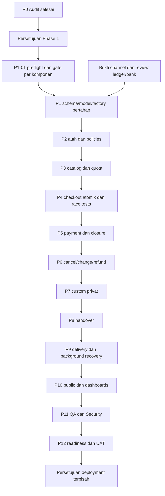

# IMPLEMENTATION PROGRESS — TBloom Cake

## A. Project Overview

| Field | Nilai |
|---|---|
| Proyek | TBloom Cake |
| Baseline | PRD v2.1 / R1, finalisasi 19 Oktober 2026 |
| Diperbarui | 22 Oktober 2026, Asia/Jakarta (UTC+07:00) |
| Status keseluruhan | Phase 1 berjalan; prasyarat G-PAY untuk P1-05 sedang diverifikasi; discovery merchant dan dua probe live awal lulus |
| Fase aktif | Phase 1, persetujuan pengguna tetap berlaku; Phase 2 belum dimulai |
| Task aktif | P1-05 IN PROGRESS pada prasyarat G-PAY; migration orders/items NOT RUN |
| Milestone berikutnya | Bukti sandbox finalitas per channel sebelum schema payment/order terkait dan payment/release runtime |
| Target stack | Laravel 13 / PHP 8.4 / MySQL InnoDB / Blade + Tailwind 4 / Midtrans Snap / Fonnte + email / database queue / Pest |
| Repository saat audit | Branch main; HEAD 95fab79959ea4d9fb8077140bd2f2d0b95a61a5e; origin fardhanfahrezy/tbloom-cake |
| Checkpoint source22 Oktober | Branch lokal codex/phase1-database-foundation; commits b13517f (test isolation), 68ac4e1 (users), 48896db (catalog), 518efe3 (testimonials), e82dcd5 (tracker); checkpoint P1-04 terverifikasi pada sesi lanjutan; tidak ada push/PR |
| Batas eksekusi | Phase 1 disetujui; schema tbloom_testing boleh dipakai test sintetis. Tidak mereset development DB, deploy, transfer bank, atau mengirim notifikasi nyata |

Sumber yang sudah dibaca seluruhnya: PRD-TBloom-Cake-v2.1.md, Architecture-Document.md, Database-Schema.md, Laravel-Structure-Document.md, Acceptance-Criteria.md, Test-Cases.md, Traceability-Matrix.md. Dokumen sumber tetap merupakan spesifikasi, bukan bukti implementasi. Instruksi master prompt lampiran dan AGENTS.md berlaku. `.ai/rules` tidak ditemukan pada audit ini.

Tracker ini menjadi satu tempat roadmap, checklist, keputusan, hasil test, dan penggunaan plugin sesuai permintaan pengguna. Tidak membuat `tasks/plan.md`, `tasks/todo.md`, atau base folder baru dari default skill Plan karena pengguna menentukan satu file progres utama.

### Bukti repository dan environment

| Area | Hasil aktual 21 Oktober 2026 | Implikasi |
|---|---|---|
| PHP / Composer | PHP CLI 8.4.12; Composer 2.10.1 | Sesuai major target; composer.json masih mengizinkan PHP ^8.3, pengetatan constraint belum dilakukan |
| PHP dependencies | Laravel 13.35.0, Tinker 3.0.2, Boost 2.10.3, Pint 1.32.1, Pest 5.3.1, Pest Laravel 5.0.1, Pail 1.2.7, Pao 1.1.5, Faker 1.24.1, Mockery 1.6.15, Collision 8.9.5 | Diverifikasi dengan composer show --direct dan Boost application_info; tidak memasang dependency |
| Node / npm | Node 25.9.0; npm 11.12.1 | Versi aktual, bukan keputusan versi deployment |
| JS dependencies | Tailwind/@tailwindcss/vite 4.3.3; Vite 8.3.4; laravel-vite-plugin 3.2.0; concurrently 10.0.6; Bootstrap 5.3.8 | Bootstrap terpasang tetapi tidak diimport app.css/app.js; tetap Blade/Tailwind, tidak migrasi ke Bootstrap 6 |
| Optional package | npm ls melaporkan @laravel/multiplex unmet optional dependency | Tidak memasang ulang; belum dibuktikan memblokir aplikasi/build |
| Konfigurasi lokal | APP_ENV local; debug true; locale en; session/cache/queue database; mail log; disk local | Konfigurasi pengembangan; belum validasi konfigurasi produksi atau pengiriman email |
| Waktu | app.timezone UTC; belum ada konfigurasi/operasi bisnis Asia/Jakarta | UTC sesuai penyimpanan event. Konversi kalender/cutoff Jakarta perlu diimplementasikan, bukan mengganti semua timestamp menjadi WIB |
| Secrets | APP_KEY tersedia; Midtrans/Fonnte keys tidak tersedia dalam .env saat pemeriksaan | Hanya memeriksa keberadaan, tidak menyalin nilai. .env diabaikan Git dan tidak tracked. Kredensial sandbox tetap gate integrasi |
| Database | MySQL 8.4.3, schema lokal tbloom; 9 tabel, seluruhnya InnoDB dan utf8mb4_unicode_ci | Koneksi Boost berhasil. Status connection refused pada dokumen 19 Oktober adalah histori, bukan blocker koneksi saat ini |
| Isolation / timezone DB | REPEATABLE-READ; session timezone SYSTEM, system SE Asia Standard Time | READ COMMITTED rekomendasi schema belum dikonfigurasi/diuji. UTC connection perlu diverifikasi sebelum DML timestamp; tidak mengubah server global |
| SQL mode | ONLY_FULL_GROUP_BY, STRICT_TRANS_TABLES, NO_ZERO_IN_DATE, NO_ZERO_DATE, ERROR_FOR_DIVISION_BY_ZERO, NO_ENGINE_SUBSTITUTION | Metadata terbaca; belum membuktikan CHECK/composite FK R1 bekerja |
| Collation | Default schema utf8mb4_0900_ai_ci; tabel scaffold utf8mb4_unicode_ci | Tentukan collation eksplisit yang sama di kedua sisi FK dan binary identifier pada migration terkait |
| Data existing | users 0; sessions 4; cache 3; migrations 3; password_reset_tokens/jobs/job_batches/failed_jobs/cache_locks masing-masing 0 | Snapshot hitungan saat query; database tidak kosong, cache/session dapat berubah oleh penggunaan normal. Tidak membaca payload/PII |
| Migration | Tiga migration scaffold sudah Ran, batch 1; tidak ada migration bisnis | Status dikonfirmasi query Boost dan artisan migrate:status di luar sandbox; tidak menjalankan migration |
| Schema users | name/email varchar255; tanpa WA/role/is_active; timestamp nullable; hanya PK dan unique email | Target R1 belum terpasang. Backfill/shrink preflight tetap harus membaca ulang data saat implementasi |
| Kode existing | User + factory, base Controller, AppServiceProvider, routes / dan health /up, welcome view, migration users/cache/jobs | Tidak ada model/controller/policy/job bisnis, auth endpoints, payment, quota, custom, atau refund |
| Scheduler | artisan schedule:list: No scheduled tasks have been defined | Konfigurasi queue database bukan bukti worker/scheduler beroperasi |
| Test existing | Dua example tests; phpunit SQLite :memory:, array mail/session/cache, sync queue | Tidak ada test bisnis. SQLite tidak membuktikan row locks InnoDB |
| GitHub | Connector get_repo berhasil; repository public, default branch main; local main...origin/main | Metadata remote terverifikasi. Tidak membuat commit/branch/PR/push pada sesi audit |
| Aset/desain | Tidak ada tautan Figma pada tujuh dokumen; public hanya aset scaffold | Sumber desain Figma/brand/foto aktual belum diberikan; tidak mengarang desain Figma |
| Perubahan pihak lain | .env.example berubah 1 baris selama audit, sebelum agen menulis tracker | Dipertahankan; bukan perubahan agen. Jangan memasukkannya ke commit otomatis |

Tidak ada bukti build frontend, sandbox payment, email/WhatsApp delivery, backup/restore, concurrency, atau deployment dari sesi ini.

## B. Progress Dashboard

Jumlah dihitung dari task ID pada bagian C. COMPLETED untuk Phase 0 berarti deliverable audit terbukti, bukan acceptance fitur bisnis lulus. NOT STARTED dapat memiliki dependensi/gate terbuka; BLOCKED dipakai ketika task sudah dicoba dan tidak dapat diselesaikan.

| Phase | Total Tasks | Completed | In Progress | Blocked | Not Started |
|---|---:|---:|---:|---:|---:|
| 0 — Audit & environment | 5 | 5 | 0 | 0 | 0 |
| 1 — Database foundation | 14 | 6 | 1 | 0 | 7 |
| 2 — Authentication & authorization | 5 | 0 | 0 | 0 | 5 |
| 3 — Catalog & availability | 4 | 0 | 0 | 0 | 4 |
| 4 — Checkout & order | 5 | 0 | 0 | 0 | 5 |
| 5 — Payment | 7 | 0 | 0 | 0 | 7 |
| 6 — Cancellation & refund | 7 | 0 | 0 | 0 | 7 |
| 7 — Custom requests | 3 | 0 | 0 | 0 | 3 |
| 8 — Handover | 3 | 0 | 0 | 0 | 3 |
| 9 — Notifications & background | 4 | 0 | 0 | 0 | 4 |
| 10 — Public & dashboards | 4 | 0 | 0 | 0 | 4 |
| 11 — Security & QA | 5 | 0 | 0 | 0 | 5 |
| 12 — Deployment readiness | 4 | 0 | 0 | 0 | 4 |
| **Total** | **70** | **11** | **1** | **0** | **58** |

Progres audit/roadmap: 5/5 task Phase0. Phase1: enam task selesai, P1-05 sedang mengerjakan prasyarat G-PAY, tujuh task belum dimulai. Tidak menandai P1-05 selesai dari discovery atau penerimaan payload Snap.

## C. Detailed Implementation Checklist

Status: `[ ]` NOT STARTED; `[~]` IN PROGRESS; `[x]` COMPLETED; `[!]` BLOCKED. Phase ditentukan oleh subbagian dan prefiks task. Kolom files adalah rencana kandidat sampai task dikerjakan, bukan klaim file dibuat. Semua task belum dimulai memiliki bukti test **NOT RUN**. Setiap executor harus membatasi satu task pada perubahan kecil, memecah menjadi child ID bila cakupan aktual terlalu besar, memperbarui jumlah dashboard, dan menyelesaikan/test/dokumentasikan task sebelum berpindah.

AC baseline Fxxx-ACn merujuk PRD §4. ID test tetap T-01–34 dan DBT-01–21, tidak menggantinya dengan ID baru. Coverage tambahan auth/konten/NFR boleh memakai nama test deskriptif saat baseline tidak memiliki ID yang tepat. DBT-20 adalah review dokumentasi, bukan runtime business test.

### Phase 0 — Repository Audit & Environment

| Status / Task ID | Deskripsi / requirement | AC / test | Dependencies | File aktual | Bukti / catatan |
|---|---|---|---|---|---|
| [x] P0-01 | Baca tujuh sumber, K-01–20/A-01–09 dan traceability seluruh F/BR/NFR | Master §4/13; DBT-20 review statis parsial | — | Tidak mengubah sumber | Seluruh sumber dibaca; konflik/otoritas di F/H; tidak menyebut DBT-20 full pass |
| [x] P0-02 | Audit source, dependency, config nonsecret, GitHub; semua F-001–010 | Master Phase 0; security/reliability NFR | P0-01 | Tidak mengubah aplikasi | composer show, npm ls, inventory app/routes/tests, GitHub get_repo; rincian A |
| [x] P0-03 | Audit MySQL dan migration tanpa mutasi; C-01–12 | Schema §11.1; bukan DBT-01 pass | P0-02 | Tidak mengubah database | Boost SELECT/metadata/count; artisan migration status; InnoDB 9 tabel, 3 migration |
| [x] P0-04 | Verifikasi baseline runner dan pisahkan test bisnis | Master quality gate; T/DBT tetap NOT RUN | P0-02 | Tidak mengubah test | Pest dua example: 2 passed, 2 assertions; hambatan sandbox dibuktikan dan alternatif berhasil |
| [x] P0-05 | Roadmap, graph, gates, log plugin dan next task | Master §5–6/13; seluruh Traceability Matrix | P0-01–04 | IMPLEMENTATION-PROGRESS.md | Tracker ditulis dan diperiksa; Phase 1 belum diotorisasi |

### Phase 1 — Database Foundation

Gate G-APPROVAL wajib sebelum seluruh task fase ini. Models/enums/factories dibangun mengikuti tabel yang sudah lolos gate; setiap slice yang melebihi sekitar lima file dipecah sebelum implementasi. Tidak menjalankan DDL pada schema tbloom sebagai database pengujian.

| Status / Task ID | Deskripsi / requirement | Acceptance / test wajib | Dependencies / gate | Rencana files | Bukti / catatan |
|---|---|---|---|---|---|
| [x] P1-01 | Preflight dedicated MySQL test dan fail-closed guard; BR-01, NFR reliability | Target terpisah, bootstrap menolak dev/remote/override; dua koneksi UTC/READ COMMITTED; prasyarat DBT-01/18/19 | P0-05, G-APPROVAL, G-DB | phpunit.mysql.xml; config/database.php; tests/TestCase.php; tests/Feature/DatabaseSafetyTest.php; tests/Feature/MySqlEnvironmentTest.php | RED9 failed → GREEN13 passed/21 assertions (MySQL); schema baru tbloom_testing, belum DDL bisnis |
| [x] P1-02 | Expand/validate/contract users; role/WA aktif; F-002/010 | Shrink/backfill sah, unique WA, role/active CHECK, UTC preserve; DBT-01/03/19 bagian users | P1-01, G-DATA | Dua migration baru; User.php; UserFactory.php; Models/UserRole.php; UserFoundationTest.php | 14 MySQL tests passed/41 assertions; Review Standards+Spec awal3 temuan, semua diperbaiki dan re-review tanpa required finding. Belum deploy |
| [x] P1-03 | DDL products/variants/images; F-001/009, C-01/07 | Types/unique/prices/category/RESTRICT; DBT-01/02/03 bagian katalog | P1-02 | Tiga models/factories/migrations/tests; ProductCategory; CatalogTestSeeder | 26 MySQL tests passed/67 assertions; seeder khusus tbloom_testing, review Standards1 temuan diperbaiki/Spec0; full regression sebelum seeder52 passed114 assertions |
| [x] P1-04 | DDL daily availability; F-004, BR-12/13 | Unique produk/tanggal, FK/updater, composite parent key, quota tanpa counter kedua; DBT-01/02/03 sebagian | P1-03; instruksi eksplisit pengguna22 Oktober untuk mengerjakan schema dan test tbloom_testing | DailyAvailability model/factory/migration/test; Product relation; CatalogTestSeeder | COMPLETED schema-only:24 test P1-04; bersama katalog35 passed/99 assertions; full MySQL90/210; Review0/0 required findings. D-012; runtime quota/release/concurrency belum dibuat |
| [~] P1-05 | DDL orders/items + snapshots; F-002/005, C-01/04/07 | One item/order, composite FK, money/deadline/pickup/terms CHECK; DBT-01/02/03 | P1-04, G-PAY | Prasyarat aktual: config/services.php, routes/console.php, MidtransSandboxPreflightTest, MidtransSandboxContractTest dan tracker; migration/model belum dibuat | IN PROGRESS prasyarat: GET merchant22 kanal aktif,24 fake-HTTP tests/81 assertions,2 opt-in live session probes/8 assertions. Gate effective expiry/success timing/final close belum lulus; DDL NOT RUN |
| [ ] P1-06 | DDL payments/events dan closure FK terakhir; F-006 | Unique reference/payment, claim/lease, same-payment closure; DBT-01/02/03 | P1-05, G-PAY | migrations; models/factories; focused tests | NOT RUN; kontrak channel harus dibuktikan sebelum migration terkait |
| [ ] P1-07 | DDL canonical movements; F-006/007, C-05 | Immutable facts, provenance/dedup/correction representation; DBT-01/02/06/07 | P1-06, P1-09, G-LEDGER | migration setelah transfers; model/factory; focused tests | NOT RUN; urutan file DDL mengikuti FK, bukan nomor checklist |
| [ ] P1-08 | DDL order_requests; F-007, C-03/06 | Composite ownership, generated pending slot, state timestamps; DBT-01/02/03 | P1-05 | migration; model/factory; enum; test | NOT RUN |
| [ ] P1-09 | DDL refund obligations/transfers/evidence; F-007 | Cross-object FK, one obligation/active attempt, encrypted TEXT, evidence checks; DBT-01/02/03 | P1-06, P1-08, G-LEDGER, G-BANK | migrations; models/factories/tests per slice | NOT RUN; obligation bank nullable; prepare bank wajib verified |
| [ ] P1-10 | DDL custom requests/attachments; F-003 | Private metadata, min attachment via app, tanpa payment/quota FK; DBT-01/03/15 | P1-02, G-FILES | migrations; models/factories/tests per slice | NOT RUN |
| [ ] P1-11 | DDL audit/outbox; F-010, BR-21, K-19 | Stable dedup, HMAC/encryption, fenced leases, redacted data; DBT-01/03/13/14 | P1-05, P1-10, G-FILES | migrations; models/factories; focused tests | NOT RUN; tabel boleh dirancang tanpa mengarang retry final |
| [x] P1-12 | DDL testimonials; F-008 Should Have | Publication/rating CHECK; DBT-01/03 bagian schema, bukan UI F008-AC1 | P1-02 | migration180529; Testimonial model/enum/factory/test seeder; TestimonialFoundationTest | 11 MySQL tests passed/22 assertions; source Review Standards0/Spec0 required; CHECK enforced; konten sintetis hanya test, UI tetap Phase10 |
| [x] P1-13 | Verifikasi infra dan indexes framework | Dictionary delapan tabel infra kompatibel driver, EXPLAIN sebelum index queue; DBT-01/19 sebagian | P1-01 | Tracker; tanpa migration/index baru | Metadata kolom/null/default/index8 tabel cocok; InnoDB/unicode_ci; EXPLAIN query pop memakai jobs_queue_index pada DB kosong. Bukan load/production plan proof |
| [ ] P1-14 | Schema/model/factory integrity dan upgrade rehearsal | Seluruh 27 tabel sesuai, semua enum casts/relasi/factory tersedia; data invalid ditolak; DBT-01/02/03/15/19 | P1-02–13, semua gate terkait | tests integrity; perbaikan minimum files terkait | NOT RUN; child tasks model/factory yang belum tercakup wajib dicatat, bukan ditandai selesai massal |

Urutan DDL normatif: users/catalog → availability/orders/custom → items/payments tanpa closure FK → events → requests/refund_logs → transfers → evidence/movements → audit/outbox; closure FK belakangan. P1-07 menunggu P1-09 karena FK ke transfers. Tidak ada siklus dependency task.

### Phase 2 — Authentication & Authorization

| Status / Task ID | Deskripsi / requirement | Acceptance / test wajib | Dependencies | Rencana files | Bukti / catatan |
|---|---|---|---|---|---|
| [ ] P2-01 | Register customer aktif; F-002, K-17 | Public role spoof diabaikan, normalized contacts unik, password≥12, unverified tidak dihalangi; T-01/02 | Phase 1 gate, P1-02 | controller/request/routes/view/test | NOT RUN |
| [ ] P2-02 | Login/logout dan active-account boundary | Session regenerate/invalidate, throttling, inactive ditolak | P2-01 | auth controller/request/middleware/view/test | NOT RUN; baseline belum memberi ID khusus login/logout |
| [ ] P2-03 | Email password reset | Token terbatas/hash, anti-enumeration, mail fake, no real send | P2-02 | reset controller/request/notification/view/test | NOT RUN; pengiriman nyata tetap gate email |
| [ ] P2-04 | Profile + own-resource policies; F-002/010 | Re-auth contact changes; snapshot historis tetap; cross-customer403/404; R1-AC19, DBT-14 | P2-02 | profile controller/request/policies/views/test | NOT RUN |
| [ ] P2-05 | Owner kelola Admin, role middleware | Customer dashboard staf ditolak; last active Owner dilindungi dengan lock | P2-04 | staff controller/policy/middleware/views/test | NOT RUN; tidak seeder akun produksi tanpa persetujuan |

### Phase 3 — Product Catalog & Availability

| Status / Task ID | Deskripsi / requirement | Acceptance / test wajib | Dependencies | Rencana files | Bukti / catatan |
|---|---|---|---|---|---|
| [ ] P3-01 | Katalog/tanggal/detail/unit sizes; F-001 | F001-AC1–3, R1-AC14/15; T-03/05, DBT-04/17 | Phase 2 gate, P1-03/04 | catalog controller/query/views/test | NOT RUN; final checkout assertions dilengkapi P4-02 |
| [ ] P3-02 | Admin produk/harga/archive; F-009 | F009-AC1/2; old snapshot tidak berubah; DBT-03/15 | P3-01 | requests/controller/policy/views/test | NOT RUN |
| [ ] P3-03 | Product image processing/storage; F-001/009 | MIME/content/alt/dimensions, safe public output; DBT-14 | P3-02, G-FILES | upload request/controller/view/test | NOT RUN |
| [ ] P3-04 | Admin quota/default override; F-004/009 | F004-AC1–4/F009-AC3, R1-AC03/15; T-03–05/24, DBT-04 | P3-02, P1-04/05 | quota operation/controller/request/view/test | NOT RUN; direct quota races MySQL; 20 actual checkout proof menunggu P4-05 |

### Phase 4 — Checkout & Order Management

| Status / Task ID | Deskripsi / requirement | Acceptance / test wajib | Dependencies | Rencana files | Bukti / catatan |
|---|---|---|---|---|---|
| [ ] P4-01 | Calendar/cutoff/allowlist/pickup/personalization; F-002/005, BR-01–11 | F002-AC2–4, R1-AC14/16; T-06/07/08/26, DBT-17 | Phase 3 gate, P2-04 | config domain; request; calendar operation; focused tests | NOT RUN; event UTC tetap, evaluasi bisnis Jakarta; pilihan rasa/filling nyata G-CONTENT |
| [ ] P4-02 | Atomic checkout/capacity/max3; F-002/004 | R1-AC03/13/15/17; T-03–05/07/10, DBT-03/04/18 | P4-01, P3-04, P1-05/06/11 | checkout operation/controller/request/test | NOT RUN; one clock setelah locks; audit/outbox row satu commit sejak awal |
| [ ] P4-03 | Idempotency dan immutable snapshots; F-002 | F002-AC5, R1-AC02/17; T-09/10/26, DBT-02/03 | P4-02 | checkout operation/request; focused test | NOT RUN; satu payment reference; hash payload berbeda ditolak |
| [ ] P4-04 | Order detail/checkout UI/countdown/terms; F-002/005/006 | F002-AC6/F005-AC1/2/F006-AC6; T-08/26/32 | P4-03 | order controller/policy/views/js/test | NOT RUN; UI paid hanya dari server, terms unselected default |
| [ ] P4-05 | Checkout concurrency dan state gate | 20 checkout/5 units, sizes shared, max3 held, lock melewati cutoff; DBT-04/17/18, T-04/07 | P4-03/04, G-DB | MySQL concurrency tests | NOT RUN; dua koneksi/proses, barriers, tanpa satu outer test transaction |

### Phase 5 — Payment Integration

| Status / Task ID | Deskripsi / requirement | Acceptance / test wajib | Dependencies / gate | Rencana files | Bukti / catatan |
|---|---|---|---|---|---|
| [ ] P5-01 | Adapter contract regression/sandbox per channel; F-006 | R1-AC01–04; T-32/33, DBT-16 | Phase 4 gate, G-PAY | adapter contract/tests; evidence di tracker | NOT RUN; pre-migration feasibility proof G-PAY harus sudah ada, bukan pertama kali di sini |
| [ ] P5-02 | Snap session absolute expiry/reference recovery | F006-AC1/6, R1-AC02; T-09/16/32 | P5-01 | adapter/config/controller/test | NOT RUN; HTTP di luar lock; timeout bukan izin reference baru |
| [ ] P5-03 | Signature+durable inbox/fencing | F006-AC3/5, R1-AC18/19; T-11/12, DBT-12/14 | P5-02, P1-06, G-RETRY | webhook controller/request/processor/test | NOT RUN; CSRF exception hanya endpoint; raw amount signature tetap |
| [ ] P5-04 | Apply canonical receipt/time/amount/reversal | R1-AC01/04/05/09/21; T-12/13/15/25/27/33, DBT-05/06/07 | P5-03, P1-07, G-LEDGER | payment operation/adapter/test | NOT RUN; 80% tidak berubah dari settlement ulang; amount anomaly tidak fulfill |
| [ ] P5-05 | Final closure/release dan unpaid cancel resolution | R1-AC03/12; T-14/16, DBT-05 | P5-04 | close/expiry operation/job/test | NOT RUN; pending/timeout/404 tunggal tidak cukup; timely payment menang |
| [ ] P5-06 | Reconciliation/reclaim/backoff/manual escalation | R1-AC18/24; T-16/33, DBT-12/18/21 | P5-05, G-RETRY | job/command/schedule/test | NOT RUN; auto24/7, manual09–17; no customer SLA |
| [ ] P5-07 | Timely receipt vs wrong-final-expiry incident | R1-AC04/20; T-34, DBT-05/16/18 | P5-06 | recovery operation/policy/test | NOT RUN; freeze/Owner exception, tanpa auto overbook/ambil alokasi/refund |

### Phase 6 — Cancellation, Changes & Refund

| Status / Task ID | Deskripsi / requirement | Acceptance / test wajib | Dependencies / gate | Rencana files | Bukti / catatan |
|---|---|---|---|---|---|
| [ ] P6-01 | Submit/reject cancellation dan H-2; F-007 | F007-AC1/2, R1-AC07/12/16; T-17/30, DBT-05/11/17 | Phase 5 gate, P1-08 | operation/controller/request/policy/test | NOT RUN; parent lock walau row request belum ada |
| [ ] P6-02 | Approve/store cancel+release+gross obligation | F007-AC3/5, R1-AC05/09/11/21; T-18/19/27, DBT-06/07/11 | P6-01, P1-09 | cancellation/refund operation; focused tests | NOT RUN; atomic applied; floor sekali atas total; noMDR |
| [ ] P6-03 | Allowed personalization changes / courier note | R1-AC16; T-17/26, DBT-11/17 | P6-01 | change operation/request/policy/controller/test | NOT RUN; pickup time/method immutable; note sebelum handover |
| [ ] P6-04 | Exclusive Admin claim / Owner takeover | R1-AC06; T-28/29, DBT-08/10 | P6-02, P2-05 | assignment operation/policy/controller/test | NOT RUN; assignment_version; unknown attempt tetap menahan dana |
| [ ] P6-05 | Verified bank/private evidence pipeline | R1-AC10/19/23; T-20/22, DBT-09/14/15 | P6-04, G-BANK, G-FILES | requests/storage controller/policy/test | NOT RUN; obligation boleh tanpa bank; prepare tidak |
| [ ] P6-06 | Prepare/unknown/complete/confirmed failure | R1-AC06/10/11/21; T-20/25/28/29, DBT-08/09/10 | P6-05, P5-04 | transfer operations; focused tests | NOT RUN; reference/mutasi/time/evidence durable; no bank API transfer |
| [ ] P6-07 | Refund races and duplicate/reversal regression | R1-AC05/06/11/20/21; T-25/27/28/29, DBT-06–10/18 | P6-06 | MySQL financial concurrency tests | NOT RUN; independent excess facts tetap dicatat incident |

### Phase 7 — Custom Cake Requests

| Status / Task ID | Deskripsi / requirement | Acceptance / test wajib | Dependencies | Rencana files | Bukti / catatan |
|---|---|---|---|---|---|
| [ ] P7-01 | Custom form/request/calendar/idempotency; F-003 | F003-AC1/2/4, R1-AC14/16; T-01/21, DBT-17 | Phase 6 gate, P1-10, P4-01 | request/operation/controller/view/test | NOT RUN; H3/H7/D90, tanpa payment/DP/quota |
| [ ] P7-02 | 1–3 private image attachments | F003-AC3/4, R1-AC19/23; T-22, DBT-14/15 | P7-01, G-FILES | storage/controller/policy/request/test | NOT RUN; JPEG/PNG/WebP≤5MB, noSVG; minimum durable sebelum commit |
| [ ] P7-03 | Admin custom lifecycle/edits | F003-AC1–4, R1-AC16; T-21/22, DBT-17 | P7-02 | status/change operation/controller/policy/view/test | NOT RUN; accepted/rejected terminal, add print tetap H7 |

### Phase 8 — Pickup & Handover

| Status / Task ID | Deskripsi / requirement | Acceptance / test wajib | Dependencies | Rencana files | Bukti / catatan |
|---|---|---|---|---|---|
| [ ] P8-01 | Identifikasi pengambil / informasi pickup | F005-AC1–3, F008-AC3; T-08/26 | Phase 7 gate, P4-04, G-CONTENT | handover request/controller/views/test | NOT RUN; toko serah09–21, produksi09–17; no auto no-show |
| [ ] P8-02 | Atomic complete dan cancellation hold | F010-AC2/3, R1-AC07/08/15; T-24/30, DBT-11 | P8-01, P6-01/02 | handover operation/policy/controller/test | NOT RUN; completed tetap konsumsi kuota |
| [ ] P8-03 | Submit/approval vs handover races | R1-AC08/20; T-31, DBT-11/18 | P8-02 | MySQL concurrency tests | NOT RUN; parent lock, satu hasil sah beserta audit/refund |

### Phase 9 — Notifications & Background Processing

| Status / Task ID | Deskripsi / requirement | Acceptance / test wajib | Dependencies / gate | Rencana files | Bukti / catatan |
|---|---|---|---|---|---|
| [ ] P9-01 | Outbox scanner/fencing/enqueue recovery; BR-21 | R1-AC18; T-23, DBT-13 | Phase 8 gate, P1-11, G-RETRY | command/job/outbox operation/test | NOT RUN; producers sudah menulis outbox atomik pada fase domain |
| [ ] P9-02 | Fonnte/email adapters & minimum templates | R1-AC19/22; T-23, DBT-13/14/21 | P9-01, G-NOTIFY | adapter/config/templates/test | NOT RUN; customer hanya pemilik; Admin tepat lima kategori K-19 |
| [ ] P9-03 | Scheduler/worker config/reclaim/backoff | R1-AC18/24; T-16/23, DBT-12/13/21 | P9-02, P5-06, G-RETRY | routes/console.php; jobs/commands/tests | NOT RUN; queue timeout/lease/retry_after konsisten; stale worker fenced |
| [ ] P9-04 | Unknown send/obsolete suppression/recovery | R1-AC18/22/24; DBT-13/21 | P9-03 | dispatcher/templates; focused tests | NOT RUN; no external exactly-once claim; purge nonaktif |

### Phase 10 — Public Pages & Operational Dashboard

| Status / Task ID | Deskripsi / requirement | Acceptance / test wajib | Dependencies / gate | Rencana files | Bukti / catatan |
|---|---|---|---|---|---|
| [ ] P10-01 | Public profile/pickup/policies & assets; F-008 | F008-AC3; jam/cutoff benar; keyboard/mobile | Phase 9 gate, G-CONTENT | views/components/controller/assets/test | NOT RUN; Figma hanya bila sumber tersedia; UI setiap fitur dasar tetap dibuat di fase fiturnya |
| [ ] P10-02 | Customer history/status order-payment-refund | F002-AC6, R1-AC19; cross-customer tests, DBT-14 | P10-01, P6-06, P7-03 | controller/policy/views/test | NOT RUN; review tidak meminta bayar ulang |
| [ ] P10-03 | Admin/Owner operational dashboard; F-010 | F010-AC1–4; T-02/28–31; DBT-14/19 | P10-02, P8-03, P9-04 | controller/query/policy/views/test | NOT RUN; filters/pagination, no revenue chart/mark-paid CRUD |
| [ ] P10-04 | Testimonials Should Have + responsive/a11y pass | F008-AC1/2; DBT-03; viewport360/keyboard/focus/contrast | P10-03, P1-12, G-CONTENT | controller/request/policy/views/test | NOT RUN; draft tidak bocor; review prioritas tidak memblokir payment |

### Phase 11 — Security, Integration & Quality Assurance

| Status / Task ID | Deskripsi / requirement | Acceptance / test wajib | Dependencies / gate | Rencana files | Bukti / catatan |
|---|---|---|---|---|---|
| [ ] P11-01 | Review traceability seluruh F/BR/K/NFR | Semua baseline AC + R1-AC01–24 dipetakan implementasi/test; DBT-20 | Phase 10 gate | tracker; koreksi source docs hanya jika diminta | NOT RUN; tutup gaps tanpa klaim test fiktif |
| [ ] P11-02 | Review plugin + Codex Security audit | R1-AC19/20/22/23; DBT-14/15/21; findings tervalidasi | P11-01 | scoped fixes/tests hanya sesudah temuan | NOT RUN; audit keamanan belum dijalankan pada Phase 0 |
| [ ] P11-03 | MySQL financial/concurrency/recovery suite | DBT-01–21 seluruh applicable; T-03–34; isolation/locks trace | P11-02, G-DB, G-RETRY, G-LEDGER | focused/regression tests | NOT RUN; SQLite tidak jadi pengganti |
| [ ] P11-04 | Sandbox provider end-to-end | T-11/13–16/32–34, DBT-16; recipients aman | P11-03, G-PAY, G-NOTIFY | integration tests/evidence tracker | NOT RUN; tidak menyentuh production/customer nyata |
| [ ] P11-05 | Full regression/build/performance/a11y | php artisan test --compact; npm run build; NFR PRD §8.2; DBT-19 | P11-04 | perbaikan scoped + test bila diperlukan | NOT RUN; target non-input belum menjadi SLA final |

### Phase 12 — Deployment Readiness

| Status / Task ID | Deskripsi / requirement | Acceptance / test wajib | Dependencies / gate | Rencana files | Bukti / catatan |
|---|---|---|---|---|---|
| [ ] P12-01 | Production config/storage/keys/channel readiness | Secrets/cookies/HTTPS/permissions; R1-AC19/23 | Phase 11 gate, G-PLATFORM, G-FILES | config/deploy files hanya bila disetujui | NOT RUN; bukan persetujuan deployment |
| [ ] P12-02 | Queue/scheduler/alerts/backup-restore rehearsal | R1-AC18/20/24; DBT-12/13/15/19; keys/files pulih | P12-01 | config/commands/tests/evidence tracker | NOT RUN; backup objectives perlu validasi operasional |
| [ ] P12-03 | UAT / final traceability / release checklist | Semua Must Have terbukti, limitations jujur, tidak ada critical unresolved | P12-02 | tracker/UAT evidence | NOT RUN; retensi pending tidak memberi izin purge |
| [ ] P12-04 | Handoff readiness dan gate deployment eksplisit | Owner menyetujui platform dan deployment; evidence runtime setelah deploy jika diotorisasi | P12-03, G-DEPLOY | deployment config bila diotorisasi | NOT RUN; Railway hanya pada tahap deployment dengan persetujuan, Cloud skill bila Cloud dipilih |

### Dependency graph dan checkpoints

Sesudah setiap 2–3 task: focused tests, pemeriksaan diff/traceability, update tracker. Sesudah setiap fase: laporkan bukti aktual dan tunggu persetujuan fase berikutnya sesuai master prompt. Domain outbox producer/audit ditulis pada fase domain yang bersangkutan; transport dan recovery lengkap di Phase 9. Status order paid/cancelled/expired dan alokasi tidak diubah sementara untuk mengejar urutan roadmap.

## D. Current Task

- Task aktif: **P1-05**, masih pada prasyarat **G-PAY**. Recovery Git cocok d77212a; hanya .env.example pihak lain dirty sebelum perubahan baru. Tidak mengulang P1-04 atau membuka Phase2.
- Checkpoint prasyarat selesai: command read-only midtrans:sandbox-preflight, config key/mode, strict channel parsing dan redaksi errors;24 fake-HTTP tests/81 assertions. GET merchant berhasil dengan key lokal,22 kanal aktif terverifikasi tanpa mengubah preferensi.
- Dua live probes opt-in lulus/8 assertions: request Snap berisi22 identifier + expiry30menit absolut diterima; request BCA dengan start_time mundur10menit diterima. Sesi belum dipilih metode dan Core status menghasilkan logical404; HTTP200/provider404 dikonfirmasi terpisah. Ini bukan bukti effective instrument expiry, paid_at atau final closure.
- Pekerjaan belum selesai: pemilihan/konfirmasi instrumen per kanal, boundary tepat deadline, pemetaan waktu sukses dan presisi, race close/settle serta webhook recovery. Konfirmasi provider tentang timestamp/finalitas sudah ditanyakan sebagai sumber tambahan; tidak mengubah K-01 atau mengurangi kanal tanpa keputusan pengguna.
- Task terakhir: **P1-04 — Daily availability**, COMPLETED schema-only sesuai instruksi eksplisit pengguna (D-012). RED→GREEN schema dan fixture; tes terkait35 passed/99 assertions di tbloom_testing. Review Standards0/Spec0 required findings.
- Implementasi selesai: tabel dengan unique produk/tanggal dan produk/id, index tanggal/produk, quota unsigned tanpa default/counter kedua, FK RESTRICT produk/updater, tanggal kalender DATE dan timestamps DATETIME(0). Model/date cast, relasi, factory snapshot default dan guarded synthetic seeder tersedia.
- Pekerjaan parsial domain: operasi materialisasi production, transaksi ubah quota, perhitungan used dari alokasi, checkout concurrency dan release belum dibuat; tetap P3/P4/P5. DBT-02 composite order-item FK baru dapat dibuktikan setelah P1-05; sekarang parent key terverifikasi.
- Task yang selesai sesi22 Oktober: P1-03 katalog (26 focused tests/67 assertions), P1-12 testimoni (11/22), P1-13 audit read-only delapan tabel infra.
- Recovery P1-01/P1-02:27 passed/62 assertions. Product scaffold yang terputus sudah dilengkapi; tidak menghapus atau menimpa .env.example milik perubahan pihak lain.
- Acceptance scope: schema/model/factory/test seeder dan integritas database. Katalog publik/Admin, auth, checkout dan visibilitas testimoni tetap fase berikutnya; bukan fitur UI selesai.
- DDL/DML hanya dijalankan pada tbloom_testing. Database development tetap sembilan tabel scaffold; migration aplikasi baru belum diterapkan ke development/production.
- Gate berikutnya: bukti per channel untuk waktu sukses/zona/presisi, absolute expiry, final close versus settlement/recovery; dokumentasi provider umum atau mock tidak menutup gate sandbox.
- Final regression checkpoint P1-04:90 MySQL tests passed/210 assertions; profil default14 passed/76 skipped/15 assertions. Pint/diff check saat itu passed. Sesi baru belum menjalankan DDL P1-05, Phase2 atau deployment.

## E. Completed Tasks

| Tanggal | Task | Ringkasan / file | Test/pemeriksaan dan hasil |
|---|---|---|---|
| 2026-10-21 | P0-01 | Seluruh tujuh dokumen dibaca; tanpa edit sumber | Review statis F-001–010, BR-01–21, A/K, AC baseline/R1, T/DBT; runtime bisnis tidak dijalankan |
| 2026-10-21 | P0-02 | Audit scaffold/config/dependencies/GitHub; tanpa perubahan aplikasi | Versi dan inventory terbaca; GitHub get_repo berhasil; gaps di A/F |
| 2026-10-21 | P0-03 | Audit schema/data aggregate dan migration; tanpa mutasi | MySQL8.4.3/InnoDB; metadata/count berhasil; 3 migration Ran |
| 2026-10-21 | P0-04 | Baseline runner diverifikasi; tanpa mengedit tests | php vendor/bin/pest --compact tests/Feature/ExampleTest.php tests/Unit/ExampleTest.php di luar sandbox: 2 passed, 2 assertions, duration_ms4021 |
| 2026-10-21 | P0-05 | IMPLEMENTATION-PROGRESS.md dibuat | Struktur A–J, 70 unique task IDs, dashboard/checklist, graph/gates dan diff diperiksa |
| 2026-10-21 | P1-01 | Test MySQL dedicated dan bootstrap guard tersedia, lima files konfigurasi/test | RED9 failed sebelum guard; GREEN13 passed/21 assertions, dua koneksi MySQL berbeda, UTC/READ COMMITTED |
| 2026-10-21 | P1-02 | Users R1 expand/contract, enum casts dan factory states; tanpa backfill fiktif | 14 tests passed/41 assertions; legacy UTC regression RED00:15→07:15 lalu GREEN; rollback dan duplicate preflight terbukti; review selesai |
| 2026-10-22 | P1-03 | Products/variants/images, enum dan synthetic factories/seeder; schema/index/FK/CHECK sesuai R1 | RED→GREEN per slice; katalog26 passed67 assertions; Review Standards/Spec terselesaikan; tidak membuat produk toko atau mengunggah file |
| 2026-10-22 | P1-13 | Audit source framework+live metadata delapan tabel infra tanpa perubahan DDL | Boost read-only COLUMNS/STATISTICS/TABLES sesuai dictionary; EXPLAIN worker query memakai jobs_queue_index; volume representatif tetap P11/DBT-19 |
| 2026-10-22 | P1-12 | Testimonial model/enum/factory, constrained DDL dan guarded synthetic test seeder | RED draft enum belum tersedia→GREEN11 passed/22 assertions; rating1..5/null, status, timestamps, seed refusal dan rollback diuji; Review0/0 required findings |
| 2026-10-22 | P1-04 | DailyAvailability model/factory/migration/test, Product relation dan CatalogTestSeeder; tujuh file termasuk tracker |24 tests P1-04,35 focused passed/99 assertions bersama katalog; full MySQL90/210; default14 passed/76 skipped/15 assertions; Pint dan dua review lulus |

## F. Blockers & Pending Decisions

### Gate pelaksanaan / bisnis

| Gate | Status / bukti | Dampak / tindakan berikutnya |
|---|---|---|
| G-APPROVAL | Phase 1 DISETUJUI pengguna: “ya lanjutkan ke phase 1” | Berlaku untuk pekerjaan Phase 1 dan setup test lokal yang diperlukan; Phase 2/deployment tetap memerlukan persetujuan tersendiri |
| G-RETENTION | Durasi retensi final per kelas belum disetujui Owner | K-20 prinsip sudah disetujui; jangan bertanya ulang prinsip. Purge otomatis tetap nonaktif termasuk staging/log/backup |
| G-DEPLOY | Belum ada persetujuan deployment | Tidak deploy Railway/Cloud atau akses production. Persetujuan fase implementasi bukan persetujuan deployment |
| G-PLATFORM | PRD §7.1 menyebut Laravel Cloud; instruksi terkini membolehkan Railway hanya saat deployment dan setelah approval | Jangan mengganti target secara diam-diam. Pilihan platform ditutup pada readiness tanpa mengubah stack/bisnis |

### Technical blockers

| Gate | Masalah / bukti | Dampak / tindakan berikutnya |
|---|---|---|
| G-LEDGER | Schema §8/11: representasi koreksi fakta append-only, canonical key/provenance/cross-FK belum direview TL | Block migration ledger/refund terkait. Tinjau tanpa membuat endpoint edit/delete facts; tambah test correction sebelum implementasi |
| G-RETRY | K-18 strategi disetujui; angka attempts/backoff/lease/timeout/deadlock jitter belum final | TL menyiapkan proposal angka per proses; jangan menandai retry-boundary AC24/DBT-21 lulus atau memakai jadwal usulan PRD sebagai final |
| G-FILES | Local private disk tersedia; durability, keys/HMAC recovery/rotation, proof pipeline dan restore belum dibuktikan | Gate file/evidence/outbox privacy dan production storage. Setup minimum diuji dengan fakes, restore nyata pada lingkungan aman |
| G-DATA | Snapshot users kosong, tetapi dapat berubah sebelum migration | Requery counts/anomalies sebelum shrink/backfill; jangan menggunakan snapshot audit sebagai izin asumsi semua DB kosong |
| G-BANK | Source account alias, stable bank reference, verified destination/mutasi dan SOP takeover belum terbukti | Block migration/flow transfer terkait; tidak melakukan transfer nyata. Unknown tidak otomatis gagal/expire |

### External integration blockers

| Gate | Masalah / bukti | Dampak / tindakan berikutnya |
|---|---|---|
| G-PAY | Key Sandbox berhasil mengakses GET preferences:22 kanal aktif. Dua live session probes menerima payload expiry absolut, tetapi effective expiry setelah pemilihan instrumen, timestamp/presisi sukses dan final-close race belum dibuktikan. Kartu/3DS memakai expiry issuer setelah Pay menurut docs | P1-05 baru prasyarat; DDL orders/items dan P1-06 tetap belum dijalankan. Seluruh kanal pilihan pengguna dipertahankan. Tuntaskan DBT-16 per kanal dan konfirmasi provider untuk kontrak waktu/finalitas yang belum jelas; discovery/token acceptance bukan pass gate |
| G-NOTIFY | Fonnte token tidak ada; mail driver log; recipient configuration/device/provider idempotency/status belum dibuktikan | Automated tests fake saja; real sandbox/internal-recipient test hanya dengan izin. Jangan kirim customer nyata |
| G-CONTENT | Logo/foto/alamat toko/contact/allowlist rasa/filling/harga/unit kemasan dan desain Figma aktual belum tersedia dalam scope audit | Jangan mengarang master bisnis. Plumbing/factory sintetis boleh setelah fase disetujui; data publik final menunggu sumber |
| G-ARCHITECT | Tool/skill bernama AI Software Architect tidak ditemukan dalam katalog sesi | Fallback review teknis standar berdasarkan dokumen; tidak mengaku plugin architect dijalankan. Skill lokal improve-codebase-architecture diperiksa: fokus refactor scaffold, tidak sesuai tugas audit ini |

### Environment dan test blockers

| Gate | Status / bukti | Dampak / tindakan berikutnya |
|---|---|---|
| G-DB | CLOSED untuk local test setup: tbloom_testing baru; 13 test passed termasuk dua koneksi independen dan bootstrap refusal | Gunakan phpunit.mysql.xml. Guard hanya mengizinkan local tbloom_testing/SQLite memory sebelum traits reset; race bisnis dengan barrier belum diuji |
| Sandbox CLI | Dalam sandbox MySQL socket ditolak dan PHP is_readable(vendor/autoload.php)=false walau file_exists=true | Di luar sandbox read-only migration status dan dua example tests berhasil. Tidak perlu mengubah ACL/vendor/dependency untuk menyelesaikan audit |
| Test invocation | Artisan meneruskan --no-interaction ke PHPUnit13 dan opsi ditolak | Untuk test gunakan php vendor/bin/pest --compact <path>, yang diizinkan AGENTS.md; Artisan non-test tetap --no-interaction |
| Business suite | Test schema/factory/guard users, katalog dan testimoni sudah berjalan; flow checkout/payment/refund belum ada | Partial DBT-01/02/03/19 terverifikasi sesuai log. T-01–34 dan DBT lain belum dijalankan penuh; sandbox/build/restore/UAT/load tetap belum terbukti |

### Rekonsiliasi dokumen dan otoritas

- PRD §6.4 masih menulis retensi belum diputuskan secara umum. PRD §1.4 K-20 dan companion docs lebih spesifik: prinsip per kelas sudah disetujui; hanya durasi final pending. Tidak membuka ulang keputusan prinsip dan tidak purge otomatis.
- Roadmap tujuh fase pada PRD §9 dan Phase 0–12 pada master berbeda tingkat rincian. Gunakan Phase 0–12 untuk eksekusi, tetap mempertahankan seluruh deliverable PRD dan checkpoints persetujuan tiap akhir fase.
- Riwayat connection refused 19 Oktober tetap benar sebagai histori. Bukti live 21 Oktober menunjukkan DB reachable, tanpa membuktikan constraints R1 sudah terpasang.
- Schema summary Boost mengelompokkan beberapa tipe integer secara umum; detail metadata migrations.id adalah INT UNSIGNED, sesuai source framework increments dan dictionary. Gunakan detail metadata untuk oracle DDL, bukan ringkasan saja.
- Target Laravel Cloud dalam PRD belum diganti oleh aturan kondisional Railway. Tidak ada keputusan platform baru dibuat pada sesi ini.
- CLAUDE.md masih berisi bootstrap pemasangan PHP8.5/Boost. Prasyarat PHP8.4 dan Boost sudah tersedia, sehingga tidak menjalankan ulang bootstrap atau mengubah dependency; instruksi target pengguna dan AGENTS.md berlaku.
- Tidak ditemukan kontradiksi baru yang memerlukan perubahan persentase refund, scope checkout, H-2/H-3/H-7, batas3/D90, penerima K-19, atau kebijakan K-01–20.

### G-PAY — bukti merchant dan gap kontrak,22 Oktober2026

Pengguna menyatakan kanal Snap Sandbox aktif dan mengotorisasi informasi ini untuk pengujian gate. GET live resmi mengembalikan22 identifier: akulaku, alfamart, bca_va, bni_va, bri_va, bsi_va, cimb_va, credit_card, dana, danamon_va, echannel, google_pay, gopay, indomaret, kredivo, other_qris, other_va, ovo, permata_va, saqu_va, seabank_va, shopeepay. Identifier induk tidak membuktikan subfitur GoPay Later/SpayLater atau activation production. Tidak mengirim PATCH atau mengubah toggle merchant.

| Kelompok pilihan pengguna | Bukti yang tersedia | Bukti yang belum tersedia |
|---|---|---|
| VA11 identifier termasuk echannel/other_va | Enabled preference terbaca; dimasukkan bulk enabled_payments pada request Snap yang diterima; BCA delayed session creation10menit diterima | Pemilihan/charge instrumen aktual, expiry_time efektif, asal timestamp customer paid, close/settle race per bank |
| GoPay/ShopeePay/OVO/DANA/other_qris |5 identifier enabled dan tercakup request sesi | Variasi QR/deeplink/PayLater, timestamp/presisi sukses, absolute instrument expiry, final close/race |
| credit_card/google_pay |2 identifier enabled dan tercakup request sesi | Capture time customer, issuer OTP/3DS expiry, Google Pay instrument path, final close/race |
| alfamart/indomaret |2 identifier enabled dan tercakup request sesi | Kode bayar/expiry metode, waktu aksi customer versus laporan provider, final close/race |
| akulaku/kredivo |2 identifier enabled dan tercakup request sesi dengan synthetic item_details | Approval/pembayaran aktual, timestamp/presisi, expiry efektif, final close/race |

Sumber resmi dan batas interpretasi:

- [Preference API](https://docs.midtrans.com/reference/snap-checkout-preference-api): GET /snap/v3/merchant-preferences memakai Basic server key dan memberi name/enabled. Command menampilkan identifier valid saja; identity, body error, key dan token tidak dicetak.
- [Expiry Snap](https://docs.midtrans.com/reference/expire-a-snap-session): expiry.start_time mengikat blanket expiry; page expiry saja tidak menghapus kesempatan membayar melalui instrumen yang masih valid. Setelah kartu masuk OTP/3DS, expiry dipengaruhi issuer. Dokumentasi ini belum membuktikan pemenuhan BR-10 per kanal merchant.
- [GET status](https://docs.midtrans.com/docs/get-status-api-requests): transaction_time bukan definisi universal waktu customer membayar; card capture dapat mendahului settlement. [Webhook caveat](https://docs.midtrans.com/docs/https-notification-webhooks) menjelaskan Core not-found dapat muncul sebelum customer memilih kanal Snap. Live GET terhadap sesi sintetis memang menghasilkan HTTP200/status_code404, tanpa transaction_status.
- [Snap request](https://docs.midtrans.com/reference/request-body-json-parameter) dan [Integration Guide](https://docs.midtrans.com/docs/snap-snap-integration-guide): identifier order maksimum50 karakter. Probe memakai prefix TBLOOM-GPAY- ditambah UUID,48 karakter, dan nominal sintetis500000, bukan master harga toko. Request awal dengan53 karakter ditolakHTTP400; setelah prefix diperbaiki, sesi berhasil dibuat.
- Session token/redirect URL tidak disimpan/dicetak. Probe hanya membuat sesi tanpa customer_details, VA/QR/card charge, atau pembayaran; sesi sintetis dibiarkan mengikuti expiry yang diminta. Tidak ada fakta pembayaran/closure/order/quota aplikasi yang dibuat dari probe.

**Status G-PAY: OPEN.** Token acceptance termasuk backdated start_time bukan bukti deadline efektif saat kanal dipilih belakangan. Belum ada verified payment timestamp atau final-close evidence. Konfirmasi teknis provider diminta mengenai field sukses/presisi dan finalitas close versus settlement, khususnya kartu/3DS; pengujian instrumen dan simulator DBT-16 tetap harus dikerjakan sebelum DDL P1-05. Tidak ada dukungan kanal yang diarang atau kanal pengguna yang dinonaktifkan diam-diam.

## G. Test Execution Log

Log ini mencatat hasil aktual, termasuk invocation/environment errors. Test ID `—` berarti pemeriksaan scaffold/alat, bukan ID bisnis pengganti.

| Date | Task | Test ID | Command/Method | Result | Evidence |
|---|---|---|---|---|---|
| 2026-10-21 | P0-02 | — | php --version; composer --version; composer show --direct; node --version; npm --version; npm ls --depth=0 | PASSED | Versi A; optional multiplex unmet dilaporkan, tidak dependency baru |
| 2026-10-21 | P0-03 | — | Boost application_info/database_schema/database_query SELECT VERSION/metadata/count/migrations | PASSED | MySQL8.4.3, InnoDB9, migration3; tanpa payload session/cache/PII |
| 2026-10-21 | P0-03 | — | php artisan migrate:status --no-interaction, sandbox | BLOCKED | SQLSTATE HY000/2002 socket access forbidden; bukan database kosong |
| 2026-10-21 | P0-03 | — | php artisan migrate:status --no-interaction, di luar sandbox melalui tool approval | PASSED | Ketiga migration scaffold Ran batch1; exit0 |
| 2026-10-21 | P0-02 | — | artisan route:list --except-vendor; schedule:list; config:show app.timezone/queue.default/mail.default, --no-interaction | PASSED | Route aplikasi /; scheduler kosong; UTC/database/log |
| 2026-10-21 | P0-04 | — | artisan test --compact tests/Feature/ExampleTest.php --no-interaction dan Unit/ExampleTest.php | FAILED | Runner belum menjalankan assertion: Unknown option --no-interaction |
| 2026-10-21 | P0-04 | — | php vendor/bin/pest --compact, masing-masing example file di sandbox | BLOCKED | Cannot open bootstrap script vendor/autoload.php; PHP file_exists true/is_readable false; PHPUnit BootstrapLoader memakai is_readable |
| 2026-10-21 | P0-04 | — | php vendor/bin/pest --compact tests/Feature/ExampleTest.php tests/Unit/ExampleTest.php, di luar sandbox melalui tool approval | PASSED | tool pest result passed, tests2, passed2, assertions2, duration_ms4021, exit0 |
| 2026-10-21 | P0-01 | DBT-20 | Pembacaan tujuh dokumen dan perbandingan source/metadata | NOT RUN | Review statis parsial dilakukan; full implementasi/traceability oracle DBT-20 belum tersedia, tidak diklaim lulus |
| 2026-10-21 | Semua fase bisnis | T-01–34; DBT-01–21 runtime | Belum ada test code bisnis / sandbox / dedicated MySQL test | NOT RUN | Checklist rencana saja, tidak ada business test pass |
| 2026-10-21 | P0-05 | — | Baca tracker; hitung task/checklist/dashboard; git diff --check; git status | PASSED | 70 task ID unik, hitungan konsisten, hanya tracker ditulis agen; .env.example milik perubahan paralel dipertahankan |
| 2026-10-21 | P11-05 | — | npm run build | NOT RUN | Phase0 source read-only; belum menguji build atau download font eksternal |
| 2026-10-21 | P1-01 | DBT-01/18/19 prerequisites | php vendor/bin/pest --compact tests/Feature/DatabaseSafetyTest.php | FAILED | RED9 assertions gagal karena guard belum tersedia, sebelum perubahan konfigurasi |
| 2026-10-21 | P1-01 | DBT-01/18/19 prerequisites | php vendor/bin/pest --compact --configuration phpunit.mysql.xml tests/Feature/DatabaseSafetyTest.php tests/Feature/MySqlEnvironmentTest.php | PASSED | Run terakhir13 passed/21 assertions; bootstrap child sengaja target tbloom ditolak; tidak ada DDL bisnis |
| 2026-10-21 | P1-02 | DBT-01/03/19 users | php vendor/bin/pest --compact --configuration phpunit.mysql.xml tests/Feature/UserFoundationTest.php | PASSED | Terakhir14 passed/41 assertions. Intermediate failures: enum belum ada; assertion model-vs-DB diperbaiki; regression UTC benar-benar RED; nowdoc indentation diperbaiki. Bukan suite DBT lengkap |
| 2026-10-21 | P1-01/02 | — | php vendor/bin/pint --dirty --format agent | PASSED | Sandbox writable check terblokir; run di luar sandbox berhasil memformat tiga files, tanpa patch vendor |
| 2026-10-22 | Recovery | DBT-01/03/19 users + setup | php vendor/bin/pest --compact --configuration phpunit.mysql.xml tests/Feature/DatabaseSafetyTest.php tests/Feature/MySqlEnvironmentTest.php tests/Feature/UserFoundationTest.php | PASSED |27 passed/62 assertions; verifikasi ulang catatan sesi sebelumnya |
| 2026-10-22 | P1-03 | DBT-01/02/03 katalog | Focused Product/Variant/Image tests secara serial | PASSED | RED kategori/relasi belum tersedia → GREEN; seeder stub RED expected3 found0 → GREEN; terakhir26 passed/67 assertions |
| 2026-10-22 | P1-03 | Regression | php vendor/bin/pest --compact --configuration phpunit.mysql.xml | PASSED |52 passed/114 assertions sebelum seeder ditambah; duration_ms126255; bukan bukti seluruh27 tabel R1 tersedia |
| 2026-10-22 | Recovery | — | Run produk sempat overlap dengan runner MySQL sebelumnya | FAILED | Unknown table akibat overlap DDL pada disposable DB; run dibatalkan sebagai bukti RED fitur, diulang serial; development tetap terpisah |
| 2026-10-22 | P1-13 | DBT-01/19 infra sebagian | Boost database_query pada mysql_testing: COLUMNS, STATISTICS, TABLES, EXPLAIN pop SQL | PASSED | Delapan tabel infra cocok, engine/collation dan index terverifikasi; tidak mengklaim optimasi atau load test dari data kosong |
| 2026-10-22 | P1-12 | DBT-01/03 testimonials | php vendor/bin/pest --compact --configuration phpunit.mysql.xml tests/Feature/TestimonialFoundationTest.php | PASSED |11 passed/22 assertions; bukan bukti publikasi UI atau authorization Phase10 |
| 2026-10-22 | P1-03/12 | DBT-03 | Boost information_schema.TABLE_CONSTRAINTS | PASSED | Enam CHECK katalog/varian/testimoni ENFORCED=YES, termasuk kategori/flags/price/rating/publication |
| 2026-10-22 | Phase1 | Formatter | php vendor/bin/pint --dirty --format agent | PASSED | Run terakhir result passed setelah seeder/testimoni; tidak memodifikasi dependency/vendor |
| 2026-10-22 | Phase1 final checkpoint | Partial DBT schema + regression | php vendor/bin/pest --compact --configuration phpunit.mysql.xml | PASSED |66 passed/153 assertions, duration_ms55785; semua test yang tersedia, bukan seluruh55 skenario bisnis T/DBT |
| 2026-10-22 | Phase1 final checkpoint | Default profile | php vendor/bin/pest --compact | PASSED |14 passed/52 MySQL-only skipped/15 assertions, duration_ms6479. Skipped tidak dianggap pass schema |
| 2026-10-22 | P1-04 RED awal | Daily availability relation/schema | php vendor/bin/pest --compact --configuration phpunit.mysql.xml tests/Feature/DailyAvailabilityFoundationTest.php | FAILED |3 errors/0 assertions: product relation dan updated_by column belum tersedia; duration_ms22188 |
| 2026-10-22 | P1-04 GREEN awal | Model/date/default fixture | Perintah focused yang sama | PASSED |3 passed/9 assertions; duration_ms6267 |
| 2026-10-22 | P1-04 fixture RED | Constraint/schema/index/fixture | Perintah focused yang sama setelah test ditambah | FAILED |23 passed/48 assertions,1 failed: seeder belum membuat availability, expected3 found0; duration_ms22900 |
| 2026-10-22 | P1-04 + katalog GREEN | Partial DBT-01/02/03 dan factory regression | php vendor/bin/pest --compact --configuration phpunit.mysql.xml tests/Feature/DailyAvailabilityFoundationTest.php tests/Feature/ProductFoundationTest.php | PASSED |35 passed/99 assertions; duration_ms19017.24 test P1-04; composite parent key diuji metadata, composite order-item FK tetap P1-05; bukan bukti concurrency/runtime quota |
| 2026-10-22 | P1-04 | Formatter | php vendor/bin/pint --dirty --format agent | PASSED |Result passed, exit0 |
| 2026-10-22 | P1-04 final regression | Seluruh automated tests tersedia, profil MySQL | php vendor/bin/pest --compact --configuration phpunit.mysql.xml | PASSED |90 passed/210 assertions; duration_ms85239; DDL/DML hanya tbloom_testing, serial; bukan full acceptance bisnis |
| 2026-10-22 | P1-04 final regression | Profil default | php vendor/bin/pest --compact | PASSED |14 passed/76 MySQL-only skipped/15 assertions; duration_ms7668; skipped bukan bukti schema |
| 2026-10-22 | P1-05 / G-PAY | Console seam RED→GREEN | php vendor/bin/pest --compact tests/Feature/MidtransSandboxPreflightTest.php | PASSED setelah RED |Command belum ada→1 pass/3 assertions; discovery belum ada→2 pass/11; malformed records5 failed→9 pass/32. Key opaque regression1 failed→GREEN9/32; semua HTTP fake |
| 2026-10-22 | P1-05 / G-PAY | Guard/config/error regression | php vendor/bin/pest --compact --configuration phpunit.mysql.xml tests/Feature/MidtransSandboxPreflightTest.php | PASSED |24 passed/81 assertions; duration_ms2771; production/staging/mode ambiguity/key kosong, invalid payload,401/403/429/500/302, connection failure, empty set dan no leak; tidak membuat DB records |
| 2026-10-22 | P1-05 / G-PAY | Merchant discovery live | php artisan midtrans:sandbox-preflight --no-interaction | PASSED |HTTP GET autentikasi berhasil;22 enabled IDs di subsection F; tidak mencetak key/merchant identity atau mengubah preferences. Guard prefix awal terlalu ketat dan ditolak lokal; fix memakai nonblank key+modefalse+fixed sandbox host, autentikasi tetap provider |
| 2026-10-22 | P1-05 / G-PAY | Live probe diagnosis | MIDTRANS_SANDBOX_CONTRACT_TESTS=true, direct Pest phpunit.mysql.xml MidtransSandboxContractTest | FAILED lalu direkonsiliasi |Pertama2xHTTP400; reference53 karakter melebihi max50, diganti prefix sehingga48. Berikutnya creation accepted tetapi assertion transport404 salah (actualHTTP200). Read-only GET terhadap reference yang sama membuktikan logical status_code404 dan transaction_status absent; tidak menyimpulkan final unpaid |
| 2026-10-22 | P1-05 / G-PAY | Live session acceptance + preselection not-found | Flag opt-in sementara=true; php vendor/bin/pest --compact --configuration phpunit.mysql.xml tests/Feature/MidtransSandboxContractTest.php | PASSED |2 passed/8 assertions; duration_ms2708. Flag dipulihkan dalam finally dan exit runner dipropagasi. Acceptance payload + logical404 saja; belum effective expiry/timing/finality. Tidak charge/payment/refund, PII, notifikasi customer, atau mutation DB |
| 2026-10-22 | P1-05 / G-PAY | Formatter | php vendor/bin/pint --dirty --format agent | PASSED |Run awal memperbaiki ordered_imports; run terakhirpassed exit0 |
| 2026-10-22 | P1-05 / G-PAY | MySQL regression | php vendor/bin/pest --compact --configuration phpunit.mysql.xml | PASSED |114 passed/291 assertions,2 opt-in live skipped; duration_ms44493. Sesudah review mempersempit3 HTTP fake, focused24/81 diulang lulus duration_ms2982; source aplikasi tidak berubah |
| 2026-10-22 | P1-05 / G-PAY | Default regression setelah review fix | php vendor/bin/pest --compact | PASSED |38 passed/96 assertions,78 skipped (76 MySQL-only+2 opt-in live); duration_ms10802. Tidak ada network Sandbox dari suite default |

## H. Decision Log dan Plugin Execution Log

### Keputusan teknis sesi

| ID / tanggal | Keputusan / alasan | Alternatif / dampak / otoritas |
|---|---|---|
| D-001 / 2026-10-21 | Satu tracker ini menyimpan roadmap dan seluruh log | Menggantikan default tasks/plan.md + tasks/todo.md milik Plan atas instruksi eksplisit pengguna; tidak menambah base folder |
| D-002 / 2026-10-21 | Tetap stack dan desain bisnis yang disetujui | Tidak menggunakan Bootstrap6 walau skill tersedia; Bootstrap5.3.8 existing tetap untouched. Tidak menambah Midtrans SDK/dependency sebelum perlu dan disetujui |
| D-003 / 2026-10-21 | UTC untuk event; konversi bisnis Jakarta menjadi task implementasi eksplisit | Tidak mengganti app.timezone secara membabi buta; Boost docs Laravel13 tentang date/timezone mendukung penyimpanan UTC. Belum memilih API/class baru |
| D-004 / 2026-10-21 | Baseline test direct Pest di luar sandbox bila file-read checks terblokir | Diuji berhasil; tidak memodifikasi vendor/ACL. Pemeriksaan MySQL read-only tetap melalui Boost; CLI status diverifikasi di luar sandbox |
| D-005 / 2026-10-21 | Gate per komponen sebelum DDL terkait, tanpa mengubah persetujuan bisnis | Payment/ledger/refund gate tidak dipindahkan diam-diam ke setelah migration. P1-01 menjadi task siap berikutnya setelah approval; unresolved gates dapat memblokir slice terkait |
| D-006 / 2026-10-21 | Proposal retry/retensi/platform tetap pending sesuai kewenangan | Tidak menetapkan angka baru, tidak membuka ulang K-17–20, tidak deploy. Arsitektur kompleks akan direview dengan fallback bila plugin khusus tidak tersedia |
| D-007 / 2026-10-21 | Test MySQL memakai local schema tbloom_testing dengan config terpisah dan guard sebelum Laravel database traits | Setup non-destruktif schema baru dalam otorisasi Phase1; tidak mengubah global MySQL isolation/timezone atau koneksi development. TEST_DB_USERNAME/PASSWORD opsional, tidak ada secret di source |
| D-008 / 2026-10-22 | Seeder katalog hanya untuk lingkungan testing dan actual schema tbloom_testing; tidak didaftarkan DatabaseSeeder | Memenuhi AGENTS model+factory+seeder tanpa mengarang data bisnis atau menjalankan seed development/production; fixture nama [TEST] dan unit uji |
| D-009 / 2026-10-22 | P1-04 blocked G-PAY; kerjakan audit P1-13 independen setelah P1-03 selesai | Bukan waive gate provider; tidak membuat schema quota/payment secara spekulatif; seluruh runner DDL test harus serial |
| D-010 / 2026-10-22 | Selesaikan P1-12 yang independen saat quota tertahan; hanya schema dan metadata sintetis | Tidak mengklaim Should Have UI selesai, tidak menerbitkan ulasan customer, tidak menjadikan pekerjaan testimoni pengganti gate pembayaran |
| D-011 / 2026-10-22 | Simpan checkpoint lokal dalam commit terpisah pada codex/phase1-database-foundation | Empat source commits setelah tests/reviews; Git CLI dipakai untuk staging/commit lokal, tidak ada operasi remote. .env.example pihak lain tidak di-stage |
| D-012 / 2026-10-22 | Pengguna secara eksplisit mengotorisasi P1-04 Daily Availability dan tes tbloom_testing setelah menyediakan kredensial sandbox | Scope P1-04 ditajamkan ke schema/model/factory/fixtures/relasi, tanpa payment/release operation. Dependensi G-PAY yang sebelumnya terlalu luas pada task ini tidak dianggap bukti payment finality; G-PAY tetap wajib untuk runtime pembayaran/expiry/release dan task P1-05/06 terkait. Tidak mengubah K-01–20 atau mengklaim sandbox pass |
| D-013 / 2026-10-22 | Kerjakan prasyarat G-PAY sebelum DDL P1-05; gunakan GET preference resmi dan opt-in synthetic Snap probes | Pilihan22 kanal berasal dari konfirmasi pengguna dan merchant live, bukan allowlist production baru. Diagnostic hanya local/testing, fixed Sandbox host, no redirects,5s connect/15s response, tanpa retries; ini budget probe, bukan parameter G-RETRY domain. Flag live false secara default; keys/token/payload tidak masuk output/tracker |
| D-014 / 2026-10-22 | Pisahkan HTTP transport, status_code provider, session acceptance, dan bukti pembayaran final | Live Core GET menghasilkan HTTP200/provider404 sebelum metode dipilih. Prefix key bukan kontrak autentikasi; provider GET membuktikan key. Reference sintetis48 karakter mempertahankan UUID utuh dalam batas50 resmi. Tidak memperlakukan token issuance/404 sebagai izin release atau waive G-PAY |

### Plugin yang benar-benar dijalankan

| Plugin / capability | Tindakan aktual dan hasil | Dampak / file / keputusan |
|---|---|---|
| Plan — entry-plan + planning-and-task-breakdown (skill workflow) | Instruksi dibaca dan workflow audit/roadmap/dependencies/checkpoints diterapkan | IMPLEMENTATION-PROGRESS.md bagian B/C/F; D-001/D-005. Bukan klaim ada tool MCP Plan dipanggil |
| Debug — entry-debug + debugging-and-error-recovery (skill workflow) | Reproduce runner errors, inspect BootstrapLoader/PHP readability, bandingkan sandbox vs luar sandbox; direct Pest/status berhasil | Log G, D-004; tidak ada patch aplikasi atau test ditambahkan untuk masalah akses sandbox |
| Laravel Boost | application_info; database_schema summary+detail; database_query read-only; search_docs scoped laravel/framework | Audit versi/DB, dasar timezone/locking/test isolation; bagian A/F/G/H. Tidak menjalankan tinker atau mutasi DB |
| GitHub connector | get_repo repository_full_name=fardhanfahrezy/tbloom-cake berhasil | Metadata repository public/default main; tanpa push/PR/komentar/review remote |
| Build — entry-build + implement/incremental-implementation + tdd | P1-01 dilaksanakan dengan test RED→GREEN; guard/config minimum, 13 focused tests passed | Lima files konfigurasi/tests P1-01; D-007; belum commit/push atau mengubah dependency |
| Review — entry-review/code-review + code-review-and-quality | Dua reviewer paralel Standards/Spec diwajibkan workflow. Tiga required findings (UTC migration, coverage rollback/duplicates, array-shape) diperbaiki; re-review tidak menemukan required finding tersisa | P1-01/02 source dan regression tests; review scope uncommitted terhadap HEAD95fab79, tidak menyentuh .env.example |
| Debug — workflow recovery | Triage legacy timestamp shift direproduksi dari +07:00, fix UTC+finally restore; runner/pint sandbox dan nowdoc syntax diperiksa | User migration/test; tidak mengubah dependency atau ACL |
| Build + Laravel Boost / 2026-10-22 | Recovery versions/docs; tiga slice katalog dan seeder dengan RED→GREEN | Product/Variant/Image models,factories,migrations/tests; enum; seeder; tidak mengubah stack/dependency |
| Review / 2026-10-22 | Reuse dua reviewer paralel sesuai workflow Standards/Spec untuk P1-03. Standards meminta seeder; diperbaiki dan re-review clear. Spec0 required findings | Semua file katalog termasuk seeder; source-only reviewers, test evidence berasal dari runner parent |
| Laravel Boost / 2026-10-22 | P1-13 metadata/EXPLAIN read-only; pemeriksaan ENFORCED CHECK | Tracker audit infra; tidak ada index/migration tambahan karena bukti optimasi belum tersedia |
| Build + Review / 2026-10-22 | P1-12 RED→GREEN dan dua reviewer sumber Standards/Spec, keduanya0 required findings | Enam files testimoni; tidak memakai plugin Figma/Railway/Security scan atau mengubah business scope |
| Build git-workflow / 2026-10-22 | Checkpoint lokal via Git CLI: b13517f,68ac4e1,48896db,518efe3; staged diff/check diperiksa tiap commit | Konfigurasi/test isolation, users, catalog, testimonials dipisah. Connector GitHub tidak dipanggil ulang karena tidak ada perubahan remote; bukan klaim remote review/push |
| Build + Laravel Boost / P1-04,2026-10-22 | Workflow incremental/TDD diterapkan; Boost search_docs migrations/index/FK/factory dan database_schema mysql_testing sebelum perubahan; versi package diverifikasi ulang | DailyAvailability model/factory/migration/test, Product relation, guarded CatalogTestSeeder. D-012; tidak menambah dependency atau memanggil API Midtrans |
| Review / P1-04,2026-10-22 | Workflow dua reviewer source-only paralel dijalankan ulang terhadap working patch baseline e82dcd5. Standards0/Spec0 required findings; tidak ada judgment smell yang memerlukan perubahan | Scope schema/model/factory/fixtures dan tests; kedua reviewer tidak menjalankan test/DDL sehingga runner database tetap serial |
| Build git-workflow / P1-04,2026-10-22 | Checkpoint lokal P1-04 pada branch existing; hanya tujuh file task/tracker disertakan | .env.example tetap perubahan pihak lain. Tidak ada push/PR atau operasi GitHub remote baru |
| Build + Laravel Boost / P1-05 prerequisite,2026-10-22 | Workflow TDD/incremental, Artisan test generators; Boost search_docs console tests/HTTP auth/fakes dan package versions diverifikasi ulang | services config, console command, fake-HTTP tests, opt-in live tests. Tidak menambah dependency atau menulis orders/items migration |
| Research skill lokal + web / P1-05 prerequisite | Background source-only research memakai reviewer agent; parent membaca halaman API resmi Midtrans dan menjalankan probe hanya terhadap Sandbox merchant | Subsection F menyimpan sumber dan gap; skill meminta file Markdown, pengguna menentukan tracker tunggal sehingga findings ditulis di sini, tanpa dokumen baru. Bukan plugin AI Software Architect |
| Debug / P1-05 prerequisite | Diagnose guard format key dengan metadata boolean tanpa value, length constraint ref dan HTTP/provider code mismatch; regression/probe ulang berhasil | D-014, log G; tidak mengubah .env/ACL/vendor atau keputusan bisnis |
| Review / P1-05 prerequisite | Dua reviewer source-only Standards/Spec terhadap working patch baseline d77212a. Standards meminta fake tepat endpoint;3 calls diperbaiki dan re-review resolved. Spec0 required findings | Tidak ada required finding tersisa; tidak mengklaim DBT-16 atau G-PAY lulus. Reviewer tidak menjalankan API merchant atau test/DDL |

Skill pendukung yang diterapkan: using-superpowers (pemilihan workflow), laravel-best-practices/config (audit config), testing-best-practices/isolation (rencana coverage dan batas test), verification-before-completion (bukti sebelum status selesai). Ini skill lokal, bukan klaim scan keamanan atau code review plugin telah selesai.

### Plugin diperiksa / belum dijalankan

| Plugin | Status jujur / alasan |
|---|---|
| AI Software Architect | Tidak tersedia dengan nama/capability itu dalam katalog sesi. Fallback penelaahan dokumen/source standar; tidak mengaku memakai plugin tersebut |
| Build | Workflow dijalankan pada Phase1 P1-01; lihat log aktual di atas. Bukan klaim tool MCP Build dipanggil |
| Review | Dijalankan pada P1-01/02 melalui workflow skill dan dua reviewer; scope serta hasil di log aktual |
| Codex Security | Instruksi security-scan dan security-diff-scan/preflight diperiksa; scan belum dimulai/dijalankan. Audit terukur tetap P11-02, dapat lebih awal pada fitur sensitif; review schema P1-04 bukan laporan Codex Security |
| Figma | Belum dijalankan; tidak ada desain/link Figma yang teridentifikasi |
| Railway / Laravel Cloud | Belum dijalankan; belum tahap deployment atau persetujuan |
| Plugin lain | Tidak dijalankan tanpa manfaat konkret; tidak memasang plugin baru |

Pada sesi berikutnya tambahkan setiap penggunaan nyata yang memengaruhi kode/config/DB/keputusan ke log ini; jangan menandai plugin digunakan hanya karena tersedia atau instruksinya dibaca.

## I. Session History

### 21 Oktober 2026 — Phase 0, pencatatan akhir 22:35 WIB

- Task dikerjakan: P0-01–05; ketujuh sumber, AGENTS.md/CLAUDE.md, scaffold, dependencies/config dan database diaudit.
- Perubahan aktual oleh agen: membuat tracker ini; tidak mengedit kode/config/migration/test atau data. `.env.example` berubah oleh aktivitas lain selama sesi dan dipertahankan.
- Pengujian: metadata MySQL+aggregate read-only, migration status, route/schedule/config inspection; dua example test lulus di luar sandbox. Tidak ada test bisnis/build/provider/security scan yang lulus diklaim.
- Kendala: sandbox socket/readability, flag PHPUnit yang tidak didukung; ditangani dengan jalur yang sudah diizinkan. Dedicated MySQL test dan kontrak provider/ledger/SOP/parameter teknis masih gate.
- Keputusan: tetap baseline bisnis/stack, satu tracker, gate sebelum migration terkait, berhenti setelah Phase0.
- Task berikutnya: P1-01 setelah pengguna menyetujui Phase1. Tidak memulai fase lanjutan berdasarkan diamnya pengguna.

### 22 Oktober 2026 — Recovery Phase 1

- Pengguna meminta resume dalam Phase1 yang sudah disetujui. Tidak ada persetujuan fase baru.
- Verifikasi ulang P1-01/P1-02:27 passed/62 assertions. Products scaffold belum selesai; tidak diklaim valid.
- Sesi sebelumnya terhenti saat approval reviewer tidak dapat memproses test akibat usage limit; action tersebut tidak dijalankan. Setelah resume, review tool berhasil dan testing kembali tersedia.
- Dua runner DDL sempat overlap pada schema disposable, sehingga satu run produk gagal unknown-table. Setelah runner sebelumnya selesai, run serial mereproduksi RED fitur yang sebenarnya; database development tidak direset.
- Task aktif P1-03; langkah berikutnya products→variants→images, lalu focused test/review dan update tracker.

### 22 Oktober 2026 — Checkpoint katalog, infra dan testimoni

- P1-03 selesai: products/variants/images, casts/relationships, money guard, FK/index, fixture seeder dan metadata proof. Review meminta seeder; sudah diperbaiki dan diverifikasi.
- P1-13 selesai: delapan tabel infrastruktur cocok dengan source framework dan dictionary; EXPLAIN pada data kosong tidak dipakai sebagai klaim performa/load.
- P1-12 selesai: schema testimoni dan synthetic test seeder; rating/publication CHECK enforced, tanpa halaman publik atau konten nyata.
- P1-04 dinyatakan BLOCKED: G-PAY belum memiliki bukti sandbox per channel. Schema kuota/order/payment tidak dibuat, bukan dianggap lulus dari dokumentasi atau fake HTTP.
- Focused testing: katalog26/67; testimonial11/22; recovery27/62. Regresi final MySQL66 passed/153 assertions; profil default14 passed/52 skipped/15 assertions. Pint passed.
- Source/dependency bisnis tetap baseline R1. Tidak ada migration development/production, seed toko, notifikasi nyata, transfer atau deployment.
- Checkpoint source tersimpan dalam empat commit lokal terpisah pada codex/phase1-database-foundation. Tracker disimpan sesudah catatan hasil aktual. .env.example tetap perubahan pihak lain dan tidak dimasukkan commit.

### 22 Oktober 2026 — P1-04 Daily Availability

- Recovery: tracker/instruksi/spec terkait dan Git direkonsiliasi; sebelumnya hanya .env.example pihak lain yang dirty. Tidak ada schema/model Daily Availability existing untuk ditimpa.
- Pengguna mengotorisasi P1-04 dan tes tbloom_testing secara eksplisit setelah menyiapkan sandbox keys. Presence key/mode diperiksa tanpa mencetak nilainya; tidak memanggil endpoint Midtrans. D-012 menjaga batas schema-only dan G-PAY runtime tetap terbuka.
- Implementasi: DailyAvailability model/factory, migration2026_10_21_184835, Product.dailyAvailabilities, CatalogTestSeeder dan24 Pest tests. Quota wajib eksplisit di DB; factory mengambil default parent saat fixture dibuat. Tanggal memakai kalender Jakarta tanpa menyimpan waktu/zona pada kolom DATE.
- TDD:3 errors relasi/kolom→3 passed/9 assertions; expanded23 passed dan1 expected seeder failure→focused35 passed/99 assertions setelah fixture dilengkapi. Final MySQL90 passed/210 assertions; default14 passed/76 skipped/15 assertions. Pint passed.
- Review Standards0 required findings dan Spec0 required findings; source-only. Tidak ada tes database paralel, dependency baru, schema development reset, payment/release operation atau deployment.
- P1-04 COMPLETED schema-only; Phase1 menjadi6/14. Delapan task lain belum dimulai. P1-05 tetap menunggu bukti merchant/channel G-PAY; credential readiness bukan sandbox finality proof.

### 22 Oktober2026 — Prasyarat G-PAY sebelum P1-05

- Recovery tujuh sumber terkait, tracker, AGENTS/CLAUDE dan Git: checkpoint d77212a sesuai; .env.example tetap perubahan pihak lain. .ai/rules absent. Tidak menjalankan ulang bootstrap PHP/Boost atau mengubah dependency.
- Pengguna mengonfirmasi seluruh kanal Snap Sandbox aktif untuk pengujian. Command preflight read-only ditulis di routes/console.php, config di services.php,24 fake-HTTP tests dan2 live opt-in tests di Feature. Tidak ada model/migration orders/items dibuat.
- Live GET mengonfirmasi22 kanal; empat sesi sintetis diterima dalam dua run setelah ref diperbaiki, tanpa instrumen/customer/payment. Run terakhir2 probes passed/8 assertions. Timestamp start_time BCA mundur10menit diterima sebagai payload; effective instrument expiry belum diuji.
- Diagnosis penting: probe awalHTTP400 dengan reference53 karakter, batas resmi50; prefix diperpendek tanpa memotong UUID. Core transportHTTP200/provider404 pada sesi tanpa pilihan metode dikonfirmasi read-only. Error diagnostik awal PHP -r tanpa autoload menghasilkan class-not-found; pengukuran berikutnya memakai bootstrap yang benar, tanpa patch dependency.
- Pengujian deterministik24/81; MySQL regression114/291 dengan2 live skipped; setelah review fake dipersempit, focused24/81 diulang dan default38/96 dengan78 skipped lulus. Pint passed. Standards1 finding diperbaiki/re-review resolved, Spec0.
- P1-05 masih IN PROGRESS pada prasyarat, schema NOT RUN. G-PAY OPEN untuk effective expiry, timestamp/presisi dan final close/settle per kanal. Konfirmasi teknis provider diminta melalui pertanyaan pengguna; tidak menganggap belum adanya jawaban sebagai persetujuan bypass. Phase1 tetap6/14 completed; Phase2/deployment tidak dimulai.
- Checkpoint Git lokal mencakup lima file task/tracker; .env.example tidak di-stage, tidak ada push/PR. Codex Security scan dan Figma/Railway tidak dijalankan pada slice ini; bukti security scan tetap task P11-02.

## J. Next Action

**Task aktif berikutnya tetap P1-05: tuntaskan G-PAY sebelum menulis migration orders/items.**

Checkpoint discovery dan dua session probes selesai; source/tests terverifikasi. Langkah berikutnya: uji pemilihan instrumen melalui simulator resmi per kanal, bandingkan expiry_time dengan created_at+30menit saat late selection/refresh, lalu close/settle race dan timestamp sukses per kanal. Bukti provider yang diminta diperlukan untuk mengikat arti waktu sukses/finalitas yang tidak terjawab oleh token creation atau sampel API.

G-PAY tetap memerlukan bukti sandbox merchant/channel tentang absolute expiry sejak created_at, timestamp sukses/zona/presisi, final close/settlement race dan recovery ambigu sebelum slice payment/order terkait. Pembuktian transaksi/concurrency checkout memerlukan fase domain yang sesuai. Jangan membuka Phase2 sebelum Phase1 selesai dan persetujuan berikutnya diberikan.
